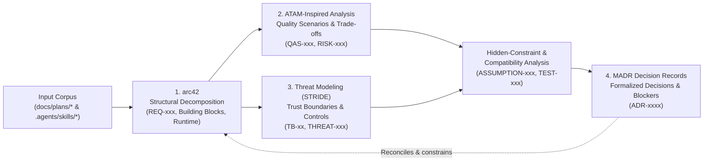

# 00. Architecture Documentation & Evaluation Methodology

**Document Status:** Baseline Architecture Methodology  
**Target System:** CyberPipe (.NET 10 Personal, Engineering & Business AI Assistant and Agent Orchestrator)  
**Repository Baseline State:** Pre-Implementation (`CyberPipe.slnx` empty, `0` `.cs`/`.csproj` files; 28 planning and skill artifacts analyzed)  
**Last Verified:** 2026-10-18

---

## 1. Purpose and Integrated Architecture Workflow

This directory (`docs/arch-argon/`) establishes an evidence-based, defense-in-depth architecture baseline for **CyberPipe** by synthesizing and stress-testing the planning corpus in [`docs/plans/`](../plans/README.md) and the repository skills in [`.agents/skills/`](../../.agents/skills/).

Because CyberPipe is currently in a **pre-implementation state** (`AUD-01`: `CyberPipe.slnx` contains only `<Solution />`), the objective of this documentation is not merely to restate the proposed design, but to **discover hidden technology constraints, incompatible library assumptions, security boundary gaps, and conflicting requirements** before a single line of production C# code is committed.

Four complementary architecture methodologies are applied together in a closed traceability loop:

| Methodology | Primary Role in `docs/arch-argon/` | Output Artifacts | Traceability IDs Produced |
| :--- | :--- | :--- | :--- |
| **1. arc42** | Primary structural backbone covering goals, constraints, context, strategy, building blocks, runtime, deployment, cross-cutting concepts, decisions, quality, risks, and glossary. | [`02-arc42/01-introduction-and-goals.md`](02-arc42/01-introduction-and-goals.md) through [`02-arc42/12-glossary.md`](02-arc42/12-glossary.md) | `REQ-001` .. `REQ-020` |
| **2. ATAM** | Quantitative evaluation of competing quality attributes (latency vs. safety, process isolation vs. warm startup, decentralization vs. transactional consistency), sensitivity points, trade-offs, and risk ranking. | [`03-atam/quality-attribute-scenarios.md`](03-atam/quality-attribute-scenarios.md), [`03-atam/tradeoff-analysis.md`](03-atam/tradeoff-analysis.md), [`03-atam/risk-register.md`](03-atam/risk-register.md) | `QAS-001` .. `QAS-014`, `RISK-001` .. `RISK-016` |
| **3. Threat Modeling** | Systematic identification of high-value assets, 5 trust boundaries (`TB-01`..`TB-05`), attack surfaces, STRIDE threat scenarios, concrete OS/cryptographic controls, and negative verification tests. | [`04-threat-model/scope-assets-and-trust-boundaries.md`](04-threat-model/scope-assets-and-trust-boundaries.md), [`04-threat-model/data-flows.md`](04-threat-model/data-flows.md), [`04-threat-model/threat-register.md`](04-threat-model/threat-register.md), [`04-threat-model/mitigations-and-verification.md`](04-threat-model/mitigations-and-verification.md) | `TB-01` .. `TB-05`, `THREAT-001` .. `THREAT-016` |
| **4. ADR (MADR)** | Explicit record of high-consequence architectural choices, rejected alternatives, discovered blockers (e.g., non-existent NuGet packages, native binary conflicts), and Phase 0 acceptance gates. | [`05-adr/README.md`](05-adr/README.md), [`05-adr/template.md`](05-adr/template.md), [`05-adr/0001-example-decision.md`](05-adr/0001-example-decision.md) .. [`05-adr/0008-token-budget-governance-and-crash-recovery.md`](05-adr/0008-token-budget-governance-and-crash-recovery.md) | `ADR-0001` .. `ADR-0008` |
| **Validation & Gating** | Verification of external package capabilities, licensing, assumptions, open questions, and pre-implementation review gates. | [`06-validation/assumptions-and-open-questions.md`](06-validation/assumptions-and-open-questions.md), [`06-validation/technology-compatibility-matrix.md`](06-validation/technology-compatibility-matrix.md), [`06-validation/architecture-review-checklist.md`](06-validation/architecture-review-checklist.md) | `ASSUMPTION-001` .. `ASSUMPTION-012`, `TEST-001` .. `TEST-015` |

---

## 2. Methodology Descriptions, Application, Limitations, and References

### 2.1 arc42 (Architecture Documentation Template and Method)

* **Purpose and Scope:**  
  Created by Dr. Gernot Starke and Dr. Peter Hruschka, **arc42** is a pragmatic, internationally established template for software and system architecture documentation. It separates *what* a system must achieve (Sections 1–3, 10) from *how* it is structured, executed, and deployed (Sections 4–9) and *what risks remain* (Section 11).
* **Workflow and Practical Application to CyberPipe:**  
  1. Extract explicit functional and quality requirements (`REQ-001`..`REQ-017`) and inferred architectural requirements (`REQ-018`..`REQ-020`) from [`docs/plans/`](../plans/README.md) into [Section 1 (Introduction and Goals)](02-arc42/01-introduction-and-goals.md).
  2. Document hard technical, OS, regulatory/licensing, and organizational constraints in [Section 2 (Architecture Constraints)](02-arc42/02-architecture-constraints.md).
  3. Map external actors (`Owner`, `Guest`, Telegram Bot API, Ollama/LM Studio, Cloud LLM APIs, OSINT APIs, OS subsystems) in [Section 3 (Context and Scope)](02-arc42/03-context-and-scope.md).
  4. Decompose the 3-executable deployment (`CyberPipe.exe`, `CyberPipe.UI.Desktop.exe`, `worker/CyberPipe.Brainstem.exe`) and 16-project solution DAG in [Section 5 (Building Block View)](02-arc42/05-building-block-view.md), [Section 6 (Runtime View)](02-arc42/06-runtime-view.md), and [Section 7 (Deployment View)](02-arc42/07-deployment-view.md), explicitly distinguishing **Proposed (Unimplemented)** components from existing repository artifacts.
  5. Analyze deep operational semantics—SQLCipher key management, SQLite WAL locking, IPC authentication, taint propagation, and crash recovery—in [Section 8 (Cross-Cutting Concepts)](02-arc42/08-crosscutting-concepts.md).
* **Expected Outputs:**  
  Twelve cohesive documents under [`02-arc42/`](02-arc42/01-introduction-and-goals.md) with zero silently omitted sections.
* **Limitations:**  
  arc42 provides structure but does not by itself verify whether chosen libraries (`MassTransit.SqlTransport.Sqlite`, `Hangfire.Storage.SQLite`, `SQLitePCLRaw.bundle_e_sqlcipher`) are mutually compatible or whether security controls resist bypass. Therefore, arc42 is paired with ATAM, STRIDE Threat Modeling, and the Technology Compatibility Matrix.
* **Authoritative References:**
  * **arc42 Overview:** `https://arc42.org/overview/` — *Defines the 12-section taxonomy used directly for the [`02-arc42/`](02-arc42/01-introduction-and-goals.md) directory structure.* *(Note: Live HTTP fetch to `arc42.org` was skipped during automated verification due to local environment permission policy; structure follows the standard arc42 v8 specification).*
  * **arc42 Documentation Reference:** `https://docs.arc42.org/` — *Provides section-by-section content guidelines applied to separate black-box/white-box building block views ([`05-building-block-view.md`](02-arc42/05-building-block-view.md)) from cross-cutting operational concepts ([`08-crosscutting-concepts.md`](02-arc42/08-crosscutting-concepts.md)).*
  * **arc42 Method:** `https://arc42.org/method/` — *Guides the top-down refinement from system context ([`03-context-and-scope.md`](02-arc42/03-context-and-scope.md)) to Level 1–3 decomposition.*
  * **arc42 Practical Examples:** `https://examples.arc42.org/sections/` — *Provides reference patterns for mapping runtime sequence diagrams ([`06-runtime-view.md`](02-arc42/06-runtime-view.md)) and quality trees ([`10-quality-requirements.md`](02-arc42/10-quality-requirements.md)).*

---

### 2.2 ATAM (Architecture Tradeoff Analysis Method)

* **Purpose and Scope:**  
  Developed by the Software Engineering Institute (SEI) at Carnegie Mellon University, **ATAM** evaluates how architectural decisions satisfy or trade off competing quality attributes (e.g., sub-millisecond Fast-Path latency vs. persistent crash-recovery logging; out-of-process `AppContainer` security vs. GPU driver compatibility for `Whisper.net`).
* **Workflow and Practical Application to CyberPipe:**  
  1. Identify architectural drivers and construct a prioritized **Utility Tree** in [`02-arc42/10-quality-requirements.md`](02-arc42/10-quality-requirements.md).
  2. Formulate **14 measurable Quality Attribute Scenarios (`QAS-001`..`QAS-014`)** in [`03-atam/quality-attribute-scenarios.md`](03-atam/quality-attribute-scenarios.md), each with explicit stimulus, environment, affected component, measurable response criterion (`p95`/`p99` latency, memory cap, or failure-rejection rate), and verification test (`TEST-xxx`).
  3. Analyze architectural approaches in [`03-atam/tradeoff-analysis.md`](03-atam/tradeoff-analysis.md) to expose **Sensitivity Points** (decisions where a small parameter change breaks a quality target) and **Trade-off Points** (decisions where improving one quality attribute degrades another).
  4. Consolidate confirmed defects, architectural contradictions, and unverified hypotheses into a scored **Risk Register (`RISK-001`..`RISK-016`)** in [`03-atam/risk-register.md`](03-atam/risk-register.md).
* **Expected Outputs:**  
  Measurable scenarios (`QAS-001`..`QAS-014`), explicit trade-off matrices, sensitivity points, non-risks backed by evidence, risk themes, and a prioritized risk register (`RISK-001`..`RISK-016`).
* **Methodological Limitation Statement:**  
  > [!IMPORTANT]
  > **Lightweight ATAM-Inspired Assessment (No Formal Stakeholder Workshop):**  
  > A formal SEI ATAM evaluation requires a multi-day Phase 1 / Phase 2 workshop with live stakeholders, product owners, and operations personnel voting on scenarios. This assessment is an **evidence-based, single-architect ATAM-inspired evaluation** conducted over the repository plans (`docs/plans/`). Where numeric thresholds in `docs/plans/` lack empirical benchmark proof (e.g., `Tier 0 < 1 ms`, `Tier 1 5–15 ms`), they are explicitly recorded as **Proposed Target SLOs requiring Phase 0/5 `BenchmarkDotNet` verification (`AUD-06`)**, never as verified measurements.
* **Authoritative References:**
  * **SEI ATAM Overview and Report (Kazman, Klein, Clements, CMU/SEI-2000-TR-004):** [https://www.sei.cmu.edu/library/the-architecture-tradeoff-analysis-method/](https://www.sei.cmu.edu/library/the-architecture-tradeoff-analysis-method/) *(Verified accessible 2026-10-18)* — *Defines the 6-part Quality Attribute Scenario structure (Source, Stimulus, Artifact, Environment, Response, Response Measure) and the concepts of Sensitivity Points, Trade-off Points, Risks, and Non-Risks used in [`03-atam/`](03-atam/quality-attribute-scenarios.md).*
  * **SEI ATAM Method for Architecture Evaluation:** `https://www.sei.cmu.edu/library/atam-method-for-architecture-evaluation/` — *Provides the taxonomy for grouping individual risks into overarching Architectural Risk Themes (see [`03-atam/risk-register.md`](03-atam/risk-register.md)).*

---

### 2.3 Threat Modeling (Data-Flow Centric & STRIDE)

* **Purpose and Scope:**  
  Threat Modeling systematically identifies what assets require protection (Confidentiality, Integrity, Availability), how data and control traverse trust boundaries, what capabilities realistic attackers possess, how components can be subverted, and which enforced technical controls mitigate those threats.
* **Workflow and Practical Application to CyberPipe:**  
  1. Inventory 10 core assets (`ASSET-01`..`ASSET-10`), 6 actor/identity profiles, and **5 explicit Trust Boundaries (`TB-01`..`TB-05`)** in [`04-threat-model/scope-assets-and-trust-boundaries.md`](04-threat-model/scope-assets-and-trust-boundaries.md).
  2. Construct annotated Data-Flow Diagrams (DFDs) for Telegram command execution, untrusted PDF/audio processing in `Brainstem`, Netrunner DAG execution, and Hangfire loopback authentication in [`04-threat-model/data-flows.md`](04-threat-model/data-flows.md).
  3. Apply **STRIDE** (**S**poofing, **T**ampering, **R**epudiation, **I**nformation Disclosure, **D**enial of Service, **E**levation of Privilege) across every trust-boundary crossing to catalog **16 concrete threats (`THREAT-001`..`THREAT-016`)** in [`04-threat-model/threat-register.md`](04-threat-model/threat-register.md).
  4. Map each threat to its exact OS kernel, cryptographic, or deterministic C# control, its known bypass limitations (e.g., why AST blacklists or DNS `1.1.1.3` alone are insufficient), residual risk, and negative verification test (`TEST-xxx`) in [`04-threat-model/mitigations-and-verification.md`](04-threat-model/mitigations-and-verification.md).
* **Expected Outputs:**  
  Asset catalog, trust boundary map, DFDs, STRIDE threat register (`THREAT-001`..`THREAT-016`), control limitation analysis, and negative security test specifications (`TEST-002`, `TEST-003`, `TEST-004`, `TEST-006`, `TEST-007`, `TEST-008`, `TEST-010`, `TEST-011`).
* **Limitations:**  
  STRIDE is a threat-elicitation heuristic, **not** a complete security proof or penetration test. Because CyberPipe has zero compiled code (`AUD-01`), all proposed mitigations (such as Windows `AppContainer`, `Process SACL NO_READ_UP`, `ACCESS_DENIED_ACE` on `data/`, and `SQLCipher` encryption) are **unverified design controls** until validated by automated negative tests (`CyberPipe.Tests.Isolation`, `CyberPipe.Tests.SafetyAndBudget`) in Phase 0.
* **Authoritative References:**
  * **OWASP Threat Modeling Community Guide:** [https://owasp.org/www-community/Threat_Modeling](https://owasp.org/www-community/Threat_Modeling) *(Verified accessible 2026-10-18)* — *Frames the four-question threat modeling workflow ("What are we working on? What can go wrong? What are we going to do about it? Did we do a good job?") applied across [`04-threat-model/`](04-threat-model/scope-assets-and-trust-boundaries.md).*
  * **Microsoft Threat Modeling Tool Overview:** `https://learn.microsoft.com/en-us/azure/security/develop/threat-modeling-tool` — *Supplies the Data-Flow Diagram (DFD) element conventions (External Interactors, Processes, Data Stores, Data Flows, Trust Boundaries) used in [`04-threat-model/data-flows.md`](04-threat-model/data-flows.md).*
  * **Microsoft STRIDE Threat Methodology:** `https://learn.microsoft.com/en-us/azure/security/develop/threat-modeling-tool-threats` — *Defines the STRIDE mapping to security properties (Authentication, Integrity, Non-repudiation, Confidentiality, Availability, Authorization) used in [`04-threat-model/threat-register.md`](04-threat-model/threat-register.md).*

---

### 2.4 ADR — Architecture Decision Records (MADR Format)

* **Purpose and Scope:**  
  Architecture Decision Records capture architecturally significant decisions—choices that are expensive to reverse, span multiple assemblies, carry security or licensing implications, or contain unresolved technical uncertainty—together with their context, decision drivers, considered alternatives, evidence, and revisit triggers.
* **Workflow and Practical Application to CyberPipe:**  
  1. Establish a standardized MADR-based template in [`05-adr/template.md`](05-adr/template.md) enriched with explicit fields for **Evidence & Verification Status**, **Risks (`RISK-xxx`)**, **Threats (`THREAT-xxx`)**, **Acceptance Criteria (`TEST-xxx`)**, and **Revisit Triggers**.
  2. Document 8 foundational architectural decisions (`ADR-0001`..`ADR-0008`) in [`05-adr/`](05-adr/README.md).
  3. Enforce strict epistemic honesty: **no ADR is marked `Accepted` without implementation proof or resolved blockers.** Decisions recorded in [`docs/plans/17-adr-mvp.md`](../plans/17-adr-mvp.md) are documented with their actual engineering status (`Proposed — Pending Phase 0 PoC` or `Proposed — Blocked by RISK-001`), exposing where `docs/plans/` selected a non-existent package (`MassTransit.SqlTransport.Sqlite`) or incompatible native dependencies.
* **Expected Outputs:**  
  ADR index ([`05-adr/README.md`](05-adr/README.md)), reusable MADR template ([`05-adr/template.md`](05-adr/template.md)), and 8 detailed ADRs ([`0001-example-decision.md`](05-adr/0001-example-decision.md) through [`0008-token-budget-governance-and-crash-recovery.md`](05-adr/0008-token-budget-governance-and-crash-recovery.md)).
* **Limitations:**  
  ADRs record *intent and analysis at a point in time*; without executable CI gates (`ArchUnitNET`, `Publish Directory Layout Gate`, `CyberPipe.Tests.Isolation`), code can drift from ADRs. Each ADR therefore links directly to a mandatory `TEST-xxx` verification gate.
* **Authoritative References:**
  * **Markdown Architectural Decision Records (MADR):** [https://adr.github.io/madr/](https://adr.github.io/madr/) *(Verified accessible 2026-10-18)* — *Provides the structured Markdown decision format (Context, Decision Drivers, Considered Options, Decision Outcome, Pros/Cons of Options) used across [`05-adr/`](05-adr/README.md).*
  * **MADR Decisions and Rationale:** `https://adr.github.io/madr/decisions/` — *Illustrates self-documenting ADR numbering, status lifecycles, and option comparison tables.*
  * **MADR GitHub Repository:** `https://github.com/adr/madr` — *Source of the canonical MADR 3.x/4.x template adapted in [`05-adr/template.md`](05-adr/template.md).*

---

## 3. Evidence Classification and Epistemic Rules

Throughout `docs/arch-argon/`, every technical claim is classified into one of five explicit epistemic categories (see [`06-validation/technology-compatibility-matrix.md`](06-validation/technology-compatibility-matrix.md)):

1. **Verified Fact:** Directly confirmed by inspecting the repository filesystem, Git history, or official package/API registries during this analysis (e.g., `CyberPipe.slnx` is 14 bytes `<Solution />`; `MassTransit.SqlTransport.Sqlite` does not exist on NuGet; `Hangfire.Storage.SQLite` depends on `sqlite-net-pcl` + `SQLitePCLRaw.bundle_green`).
2. **Vendor-Documented (Untested in Repo):** Documented in official vendor/OS specifications (e.g., Windows `JOB_OBJECT_LIMIT_ACTIVE_PROCESS = 1`, `SYSTEM_MANDATORY_LABEL_NO_READ_UP` on Process Kernel Objects, SQLCipher 256-bit AES page encryption), but not yet executed in a repository PoC.
3. **Architectural Inference:** Logically derived from combining two or more facts (e.g., compiling `main.csx` via Roslyn `Microsoft.CodeAnalysis.CSharp.Scripting` inside a `64 MB` Job Object will trigger `OutOfMemoryException`; loading both `bundle_green` and `bundle_e_sqlcipher` in one process creates a native provider collision).
4. **Unverified Hypothesis:** Assumed in `docs/plans/` without empirical proof (e.g., `AppContainer` compatibility with CUDA/DirectML for `Whisper.net`; sub-millisecond `Tier 0` / `< 15 ms` `Tier 1` latency; cross-platform parity between `AppContainer`, `bwrap`, and `Seatbelt`).
5. **Architect Recommendation:** Concrete engineering action proposed to resolve a contradiction, risk, or missing requirement (e.g., replacing non-existent `MassTransit.SqlTransport.Sqlite` with either `System.Threading.Channels` + SQLite Outbox or `MassTransit.EntityFrameworkCore` Outbox over `InMemory`).
