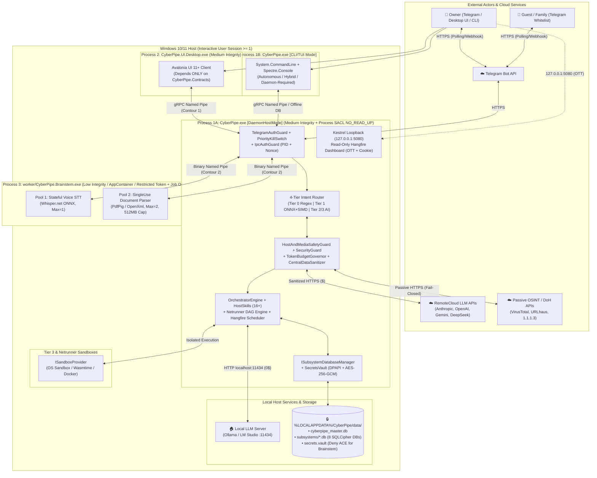

# 01. Architecture Overview & Preliminary Investigation Report

**Document Status:** Baseline Architecture Synthesis & Audit Reconciliation  
**Target System:** CyberPipe (.NET 10 Zero-Trust AI Assistant, 4-Tier Intent Router & Netrunner DAG Engine)  
**Current Readiness Verdict:** **NOT READY FOR FEATURE SPRINT IMPLEMENTATION — PHASE 0 GATED (`AUD-01`, `RISK-001`..`RISK-008`)**

---

## 1. Executive Summary

**CyberPipe** is designed as a local-first, low-latency, token-frugal personal, engineering, and business AI assistant and autonomous agent orchestrator targeting **.NET 10**, managed via **Telegram**, **Avalonia Desktop UI**, and a **System CLI/TUI**.

Its core architectural thesis is sound and well-motivated:
1. **Eliminate LLM Bureaucracy & Token Waste:** Replace multi-agent LLM chatter with a deterministic C# orchestrator (`OrchestratorEngine`) and a **4-Tier Cascading Intent Router (`TieredIntentRouter`)** so that 70–85% of routine commands execute locally in `Tier 0` (Regex/slash commands, `< 1 ms`, 0 tokens) or `Tier 1` (in-memory `ONNX` embeddings + `SIMD TensorPrimitives` + role-scoped cache, `5–15 ms`, 0 cloud tokens), plus reusable **Netrunner** ETL packages (`Mini-n8n` DAG workflows).
2. **Enforce Deterministic Host & Financial Guardrails:** Protect the host PC from destructive commands (`HostSafetyGuard`), audio/NSFW abuse (`MediaSafetyGuard` with volume clamping `<= 60%` day / `<= 25%` night and `EnsureSafeVolumeBeforePlayback()`), runaway cloud bills (`TokenBudgetGovernor` with `SoftTaskTokenLimit = 4,000` auto-pause, `MaxOutputTokens = 2,048`, and `< 50 ms` `/stop` kill-switch), indirect prompt injections (`MemoryTrustSource.UntrustedExternal` triggering physical `Hard Tool Stripping`), and secret leakage (`CentralDataSanitizer` at egress without blind rehydration).
3. **Isolate Untrusted Parsing and Code Execution:** Offload native audio transcription (`Whisper.net`) and untrusted document parsing (`PdfPig` / `OpenXml`) into a sterile out-of-process worker (`worker/CyberPipe.Brainstem.exe`) constrained by OS sandboxing (`AppContainer` / `Restricted Token + Deny DACL` + `Job Object` + `Process SACL NO_READ_UP`), while isolating Tier 3 generated scripts inside pluggable sandboxes (`ISandboxProvider`).

### Critical Readiness Finding

Despite extensive conceptual documentation in [`docs/plans/`](../plans/README.md) and a prior audit ([`muse-wonder-audit.md`](../plans/muse-wonder-audit.md)) partially addressed by [`17-adr-mvp.md`](../plans/17-adr-mvp.md), **this architectural investigation uncovered multiple blocking technical incompatibilities and unresolved defects that prevent starting Sprint 1 implementation immediately:**

* **Blocker 1 (`RISK-001` — Non-Existent NuGet Package):** [`03-tech-stack-libraries.md`](../plans/03-tech-stack-libraries.md) and [`17-adr-mvp.md` (`ADR-001`)](../plans/17-adr-mvp.md) specify `MassTransit.SqlTransport.Sqlite` (`data/subsystems/masstransit.db`) as the persistent SQLite transport for MassTransit. **No such package exists**—MassTransit's SQL Transport supports only PostgreSQL and SQL Server. Furthermore, MassTransit v9 requires a paid commercial license (~$400/mo), and MassTransit's DI registration does not natively support 1-click in-place transport hot-swapping (`InMemory` $\leftrightarrow$ `SQLite` $\leftrightarrow$ `RabbitMQ`) without rebuilding the bus container.
* **Blocker 2 (`RISK-002` & `RISK-005` — SQLite Native Binary Collision & Encryption Bypass):** Combining `Microsoft.Data.Sqlite`, `Hangfire.Storage.SQLite` (which pulls `sqlite-net-pcl` + `SQLitePCLRaw.bundle_green`), and `SQLitePCLRaw.bundle_e_sqlcipher` in `CyberPipe.exe` creates a native `e_sqlite3` provider clash. If `bundle_green` or standard `bundle_e_sqlite3` loads first, `Password=...` is ignored or fails, leaving databases unencrypted (`AUD-04`). In addition, `Cache=Shared` in [`09-data-protection-and-state-hub.md`](../plans/09-data-protection-and-state-hub.md) degrades WAL concurrency and weakens per-connection key verification.
* **Blocker 3 (`RISK-003` — Netrunner Execution & Memory Paradox):** [`16-netrunner-etl-and-workflow-engine.md`](../plans/16-netrunner-etl-and-workflow-engine.md) specifies `"engine": "CSharpRoslyn"`, `"entrypoint": "main.csx"`, `"maxMemoryMb": 64` executed via `Brainstem` or `ISandboxProvider`. However, `BrainstemTaskKind` ([`15-cli-and-execution-modes.md`](../plans/15-cli-and-execution-modes.md)) only supports `Ping`, `WhisperTranscribe`, and `DocumentExtractText`, and Roslyn in-memory compilation (`Microsoft.CodeAnalysis.CSharp.Scripting`) requires `150–300 MB` RAM—guaranteeing an immediate `OutOfMemoryException` under a `64 MB` Job Object limit.
* **Blocker 4 (`RISK-008` — Orphan Tables Across the 8 Subsystem Databases):** [`09-data-protection-and-state-hub.md`](../plans/09-data-protection-and-state-hub.md) and [`17-adr-mvp.md` (`ADR-002`)](../plans/17-adr-mvp.md) forbid storing domain data in `cyberpipe_master.db` and define 8 subsystem databases (`hangfire`, `masstransit`, `knowledge`, `crm`, `finance`, `budget`, `health`, `netrunner`), but never assign an owner database for `InFlightOperations`, `SemanticIntentCache`, or `SemanticResponseCache`.

---

## 2. Complete Inventory of Examined Repository Artifacts

All **28 files** currently present in the repository were inspected and cross-checked during the mandatory preliminary investigation:

| # | Path | Size (Bytes) | Artifact Role & Key Architectural Evidence |
| :-: | :--- | ---: | :--- |
| 1 | [`CyberPipe.slnx`](../../CyberPipe.slnx) | 14 | Empty XML solution (`<Solution />`). Confirms zero implementation (`AUD-01`). |
| 2 | [`.gitignore`](../../.gitignore) | 6,585 | Standard Visual Studio / .NET ignore rules (`BenchmarkDotNet.Artifacts/`, `publish/`, `bin/`, `obj/`). |
| 3 | [`.gitattributes`](../../.gitattributes) | 2,581 | Standard `* text=auto` line-ending normalization. |
| 4 | [`docs/plans/README.md`](../plans/README.md) | 12,803 | Master index of planning docs; records `pre-implementation (AUD-01)` banner and summary of `L1–L6` MVP decisions. |
| 5 | [`docs/plans/01-principles.md`](../plans/01-principles.md) | 21,286 | 10 core principles: MassTransit bus, 4-Tier router, Anti-Wipe/Volume Clamp/NSFW guard, `TokenBudgetGovernor`, Zero-Trust sandboxes, Egress sanitizer, Stealth OSINT, resource monitor, Hangfire, master+subsystem SQLite catalog. |
| 6 | [`docs/plans/02-architecture-diagram.md`](../plans/02-architecture-diagram.md) | 15,499 | High-level Mermaid data-flow diagram and walkthrough of Path A (Fast-Path), Path B (Tier 3 Agent), Path C (Proactive/Meetings), plus SLO measurement note (`AUD-06`). |
| 7 | [`docs/plans/03-tech-stack-libraries.md`](../plans/03-tech-stack-libraries.md) | 29,671 | .NET 10 library table; Hangfire Read-Only Dashboard OTT + cookie auth code; MassTransit 3-provider UI selector (`InMemory`, `MassTransit.SqlTransport.Sqlite`, `RabbitMQ`). |
| 8 | [`docs/plans/04-agent-mesh-proposals.md`](../plans/04-agent-mesh-proposals.md) | 22,210 | 4-Tier Intent Router, `SemanticIntentCache` & `SemanticResponseCache` (`QueryHash, UserRole, DataVersion, ExpiresAtUtc`), `TokenBudgetGovernor` (`Soft=4k`, `Hard=12k`, `MaxTurns=3`), `PriorityKillSwitch`, `TaskLifecycleState`. |
| 9 | [`docs/plans/05-security-agent.md`](../plans/05-security-agent.md) | 19,316 | `TelegramAuthGuard`, `HostAndMediaSafetyGuard` (`AudioSafetyOptions`, `EnsureSafeVolumeBeforePlayback`, NSFW filter), Stealth OSINT (`Fail-Closed`), AST rules, `MemoryTrustSource` & `Hard Tool Stripping`. |
| 10 | [`docs/plans/06-solution-structure.md`](../plans/06-solution-structure.md) | 13,224 | 16-project `src/` + 5-project `tests/` layout and strict acyclic assembly dependency rules (Level 0 `Contracts`, Level 1 `Security.Telemetry`). |
| 11 | [`docs/plans/07-ui-isolation-and-arch-tests.md`](../plans/07-ui-isolation-and-arch-tests.md) | 20,378 | Avalonia Desktop UI 8-panel specification and 7 `ArchUnitNET` static integrity test rules (`ArchitectureIntegrityTests`). |
| 12 | [`docs/plans/08-implementation-roadmap.md`](../plans/08-implementation-roadmap.md) | 26,723 | Phase 0 prerequisite gate (`ADR-001`..`ADR-003` + PoCs) followed by Sprints 1–5 roadmap and DoD criteria. |
| 13 | [`docs/plans/09-data-protection-and-state-hub.md`](../plans/09-data-protection-and-state-hub.md) | 32,859 | `CentralDataSanitizer` (egress-only, no blind rehydration), `SecretsVault` (`DPAPI`/`LibSecret`/`Keychain`), `cyberpipe_master.db` + 8 `data/subsystems/*.db`, `ISubsystemDatabaseManager`, `GlobalStateHub`, `appsettings.json`, key rotation/backup policy. |
| 14 | [`docs/plans/10-sandbox-telemetry-and-heuristics.md`](../plans/10-sandbox-telemetry-and-heuristics.md) | 9,779 | `ISystemResourceMonitor`, `IHardwareCapabilitiesProbe`, `ToolOutputTruncator` (`1,500` chars), `ExecutionTelemetryDigest` (`1 GB -> 30 KB`), `EphemeralWorkspace`. |
| 15 | [`docs/plans/11-changelog.md`](../plans/11-changelog.md) | 34,570 | Revision history of design iterations (marked as designed, not implemented, per `AUD-15`). |
| 16 | [`docs/plans/12-assistant-capabilities-and-skills.md`](../plans/12-assistant-capabilities-and-skills.md) | 36,297 | Functional catalog: `0$ Voice-to-Intent`, `ProactiveScheduler` (`UserScheduledTasks`), `KnowledgeVault`, OCR, workspace profiles, and 16+ Personal, Dev/DevOps, Business, and Netrunner skills. |
| 17 | [`docs/plans/13-model-advisor-and-tier-configuration.md`](../plans/13-model-advisor-and-tier-configuration.md) | 22,811 | `ModelHostingType` (`Local` vs `RemoteCloud`), `IHardwareCapabilitiesProbe` + `IModelCompatibilityAdvisor` KV-Cache formula, 15 curated local models, and 11 curated cloud entries. |
| 18 | [`docs/plans/14-fault-isolation-and-resilience.md`](../plans/14-fault-isolation-and-resilience.md) | 16,090 | 5 resilience contours: `SafeBoot` (`BackgroundServiceExceptionBehavior.Ignore`), `Bulkhead Lanes`, `IsolatedWorkerBase` (quarantine after 3 faults/min), `QuotaBoundedStream (16 MB)`, `InFlightOperations` poison-pill recorder. |
| 19 | [`docs/plans/15-cli-and-execution-modes.md`](../plans/15-cli-and-execution-modes.md) | 49,845 | Canonical spec for 3 executables (`CyberPipe`, `CyberPipe.UI.Desktop`, `worker/CyberPipe.Brainstem`), `IBrainstemIsolationPlatform` (Windows Profile A `AppContainer` & Profile B `RestrictedToken + Deny DACL` + `Process SACL NO_READ_UP`), IPC auth, 2 worker pools, `worker.manifest.json`, CI isolation tests, CLI command matrix. |
| 20 | [`docs/plans/16-netrunner-etl-and-workflow-engine.md`](../plans/16-netrunner-etl-and-workflow-engine.md) | 51,366 | Netrunner 6-file package standard, 8-node Mini-n8n DAG workflow engine, 4 branching patterns, `DeferRetry`/`untilExpression`, `netrunner.db` schema, `Pipeline:CrashRecoveryPolicy`, workflow limits. |
| 21 | [`docs/plans/17-adr-mvp.md`](../plans/17-adr-mvp.md) | 4,223 | Summary of MVP decisions `ADR-001`..`ADR-003` and answers to `L1–L6` of `muse-wonder-audit.md`. |
| 22 | [`docs/plans/muse-wonder-audit.md`](../plans/muse-wonder-audit.md) | 28,928 | Prior stress-test audit identifying `AUD-01`..`AUD-15` and remediation phases `K.1`..`K.4`. |
| 23 | [`.agents/skills/netrunner-script-package/SKILL.md`](../../.agents/skills/netrunner-script-package/SKILL.md) | 11,261 | Agent skill specification for creating and validating Netrunner 6-file ETL packages and DAG workflows. |
| 24 | [`.agents/skills/netrunner-script-package/resources/netrunner.manifest.template.json`](../../.agents/skills/netrunner-script-package/resources/netrunner.manifest.template.json) | 1,278 | JSON template for `netrunner.manifest.json`. |
| 25 | [`.agents/skills/netrunner-script-package/scripts/validate-netrunner-package.ps1`](../../.agents/skills/netrunner-script-package/scripts/validate-netrunner-package.ps1) | 3,827 | PowerShell script verifying the 6 mandatory Netrunner files, JSON syntax, and SHA-256 hashes. |
| 26 | [`.agents/skills/rabbitmq-windows/SKILL.md`](../../.agents/skills/rabbitmq-windows/SKILL.md) | 5,743 | Non-admin Windows RabbitMQ + portable Erlang/OTP 26/27 operational guide. |
| 27 | [`.agents/skills/rabbitmq-windows/scripts/install-erlang-portable.ps1`](../../.agents/skills/rabbitmq-windows/scripts/install-erlang-portable.ps1) | 3,813 | Downloads portable Erlang/OTP, extracts via 7-Zip (`C:\Program Files\7-Zip\7z.exe`), runs `Install.exe -s`, configures `rabbitmq-env-conf.bat`. |
| 28 | [`.agents/skills/rabbitmq-windows/scripts/{start,status,stop}-rabbitmq.ps1`](../../.agents/skills/rabbitmq-windows/scripts/start-rabbitmq.ps1) | 4,713 | 3 PowerShell scripts (`start-rabbitmq.ps1`, `status-rabbitmq.ps1`, `stop-rabbitmq.ps1`) using WMI `Win32_Process` breakaway and `rabbitmqctl.bat`. |

---

## 3. High-Level System Architecture & Context

At a high level, CyberPipe is a **single-user, multi-process desktop and background daemon system** running in the interactive user session (`Session >= 1` on Windows 10/11 for MVP).

---

## 4. Summary of Discovered Contradictions, Hidden Constraints, and Audit Reconciliation

While [`17-adr-mvp.md`](../plans/17-adr-mvp.md) resolved several surface-level naming discrepancies from [`muse-wonder-audit.md`](../plans/muse-wonder-audit.md), our deep technology and cross-document inspection identified **10 residual contradictions and hidden technical traps** that must be addressed in Phase 0:

| # | Category | Finding in `docs/plans/` | Technical Reality & Architectural Impact | Tracked In |
| :-: | :--- | :--- | :--- | :--- |
| 1 | **Messaging Library Trap** | [`03-tech-stack-libraries.md`](../plans/03-tech-stack-libraries.md) and [`17-adr-mvp.md`](../plans/17-adr-mvp.md) specify `MassTransit.SqlTransport.Sqlite` (`data/subsystems/masstransit.db`). | **Package does not exist.** MassTransit SQL Transport supports only PostgreSQL and SQL Server. Also, MassTransit v9 is commercial (~$400/mo), and DI singletons cannot hot-swap transports without a bus proxy or process restart. | `RISK-001`, [`ADR-0002`](05-adr/0002-message-bus-and-transport-strategy.md) |
| 2 | **SQLite Native Binary Clash** | [`03-tech-stack-libraries.md`](../plans/03-tech-stack-libraries.md) combines `Microsoft.Data.Sqlite`, `Hangfire.Storage.SQLite`, and `SQLitePCLRaw.bundle_e_sqlcipher`. | `Microsoft.Data.Sqlite` pulls `bundle_e_sqlite3` and `Hangfire.Storage.SQLite` pulls `sqlite-net-pcl` + `bundle_green`. Loading unencrypted `e_sqlite3` before `e_sqlcipher` causes `Password=...` to be ignored or throw, breaking `ADR-003`. | `RISK-002`, `RISK-005`, [`ADR-0003`](05-adr/0003-decentralized-sqlite-and-sqlcipher-encryption.md) |
| 3 | **SQLite `Cache=Shared` Hazard** | [`09-data-protection-and-state-hub.md`](../plans/09-data-protection-and-state-hub.md) (L175) uses `Mode=ReadWriteCreate;Cache=Shared;` with `WAL` and `SQLCipher`. | SQLite deprecates shared cache; with SQLCipher and WAL, `Cache=Shared` causes table-locking anomalies and allows subsequent in-process connections to attach without re-verifying the password. Use `Cache=Private;Pooling=True`. | `RISK-002`, [`08-crosscutting-concepts.md`](02-arc42/08-crosscutting-concepts.md) |
| 4 | **Netrunner Sandbox & `64 MB` Roslyn OOM** | [`16-netrunner-etl-and-workflow-engine.md`](../plans/16-netrunner-etl-and-workflow-engine.md) runs `CSharpRoslyn` (`main.csx`) with `maxMemoryMb: 64` in `Brainstem` or `ISandboxProvider`. | `BrainstemTaskKind` ([`15-cli-and-execution-modes.md`](../plans/15-cli-and-execution-modes.md)) lacks a Netrunner task type, and Roslyn `CSharpScript` compilation requires `150–300 MB` RAM—crashing immediately under a `64 MB` Job Object limit. Scripts must be pre-compiled by the host into `.dll`/`.wasm` before sandbox execution. | `RISK-003`, [`ADR-0007`](05-adr/0007-proactive-scheduling-and-netrunner-dag-engine.md) |
| 5 | **Orphan SQLite Tables** | [`08-implementation-roadmap.md`](../plans/08-implementation-roadmap.md) & [`14-fault-isolation-and-resilience.md`](../plans/14-fault-isolation-and-resilience.md) define `InFlightOperations`, `SemanticIntentCache`, and `SemanticResponseCache`. | None of the 8 subsystem databases in [`09-data-protection-and-state-hub.md`](../plans/09-data-protection-and-state-hub.md) claims ownership of these 3 tables, and `cyberpipe_master.db` is strictly forbidden from storing operational data. | `RISK-008`, `REQ-018`, [`ADR-0003`](05-adr/0003-decentralized-sqlite-and-sqlcipher-encryption.md) |
| 6 | **Windows `AppContainer` ACLs** | [`15-cli-and-execution-modes.md`](../plans/15-cli-and-execution-modes.md) spawns `Brainstem.exe` in `AppContainer` with `Capabilities = Empty`. | If run outside `C:\Program Files` (e.g., dev/CI or per-user install), `AppContainer` (`S-1-15-2-1`) lacks read/execute permissions on `./worker/`, `./models/whisper/`, and the Named Pipe DACL unless explicitly granted by the supervisor prior to spawn. | `RISK-006`, [`ADR-0004`](05-adr/0004-brainstem-process-isolation-and-sandboxing.md) |
| 7 | **`Program Files` vs Auto-Update** | [`15-cli-and-execution-modes.md`](../plans/15-cli-and-execution-modes.md) (Section 8) puts binaries in `C:\Program Files\CyberPipe\` (Admin-only write) while running a user-level `Side-by-Side Update`. | A `Medium Integrity` daemon cannot create or swap `C:\Program Files\CyberPipe\app-{version}\` without UAC elevation or a signed updater helper. | `RISK-013`, [`07-deployment-view.md`](02-arc42/07-deployment-view.md) |
| 8 | **False DNS `1.1.1.3` Media Guarantee** | [`01-principles.md`](../plans/01-principles.md) & [`05-security-agent.md`](../plans/05-security-agent.md) claim DNS `1.1.1.3` blocks 18+ tracks in Spotify/Yandex.Music. | External media players use the OS DNS resolver (not `CyberPipe`), and DNS `1.1.1.3` blocks adult *domains*, not explicit songs inside `spotify.com`. | `RISK-012`, `THREAT-015` |
| 9 | **`MaxLlmTurnsPerTask` Drift (`3` vs `5`)** | [`02-architecture-diagram.md`](../plans/02-architecture-diagram.md) & [`08-implementation-roadmap.md`](../plans/08-implementation-roadmap.md) state `MaxLlmTurnsPerTask = 3` for `Local` models; [`13-model-advisor-and-tier-configuration.md`](../plans/13-model-advisor-and-tier-configuration.md) (L35) states `5`. | Contradictory turn limit for local models; must be unified as a configurable property in `BudgetPolicyOptions` (`MaxRemoteTurnsPerTask = 3`, `MaxLocalTurnsPerTask = 5`). | `RISK-016`, [`ADR-0008`](05-adr/0008-token-budget-governance-and-crash-recovery.md) |
| 10 | **CLI & Enum Naming Drift** | `11-changelog.md` (L51) mentions `Cronos` vs `Hangfire` (L74); `15-cli-and-execution-modes.md` (L279) uses `CyberPipe cron` vs `cyberpipe schedule` in `12` (L37); `05` (L110) uses `OwnerExplicit` vs `TrustedOwner` in `12` (L90). | Naming drift across specifications will cause contract mismatches if not normalized in `CyberPipe.Contracts` during Phase 0. | `RISK-016`, [`12-glossary.md`](02-arc42/12-glossary.md) |

---

## 5. Master Traceability Summary

Every major architectural requirement (`REQ-001`..`REQ-020`) is traced across building blocks, quality attribute scenarios (`QAS-xxx`), risks (`RISK-xxx`), threats (`THREAT-xxx`), ADRs (`ADR-xxxx`), and validation tests (`TEST-xxx`):

| Req ID | Requirement Summary | Primary Component(s) | Quality Scenarios | Key Risks & Threats | Governing ADR | Verification Gate |
| :--- | :--- | :--- | :--- | :--- | :--- | :--- |
| **`REQ-001`** | 4-Tier Cascading Intent Router (0-Token Fast-Path) | `CyberPipe.Router` | `QAS-001`, `QAS-002` | `RISK-010`, `RISK-011`, `RISK-015` | [`ADR-0001`](05-adr/0001-example-decision.md) | `TEST-009`, `TEST-014` |
| **`REQ-002`** | `Local` vs `RemoteCloud` Tier Model Config & Advisor | `Core.Orchestration`, `Security.Telemetry` | `QAS-012` | `RISK-016` | [`ADR-0001`](05-adr/0001-example-decision.md), [`ADR-0008`](05-adr/0008-token-budget-governance-and-crash-recovery.md) | `TEST-009`, `TEST-014` |
| **`REQ-003`** | `TokenBudgetGovernor` & Auto-Pause (`PausedByBudget`) | `Security.Budget` | `QAS-009` | `RISK-016`, `THREAT-010` | [`ADR-0008`](05-adr/0008-token-budget-governance-and-crash-recovery.md) | `TEST-011` |
| **`REQ-004`** | Priority Kill-Switch (`/stop` `< 50 ms` local) | `Security.Budget`, `Gateway.Telegram` | `QAS-003` | `RISK-015`, `THREAT-011`, `THREAT-012` | [`ADR-0008`](05-adr/0008-token-budget-governance-and-crash-recovery.md) | `TEST-011`, `TEST-012` |
| **`REQ-005`** | Telegram Whitelist & RBAC (`Owner` vs `Guest`) | `Gateway.Telegram` | `QAS-001` | `THREAT-001` | [`ADR-0001`](05-adr/0001-example-decision.md) | `TEST-010` |
| **`REQ-006`** | Host Anti-Wipe & Media/Volume Safety Guard | `Security.Guards`, `Skills.Host` | `QAS-014` | `RISK-012`, `THREAT-015` | [`ADR-0001`](05-adr/0001-example-decision.md) | `TEST-010` |
| **`REQ-007`** | `MemoryTrustSource` & `Hard Tool Stripping` | `Security.Guards`, `Router` | `QAS-007` | `THREAT-002` | [`ADR-0004`](05-adr/0004-brainstem-process-isolation-and-sandboxing.md) | `TEST-010` |
| **`REQ-008`** | Egress `CentralDataSanitizer` (No Blind Rehydration) | `Security.Sanitization` | `QAS-008` | `THREAT-003` | [`ADR-0006`](05-adr/0006-secrets-vault-and-egress-sanitization.md) | `TEST-013` |
| **`REQ-009`** | Decentralized SQLite WAL + SQLCipher + `SecretsVault` | `Storage.Sqlite`, `Security.Sanitization` | `QAS-006` | `RISK-002`, `RISK-008`, `RISK-014`, `THREAT-009` | [`ADR-0003`](05-adr/0003-decentralized-sqlite-and-sqlcipher-encryption.md), [`ADR-0006`](05-adr/0006-secrets-vault-and-egress-sanitization.md) | `TEST-002`, `TEST-003`, `TEST-015` |
| **`REQ-010`** | `MassTransit` Bus & `GlobalStateHub` | `Core.Orchestration`, `Storage.Sqlite` | `QAS-011` | `RISK-001` | [`ADR-0002`](05-adr/0002-message-bus-and-transport-strategy.md) | `TEST-001` |
| **`REQ-011`** | `CyberPipe.Brainstem` Dual Pools & OS Isolation | `Execution.Providers`, `Brainstem` | `QAS-005`, `QAS-010` | `RISK-006`, `THREAT-004`, `THREAT-013` | [`ADR-0004`](05-adr/0004-brainstem-process-isolation-and-sandboxing.md) | `TEST-004`, `TEST-005` |
| **`REQ-012`** | In-Process Bulkheads, `IsolatedWorkerBase`, Quotas | `Security.Telemetry` | `QAS-010`, `QAS-012` | `THREAT-011`, `THREAT-012` | [`ADR-0008`](05-adr/0008-token-budget-governance-and-crash-recovery.md) | `TEST-005`, `TEST-012` |
| **`REQ-013`** | Pluggable Tier 3 Sandboxes, AST, Passive OSINT | `Execution.Providers`, `Security.Guards` | `QAS-007`, `QAS-012` | `RISK-007`, `THREAT-005`, `THREAT-014` | [`ADR-0004`](05-adr/0004-brainstem-process-isolation-and-sandboxing.md) | `TEST-007`, `TEST-010` |
| **`REQ-014`** | Netrunner 6-File ETL Packages & Mini-n8n DAG Engine | `Skills.Netrunner`, `Storage.Sqlite` | `QAS-011` | `RISK-003`, `THREAT-006` | [`ADR-0007`](05-adr/0007-proactive-scheduling-and-netrunner-dag-engine.md) | `TEST-008`, `TEST-012` |
| **`REQ-015`** | `Hangfire` Proactive Scheduler & Loopback Dashboard | `Core.Orchestration`, `Gateway.Api` | `QAS-008` | `RISK-005`, `THREAT-008` | [`ADR-0005`](05-adr/0005-ipc-security-and-hangfire-dashboard-auth.md), [`ADR-0007`](05-adr/0007-proactive-scheduling-and-netrunner-dag-engine.md) | `TEST-006` |
| **`REQ-016`** | 16+ Personal/Dev/Business Skills & `KnowledgeVault` | `Skills.Host`, `Storage.Sqlite` | `QAS-002`, `QAS-014` | `RISK-004`, `RISK-007` | [`ADR-0001`](05-adr/0001-example-decision.md), [`ADR-0003`](05-adr/0003-decentralized-sqlite-and-sqlcipher-encryption.md) | `TEST-007`, `TEST-014` |
| **`REQ-017`** | 16-Project DAG, UI Decoupling, IPC & CLI/TUI Modes | `Contracts`, `UI`, `Host/CyberPipe` | `QAS-004`, `QAS-013` | `RISK-009`, `THREAT-007` | [`ADR-0001`](05-adr/0001-example-decision.md), [`ADR-0005`](05-adr/0005-ipc-security-and-hangfire-dashboard-auth.md) | `TEST-005`, `TEST-006`, `TEST-014` |
| **`REQ-018`** | *(Inferred)* Explicit Subsystem DB Ownership for All Tables | `Storage.Sqlite` | `QAS-006`, `QAS-011` | `RISK-008` | [`ADR-0003`](05-adr/0003-decentralized-sqlite-and-sqlcipher-encryption.md) | `TEST-002` |
| **`REQ-019`** | *(Inferred)* Strict Fail-Closed Security Initialization | `Host/CyberPipe`, `Security.*` | `QAS-005`, `QAS-006` | `THREAT-009`, `THREAT-016` | [`ADR-0003`](05-adr/0003-decentralized-sqlite-and-sqlcipher-encryption.md), [`ADR-0004`](05-adr/0004-brainstem-process-isolation-and-sandboxing.md) | `TEST-003`, `TEST-004` |
| **`REQ-020`** | *(Inferred)* Idempotent Multi-DB Checkpoint Recovery | `Core.Orchestration`, `Skills.Netrunner` | `QAS-011` | `RISK-008` | [`ADR-0003`](05-adr/0003-decentralized-sqlite-and-sqlcipher-encryption.md), [`ADR-0008`](05-adr/0008-token-budget-governance-and-crash-recovery.md) | `TEST-001`, `TEST-012` |
