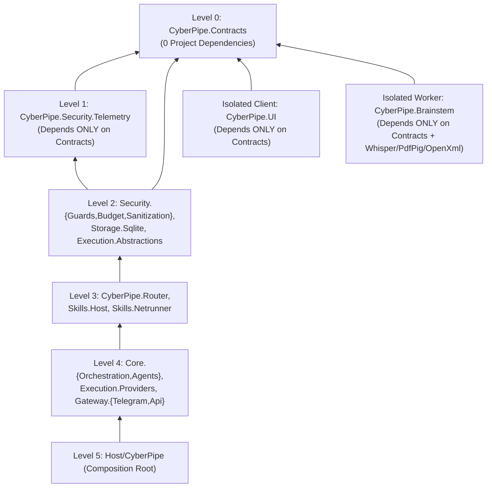

# arc42 — 02. Architecture Constraints

**Previous Section:** [`01-introduction-and-goals.md`](01-introduction-and-goals.md) | **Next Section:** [`03-context-and-scope.md`](03-context-and-scope.md)

---

## 2.1 Technical and Platform Constraints

| Constraint ID | Constraint Area | Mandatory Rule / Limitation | Architectural Impact & Evidence |
| :--- | :--- | :--- | :--- |
| **`CON-TECH-01`** | **Runtime & Language** | **.NET 10 (C# 13/14)** across all 16 source and 5 test projects (`CyberPipe.slnx`). | Requires `System.Numerics.Tensors` (`TensorPrimitives.CosineSimilarity`) for SIMD vector search and `Microsoft.Extensions.AI` (`IChatClient`). Target `.NET 10` SDK availability and native AOT/JIT compatibility must be verified via `CyberPipe doctor` (`ASSUMPTION-001`). |
| **`CON-TECH-02`** | **Target OS & Session Model** | **Windows 10/11 (x64)** is the sole MVP target OS (`L4` in [`17-adr-mvp.md`](../../plans/17-adr-mvp.md)), running in an **interactive user session (`Session >= 1`)** at `Medium Integrity` (no UAC admin elevation required at runtime). | Windows `Session 0` services cannot access `WASAPI` audio, clipboard, or `Windows.Media.Ocr`. Furthermore, because the daemon runs at `Medium Integrity` without `SeAssignPrimaryTokenPrivilege`, child worker sandboxing (`CyberPipe.Brainstem`) is constrained to kernel mechanisms callable by a standard user: `AppContainer` (`PROC_THREAD_ATTRIBUTE_SECURITY_CAPABILITIES`), `CreateRestrictedToken` with `SidsToRestrict` + user-owned directory DACL (`ACCESS_DENIED_ACE`), `Process SACL NO_READ_UP`, and `Windows Job Object` ([`15-cli-and-execution-modes.md`](../../plans/15-cli-and-execution-modes.md)). |
| **`CON-TECH-03`** | **Windows NTFS SACL Limitation** | The Windows NTFS security monitor **ignores `SYSTEM_MANDATORY_LABEL_NO_READ_UP`** on file and directory SACLs (enforcing `No-Write-Up` only, whereas `NO_READ_UP` is enforced by the kernel only on **Process and Thread objects** in RAM). | Protecting `%LOCALAPPDATA%\CyberPipe\data\` (`cyberpipe_master.db`, `data/subsystems/*.db`, `secrets.vault`) from a `Low Integrity` restricted-token worker **cannot** rely on file Integrity Levels alone; it strictly requires either `AppContainer` (which lacks default read access to user profile folders) or an explicit `ACCESS_DENIED_ACE` in the `data\` folder DACL targeting `RestrictedWorkerCustomSid (S-1-5-99-214-1)` present in `SidsToRestrict` ([`15-cli-and-execution-modes.md` Section 3.1](../../plans/15-cli-and-execution-modes.md)). |
| **`CON-TECH-04`** | **SQLite Engine & Encryption Constraints** | Stock `Microsoft.Data.Sqlite` (`SQLitePCLRaw.bundle_e_sqlite3`) **does not encrypt database pages** when `Password=...` is passed (`AUD-04`). Full-page encryption requires `Microsoft.Data.Sqlite.Core` initialized with `SQLitePCLRaw.bundle_e_sqlcipher`. | Mixing `SQLitePCLRaw.bundle_e_sqlite3` or `bundle_green` (pulled transitively by `Hangfire.Storage.SQLite`) with `bundle_e_sqlcipher` in the same process causes native `e_sqlite3` provider conflicts (`RISK-002`, `RISK-005`). Furthermore, SQLite WAL enforces single-writer file locking per `.db` file and cannot perform distributed atomic transactions across separate encrypted `.db` files without `ATTACH DATABASE`. |
| **`CON-TECH-05`** | **Message Bus Package Availability** | MassTransit's official SQL Transport (`MassTransit.SqlTransport.*`) supports **only PostgreSQL and SQL Server**. The package `MassTransit.SqlTransport.Sqlite` referenced in [`03-tech-stack-libraries.md`](../../plans/03-tech-stack-libraries.md) **does not exist** (`RISK-001`). | The persistent SQLite transport option for MassTransit cannot be implemented as specified in [`03-tech-stack-libraries.md`](../../plans/03-tech-stack-libraries.md) and [`17-adr-mvp.md`](../../plans/17-adr-mvp.md). Persistent local messaging must either use `MassTransit` `InMemory` + SQLite transactional Outbox/checkpoint tables or a dedicated SQLite-backed queue adapter ([`ADR-0002`](../05-adr/0002-message-bus-and-transport-strategy.md)). |
| **`CON-TECH-06`** | **Hardware & Memory Envelope** | The daemon must run alongside the user's primary applications (IDEs, browsers, games) with idle CPU `< 0.1%`, bounded in-process queues (`Channel.CreateBounded<T>`), stream cap `16 MB` (`QuotaBoundedStream`), gRPC frame cap `4 MB`, and `Brainstem` PDF parser cap `512 MB`. | Local generative LLMs (`Ollama` / `LM Studio`) require $\text{Q4SizeGb} \times 1.35 + 1.0\text{ GB}$ RAM/VRAM at `num_ctx = 8192`. Similarly, in-memory Roslyn script compilation (`Microsoft.CodeAnalysis.CSharp.Scripting`) requires `150–300 MB` RAM and cannot compile inside a `64 MB` Job Object limit (`RISK-003`). |

---

## 2.2 Security and Compliance Constraints

1. **Zero Raw Shell from Chat (`CON-SEC-01`):** No string originating from Telegram or an LLM response may ever be passed directly to `cmd.exe`, `powershell.exe`, or `bash` on the host (`REQ-006`).
2. **Physical Tool Stripping on Untrusted Context (`CON-SEC-02`):** Whenever any input in a session carries `MemoryTrustSource.UntrustedExternal` (external PDFs, DOCX files, web pages, RSS feeds, forwarded third-party messages), all host-mutating tool schemas must be physically removed from `ChatOptions.Tools` prior to calling `IChatClient` (`REQ-007`).
3. **Egress-Only Sanitization Without Rehydration (`CON-SEC-03`):** Secrets and PII are redacted (`[REDACTED:TYPE:ID]`) at egress boundaries (`RemoteCloud` LLM, `Serilog`, `Telegram`). Automatic string replacement of `[REDACTED:ID]` back into LLM-generated tool arguments is strictly forbidden to prevent Confused Deputy secret exfiltration (`REQ-008`).
4. **Stealth OPSEC & Fail-Closed Inspection (`CON-SEC-04`):** `SecurityGuard` must never send direct network packets (`ping`, `curl`, `nmap`) from the user's host to unknown external URLs/IPs under inspection; it must query only passive OSINT/DoH providers (`VirusTotal`, `URLhaus`, `1.1.1.3`) and default to `RiskLevel.RequiresApproval` (`Fail-Closed`) if OSINT APIs time out or fail (`REQ-013`).
5. **Loopback-Only Read-Only Dashboard (`CON-SEC-05`):** The embedded Kestrel server hosting the Hangfire Dashboard must bind exclusively to `127.0.0.1` (`IPAddress.IsLoopback`), enforce `IsReadOnlyFunc = _ => true` (zero browser mutations), and require a 256-bit single-use token (OTT, 30s TTL, stored as SHA-256) exchanged for an `HttpOnly; SameSite=Strict` session cookie (`REQ-015`).

---

## 2.3 Structural and Build Governance Constraints (`ArchUnitNET`)

The solution structure ([`06-solution-structure.md`](../../plans/06-solution-structure.md) and [`07-ui-isolation-and-arch-tests.md`](../../plans/07-ui-isolation-and-arch-tests.md)) imposes six mandatory compile-time constraints verified by `CyberPipe.Tests.Architecture` and CI build gates:

1. **Level 0 Purity (`CON-ARCH-01`):** `CyberPipe.Contracts` must have zero dependencies on any other project in the solution.
2. **Level 1 Base Resilience Layer (`CON-ARCH-02`):** `CyberPipe.Security.Telemetry` depends only on `CyberPipe.Contracts` and hosts `IsolatedWorkerBase`, `QuotaBoundedStream`, `HardwareCapabilitiesProbe`, and `SystemResourceMonitor` to prevent circular dependencies between `Core`, `Storage`, and `Skills`.
3. **UI & Brainstem Isolation (`CON-ARCH-03`):** Neither `CyberPipe.UI` nor `CyberPipe.Brainstem` may reference any daemon assembly (`Core.*`, `Gateway.*`, `Storage.*`, `Skills.*`, `Security.*`, `Router.*`, `Execution.Providers`). Furthermore, the `publish/worker/` directory must pass the CI `Publish Directory Layout Gate` (zero daemon `.dll`s; all files hashed in `worker.manifest.json`).
4. **No Arbitrary Process Spawn in `Skills.Host` (`CON-ARCH-04`):** `CyberPipe.Skills.Host` cannot reference `CyberPipe.Execution.*`, `System.Diagnostics.Process`, or `CliWrap`; developer tool invocations (`git`, `dotnet`) must go through `IDevToolProcessRunner` in `CyberPipe.Contracts`.
5. **Mandatory `IsolatedWorkerBase` Inheritance (`CON-ARCH-05`):** Every class ending in `*Worker` or `*Watchdog` must inherit from `CyberPipe.Security.Telemetry.Resilience.IsolatedWorkerBase`.
6. **Ban on Unbounded Channels (`CON-ARCH-06`):** Calling `Channel.CreateUnbounded<T>()` is prohibited across all `CyberPipe.*` namespaces.

---

## 2.4 Licensing and Distribution Constraints

| Dependency / Component | License | Distribution & Architectural Constraint |
| :--- | :--- | :--- |
| **`MassTransit` (v8 vs v9)** | **v8:** Apache 2.0 (Security support ends late 2026) **v9:** Commercial License (~$400+/mo) | **Critical Constraint (`RISK-001`):** If CyberPipe is distributed as a free/open-source or standalone desktop tool without a paid commercial MassTransit v9 subscription, it is pinned to **MassTransit v8.x** (Apache 2.0) or must migrate to `System.Threading.Channels` / custom lightweight bus abstractions before v8 reaches EOL. |
| **`Hangfire.Core` / `Hangfire.AspNetCore`** | **LGPL v3** | Requires preserving LGPL v3 notices and linking `Hangfire.*.dll` dynamically (no single-file IL-merged static obfuscation that prevents user relinking of Hangfire assemblies) unless a commercial Hangfire license is purchased (`RISK-005`). |
| **`SQLitePCLRaw.bundle_e_sqlcipher`** | **BSD-3-Clause (SQLCipher Community)** / Apache 2.0 (SQLitePCLRaw) | Requires preserving BSD-3-Clause copyright notice of Zetetic LLC in documentation and binary distributions. |
| **Curated Local LLM Weights** | Apache 2.0 (`Qwen3`, `Mistral`, `SmolLM3`), MIT (`Phi-4`, `DeepSeek-R1`), `Llama License` (`Llama 3.1`), `Gemma Terms` (`Gemma 3`), `StabilityAI` (`StableLM`) | Model weights are **never bundled** inside the CyberPipe installer; users download them on demand through `Ollama` or `LM Studio`, avoiding multi-gigabyte redistribution and non-commercial weight license restrictions. |

---

## 2.5 Organizational and Process Constraints (Phase 0 Gate)

Per [`docs/plans/README.md`](../../plans/README.md), [`08-implementation-roadmap.md`](../../plans/08-implementation-roadmap.md), and [`muse-wonder-audit.md`](../../plans/muse-wonder-audit.md) (`AUD-01`, `AUD-11`):
* **Pre-Implementation Freeze (`CON-ORG-01`):** No Sprint 1–5 application feature development may begin until **Phase 0** is completed and verified (formal ADRs approved, canonical database registry verified by automated test `TEST-002`, SQLCipher wrong-key rejection PoC `TEST-003` passed, Windows `Brainstem` isolation negative PoC `TEST-004` passed, and `RISK-001`/`RISK-002`/`RISK-003` resolved).
* **SLO Measurement Discipline (`CON-ORG-02`):** All millisecond latency targets (`Tier 0 < 1 ms`, `Tier 1 5–15 ms`, Fast-Path `< 20 ms`, `/stop < 50 ms`, CLI IPC `p95 < 25 ms`) are constrained to **local host processing** on reference hardware (4+ CPU cores with AVX2, NVMe SSD, warm daemon process, IPC payload `<= 64 KB`), measured as `p95`/`p99` percentiles via `BenchmarkDotNet`. External Telegram network transit is explicitly excluded (`AUD-06`).
