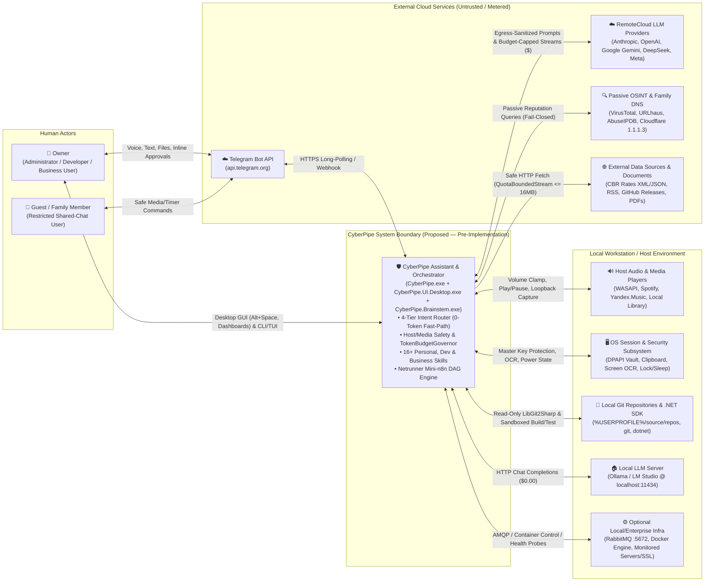

# arc42 — 03. Context and Scope

**Previous Section:** [`02-architecture-constraints.md`](02-architecture-constraints.md) | **Next Section:** [`04-solution-strategy.md`](04-solution-strategy.md)

---

## 3.1 Business Context

CyberPipe operates as an intelligent boundary between human actors (`Owner` and household/family `Guest`) and a heterogeneous set of local workstation capabilities, developer repositories, and external cloud/intelligence services.

### External Actors and Business Interfaces

| Actor / External System | Trust Level | Inputs to CyberPipe | Outputs from CyberPipe | Governing Requirements |
| :--- | :--- | :--- | :--- | :--- |
| **`Owner` (Primary User)** | `MemoryTrustSource.OwnerExplicit` (`1`) — High Trust (subject to anti-wipe & volume clamp from Telegram) | Text/voice commands, PDF/DOCX contracts, Netrunner workflows, budget/HITL button clicks (`[▶️ +5k tokens]`, `[✅ Approve]`, `/stop`), UI/CLI configuration. | Fast-Path confirmations, executive briefings, meeting action items, contract risk reports, token cost telemetry, Hangfire Read-Only Dashboard views. | `REQ-001`..`REQ-006`, `REQ-014`..`REQ-017` |
| **`Guest` (Family / Shared Chat)** | `MemoryTrustSource.GuestExplicit` (`2`) — Restricted Trust | Safe media commands (`<= 40%` volume), timers, basic status queries from whitelisted `GuestUserIds`. | Media playback state, timer notifications, role-scoped cached answers (`UserRole = Guest`). Never receives `Owner` private CRM/finance/memory records. | `REQ-001`, `REQ-005`, `REQ-006` |
| **Telegram Bot API (`api.telegram.org`)** | External Untrusted Transport (Authenticated by `TelegramUserId`) | Webhook/Long-Polling updates (`Message`, `Voice`, `Document`, `CallbackQuery` with `UpdateId`). | Egress-sanitized text messages, inline keyboards (`PausedByBudget`, `HitlApprovalNode`), exported files from `AllowedShareDirectories`. | `REQ-004`, `REQ-005`, `REQ-008` |
| **Local LLM Server (`Ollama` / `LM Studio`)** | Local Host Service (`localhost:11434`) | `Tier 2` / `Tier 3` chat completion requests with `DefaultContextTokens = 8192` (`num_ctx`) and pruned tools (`2–3` tools). | Structured JSON arguments or multi-step reasoning responses at `$0.00` token cost. | `REQ-001`, `REQ-002`, `REQ-007` |
| **`RemoteCloud` LLM Providers** | External Metered Third-Party Cloud (`Untrusted Egress`) | Prompts scrubbed by `CentralDataSanitizer` (`[REDACTED:ID]`), stripped of host tools on `TaintedContext`, capped by `MaxOutputTokens <= 2048`. | Streamed tokens and `UsageDetails` (`InputTokenCount`, `OutputTokenCount` including reasoning tokens). | `REQ-002`, `REQ-003`, `REQ-007`, `REQ-008` |
| **Passive OSINT & DoH APIs** | External Security Intelligence (`Fail-Closed`) | Hashes, domain names, or IP addresses extracted from scripts/documents by `SecurityGuard`. | Reputation scores (`VirusTotal`, `URLhaus`, `AbuseIPDB`, `1.1.1.3` DoH). Timeout/error forces `RiskLevel.RequiresApproval`. | `REQ-006`, `REQ-013` |
| **Host OS Subsystems (Audio, DPAPI, OCR, Git)** | Local Workstation Environment | Hardware metrics (`RAM`/`VRAM`/`CPU`), loopback/mic audio streams (`WASAPI`), screen bitmaps, `.git` metadata, DPAPI-unprotected master keys. | Clamped master volume (`<= 60%`/`25%`), encrypted `secrets.vault` & `data/subsystems/*.db`, sandboxed `Brainstem` / `ISandboxProvider` processes. | `REQ-006`, `REQ-009`, `REQ-011`, `REQ-016` |

---

## 3.2 Technical Context (Channels, Protocols, and Boundaries)

All technical communication channels are explicitly bounded by message size quotas, authentication mechanisms, and timeout policies:

| Channel / Interface | Source $\leftrightarrow$ Target | Protocol & Serialization | Framing / Quota Limit | Security & Authentication Control |
| :--- | :--- | :--- | :--- | :--- |
| **IPC Contour 1 (Control & Telemetry)** | `CyberPipe.UI.Desktop.exe` / `CyberPipe.exe [CLI]` $\leftrightarrow$ `CyberPipe.exe [Daemon]` | gRPC over Windows Named Pipe `\\.\pipe\CyberPipe.Control.{UserSid}` (Linux/macOS UDS `0600`) + Protobuf (`gateway.proto`, `telemetry.proto`, `budget.proto`) | `MaxReceiveMessageSize = 4 MB`, `MaxSendMessageSize = 4 MB`, `KeepAlive = 10 s`, up to `8` clients | `PipeOptions.CurrentUserOnly \| Asynchronous` (`FILE_FLAG_FIRST_PIPE_INSTANCE` on primary listener; see `RISK-009`). |
| **IPC Contour 2 (Isolated Worker)** | `CyberPipe.exe [Daemon]` $\leftrightarrow$ `worker/CyberPipe.Brainstem.exe` | Length-prefixed (`int32`) binary stream over `\\.\pipe\CyberPipe.Brainstem.{WorkerInstanceGuid}` + JSON SourceGen / Protobuf | `MaxConfiguredPayloadBytes = 16 MB` (rejected prior to allocation), `maxNumberOfServerInstances = 1` | Kernel client PID check (`GetNamedPipeClientProcessId == spawnedProcess.Id`) + 256-bit single-use `SessionNonce` burned on first frame + `worker.manifest.json` SHA-256 verification (`REQ-011`). |
| **Loopback Hangfire Dashboard** | System Browser $\leftrightarrow$ `CyberPipe.exe` (`Kestrel`) | HTTP/1.1 on `http://127.0.0.1:5080/dashboard-login` and `/hangfire` | Read-only HTML/JSON (`IsReadOnlyFunc = _ => true`) | Strict `IPAddress.IsLoopback` check + 256-bit One-Time Token (OTT, 30s TTL, stored in RAM as SHA-256) exchanged once for `CyberPipe.Dashboard` cookie (`HttpOnly; SameSite=Strict; Path=/hangfire`, 4h TTL) (`REQ-015`). |
| **Telegram Ingress / Egress** | `CyberPipe.Gateway.Telegram` $\leftrightarrow$ `api.telegram.org` | HTTPS (TLS 1.2/1.3) REST & Long-Polling (`Telegram.Bot`) | Voice/Document downloads wrapped in `QuotaBoundedStream(16 MB)` | Bot token in `SecretsVault`; `TelegramAuthGuard` numerical `TelegramUserId` whitelist (`< 0.1 ms` drop); `UpdateId` deduplication; egress `CentralDataSanitizer`. |
| **Local LLM Channel** | `CyberPipe.Router` / `Core.Agents` $\leftrightarrow$ `Ollama` / `LM Studio` | HTTP/1.1 REST (`http://localhost:11434`) via `OllamaSharp` (`IChatClient`) | `DefaultContextTokens = 8192`, `MaxOutputTokens <= 2048` | Loopback-only (`localhost`); pre-flight RAM/VRAM check via `ISystemResourceMonitor`; `Hard Tool Stripping` on `TaintedContext`. |
| **RemoteCloud LLM Channel** | `CyberPipe.Router` / `Core.Agents` $\leftrightarrow$ Cloud LLM APIs | HTTPS (TLS 1.2/1.3) via `Microsoft.Extensions.AI` (`IChatClient` pipeline) | `MaxOutputTokens <= 2048`, `SoftTaskTokenLimit = 4,000`, `HardTaskTokenLimit = 12,000` | Mandatory `SanitizingChatClient` (`CentralDataSanitizer`) + `TokenBudgetGovernor` (`DelegatingChatClient`) + `Hard Tool Stripping`. |
| **Local SQLite WAL Storage** | `ISubsystemDatabaseManager` $\leftrightarrow$ `data/*.db` | In-process ADO.NET (`Microsoft.Data.Sqlite.Core` + `SQLitePCLRaw.bundle_e_sqlcipher` + `Dapper`) | `cyberpipe_master.db` + 8 isolated `data/subsystems/*.db` files (`WAL`, `synchronous=NORMAL`) | Unique 256-bit SQLCipher key per DB in `data/secrets.vault` (`DPAPI` + `AES-256-GCM`); `ACCESS_DENIED_ACE` on `data\` for `Brainstem` (`REQ-009`, `RISK-002`). |
| **Optional Enterprise AMQP** | `MassTransitBusManager` $\leftrightarrow$ Local/Remote `RabbitMQ` | AMQP 0-9-1 (`:5672`) & HTTP Management (`:15672`) | Supervised via `ICenterInfrastructureSupervisor` | Auto-generated `cyberpipe_admin` credentials stored in `SecretsVault` (`db:secret` / `rabbitmq:password`), scoped to `/` vhost (`REQ-010`). |

---

## 3.3 Scope Boundaries: Inside vs. Outside CyberPipe

* **Inside CyberPipe's Scope:**
  * The 3 executables (`CyberPipe.exe`, `CyberPipe.UI.Desktop.exe`, `worker/CyberPipe.Brainstem.exe`), 16 source projects, and 5 automated test suites.
  * Lifecycle supervision of `CyberPipe.Brainstem.exe` pools, `ISandboxProvider` instances, and optional local RabbitMQ startup (`ICenterInfrastructureSupervisor`).
  * Creation, encryption, schema migration (`PRAGMA user_version`), hot backup (`SqliteBackupService`), and ACL hardening of `%LOCALAPPDATA%\CyberPipe\data\`.
  * Validation, dry-run testing (`tests/sample.fixture.json`), SHA-256 verification, and DAG execution of Netrunner ETL packages.
* **Outside CyberPipe's Scope (External Dependencies):**
  * Installation and GPU driver management of `Ollama` / `LM Studio`, `Docker Desktop`, portable `Erlang/OTP` + `RabbitMQ Server` (assisted by `.agents/skills/rabbitmq-windows/scripts/`), `git`, and the `.NET SDK`.
  * Availability, rate limits, and pricing changes of external cloud APIs (`Telegram`, `OpenAI`, `Anthropic`, `Google`, `DeepSeek`, `VirusTotal`).
  * Host OS kernel integrity (if an attacker already has local Administrator/Kernel rootkit privileges on the user's PC, OS-level `DPAPI` and `AppContainer` boundaries can be bypassed by that privileged local attacker; see [`04-threat-model/scope-assets-and-trust-boundaries.md`](../04-threat-model/scope-assets-and-trust-boundaries.md)).
