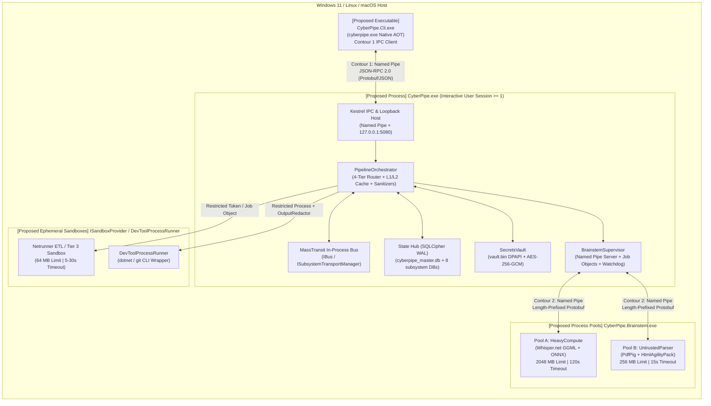
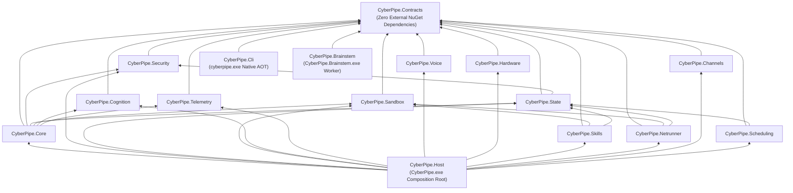
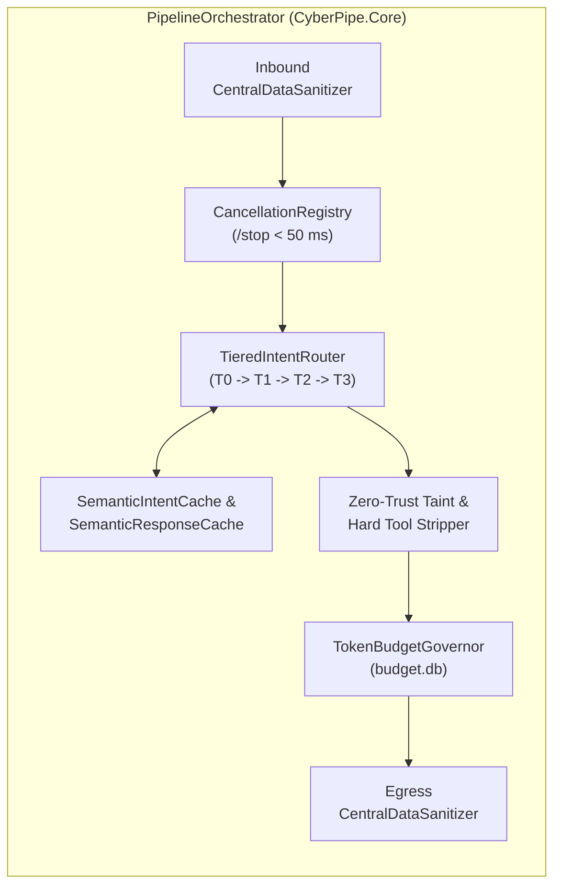

# 5. Building Block View

> **Document Role:** Decomposes the proposed **CyberPipe** system from the outside in across three hierarchical levels: Level 1 (Executables & OS Process Containers), Level 2 (16-Project Assembly DAG), and Level 3 (Critical Internal Subsystems & Components).
> **Epistemic Status:** **100% Proposed Architecture** (`0` `.cs` or `.csproj` files currently exist in `CyberPipe.slnx`; see [`RISK-004`](../03-atam/risk-register.md#risk-004)). All components below are traced to `docs/plans/` specifications and evaluated against discovered architectural risks.

---

## 5.1 Level 1 — System Container & Process View (Whitebox of Overall System)

At the operating system level, CyberPipe is decomposed into **three compiled .NET 10 executables** plus **ephemeral OS sandbox containers** for untrusted code execution (`REQ-002`, `REQ-015`).

### Level 1 Container Catalog

| Container / Executable | Target Project | Packaging & Runtime | Primary Responsibility | Trust Boundary | Source Evidence |
| :--- | :--- | :--- | :--- | :--- | :--- |
| **`CyberPipe.exe`** | `src/CyberPipe.Host` | .NET 10 CoreCLR (Self-contained or Framework-dependent, Interactive User Session) | Main long-running daemon hosting the 4-Tier Intent Router, `MassTransit` bus, `Hangfire` scheduler, `Telegram.Bot` client, Kestrel Named Pipe/Loopback servers, `SecretsVault`, and `SQLite/SQLCipher` databases. | `TB-03` (Core Daemon & State Hub) | [`02-architecture-diagram.md`](../../plans/02-architecture-diagram.md), [`15-cli-and-execution-modes.md`](../../plans/15-cli-and-execution-modes.md) |
| **`cyberpipe.exe`** | `src/CyberPipe.Cli` | .NET 10 Native AOT (`PublishAot=true`, single-file, `< 15 ms` startup) | Fast thin CLI client for human interactive commands, agentic coding tools (`--json`), and direct emergency vault/diagnostics when `--offline` is passed. | `TB-02` (Local IPC Boundary) | [`15-cli-and-execution-modes.md`](../../plans/15-cli-and-execution-modes.md) |
| **`CyberPipe.Brainstem.exe`** | `src/CyberPipe.Brainstem` | .NET 10 CoreCLR (`./worker/CyberPipe.Brainstem.exe`), SHA-256 verified at launch | Out-of-process worker executable spawned into two isolated pools (`HeavyCompute` for Whisper/ONNX and `UntrustedParser` for PDF/DOCX/HTML) under OS Job Objects/cgroups and `AppContainer`/`RestrictedToken`. | `TB-04` (`Brainstem` Worker Boundary) | [`02-architecture-diagram.md`](../../plans/02-architecture-diagram.md), [`15-cli-and-execution-modes.md`](../../plans/15-cli-and-execution-modes.md) |
| **Ephemeral Sandboxes** | Managed by `CyberPipe.Sandbox` | OS Child Processes (`AppContainer` / `bwrap` / `sandbox-exec`) | Short-lived isolated processes executing `Tier 3` agent scripts, `Netrunner` ETL scripts (`REQ-013`), and `DevToolProcessRunner` (`dotnet`/`git`, `REQ-014`). | `TB-05` (Ephemeral Sandbox Boundary) | [`10-sandbox-telemetry-and-heuristics.md`](../../plans/10-sandbox-telemetry-and-heuristics.md), [`16-netrunner-etl-and-workflow-engine.md`](../../plans/16-netrunner-etl-and-workflow-engine.md) |

---

## 5.2 Level 2 — 16-Project Assembly Decomposition & Dependency DAG

Inside the solution (`CyberPipe.slnx`), the architecture prescribes **16 source projects** under `src/` and **5 test projects** under `tests/`, governed by a strict compile-time Directed Acyclic Graph (DAG) enforced by `ArchUnitNET` (`REQ-001`, `QAS-013`).

### Level 2 Assembly Catalog (`src/` & `tests/`)

| Project Name | Layer | Permitted Project References | Key External Dependencies | Primary Responsibilities | Source Evidence |
| :--- | :--- | :--- | :--- | :--- | :--- |
| **`CyberPipe.Contracts`** | Layer 0 (Leaf) | *None* | *None* (BCL only; `Google.Protobuf` generated DTOs if isolated) | Immutable DTOs (`SkillRequest`, `SkillResult`, `TaintedData<T>`), interfaces (`ISkill`, `ISandboxProvider`, `ISecretsVault`, `ITokenBudgetGovernor`), enums (`OriginTrustLevel`, `ExecutionTier`, `BrainstemTaskKind`). | [`06-solution-structure.md`](../../plans/06-solution-structure.md) |
| **`CyberPipe.Security`** | Layer 1 | `Contracts` | `System.Security.Cryptography` | `SecretsVault` (`DPAPI` + `AES-256-GCM`), `CentralDataSanitizer` (inbound/egress PII & secret scrubber), `CommandSafetyValidator`, `HangfireOneTimeTokenMiddleware`, taint enforcement rules. | [`05-security-agent.md`](../../plans/05-security-agent.md), [`09-data-protection-and-state-hub.md`](../../plans/09-data-protection-and-state-hub.md) |
| **`CyberPipe.State`** | Layer 1 | `Contracts`, `Security` | `Microsoft.Data.Sqlite.Core`, `SQLitePCLRaw.bundle_e_sqlcipher`, `Dapper` | `SubsystemDatabaseManager` (`cyberpipe_master.db` + 8 subsystem DBs), `SemanticIntentCache`, `SemanticResponseCache` (`SIMD CosineSimilarity`), `HybridKnowledgeStore` (`FTS5` + vectors), `InFlightOperations`, `CyberPipeBackupService`. | [`09-data-protection-and-state-hub.md`](../../plans/09-data-protection-and-state-hub.md) |
| **`CyberPipe.Sandbox`** | Layer 1 | `Contracts` | OS P/Invoke (`advapi32.dll`, `userenv.dll`, `kernel32.dll`, libc) | `BrainstemSupervisor` (Dual-pool process manager, Named Pipe Contour 2 host, `worker.manifest.json` SHA-256 verifier), `ISandboxProvider` (`WindowsJobObjectSandbox`, `LinuxBubblewrapSandbox`, `MacOsSeatbeltSandbox`), `DevToolProcessRunner`. | [`02-architecture-diagram.md`](../../plans/02-architecture-diagram.md), [`10-sandbox-telemetry-and-heuristics.md`](../../plans/10-sandbox-telemetry-and-heuristics.md) |
| **`CyberPipe.Cognition`** | Layer 1 | `Contracts` | `Microsoft.Extensions.AI`, `Microsoft.ML.OnnxRuntime`, `Microsoft.ML.Tokenizers` | `TieredIntentRouter` (Tier 0 Regex/Aho-Corasick, Tier 1 ONNX embedding router, Tier 2/3 LLM escalation), `ModelRouter` (`Local/Cloud/Auto`), `TokenBudgetGovernor`, `AgentExecutionContext` loop breaker. | [`02-architecture-diagram.md`](../../plans/02-architecture-diagram.md), [`10-sandbox-telemetry-and-heuristics.md`](../../plans/10-sandbox-telemetry-and-heuristics.md), [`13-model-advisor-and-tier-configuration.md`](../../plans/13-model-advisor-and-tier-configuration.md) |
| **`CyberPipe.Telemetry`** | Layer 1 | `Contracts` | `Serilog`, `OpenTelemetry` | Structured JSON logging (`logs/cyberpipe-.jsonl`) with automatic secret redaction, OpenTelemetry spans/metrics, `LogCompressor` (`1 GB` raw log $\rightarrow$ `~30 KB` LLM diagnostic digest). | [`03-tech-stack-libraries.md`](../../plans/03-tech-stack-libraries.md), [`10-sandbox-telemetry-and-heuristics.md`](../../plans/10-sandbox-telemetry-and-heuristics.md) |
| **`CyberPipe.Voice`** | Layer 1 | `Contracts` | `Concentus` (Opus), `SherpaOnnx` / `Piper` | Voice note ingestion coordinator (delegates `Whisper.net` STT to `Brainstem` Pool A), local TTS synthesis, `AudioSafetyPrePlaybackGuard`. | [`03-tech-stack-libraries.md`](../../plans/03-tech-stack-libraries.md), [`10-sandbox-telemetry-and-heuristics.md`](../../plans/10-sandbox-telemetry-and-heuristics.md) |
| **`CyberPipe.Hardware`** | Layer 1 | `Contracts` | `NAudio` (Windows CoreAudio), OS P/Invoke (`PowrProf.dll`, `user32.dll`) | `SystemResourceMonitor` (event-driven power/battery/CPU/idle sensor), `MediaController` (`VolumeClamp <= 60%/25%`, GSMTC media keys), `NextDnsGuard` (`1.1.1.3` family filter check). | [`10-sandbox-telemetry-and-heuristics.md`](../../plans/10-sandbox-telemetry-and-heuristics.md) |
| **`CyberPipe.Core`** | Layer 2 | `Contracts`, `Security`, `State`, `Sandbox`, `Cognition`, `Telemetry` | `MassTransit`, `Polly`, `System.Threading.Channels` | `PipelineOrchestrator`, `CancellationRegistry` (`/stop` `< 50 ms` kill-switch), `SubsystemBulkheadPolicy` (Polly v8 bulkhead compartments), `SubsystemTransportManager` (`MassTransit` bus lifecycle). | [`02-architecture-diagram.md`](../../plans/02-architecture-diagram.md), [`14-fault-isolation-and-resilience.md`](../../plans/14-fault-isolation-and-resilience.md) |
| **`CyberPipe.Skills`** | Layer 2 | `Contracts`, `State`, `Sandbox` | `ClosedXML`, `QuestPDF`, `MailKit` | Built-in deterministic C# skills (`PersonalCrmSkill`, `FinanceLedgerSkill`, `HealthHabitTrackerSkill`, `DocumentGeneratorSkill`, `EmailSummarySkill`, `DevToolsSkill`). | [`12-assistant-capabilities-and-skills.md`](../../plans/12-assistant-capabilities-and-skills.md), [`12-assistant-capabilities-and-skills.md`](../../plans/12-assistant-capabilities-and-skills.md) |
| **`CyberPipe.Netrunner`** | Layer 2 | `Contracts`, `State`, `Sandbox` | `JsonSchema.Net`, `HtmlAgilityPack`, `ReverseMarkdown` | `NetrunnerPackageValidator` (6-file contract verifier), `WorkflowDagRunner` (Mini-n8n DAG executor with `SkillNode`, `NetrunnerScriptNode`, `LlmProcessNode`, `HitlApprovalNode`), WAL checkpointing in `netrunner.db`. | [`16-netrunner-etl-and-workflow-engine.md`](../../plans/16-netrunner-etl-and-workflow-engine.md) |
| **`CyberPipe.Channels`** | Layer 2 | `Contracts` | `Telegram.Bot` | `TelegramChannelAdapter` (long-polling/webhook receiver, inline approval keyboards for HITL gates, voice note downloader), `CliChannelAdapter` (Contour 1 Named Pipe JSON-RPC server). | [`03-tech-stack-libraries.md`](../../plans/03-tech-stack-libraries.md), [`15-cli-and-execution-modes.md`](../../plans/15-cli-and-execution-modes.md) |
| **`CyberPipe.Scheduling`** | Layer 2 | `Contracts`, `State` | `Hangfire.Core`, `Cronos` | `ProactiveScheduler` (natural-language-to-cron registration, quiet-hours deferral, battery-saver throttling, Hangfire recurring/delayed job bridge). | [`12-assistant-capabilities-and-skills.md`](../../plans/12-assistant-capabilities-and-skills.md) |
| **`CyberPipe.Host`** | Layer 3 (Root) | All Layer 0–2 library projects | `Microsoft.AspNetCore.Server.Kestrel` | Composition Root (`Program.cs`), DI container registration, Kestrel Named Pipe + `127.0.0.1:5080` loopback server (`Hangfire` Dashboard), startup recovery sequence. | [`06-solution-structure.md`](../../plans/06-solution-structure.md), [`15-cli-and-execution-modes.md`](../../plans/15-cli-and-execution-modes.md) |
| **`CyberPipe.Cli`** | Layer 3 (Root) | `Contracts` (and `Security`/`State` only if `--offline` is supported in-binary) | `Spectre.Console.Cli` | Native AOT CLI executable (`cyberpipe.exe`). Connects to `CyberPipe.exe` over Contour 1 Named Pipe (`\\.\pipe\CyberPipe.Ipc.{Username}`). | [`15-cli-and-execution-modes.md`](../../plans/15-cli-and-execution-modes.md) |
| **`CyberPipe.Brainstem`** | Layer 3 (Root) | `Contracts` | `Whisper.net`, `PdfPig`, `HtmlAgilityPack` | Out-of-process worker executable (`./worker/CyberPipe.Brainstem.exe`). Connects back to `BrainstemSupervisor` via Contour 2 Named Pipe (`\\.\pipe\CyberPipe.Brainstem.{InstanceGuid}`). | [`02-architecture-diagram.md`](../../plans/02-architecture-diagram.md), [`15-cli-and-execution-modes.md`](../../plans/15-cli-and-execution-modes.md) |

> [!WARNING]
> **Hidden Architectural Contradiction in `CyberPipe.Cli` (`--offline` Mode vs Thin AOT Client):**
> [`15-cli-and-execution-modes.md`](../../plans/15-cli-and-execution-modes.md) specifies that `CyberPipe.Cli` only references `CyberPipe.Contracts` for a tiny Native AOT footprint, **yet also specifies** `cyberpipe vault set --offline` and `cyberpipe db status --offline` which directly open `vault.bin` and `cyberpipe_master.db` when the daemon is stopped. To implement `--offline` without violating the assembly DAG, `CyberPipe.Cli` must either reference `CyberPipe.Security` and `CyberPipe.State` (which pulls `SQLitePCLRaw.bundle_e_sqlcipher` into the Native AOT binary) or delegate `--offline` operations to `CyberPipe.exe --oneshot`.

---

## 5.3 Level 3 — Critical Internal Building Blocks (Detailed Component Specifications)

For each critical component, the table and specifications below define its **Responsibility**, **Interfaces**, **Lifecycle**, **Failure Modes**, **Data Ownership**, **Security Boundary**, and **Recovery Behavior** (Section 5.2 requirement).

### 5.3.1 `PipelineOrchestrator` & `TieredIntentRouter` (`CyberPipe.Core` / `CyberPipe.Cognition`)
- **Responsibility:** Coordinates end-to-end execution of every user command or scheduled trigger (`REQ-003`). Enforces inbound sanitization, `/stop` preemption, 4-tier routing (`Tier 0` Regex/Aho-Corasick, `Tier 1` ONNX embedding + `SemanticIntentCache`, `Tier 2` LLM tool-calling, `Tier 3` sandboxed agent), L2 response caching, zero-trust taint checking, and egress scrubbing.
- **Interfaces:** `IPipelineOrchestrator.ExecuteAsync(CommandEnvelope, CancellationToken)`, `ITieredIntentRouter.RouteAsync(SanitizedInput, CancellationToken)`.
- **Lifecycle:** Singleton hosted service bound to `CyberPipe.exe` lifetime.
- **Failure Modes:**
  - `Tier 1` ONNX native memory corruption (`AccessViolationException`) inside `CyberPipe.exe` crashes the entire daemon (`RISK-011`).
  - `SemanticResponseCache` serving stale responses across subsystem DB writes (`RISK-010`).
- **Data Ownership:** Owns `InFlightOperations`, `SemanticIntentCache`, and `SemanticResponseCache` (which currently lack a dedicated `.db` file in `09-data-protection-and-state-hub.md` — see [`RISK-008`](../03-atam/risk-register.md#risk-008)).
- **Security Boundary:** `TB-03` (Core Daemon). Must enforce **Hard Tool Stripping** in C# before invoking `IChatClient` whenever `ContextContainsUntrustedData == true` (`REQ-006`, `QAS-007`).
- **Recovery Behavior:** On startup, scans `InFlightOperations` for tasks interrupted mid-flight (`Status == Running`), transitions non-idempotent tasks to `InterruptedRequiresConfirmation`, and notifies the Owner (`REQ-010`).

### 5.3.2 `BrainstemSupervisor` & Dual Worker Pools (`CyberPipe.Sandbox` / `CyberPipe.Brainstem`)
- **Responsibility:** Manages the lifecycle, health, binary verification, IPC framing, and OS sandboxing of out-of-process `CyberPipe.Brainstem.exe` workers (`REQ-002`, `QAS-005`, `QAS-010`).
- **Interfaces:** `IBrainstemSupervisor.ExecuteTaskAsync(BrainstemTaskRequest, CancellationToken)`.
- **Lifecycle:** Singleton in `CyberPipe.exe`; manages two distinct process pools:
  - **Pool A (`HeavyCompute`):** Warm/on-demand worker(s) for `WhisperTranscribe` (`2048 MB` RAM cap, `120 s` timeout, `5 min` idle scale-to-zero).
  - **Pool B (`UntrustedParser`):** Ephemeral/pooled worker(s) for `DocumentExtractText` (`256 MB` RAM cap, `15 s` timeout, zero network access).
- **Failure Modes:**
  - Worker crash (`AccessViolationException`, stack overflow, or OOM kill `0xC0000005` / `SIGKILL`) on malformed PDF or corrupted GGML model.
  - `worker.manifest.json` SHA-256 mismatch at launch (`SecurityIntegrityException`).
  - Windows `AppContainer` (`S-1-15-2-1`) `ACCESS_DENIED` if deployed outside `C:\Program Files` without explicit ACL grant (`RISK-006`).
- **Data Ownership:** Stateless; reads `./worker/worker.manifest.json` and `./models/whisper/*.bin` (read-only). Zero access to `data/`.
- **Security Boundary:** Spans `TB-03` (Supervisor) $\rightarrow$ `TB-04` (Worker Process). Communicates over Contour 2 Named Pipe (`\\.\pipe\CyberPipe.Brainstem.{InstanceGuid}`) using length-prefixed Protobuf with an `8 MB` frame cap (`THREAT-008`).
- **Recovery Behavior:** Exponential backoff respawn (`100 ms`, `500 ms`, `2000 ms`); after 3 consecutive crashes within `60 s`, trips the subsystem circuit breaker (`Open` for `5 min`) and returns a graceful fallback error to the user while `CyberPipe.exe` continues running uninterrupted.

### 5.3.3 `SubsystemDatabaseManager` & `HybridKnowledgeStore` (`CyberPipe.State`)
- **Responsibility:** Manages encrypted connection pools, schema migrations, `PRAGMA` configuration (`journal_mode=WAL`, `synchronous=NORMAL`, `busy_timeout=5000`, `temp_store=MEMORY`), and key rotation (`PRAGMA rekey`) across `cyberpipe_master.db` and the 8 subsystem databases (`REQ-007`, `QAS-006`).
- **Interfaces:** `ISubsystemDatabaseManager.OpenConnectionAsync(string subsystemId, CancellationToken)`, `IHybridKnowledgeStore.SearchAsync(string query, ReadOnlyMemory<float> vector, int topK)`.
- **Lifecycle:** Singleton factory managing keyed `Microsoft.Data.Sqlite` connection pools per `.db` file.
- **Failure Modes:**
  - Native `e_sqlite3` vs `e_sqlcipher` symbol clash causing silent unencrypted databases (`RISK-002`, `THREAT-006`).
  - `Cache=Shared` concurrency degradation and password bypass (`RISK-002`).
  - Partial failure across multiple `.db` files during `PRAGMA rekey` or cross-subsystem updates (`RISK-008`).
- **Data Ownership:** Owns `data/cyberpipe_master.db` and `data/subsystems/{hangfire,masstransit,knowledge,crm,finance,budget,health,netrunner}.db`.
- **Security Boundary:** `TB-03` (`ASSET-02`). Protected by OS `Deny` DACLs for sandboxed processes and SQLCipher `AES-256-CBC` page encryption using a `32-byte` key from `SecretsVault`.
- **Recovery Behavior:** SQLite WAL crash recovery on open; `PRAGMA wal_checkpoint(TRUNCATE)` prior to hot backups (`CyberPipeBackupService`) and `PRAGMA rekey` operations.

### 5.3.4 `SecretsVault` & `CentralDataSanitizer` (`CyberPipe.Security`)
- **Responsibility:**
  - `SecretsVault`: Stores API keys, bot tokens, and the SQLCipher master key inside `data/vault.bin` encrypted with `AES-256-GCM`, sealing the master key via Windows `DPAPI` (`CurrentUser`) or Linux/macOS OS keychains (`REQ-005`). Pins decrypted secrets in memory only during use and zeroes buffers via `CryptographicOperations.ZeroMemory`.
  - `CentralDataSanitizer`: Deterministic two-stage (`Regex` + structural entropy/NER) scrubber that redacts secrets, credit cards (Luhn), SSN/INN, phones, emails, paths, and tokens (`[REDACTED_SECRET]`, `[PII_EMAIL_1]`) before any cloud LLM call or log write (`REQ-005`, `QAS-008`).
- **Interfaces:** `ISecretsVault.UseSecretAsync<T>(string key, Func<ReadOnlyMemory<char>, ValueTask<T>>)`, `ICentralDataSanitizer.SanitizeForCloud(string rawInput)`.
- **Lifecycle:** Singleton in `CyberPipe.exe`.
- **Failure Modes:**
  - OS user profile corruption or password reset invalidating `DPAPI` master key (`RISK-014`).
  - High-entropy secret split across lines or Base64-encoded evading regex scrubbing (`THREAT-003`).
- **Data Ownership:** `data/vault.bin` (`ASSET-01`).
- **Security Boundary:** `TB-03` $\rightarrow$ `TB-01` (Cloud LLM egress gate). Never rehydrates `[REDACTED_*]` placeholders (`05-security-agent.md` §3.1).
- **Recovery Behavior:** Supports encrypted emergency recovery export (`cyberpipe backup create --include-recovery-key`, `ADR-0006`).

### 5.3.5 `TokenBudgetGovernor` (`CyberPipe.Cognition`)
- **Responsibility:** Enforces hard daily/monthly USD spending caps, per-task token ceilings (`MaxOutputTokens`), and loop breakers (`MaxLlmTurnsPerTask`: `3` Cloud / `3` or `5` Local — see [`RISK-016`](../03-atam/risk-register.md#risk-016)) (`REQ-009`, `QAS-009`).
- **Interfaces:** `ITokenBudgetGovernor.TryReserveBudgetAsync(BudgetReservationRequest)`, `ITokenBudgetGovernor.CommitUsageAsync(BudgetCommitReceipt)`.
- **Lifecycle:** Singleton backed by `data/subsystems/budget.db`.
- **Failure Modes:** Concurrent cloud LLM requests racing past the 100% hard cap if reservation is not atomic (`THREAT-013`).
- **Data Ownership:** `data/subsystems/budget.db`.
- **Security Boundary:** `TB-03` financial circuit breaker (`ASSET-06`).
- **Recovery Behavior:** Automatically pauses paid cloud models at 100% threshold, switches `ModelRouter` to local `Ollama`/`LlamaSharp` fallback, and awaits explicit Owner override (`/budget approve-extra`) or UTC midnight reset.

### 5.3.6 `WorkflowDagRunner` & `NetrunnerPackageValidator` (`CyberPipe.Netrunner`)
- **Responsibility:** Validates 6-file Netrunner ETL packages (`netrunner.manifest.json`, `schema.input.json`, `schema.output.json`, `SKILL.md`, entrypoint script, `tests/`) and executes cascading Mini-n8n DAG workflows (`SkillNode`, `NetrunnerScriptNode`, `LlmProcessNode`, `HitlApprovalNode`) with WAL checkpointing after every node (`REQ-013`, `QAS-011`).
- **Interfaces:** `IWorkflowDagRunner.ExecuteWorkflowAsync(WorkflowDefinition, JsonDocument initialInput, CancellationToken)`, `INetrunnerPackageValidator.ValidatePackageAsync(string directoryPath)`.
- **Lifecycle:** Scoped/Singleton service in `CyberPipe.exe` dispatching script nodes to `ISandboxProvider` (`TB-05`).
- **Failure Modes:**
  - `CSharpRoslyn` (`main.csx`) compilation inside a `64 MB` sandbox causing immediate `OutOfMemoryException` (`RISK-003`).
  - Missing `BrainstemTaskKind` enum value if routed through `Brainstem` instead of `ISandboxProvider` (`RISK-003`).
  - Schema violation on node ingress/egress (`NetrunnerSchemaViolationException`).
- **Data Ownership:** `data/subsystems/netrunner.db` (`WorkflowExecutions`, `WorkflowNodeCheckpoints`, `HitlPendingApprovals`).
- **Security Boundary:** `TB-03` (DAG state & JSON Schema validation) $\rightarrow$ `TB-05` (`NetrunnerScriptNode` execution with domain-allowlisted HTTP proxy and `64 MB` memory limit).
- **Recovery Behavior:** Resumes interrupted or `WaitingForHitlApproval` workflows from the last `Completed` node in `netrunner.db` without re-running completed upstream nodes (`QAS-011`).

### 5.3.7 `SubsystemTransportManager` (`CyberPipe.Core`)
- **Responsibility:** Configures and manages the `MassTransit` message bus (`IBus`, `IPublishEndpoint`) across `InMemory`, durable SQL, or `RabbitMQ` transports (`REQ-008`).
- **Interfaces:** `ISubsystemTransportManager.GetCurrentMode()`, `ISubsystemTransportManager.SwitchTransportAsync(TransportMode targetMode)`.
- **Lifecycle:** Singleton in `CyberPipe.exe`.
- **Failure Modes:**
  - **Critical Blocker (`RISK-001`):** `MassTransit.SqlTransport.Sqlite` (`data/subsystems/masstransit.db`) specified in `03-tech-stack-libraries.md` and `17-adr-mvp.md` **does not exist** in the MassTransit ecosystem, and MassTransit v8/v9 cannot hot-swap `IBus` singletons at runtime without rebuilding the DI container or using an `AdaptivePublishEndpoint` proxy (`ADR-0002`).
- **Data Ownership:** `data/subsystems/masstransit.db` (if replaced by a custom SQLite transactional outbox; see [`ADR-0002`](../05-adr/0002-message-bus-and-transport-strategy.md)).
- **Security Boundary:** `TB-03` (Internal event bus; external `RabbitMQ` broker requires TLS/credentials from `SecretsVault` when enabled).
- **Recovery Behavior:** Transactional outbox retry with exponential backoff; dead-letter queue persisted to SQLite for manual replay.

---

## Cross-References
- **System Context & Trust Boundaries:** [`03-context-and-scope.md`](03-context-and-scope.md)
- **Runtime Sequence Scenarios:** [`06-runtime-view.md`](06-runtime-view.md)
- **Cross-Cutting Implementation Mechanics:** [`08-crosscutting-concepts.md`](08-crosscutting-concepts.md)
- **Risk Register (`RISK-001`..`RISK-016`):** [`../03-atam/risk-register.md`](../03-atam/risk-register.md)
