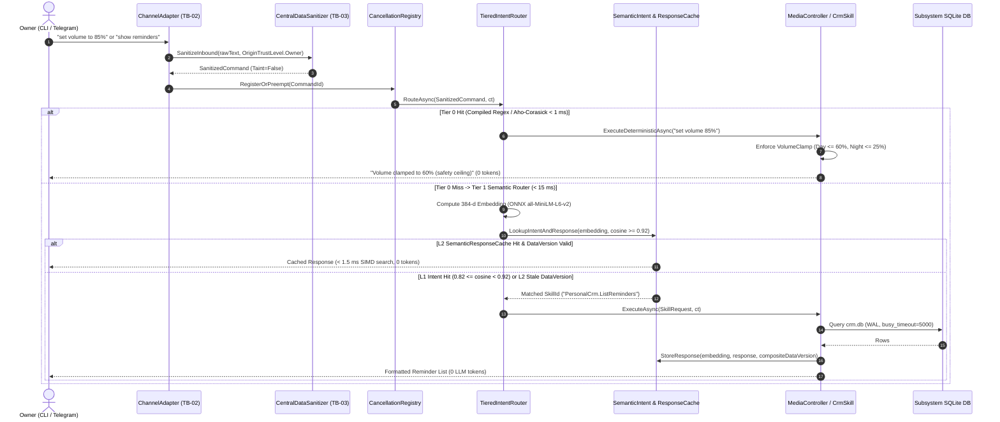

# 6. Runtime View

> **Document Role:** Specifies the dynamic runtime behavior, component interactions, sequence flows, latency budgets, and failure/recovery paths for CyberPipe's five most critical operational scenarios.
> **Epistemic Status:** **Proposed Runtime Flows** derived from `docs/plans/` and stress-tested against discovered architectural risks (`RISK-001`..`RISK-016`) and quality attribute scenarios (`QAS-001`..`QAS-014`).

---

## 6.1 Scenario A — Fast-Path Deterministic Execution (`Tier 0` & `Tier 1` + `L1/L2` Cache)

**Architectural Drivers:** `REQ-003`, `QAS-001` (`Tier 0 < 1 ms`), `QAS-002` (`Tier 1 < 15 ms` / SIMD `< 1.5 ms`), `QAS-014` (`VolumeClamp <= 60%/25%`).

### Normal & Cache-Miss Sequence Diagram



### Failure Paths & Architectural Risks in Scenario A
1. **Stale `L2 SemanticResponseCache` Across Decentralized DBs (`RISK-010`, `AUD-05`):**
   - *Failure Mechanism:* [`10-sandbox-telemetry-and-heuristics.md`](../../plans/10-sandbox-telemetry-and-heuristics.md) invalidates `SemanticResponseCache` via `PRAGMA data_version`. However, in SQLite, `PRAGMA data_version` is per-database file. If `SemanticResponseCache` only checks `cyberpipe_master.db`, mutations in `crm.db` or `finance.db` will not increment the version, causing stale data to be returned.
   - *Required Mitigation:* Maintain an in-memory `ConcurrentDictionary<string, long> SubsystemMutationEpochs` in `SubsystemDatabaseManager` incremented on every write transaction, or tag every `SemanticResponseCache` entry with its target `SubsystemId` and verify `PRAGMA data_version` on that specific `.db` connection before returning a cache hit.
2. **In-Process `ONNX Runtime` Native Fault (`RISK-011`):**
   - *Failure Mechanism:* If `Microsoft.ML.OnnxRuntime` encounters a corrupted model buffer or AVX-512 driver fault inside `CyberPipe.exe`, the native `SEGV`/`AccessViolationException` terminates the entire daemon.
   - *Required Mitigation:* Verify SHA-256 of the ONNX model file before loading, pin a known-good CPU execution provider, and provide an automatic fallback to `Brainstem` Pool A if native initialization fails.

---

## 6.2 Scenario B — `Tier 2/3` Cloud LLM Execution, Taint Stripping, Budget Governance & `/stop` Preemption

**Architectural Drivers:** `REQ-003`, `REQ-004` (`/stop < 50 ms`, `QAS-003`), `REQ-005` (`Egress Sanitizer < 0.5 ms`, `QAS-008`), `REQ-006` (`Hard Tool Stripping`, `QAS-007`), `REQ-009` (`TokenBudgetGovernor`, `QAS-009`).

```mermaid
sequenceDiagram
    autonumber
    actor Owner as Owner
    participant Orch as PipelineOrchestrator
    participant Cancel as CancellationRegistry
    participant Taint as HardToolStripper
    participant Gov as TokenBudgetGovernor (budget.db)
    participant San as Egress CentralDataSanitizer
    participant Cloud as Cloud LLM / Local Ollama

    Owner->>Orch: Complex query referencing untrusted forwarded message
    Orch->>Cancel: Create Linked CancellationTokenSource (taskId)
    Orch->>Taint: BuildChatOptions(ContextContainsUntrustedData = true)
    Note over Taint: HARD TOOL STRIPPING (REQ-006 / QAS-007):<br/>ChatOptions.Tools = Array.Empty<AITool>()<br/>Destructive tools physically removed in C#

    Orch->>Gov: TryReserveBudgetAsync(estimatedTokens, model="Claude-3.5-Sonnet")
    alt Daily/Monthly USD Cap Reached (>= 100%)
        Gov-->>Orch: BudgetExceeded -> Auto-Switch to Local Ollama (Tier 2 Fallback)
        Orch->>Owner: "[Alert] Cloud budget cap reached; routing to local Ollama"
    else Budget Reserved
        Gov-->>Orch: ReservationToken (MaxTurns = 3, MaxOutputTokens = 1024)
    end

    Orch->>San: SanitizeForCloud(promptPayload) (< 0.5 ms)
    Note over San: Scrubs API keys, cards, SSN, emails -> [REDACTED_*]<br/>Zero rehydration permitted on response
    San-->>Orch: ScrubbedPrompt

    par Async LLM Streaming Call
        Orch->>Cloud: CompleteStreamingAsync(ScrubbedPrompt, ChatOptions, ct)
    and Concurrent Emergency /stop Preemption (QAS-003)
        Owner->>Cancel: "/stop" (Priority Bypass)
        Cancel->>Cancel: CancelAll() + Kill Egress Socket + Terminate Sandbox (< 50 ms)
        Cancel-->>Owner: "Stopped all active tasks (1 cancelled)."
    end

    Cloud-->>Orch: Streamed Response / OperationCanceledException
    Orch->>Gov: CommitUsageAsync(actualPromptTokens, actualCompletionTokens)
    Orch-->>Owner: Final Response (with [REDACTED_*] intact)
```

### Failure Paths & Recovery in Scenario B
- **Runaway Agent Loop (`THREAT-013`):** If the LLM repeatedly requests tool calls, `AgentExecutionContext` increments `TurnCount` on every iteration. At `TurnCount == 3` (Cloud) or `5` (Local), C# halts tool execution and forces a final text synthesis turn (`REQ-009`).
- **Preemption of In-Flight State (`REQ-010`):** When `/stop` cancels an active task, `InFlightOperations` marks the operation `CancelledByUser` and rolls back any uncommitted SQLite transaction via `CancellationToken` propagation.

---

## 6.3 Scenario C — Untrusted Voice & Document Processing via `Brainstem` Out-of-Process Pools

**Architectural Drivers:** `REQ-002`, `QAS-005` (`Brainstem` memory/FS isolation), `QAS-010` (`50 MB` PDF bomb bulkhead survival).

```mermaid
sequenceDiagram
    autonumber
    actor Ext as External Forwarding / Telegram
    participant Orch as PipelineOrchestrator (CyberPipe.exe)
    participant Bulk as SubsystemBulkheadPolicy
    participant Sup as BrainstemSupervisor (TB-03)
    participant Pipe as Contour 2 Named Pipe (Protobuf)
    participant PoolB as Brainstem Pool B (UntrustedParser TB-04)

    Ext->>Orch: Forwarded 50 MB Malformed PDF / Voice Note
    Orch->>Orch: Wrap in TaintedData<byte[]>(OriginTrustLevel.UntrustedExternal)
    Orch->>Bulk: ExecuteInDocumentBulkheadAsync(maxParallel=2, maxQueue=4)
    Bulk->>Sup: ExecuteTaskAsync(DocumentExtractText, payload, timeout=15s)

    Sup->>Sup: Verify ./worker/worker.manifest.json SHA-256
    Sup->>PoolB: Ensure Worker Running (Job Object: 256 MB RAM, Zero Network, Deny data/ ACL)
    Sup->>Pipe: Write Length-Prefixed Protobuf Frame (<= 8 MB chunked stream)
    Pipe->>PoolB: Dispatch DocumentExtractText

    alt Normal Extraction
        PoolB->>PoolB: PdfPig extracts plain text
        PoolB-->>Pipe: Protobuf Result (ExtractedText)
        Pipe-->>Sup: ExtractedText
        Sup-->>Orch: TaintedData<string>(ExtractedText, UntrustedExternal)
    else PDF Bomb / Native OOM (> 256 MB) or 15s Timeout (QAS-010)
        PoolB-xPoolB: OS Job Object terminates CyberPipe.Brainstem.exe (OOM / Timeout)
        Pipe--xSup: BrokenPipeException / OperationCanceledException
        Sup->>Sup: Log WorkerCrash + Increment CircuitBreaker Counter
        Sup-->>Orch: Result.Failure("Document exceeded safety limits (256 MB / 15s)")
        Note over Orch: CyberPipe.exe daemon remains 100% stable (< 150 MB RAM);<br/>Telegram/CLI channels unaffected
    end
```

---

## 6.4 Scenario D — `Netrunner` Cascading DAG Execution, `HITL` Pause & Crash Recovery

**Architectural Drivers:** `REQ-010`, `REQ-013`, `QAS-011` (`Netrunner` WAL crash recovery & idempotency), `RISK-003` (`64 MB` Roslyn OOM hazard).

```mermaid
sequenceDiagram
    autonumber
    participant Hang as ProactiveScheduler (Hangfire)
    participant Dag as WorkflowDagRunner (CyberPipe.Netrunner)
    participant DB as netrunner.db (SQLCipher WAL)
    participant Val as NetrunnerPackageValidator
    participant Sand as ISandboxProvider (TB-05)
    actor Owner as Owner (Telegram HITL)

    Hang->>Dag: Trigger Workflow ("DailyCompetitorDigest")
    Dag->>DB: INSERT WorkflowExecution (State=Running, CurrentNode=Node1)

    Note over Dag,Sand: Node 1: NetrunnerScriptNode ("scrape-pricing")
    Dag->>Val: Validate 6-File Package + JSON Schema Input
    Note over Val: RISK-003 Mitigation: Must execute pre-compiled .dll/.wasm<br/>(NOT in-memory Roslyn main.csx) to stay <= 64 MB RAM
    Dag->>Sand: RunSandboxedScriptAsync(allowedDomains=["example.com"], maxMem=64MB, timeout=30s)
    Sand-->>Dag: JSON Output (UntrustedExternal)
    Dag->>Val: Validate Output against schema.output.json
    Dag->>DB: Checkpoint Node 1 = Completed (OutputJson saved in WAL)

    Note over Dag: Node 2: LlmProcessNode ("summarize-diffs") -> Hard Tool Stripping Active
    Dag->>Dag: Summarize JSON via Local/Cloud LLM (Tools Stripped)
    Dag->>DB: Checkpoint Node 2 = Completed

    Note over Dag,Owner: Node 3: HitlApprovalNode ("approve-crm-update")
    Dag->>DB: UPDATE WorkflowExecution SET State=WaitingForHitlApproval
    Dag->>Owner: Send Telegram Inline Keyboard [Approve] [Reject] (Workflow Paused, 0 CPU/RAM held)

    Note over Dag,DB: --- SIMULATED OS REBOOT / DAEMON CRASH & RESTART ---
    Owner->>Dag: Clicks [Approve] (Callback Query with HMAC / State Token)
    Dag->>DB: Load Checkpoint from netrunner.db (Nodes 1 & 2 skipped; Resume at Node 4)

    Note over Dag: Node 4: SkillNode ("PersonalCrm.UpdatePricing")
    Dag->>DB: Execute Skill -> Mark WorkflowExecution = Completed
    Dag-->>Owner: "Workflow completed after approval."
```

---

## 6.5 Scenario E — Loopback `Hangfire` Dashboard `OTT` Login & `MassTransit` Transport Lifecycle

**Architectural Drivers:** `REQ-008`, `REQ-011`, `RISK-001` (`MassTransit` transport blocker), `THREAT-005` (Loopback SSRF/CSRF).

```mermaid
sequenceDiagram
    autonumber
    actor Owner as Owner (CLI + Local Browser)
    participant CLI as cyberpipe.exe (CLI)
    participant Pipe as Contour 1 Named Pipe
    participant Auth as HangfireOttAuthService (CyberPipe.exe)
    participant Loop as Kestrel Loopback (127.0.0.1:5080)

    Owner->>CLI: cyberpipe dashboard open
    CLI->>Pipe: JSON-RPC Request ("dashboard.generateOtt")
    Pipe->>Auth: Generate Cryptographic OTT (256-bit random, TTL=60s, Single-Use)
    Auth-->>CLI: http://127.0.0.1:5080/hangfire?ott=<token>
    CLI->>Owner: Launch Default Browser with OTT URL

    Owner->>Loop: GET /hangfire?ott=<token>
    Loop->>Auth: Validate & Atomically Consume OTT (Invalidate immediately)
    alt Valid & Unexpired OTT
        Auth-->>Owner: 302 Redirect to /hangfire + Set-Cookie (HttpOnly, SameSite=Strict, Path=/hangfire)
    else Expired, Replayed, or Missing OTT (THREAT-005)
        Auth-->>Owner: 401 Unauthorized (Blocks unauthenticated localhost SSRF/CSRF)
    end
```

### Runtime Transport Switching Constraint (`RISK-001`)
In [`02-architecture-diagram.md`](../../plans/02-architecture-diagram.md) and [`17-adr-mvp.md`](../../plans/17-adr-mvp.md), `ISubsystemTransportManager` is proposed to switch `MassTransit` at runtime between `InMemory`, `SqlTransport.Sqlite`, and `RabbitMQ` via `StopAsync()`/`StartAsync()`. As documented in [`RISK-001`](../03-atam/risk-register.md#risk-001) and [`ADR-0002`](../05-adr/0002-message-bus-and-transport-strategy.md):
1. `MassTransit.SqlTransport.Sqlite` **does not exist**.
2. `MassTransit` registers `IBusControl`/`IBus` as singletons tied to a single transport configuration at host build time. Therefore, changing the transport mode (`cyberpipe config set Transport=RabbitMQ`) must either trigger a **graceful `IHost` restart** (`< 2 s` downtime after draining `InFlightOperations`) or route all publishes through a custom `IAdaptiveMessageBus` wrapper backed by a SQLite Transactional Outbox in `masstransit.db`.

---

## Cross-References
- **Building Block Specifications:** [`05-building-block-view.md`](05-building-block-view.md)
- **Data Flow Diagrams & Trust Boundaries:** [`../04-threat-model/data-flows.md`](../04-threat-model/data-flows.md)
- **Quality Attribute Scenarios (`QAS-001`..`QAS-014`):** [`../03-atam/quality-attribute-scenarios.md`](../03-atam/quality-attribute-scenarios.md)
