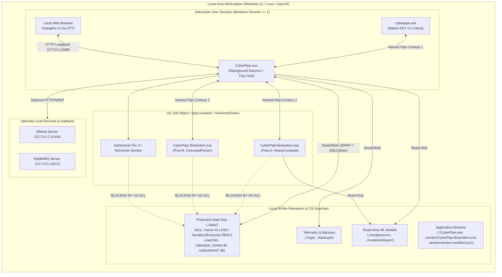

# 7. Deployment View

> **Document Role:** Describes the physical/local deployment topology, directory layout, OS session requirements, filesystem ACL boundaries, worker binary integrity verification, and atomic update mechanics of **CyberPipe**.
> **Epistemic Status:** **Proposed Deployment Architecture** derived from [`10-sandbox-telemetry-and-heuristics.md`](../../plans/10-sandbox-telemetry-and-heuristics.md), [`09-data-protection-and-state-hub.md`](../../plans/09-data-protection-and-state-hub.md), [`10-sandbox-telemetry-and-heuristics.md`](../../plans/10-sandbox-telemetry-and-heuristics.md), and [`15-cli-and-execution-modes.md`](../../plans/15-cli-and-execution-modes.md), evaluated against discovered OS security constraints (`RISK-006`, `RISK-013`).

---

## 7.1 Single-Host Deployment Topology

CyberPipe is deployed on a **single user-controlled workstation or home server** (Windows 11 primary target; Linux and macOS secondary targets) with zero required cloud infrastructure (`REQ-007`, `REQ-015`).



---

## 7.2 Mandatory Interactive User Session Constraint (Windows `Session >= 1`)

A critical operational requirement documented in [`10-sandbox-telemetry-and-heuristics.md`](../../plans/10-sandbox-telemetry-and-heuristics.md) and [`15-cli-and-execution-modes.md`](../../plans/15-cli-and-execution-modes.md) is how `CyberPipe.exe` is started at boot/login:

- **Why Windows `Session 0` Service Mode Fails Hardware/Media Features:**
  Windows Services run in isolated **Session 0**, which has no access to the interactive desktop station (`WinSta0\Default`), the user's `GlobalSystemMediaTransportControlsSessionManager` (GSMTC media keys), interactive CoreAudio endpoint volume sessions, or `GetLastInputInfo` idle detection (`REQ-012`). Furthermore, Windows Services running under `LocalSystem` or `NetworkService` have a different `DPAPI` `CurrentUser` key hive than the interactive user.
- **Canonical Deployment Mode (`Logon Task` in `Session >= 1`):**
  On Windows, `CyberPipe.exe --daemon` **must** be registered as a **Task Scheduler Logon Task** (`Run only when user is logged on`, under the interactive Owner's SID) or via the user's Startup profile. Headless Service mode (`Session 0`) is only supported for server deployments where media/audio/idle hardware hooks are explicitly disabled in configuration.

---

## 7.3 Canonical Directory Layout & Filesystem ACL Matrix

Per [`09-data-protection-and-state-hub.md`](../../plans/09-data-protection-and-state-hub.md) and [`15-cli-and-execution-modes.md`](../../plans/15-cli-and-execution-modes.md), the installation layout separates read-only binaries/models from the encrypted mutable state hub (`data/`):

```text
<CyberPipeRoot>/
├── CyberPipe.exe                      # Main Daemon & Orchestrator
├── cyberpipe.exe                      # Native AOT CLI Client
├── appsettings.json                   # Non-secret base configuration
├── worker/
│   ├── CyberPipe.Brainstem.exe        # Out-of-process worker executable
│   └── worker.manifest.json           # SHA-256 hashes of all ./worker/ files
├── models/
│   ├── onnx/all-MiniLM-L6-v2.onnx     # Tier 1 local embedding model
│   └── whisper/ggml-base.bin          # Local Whisper STT model
├── data/                              # PROTECTED STATE HUB (ASSET-01 / ASSET-02)
│   ├── vault.bin                      # AES-256-GCM + DPAPI Secrets Vault
│   ├── cyberpipe_master.db            # Core settings & subsystem registry (+ WAL/SHM)
│   └── subsystems/
│       ├── budget.db                  # TokenBudgetGovernor ledger
│       ├── crm.db                     # Personal CRM & contacts
│       ├── finance.db                 # Personal ledger & subscriptions
│       ├── hangfire.db                # Proactive scheduler persistence
│       ├── health.db                  # Habits, sleep & medication logs
│       ├── knowledge.db               # Hybrid FTS5 + Vector RAG store
│       ├── masstransit.db             # Durable outbox / message store
│       └── netrunner.db               # Netrunner DAG & HITL state
├── skills/
│   └── netrunner/                     # Installed 6-file Netrunner ETL packages
├── logs/
│   └── cyberpipe-YYYYMMDD.jsonl       # Sanitized structured logs
└── backups/
    └── cyberpipe-backup-*.cpbak       # Encrypted AES-256-GCM backup archives
```

### Filesystem Access Control Matrix (Defense-in-Depth)

| Directory / File | `CyberPipe.exe` (Owner SID) | `CyberPipe.Brainstem.exe` (Pool A: HeavyCompute) | `CyberPipe.Brainstem.exe` (Pool B: UntrustedParser) | Ephemeral Sandbox (`Tier 3` / `Netrunner`) | Other Local OS Users |
| :--- | :--- | :--- | :--- | :--- | :--- |
| **`./worker/`** | Read / Verify SHA-256 | Read & Execute (`RX`) | Read & Execute (`RX`) | Deny | Read-Only (or Deny) |
| **`./models/`** | Read / Write (Model Downloads) | Read-Only (`R`) | Deny | Deny | Read-Only (or Deny) |
| **`./data/vault.bin`** | **Full Control (`RW`)** | **Explicit OS `DENY`** | **Explicit OS `DENY`** | **Explicit OS `DENY`** | **Explicit OS `DENY`** |
| **`./data/*.db` & `subsystems/*.db`** | **Full Control (`RW`)** | **Explicit OS `DENY`** | **Explicit OS `DENY`** | **Explicit OS `DENY`** | **Explicit OS `DENY`** |
| **`./logs/` & `./backups/`** | Read / Write (`RW`) | Deny | Deny | Deny | Deny |
| **`%TEMP%\CyberPipe.Sandbox.{Guid}`** | Full Control (`RW`) | Scoped Per-Task Temp (`RW`) | Scoped Per-Task Temp (`RW`) | Scoped Per-Task Temp (`RW`) | Deny |

---

## 7.4 Discovered Deployment Risks & Required Architectural Reconciliation

### 1. Windows `AppContainer` (`S-1-15-2-1`) vs `RestrictedToken + Deny DACL` (`RISK-006`)
- **The Conflict:** [`02-architecture-diagram.md`](../../plans/02-architecture-diagram.md) and [`15-cli-and-execution-modes.md`](../../plans/15-cli-and-execution-modes.md) state that `CyberPipe.Brainstem.exe` runs inside a Windows **AppContainer** (`CreateAppContainerProfile`) *or* a **Restricted Token** (`CreateRestrictedToken` with a Restricted SID).
- **Hidden OS Constraint:** In Windows, `ALL APPLICATION PACKAGES` (`S-1-15-2-1`) has default `Read & Execute` permissions on `C:\Program Files` and `C:\Windows`, but **zero access** to `%LOCALAPPDATA%` or `%USERPROFILE%`. Furthermore, an `AppContainer` process cannot open a parent process's Named Pipe unless the pipe's `PipeSecurity` DACL explicitly grants `PipeAccessRights.ReadWrite` to the specific AppContainer SID (`DeriveAppContainerSidFromAppContainerName`).
- **Required Deployment Rule (`ADR-0004`):**
  1. At startup, `BrainstemSupervisor` must programmatically apply explicit **Allow `RX` ACLs** for the worker's AppContainer/Restricted SID onto `./worker/` and `./models/whisper/`, and add the SID to the Contour 2 Named Pipe DACL.
  2. Simultaneously, `SubsystemDatabaseManager` must apply an explicit **OS `AccessControlType.Deny` ACE** for the Restricted SID and `S-1-15-2-1` (`ALL APPLICATION PACKAGES`) on the `./data/` directory so that even if a fallback `RestrictedToken` is used instead of `AppContainer`, the worker is blocked by the NTFS kernel from opening `vault.bin` or `*.db` (`QAS-005`).

### 2. Installation Path & `Side-by-Side Atomic Update` Privilege Conflict (`RISK-013`)
- **The Conflict:** [`15-cli-and-execution-modes.md`](../../plans/15-cli-and-execution-modes.md) §1 proposes installing binaries under `C:\Program Files\CyberPipe\` while §7 specifies an automatic **Side-by-Side Update** mechanism (`./releases/v1.x/` directory swap) performed by the daemon.
- **Hidden OS Constraint:** `CyberPipe.exe` runs as a **non-elevated standard/interactive user** (principle of least privilege), which cannot write to or rename directories inside `C:\Program Files\`.
- **Required Deployment Rule:** Separate the immutable/user-writable paths using standard Windows per-user deployment (`%LOCALAPPDATA%\Programs\CyberPipe\` for binaries/releases and `%LOCALAPPDATA%\CyberPipe\data\` for the encrypted state hub), **or** require an explicit UAC elevation prompt during `cyberpipe update apply` if installed under `C:\Program Files\CyberPipe\`.

### 3. `Brainstem` Binary Integrity Verification (`worker.manifest.json`)
Before `BrainstemSupervisor` spawns `./worker/CyberPipe.Brainstem.exe`, it reads `./worker/worker.manifest.json` and computes the SHA-256 hash of `CyberPipe.Brainstem.exe` and its native dependencies (`ggml.dll`, `onnxruntime.dll`). If any hash mismatches, `BrainstemSupervisor` aborts process creation and raises a critical security alert (`THREAT-009`).

---

## Cross-References
- **Architecture Constraints:** [`02-architecture-constraints.md`](02-architecture-constraints.md)
- **Brainstem Isolation ADR (`ADR-0004`):** [`../05-adr/0004-brainstem-process-isolation-and-sandboxing.md`](../05-adr/0004-brainstem-process-isolation-and-sandboxing.md)
- **Threat Model Assets & Trust Boundaries:** [`../04-threat-model/scope-assets-and-trust-boundaries.md`](../04-threat-model/scope-assets-and-trust-boundaries.md)
