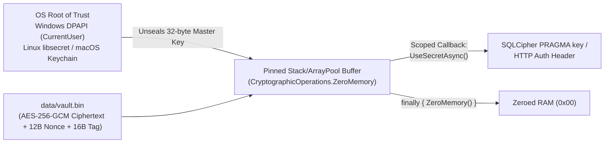

# 8. Cross-Cutting Concepts

> **Document Role:** Provides deep architectural analysis of the cross-cutting technical mechanisms that span all CyberPipe subsystems—specifically targeting **database concurrency, encryption, message bus semantics, secrets management, taint propagation, bulkheads, crash recovery, and licensing**.
> **Epistemic Status:** **Critical Technical Audit & Design Specification**. Directly addresses the hidden constraints required by Section 5.4 of the architecture review mandate.

---

## 8.1 SQLite Concurrency, WAL Mode, and SQLCipher Encryption (`RISK-002`, `RISK-008`, `ADR-0003`)

CyberPipe rejects an external DBMS in favor of a decentralized local SQLite topology: `data/cyberpipe_master.db` plus 8 subsystem databases (`data/subsystems/{hangfire,masstransit,knowledge,crm,finance,budget,health,netrunner}.db`).

### 8.1.1 Hidden Constraint 1: `SQLitePCLRaw` Native Binary Collision (`AUD-04` / `RISK-002`)
In .NET, `Microsoft.Data.Sqlite` is a thin managed wrapper around a `SQLitePCLRaw` provider.
- **The Trap:** The standard metapackage `Microsoft.Data.Sqlite` automatically brings `SQLitePCLRaw.bundle_e_sqlite3` (unencrypted standard SQLite). Meanwhile, `Hangfire.Storage.SQLite` brings `sqlite-net-pcl` + `SQLitePCLRaw.bundle_green` (also unencrypted `e_sqlite3`). If a project references `Microsoft.Data.Sqlite` alongside `SQLitePCLRaw.bundle_e_sqlcipher`, whichever calls `SQLitePCL.Batteries_V2.Init()` first wins the static native provider slot—or the native loader fails with a P/Invoke entrypoint collision. Worse, when standard `e_sqlite3` wins initialization, passing `Password=<hex>` in `SqliteConnectionStringBuilder` **does not throw an error in all configurations**—it can silently ignore the pragma and write **plaintext SQLite pages** to disk (`THREAT-006`).
- **Mandatory Architectural Fix (`ADR-0003`, `QAS-006`):**
  1. **Ban the `Microsoft.Data.Sqlite` metapackage** via `Directory.Build.props` and `ArchUnitNET`. Reference **only** `Microsoft.Data.Sqlite.Core` + `SQLitePCLRaw.bundle_e_sqlcipher`.
  2. Call `SQLitePCL.Batteries_V2.Init()` explicitly as the very first line of `Program.Main` in `CyberPipe.Host` and `CyberPipe.Cli`.
  3. Execute a **mandatory startup cryptographic self-test**: on opening each `.db` file, query `PRAGMA cipher_version;` (must return a non-null SQLCipher version string) and verify that reading the first 16 bytes of the raw `.db` file on disk **does not** equal the plaintext header `"SQLite format 3\0"` (`TEST-002`).

### 8.1.2 Hidden Constraint 2: Why `Cache=Shared` in `09-data-protection-and-state-hub.md` Must Be Replaced
Line 175 of [`09-data-protection-and-state-hub.md`](../../plans/09-data-protection-and-state-hub.md) specifies:
```csharp
Cache = SqliteCacheMode.Shared
```
- **Why `Cache=Shared` is Dangerous & Deprecated:**
  1. **Official SQLite Deprecation & Contention:** SQLite officially discourages shared-cache mode (originally designed for low-memory embedded devices in 2006). In `WAL` mode (`PRAGMA journal_mode=WAL`), `Cache=Shared` introduces table-level read/write locks across connections sharing the cache and can return `SQLITE_LOCKED` (`error code 6`), which **ignores `PRAGMA busy_timeout=5000`** (`busy_timeout` only handles `SQLITE_BUSY`, not `SQLITE_LOCKED` inside a shared cache!).
  2. **SQLCipher Authentication Bypass Risk:** In shared-cache mode, once the first connection opens the shared page cache with the valid key, subsequent connections in the same process attaching to the shared cache may bypass key verification or corrupt key state during `PRAGMA rekey`.
- **Mandatory Architectural Fix:** Use **`SqliteCacheMode.Private`** with `Pooling = true`. In `WAL` mode with `Cache=Private`, multiple readers and a single writer per `.db` file operate concurrently without `SQLITE_LOCKED`, and `PRAGMA busy_timeout = 5000` properly serializes concurrent writers.

### 8.1.3 Key Rotation (`PRAGMA rekey`) & Missing Table Ownership (`RISK-008`)
- **Atomic Key Rotation Protocol:** Rotating the database key (`PRAGMA rekey`) rewrites every page of the database. Across 9 `.db` files (`cyberpipe_master.db` + 8 subsystem DBs), `SubsystemDatabaseManager` must:
  1. Acquire a global exclusive maintenance lock (draining `InFlightOperations`).
  2. Create a pre-rotation snapshot of all `.db` files.
  3. For each `.db` file: clear its connection pool (`SqliteConnection.ClearPool`), open a single exclusive connection, run `PRAGMA wal_checkpoint(TRUNCATE);`, execute `PRAGMA rekey = 'x''<new_64_hex>''';`, verify `PRAGMA integrity_check;`, and record rotation progress in a durable rotation journal so an OS crash mid-rotation can roll back or complete deterministically.
- **Orphan Tables Resolution (`RISK-008`, `AUD-03`):** `InFlightOperations`, `SemanticIntentCache`, and `SemanticResponseCache` are defined in [`14-fault-isolation-and-resilience.md`](../../plans/14-fault-isolation-and-resilience.md) and [`10-sandbox-telemetry-and-heuristics.md`](../../plans/10-sandbox-telemetry-and-heuristics.md) without a host `.db` file in [`09-data-protection-and-state-hub.md`](../../plans/09-data-protection-and-state-hub.md).
  - *Resolution:* Assign `InFlightOperations` to `cyberpipe_master.db` (or a dedicated `runtime_state.db`) and assign `SemanticIntentCache` + `SemanticResponseCache` to `knowledge.db` (or `cache.db`), documenting that **cross-database two-phase commit (2PC) is not supported** when WAL files are active (`SQLite` cannot atomically commit across `ATTACH DATABASE` in WAL mode when crashing).

---

## 8.2 Message Bus Semantics & Transport Switching (`RISK-001`, `ADR-0002`)

| Transport Option in `docs/plans/` | Reality Check / Compatibility | Transactional & Ordering Semantics | Failure Recovery | Verdict |
| :--- | :--- | :--- | :--- | :--- |
| **`MassTransit` `InMemory`** | Supported in `MassTransit` v8 (Apache 2.0) | Volatile in-RAM channels; zero disk durability across daemon restarts. | Lost on crash unless backed by `InFlightOperations` / SQLite Outbox. | **Valid for MVP ephemeral pub/sub** |
| **`MassTransit.SqlTransport.Sqlite`** (`masstransit.db`) | **DOES NOT EXIST (`RISK-001`)**. MassTransit SQL transport only supports PostgreSQL and SQL Server. | N/A — Cannot compile or resolve from NuGet. | N/A | **Blocker — Must Replace (`ADR-0002`)** |
| **Custom SQLite Outbox + `MassTransit` `InMemory` (Recommended Replacement)** | Uses `masstransit.db` via `Microsoft.Data.Sqlite.Core` (`SQLCipher`) + `Dapper` | At-least-once delivery; FIFO ordering per `ConversationId` via `System.Threading.Channels` dispatcher. | Polls uncommitted outbox rows on startup; exponential backoff + dead-letter table. | **Recommended durable local transport** |
| **`MassTransit.RabbitMQ`** | Supported in `MassTransit` v8; requires external Erlang + RabbitMQ broker | Durable queues, exchanges, competing consumers, native DLQ. | Broker-managed redelivery and persistence. | **Optional external scale-out mode** |

---

## 8.3 Secrets Management (`SecretsVault`) & Memory Hygiene (`REQ-005`, `ADR-0006`)



- **No Plaintext `string` Persistence for Master Keys:** In .NET, `System.String` is immutable and subject to GC relocation, leaving copies of secrets in the managed heap and crash dumps. `ISecretsVault` exposes `UseSecretAsync<T>(string secretName, Func<ReadOnlyMemory<char>, ValueTask<T>> callback)` which decrypts the `AES-256-GCM` entry into a rented `char[]`/`byte[]` buffer and zeroes it inside a `finally` block using `CryptographicOperations.ZeroMemory`.
- *Limitation:* When third-party SDKs (such as `Microsoft.Data.Sqlite` connection strings or `HttpClient` headers) require a managed `System.String`, a transient managed string is unavoidable; therefore, Windows Error Reporting (WER) mini-dumps for `CyberPipe.exe` must be restricted or disabled in production (`THREAT-007`).

---

## 8.4 Zero-Trust Taint Propagation & Egress Data Sanitization (`REQ-005`, `REQ-006`)

1. **Structural Taint Wrapper (`TaintedData<T>`):**
   Every piece of data entering `CyberPipe.exe` is tagged with `OriginTrustLevel`:
   - `Owner`: Direct interactive CLI or verified Owner Telegram ID (`AllowedTelegramUserIds`).
   - `TrustedAutomation`: Verified internal scheduled trigger created by the Owner.
   - `UntrustedExternal`: Any forwarded Telegram message, email body, scraped web page, PDF/DOCX text, or Netrunner HTTP output.
2. **sticky Contagion Rule:**
   If *any* item in `AgentExecutionContext.Messages` or `ToolResults` has `OriginTrustLevel == UntrustedExternal`, the boolean property `ContextContainsUntrustedData` transitions irreversibly to `true` for the remainder of that execution pipeline.
3. **Hard Tool Stripping in C# (`QAS-007`):**
   When `ContextContainsUntrustedData == true`, `PipelineOrchestrator` **physically strips** all state-mutating, filesystem, network, and shell tools from `ChatOptions.Tools` before invoking `IChatClient.GetResponseAsync()`. Even if a prompt injection completely hijacks the LLM's generation, the runtime cannot invoke a tool that is not present in the dispatch dictionary (`THREAT-001`).
4. **One-Way Egress Sanitization (`QAS-008`):**
   Before any prompt leaves `TB-03` for a cloud LLM (`TB-01`) or is written to `logs/cyberpipe-*.jsonl`, `CentralDataSanitizer` scrubs:
   - Known secret values registered in `SecretsVault` (exact + prefix match).
   - High-entropy tokens (`sk-...`, `ghp_...`, AWS keys, JWTs, PEM blocks).
   - PII patterns (Credit cards via Luhn check, SSN/INN/Passport patterns, emails, phone numbers, local user filesystem paths).
   - **No Rehydration Rule:** Placeholders (`[REDACTED_SECRET]`, `[PII_EMAIL_1]`) are **never** rehydrated back into secrets after the LLM responds, preventing "echo-back" exfiltration attacks (`THREAT-003`).

---

## 8.5 Bulkhead Isolation, Resilience & Crash Recovery (`REQ-010`)

- **Polly v8 Subsystem Bulkheads:** Each subsystem (`Voice`, `Documents`, `CloudLlm`, `LocalLlm`, `Netrunner`, `DevTools`, `CoreDb`) is wrapped in an independent `ResiliencePipeline` with bounded concurrency (`MaxParallelization`) and queue depth (`MaxQueuedActions`). A flood of voice notes or slow PDF extractions in `Brainstem` cannot starve `Tier 0/1` fast-path commands or `/stop` preemption.
- **`InFlightOperations` Crash Recovery Table:**
  Before executing any multi-step or state-mutating operation, `PipelineOrchestrator` writes a row to `InFlightOperations` (`OperationId`, `CommandSummary`, `IdempotencyCategory`, `Status = Running`, `StartedAtUtc`).
  - On daemon startup, `StartupRecoveryService` queries all rows where `Status == Running`:
    - **`ReadOnly` / `SafeIdempotent`:** Automatically re-queued once (`RetryCount == 0`).
    - **`SideEffecting` / `Financial` / `ExternalCommunication`:** Marked `InterruptedRequiresConfirmation`; the Owner receives a Telegram/CLI notification asking whether to retry or discard (`REQ-010`).

---

## 8.6 Licensing & Supply-Chain Governance (`RISK-001`, `RISK-005`)

| Dependency | Planned Version | License | Architectural Impact & Mitigation |
| :--- | :--- | :--- | :--- |
| **`MassTransit`** | `8.x` (Pin `< 9.0.0`) | **Apache 2.0** (v8) vs **Commercial Paid** (v9) | **Must pin `MassTransit` `8.x`** in `Directory.Packages.props` (`RISK-001`). Evaluate migration to `Wolverine` (MIT) or native `System.Threading.Channels` before v8 security support ends (late 2026). |
| **`Hangfire.Core`** | `1.8.x` | **LGPL v3** | Permitted for dynamically linked NuGet libraries without modifying Hangfire source, provided LGPL v3 attribution notice is included in distribution (`RISK-005`). |
| **`QuestPDF`** | `2024.x+` | **Community MIT / Commercial** | Free under QuestPDF Community License for individuals/organizations with `< $1M USD` annual gross revenue; requires license configuration line `QuestPDF.Settings.License = LicenseType.Community;`. |
| **`Whisper.net` / `ONNX Runtime` / `SQLCipher`** | Latest stable | **MIT / BSD-3-Clause** | Permissive open-source licenses; safe for local distribution. |

---

## Cross-References
- **Technology Compatibility Matrix:** [`../06-validation/technology-compatibility-matrix.md`](../06-validation/technology-compatibility-matrix.md)
- **Decentralized SQLite & SQLCipher ADR (`ADR-0003`):** [`../05-adr/0003-decentralized-sqlite-and-sqlcipher-encryption.md`](../05-adr/0003-decentralized-sqlite-and-sqlcipher-encryption.md)
- **Message Bus Strategy ADR (`ADR-0002`):** [`../05-adr/0002-message-bus-and-transport-strategy.md`](../05-adr/0002-message-bus-and-transport-strategy.md)
