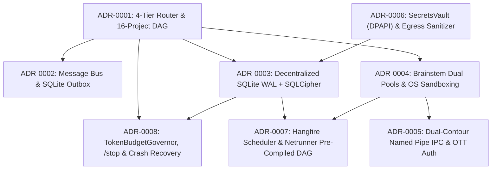

# 9. Architecture Decisions

> **Document Role:** Provides the arc42 Section 9 summary index of significant architectural decisions for **CyberPipe**, mapping each decision to its full Markdown Architectural Decision Record (MADR) in [`../05-adr/`](../05-adr/README.md), affected quality attributes, discovered risks, and current epistemic status.
> **Epistemic Status:** Per Section 4 & Section 8 of the architecture mandate, **zero ADRs are marked `Accepted`** because `CyberPipe.slnx` currently contains `0` source files (`RISK-004`) and several baseline decisions in `docs/plans/17-adr-mvp.md` require critical revisions before implementation (`RISK-001`, `RISK-002`, `RISK-003`).

---

## 9.1 Architectural Decision Log (`ADR-0001` .. `ADR-0008`)

| ADR ID | Decision Title & File Link | Reconciles Plan ADRs (`17-adr-mvp.md`) | Epistemic Status | Primary Drivers (`REQ` / `QAS`) | Key Discovered Risks & Required Revisions |
| :--- | :--- | :--- | :--- | :--- | :--- |
| **[`ADR-0001`](../05-adr/0001-example-decision.md)** | **4-Tier Intent Router, Deterministic C# Orchestrator & 16-Project Modular Monolith DAG** | `ADR-002`, `ADR-005` | **Proposed** *(Real Evidence-Backed Initial Decision)* | `REQ-001`, `REQ-003`, `QAS-001`, `QAS-002`, `QAS-013` | `RISK-010` (Cross-DB `DataVersion` cache invalidation), `RISK-011` (In-process ONNX native fault blast radius). |
| **[`ADR-0002`](../05-adr/0002-message-bus-and-transport-strategy.md)** | **Message Bus & Durable Local Transport Strategy (`MassTransit` `InMemory` + SQLite Outbox vs Non-Existent `SqlTransport.Sqlite`)** | `ADR-001` *(Supersedes/Revises)* | **Proposed (Requires Revision of `ADR-001`)** | `REQ-008`, `QAS-010` | **`RISK-001` (Critical Blocker):** `MassTransit.SqlTransport.Sqlite` does not exist; `MassTransit` v9 is commercial paid; `IBus` cannot hot-swap transports in-place without a proxy/restart. |
| **[`ADR-0003`](../05-adr/0003-decentralized-sqlite-and-sqlcipher-encryption.md)** | **Decentralized Local SQLite WAL Topology & Mandatory `SQLCipher` Page Encryption** | `ADR-004`, `ADR-010` *(Revises connection config)* | **Proposed (With Mandatory Fixes)** | `REQ-007`, `QAS-006` | **`RISK-002` (Critical):** Must ban `Microsoft.Data.Sqlite` metapackage (`e_sqlite3` clash), replace `Cache=Shared` with `Cache=Private`, and assign orphan tables (`RISK-008`). |
| **[`ADR-0004`](../05-adr/0004-brainstem-process-isolation-and-sandboxing.md)** | **Dual-Pool `Brainstem` Out-of-Process Worker Isolation & Pluggable OS Sandboxing** | `ADR-003`, `ADR-007` | **Proposed (Pending OS Validation)** | `REQ-002`, `REQ-014`, `REQ-015`, `QAS-005`, `QAS-010` | `RISK-006` (Windows `AppContainer` ACLs outside `Program Files`), `RISK-007` (`DevToolProcessRunner` arbitrary MSBuild/git hook execution). |
| **[`ADR-0005`](../05-adr/0005-ipc-security-and-hangfire-dashboard-auth.md)** | **Dual-Contour Named Pipe IPC Security & Loopback `Hangfire` Dashboard `OTT` Authentication** | `ADR-009` | **Proposed** | `REQ-011`, `REQ-016`, `QAS-004`, `QAS-005` | `RISK-009` (`FILE_FLAG_FIRST_PIPE_INSTANCE` semantics across Kestrel multi-instance pipe pools; local user SID role separation). |
| **[`ADR-0006`](../05-adr/0006-secrets-vault-and-egress-sanitization.md)** | **Hardware-Backed `SecretsVault` (`DPAPI`/`AES-256-GCM`) & Deterministic Egress `CentralDataSanitizer`** | `ADR-006` | **Proposed** | `REQ-005`, `REQ-006`, `QAS-007`, `QAS-008` | `RISK-014` (`DPAPI` master key loss on OS profile reset requires encrypted offline recovery key export). |
| **[`ADR-0007`](../05-adr/0007-proactive-scheduling-and-netrunner-dag-engine.md)** | **Proactive `Hangfire` Scheduling & `Netrunner` 6-File ETL / Mini-n8n DAG Engine** | `ADR-008` *(Revises Netrunner execution engine)* | **Proposed (Requires Revision of `main.csx` Engine)** | `REQ-011`, `REQ-013`, `QAS-011`, `QAS-012` | **`RISK-003` (High):** In-memory Roslyn (`main.csx`) OOMs under `64 MB` sandbox cap; `RISK-005` (`Hangfire.Storage.SQLite` uses `sqlite-net-pcl` & LGPL v3). |
| **[`ADR-0008`](../05-adr/0008-token-budget-governance-and-crash-recovery.md)** | **Hard-Capped `TokenBudgetGovernor`, `< 50 ms` `/stop` Preemption, Polly Bulkheads & `InFlightOperations` Recovery** | `ADR-002`, `ADR-005` *(Operational Governance)* | **Proposed** | `REQ-004`, `REQ-009`, `REQ-010`, `QAS-003`, `QAS-009` | `RISK-016` (Reconciles `MaxLlmTurnsPerTask` drift: `3` vs `5` for local models; assigns `InFlightOperations` to `cyberpipe_master.db`). |

---

## 9.2 Decision Dependency Graph

---

## 9.3 Summary of Rejected / Superseded Baseline Decisions from `docs/plans/`

1. **Rejected: `MassTransit.SqlTransport.Sqlite` (`03-tech-stack-libraries.md` / `17-adr-mvp.md` `ADR-001`):**
   - *Reason:* Package does not exist on NuGet (`RISK-001`). Replaced in [`ADR-0002`](../05-adr/0002-message-bus-and-transport-strategy.md) with `MassTransit` v8 `InMemory` + a custom Dapper/SQLCipher Transactional Outbox in `data/subsystems/masstransit.db`.
2. **Rejected: `SqliteCacheMode.Shared` (`09-data-protection-and-state-hub.md` L175):**
   - *Reason:* Causes `SQLITE_LOCKED` contention that ignores `busy_timeout=5000` and weakens SQLCipher connection authentication (`RISK-002`). Replaced in [`ADR-0003`](../05-adr/0003-decentralized-sqlite-and-sqlcipher-encryption.md) with `SqliteCacheMode.Private` + `Pooling=True`.
3. **Rejected: In-Memory `CSharpRoslyn` (`main.csx`) Inside `64 MB` Sandbox (`16-netrunner-etl-and-workflow-engine.md`):**
   - *Reason:* `Microsoft.CodeAnalysis.CSharp.Scripting` requires `150–300 MB` RAM for compilation, guaranteeing an immediate `OutOfMemoryException` (`RISK-003`). Replaced in [`ADR-0007`](../05-adr/0007-proactive-scheduling-and-netrunner-dag-engine.md) with host-side pre-compilation during `NetrunnerPackageValidator` into a restricted `.dll` or `Wasmtime` `.wasm` module before launching the `64 MB` worker.

---

## Cross-References
- **Full MADR Decision Records Directory:** [`../05-adr/README.md`](../05-adr/README.md)
- **ATAM Trade-Off Analysis:** [`../03-atam/tradeoff-analysis.md`](../03-atam/tradeoff-analysis.md)
- **Technology Compatibility Matrix:** [`../06-validation/technology-compatibility-matrix.md`](../06-validation/technology-compatibility-matrix.md)
