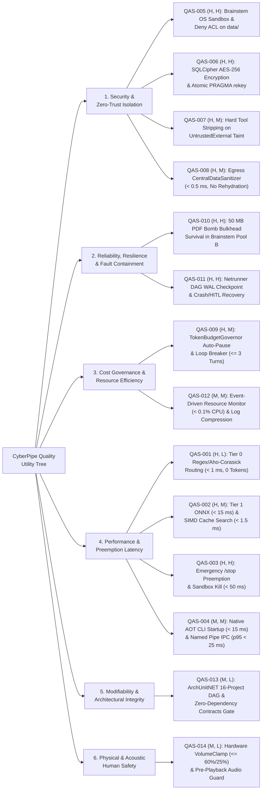

# 10. Quality Requirements

> **Document Role:** Presents the arc42 Section 10 Quality Requirements for **CyberPipe**, structured as an **ATAM Quality Attribute Utility Tree** and a summary reference table mapping every quality attribute to concrete, measurable scenarios (`QAS-001`..`QAS-014`) in [`../03-atam/quality-attribute-scenarios.md`](../03-atam/quality-attribute-scenarios.md).
> **Epistemic Status:** Target SLOs and security invariants derived from `docs/plans/`; all latency and memory numbers are currently **Unverified Target SLOs (`RISK-015`, `AUD-06`)** pending benchmark validation (`TEST-001`..`TEST-015`).

---

## 10.1 ATAM Quality Attribute Utility Tree

Prioritization notation follows ATAM convention: **`(Business Importance, Architectural Difficulty)`** rated as **H** (High), **M** (Medium), or **L** (Low).

---

## 10.2 Summary Matrix of Quality Attribute Scenarios (`QAS-001` .. `QAS-014`)

Full 6-part ATAM specifications (Source, Stimulus, Artifact, Environment, Response, Response Measure) are documented in [`../03-atam/quality-attribute-scenarios.md`](../03-atam/quality-attribute-scenarios.md).

| QAS ID | Quality Attribute | Priority `(Imp, Diff)` | Scenario Summary | Target Response Measure (SLO / Invariant) | Verification Method |
| :--- | :--- | :--- | :--- | :--- | :--- |
| **[`QAS-001`](../03-atam/quality-attribute-scenarios.md#qas-001)** | **Performance (Latency)** | `(H, L)` | Owner issues deterministic command (`Tier 0` Regex / Aho-Corasick). | Routing + dispatch latency **`p99 < 1.0 ms`**; **`0` LLM tokens** consumed. | `BenchmarkDotNet` (`TEST-007`) |
| **[`QAS-002`](../03-atam/quality-attribute-scenarios.md#qas-002)** | **Performance (Latency)** | `(H, M)` | Natural-language command routed via `Tier 1` ONNX + `SemanticResponseCache`. | ONNX embedding **`p95 < 15 ms`**; SIMD cosine scan ($10{,}000 \times 384$) **`< 1.5 ms`**; **`0` tokens**. | `BenchmarkDotNet` (`TEST-007`) |
| **[`QAS-003`](../03-atam/quality-attribute-scenarios.md#qas-003)** | **Performance / Availability (Preemption)** | `(H, H)` | Owner sends `/stop` while a `Tier 3` sandboxed agent and cloud LLM stream are active. | `CancellationTokenSource` + socket abort + OS Job Object kill complete in **`p99 < 50 ms`**. | Integration test (`TEST-008`) |
| **[`QAS-004`](../03-atam/quality-attribute-scenarios.md#qas-004)** | **Performance (IPC Throughput)** | `(M, M)` | Developer/agent runs `cyberpipe status --json` over Contour 1 Named Pipe. | Native AOT startup **`< 15 ms`**; end-to-end IPC round-trip **`p95 < 25 ms`** (`8` concurrent clients). | CLI latency benchmark (`TEST-006`) |
| **[`QAS-005`](../03-atam/quality-attribute-scenarios.md#qas-005)** | **Security (Isolation)** | `(H, H)` | Compromised `CyberPipe.Brainstem.exe` attempts to read `data/vault.bin` or open an outbound TCP socket. | OS kernel returns **`ACCESS_DENIED` (`0` bytes read)** and blocks socket creation (**`100%` containment**). | Security integration test (`TEST-004`) |
| **[`QAS-006`](../03-atam/quality-attribute-scenarios.md#qas-006)** | **Security (Confidentiality)** | `(H, H)` | Unprivileged process inspects `.db`/`.db-wal` files on disk, or Owner triggers `PRAGMA rekey`. | Raw disk headers contain **zero plaintext SQLite signatures**; key rotation succeeds atomically across all DBs. | Crypto & hex header test (`TEST-002`) |
| **[`QAS-007`](../03-atam/quality-attribute-scenarios.md#qas-007)** | **Security (Integrity)** | `(H, M)` | Untrusted external document/message contains indirect prompt injection requesting tool execution. | `ContextContainsUntrustedData == true` forces **`ChatOptions.Tools = Empty`** in C# (**`0` destructive tool calls possible**). | Red-team prompt suite (`TEST-005`) |
| **[`QAS-008`](../03-atam/quality-attribute-scenarios.md#qas-008)** | **Security (Confidentiality)** | `(H, M)` | Prompt containing API keys, Luhn credit cards, or PII is prepared for cloud LLM egress. | `CentralDataSanitizer` scrubs **`100%` of registered secrets & patterns in `< 0.5 ms`** with **zero rehydration**. | Corpus & fuzz test (`TEST-005`) |
| **[`QAS-009`](../03-atam/quality-attribute-scenarios.md#qas-009)** | **Cost Governance** | `(H, M)` | Cumulative daily cloud LLM spend reaches 100% of `DailyLimitUsd` or agent loops. | Paid cloud calls **auto-pause at `100.0%` cap** (`0` unapproved overage); loop halts at **`<= 3` cloud turns**. | Concurrency budget test (`TEST-010`) |
| **[`QAS-010`](../03-atam/quality-attribute-scenarios.md#qas-010)** | **Reliability (Fault Containment)** | `(H, H)` | `50 MB` malformed PDF bomb triggers `AccessViolationException` or `> 256 MB` OOM in `Brainstem` Pool B. | OS kills `Brainstem` worker within **`<= 15 s`**; `CyberPipe.exe` experiences **`0` crashes** and **`< 5 MB` heap delta**. | Fault-injection test (`TEST-004`) |
| **[`QAS-011`](../03-atam/quality-attribute-scenarios.md#qas-011)** | **Reliability (Recoverability)** | `(H, H)` | `CyberPipe.exe` crashes or pauses at a `HitlApprovalNode` inside a 4-node `Netrunner` DAG. | On restart/approval, workflow resumes at exact checkpointed node with **`0` duplicate executions** of prior nodes. | Crash-recovery test (`TEST-009`) |
| **[`QAS-012`](../03-atam/quality-attribute-scenarios.md#qas-012)** | **Resource Efficiency** | `(M, M)` | Daemon runs idle on battery power; diagnostic log analyzer compresses a `1 GB` `.jsonl` log file. | Idle CPU overhead **`< 0.1%`**, idle RAM **`< 150 MB`**; `1 GB` log compressed to **`<= 35 KB`** digest. | Soak & telemetry test (`TEST-012`) |
| **[`QAS-013`](../03-atam/quality-attribute-scenarios.md#qas-013)** | **Modifiability (Architecture Governance)** | `(M, L)` | Developer adds an illegal upward project reference or leaks `CyberPipe.Host.dll` into `./worker/`. | `ArchUnitNET` and publish-layout verification tests **fail the build immediately (`100%` detection)**. | Architecture test suite (`TEST-013`) |
| **[`QAS-014`](../03-atam/quality-attribute-scenarios.md#qas-014)** | **Safety (Physical / Acoustic)** | `(M, L)` | Skill or user command requests `100%` volume at `03:00 AM` or TTS playback while microphone is active. | Volume clamped to **`<= 25%` (night) / `<= 60%` (day)**; TTS suppressed during active mic recording. | Hardware safety test (`TEST-014`) |

---

## Cross-References
- **Full 6-Part ATAM Scenarios:** [`../03-atam/quality-attribute-scenarios.md`](../03-atam/quality-attribute-scenarios.md)
- **ATAM Trade-Off & Sensitivity Point Analysis:** [`../03-atam/tradeoff-analysis.md`](../03-atam/tradeoff-analysis.md)
- **ATAM Risk Register:** [`../03-atam/risk-register.md`](../03-atam/risk-register.md)
