# 11. Risks and Technical Debt

> **Document Role:** Summarizes the 16 architectural risks (`RISK-001`..`RISK-016`), hidden specification defects, and pre-implementation technical debt uncovered during the analysis of `docs/plans/`.
> **Epistemic Status:** All risks are traced to concrete source lines in `docs/plans/` and fully analyzed with severity/likelihood scoring, mitigations, and validation experiments in [`../03-atam/risk-register.md`](../03-atam/risk-register.md).

---

## 11.1 Risk Distribution Matrix (Severity vs. Likelihood)

```mermaid
flowchart LR
    subgraph P0["P0: Critical Blockers (Severity: Critical/High | Likelihood: Certain/High)"]
        R1["RISK-001: Non-Existent MassTransit.SqlTransport.Sqlite & v9 License"]
        R2["RISK-002: SQLitePCLRaw Native Binary Clash & Cache=Shared"]
        R3["RISK-003: Netrunner 64 MB Roslyn OOM & Missing Task Contract"]
        R4["RISK-004: Zero Source Code (CyberPipe.slnx Empty) vs 16-Proj Scope"]
    end

    subgraph P1["P1: High-Priority Security & Concurrency Risks"]
        R5["RISK-005: Hangfire.Storage.SQLite (sqlite-net-pcl) & LGPL v3"]
        R6["RISK-006: Windows AppContainer ACLs Outside Program Files"]
        R7["RISK-007: DevToolProcessRunner MSBuild & Git Hook Code Exec"]
        R8["RISK-008: Orphan SQLite Tables & Lack of Cross-DB 2PC"]
        R9["RISK-009: Named Pipe FirstPipeInstance Pool & Local Role Auth"]
    end

    subgraph P2["P2: Operational, Consistency & Specification Debt Risks"]
        R10["RISK-010..016: Cross-DB Cache Epoch, In-Proc ONNX, 1.1.1.3 DNS,\nProgram Files Update ACL, DPAPI Recovery Kit, Unverified SLOs, Doc Drift"]
    end

    P0 --> P1 --> P2
```

---

## 11.2 Summary of Architectural Risks (`RISK-001` .. `RISK-016`)

For full scoring rubrics, affected components, sensitivity points, and validation tests, see [`../03-atam/risk-register.md`](../03-atam/risk-register.md).

| Risk ID | Title | Severity | Likelihood | Priority | Summary of Root Cause & Required Action |
| :--- | :--- | :--- | :--- | :--- | :--- |
| **[`RISK-001`](../03-atam/risk-register.md#risk-001)** | **Non-Existent `MassTransit.SqlTransport.Sqlite`, v9 Commercial License & Hot-Swap Trap** | **Critical** | **Certain** | **P0 (Blocker)** | `MassTransit.SqlTransport.Sqlite` does not exist; v9 is paid commercial; `IBus` singletons cannot hot-swap transports in-place. Replace with `MassTransit` v8 `InMemory` + custom SQLite Outbox (`ADR-0002`). |
| **[`RISK-002`](../03-atam/risk-register.md#risk-002)** | **`SQLitePCLRaw` Native Binary Clash (`e_sqlite3` vs `e_sqlcipher`) & `Cache=Shared` Hazard** | **Critical** | **High** | **P0 (Blocker)** | Standard `Microsoft.Data.Sqlite` and `Hangfire.Storage.SQLite` load unencrypted `e_sqlite3`, silently ignoring `Password=...` (`AUD-04`). `Cache=Shared` causes `SQLITE_LOCKED` and weakens key checks. Use `Microsoft.Data.Sqlite.Core` + `bundle_e_sqlcipher` + `Cache=Private` (`ADR-0003`). |
| **[`RISK-003`](../03-atam/risk-register.md#risk-003)** | **Netrunner `64 MB` Roslyn (`main.csx`) OOM & Missing `BrainstemTaskKind` Contract** | **High** | **Certain** | **P0 (Blocker)** | In-memory Roslyn scripting needs `150–300 MB` RAM and will immediately OOM inside a `64 MB` Job Object (`16-netrunner-etl-and-workflow-engine.md`). Pre-compile scripts on the host during validation (`ADR-0007`). |
| **[`RISK-004`](../03-atam/risk-register.md#risk-004)** | **Zero Implementation Code (`CyberPipe.slnx` Empty) vs Massive 16-Project MVP Scope (`AUD-01`)** | **Critical** | **Certain** | **P0 (Blocker)** | `0` `.cs` files exist while 16 projects, 8 DBs, custom OS sandboxes, and 16+ skills are planned. Enforce strict phased vertical-slice delivery (`Phase 0` Walking Skeleton first). |
| **[`RISK-005`](../03-atam/risk-register.md#risk-005)** | **`Hangfire.Storage.SQLite` Driver Incompatibility (`sqlite-net-pcl`), `SQLITE_BUSY` & LGPL v3** | **High** | **High** | **P1** | `Hangfire.Storage.SQLite` bypasses `Microsoft.Data.Sqlite` (`ISubsystemDatabaseManager`) and suffers from write lock contention. Use a custom Dapper/SQLCipher `JobStorage` or lightweight `Cronos` scheduler (`ADR-0007`). |
| **[`RISK-006`](../03-atam/risk-register.md#risk-006)** | **Windows `AppContainer` (`S-1-15-2-1`) Access Denied Outside `Program Files` & OS Parity (`AUD-13`)** | **High** | **High** | **P1** | `AppContainer` blocks access to user directories and Named Pipes unless explicit ACLs are granted on `./worker/`, `./models/`, and Contour 2 pipes, paired with an explicit `Deny` ACL on `./data/` (`ADR-0004`). |
| **[`RISK-007`](../03-atam/risk-register.md#risk-007)** | **`DevToolProcessRunner` Arbitrary Code Execution via MSBuild Targets & Git Hooks (`AUD-08`)** | **High** | **High** | **P1** | `dotnet build/test` and `git` execute arbitrary user code in `.csproj` targets, source generators, and `.git/hooks`. Require HITL approval and `-c core.hooksPath=/dev/null` (`ADR-0004`). |
| **[`RISK-008`](../03-atam/risk-register.md#risk-008)** | **Orphan SQLite Tables (`InFlightOperations`, Caches) & Lack of Cross-DB 2PC (`AUD-03`)** | **High** | **Certain** | **P1** | 3 core tables have no assigned `.db` file in `09-data-protection-and-state-hub.md`, and WAL mode does not support atomic cross-DB commits on crash. Assign explicit DB owners (`ADR-0003`). |
| **[`RISK-009`](../03-atam/risk-register.md#risk-009)** | **Named Pipe `FirstPipeInstance` Pool Conflict & Local User Role Spoofing (`AUD-09`)** | **High** | **Medium** | **P1** | Verify Kestrel `ListenNamedPipe` applies `FILE_FLAG_FIRST_PIPE_INSTANCE` only to the first handle in the 8-instance pool, and clarify that `Member`/`Guest` RBAC applies to Telegram/remote actors, not processes running as the Owner's Windows SID (`ADR-0005`). |
| **[`RISK-010`](../03-atam/risk-register.md#risk-010)** | **Stale `SemanticResponseCache` Across Decentralized Subsystem Databases (`AUD-05`)** | **Medium** | **High** | **P2** | `PRAGMA data_version` is per-DB file; checking only `cyberpipe_master.db` serves stale cached responses after writes to `crm.db` or `finance.db`. Track composite mutation epochs (`ADR-0001`). |
| **[`RISK-011`](../03-atam/risk-register.md#risk-011)** | **In-Process `ONNX Runtime` Native Crash Blast Radius in `CyberPipe.exe`** | **High** | **Low** | **P2** | Native C++ fault in `Microsoft.ML.OnnxRuntime` inside `CyberPipe.exe` kills the entire daemon. Add SHA-256 model check and fallback to `Brainstem` Pool A (`ADR-0001`). |
| **[`RISK-012`](../03-atam/risk-register.md#risk-012)** | **False Technical Guarantee on External Media Player Content Filtering (`1.1.1.3`)** | **Medium** | **High** | **P2** | Checking UDP `1.1.1.3:53` in `CyberPipe.exe` does not filter encrypted HTTPS/DoH streams inside external Spotify/Yandex.Music desktop apps. Reframe as advisory + GSMTC metadata filter. |
| **[`RISK-013`](../03-atam/risk-register.md#risk-013)** | **`C:\Program Files\CyberPipe\` Admin ACL vs Non-Elevated Side-by-Side Update** | **Medium** | **High** | **P2** | Standard user daemon cannot swap `./releases/v1.x/` inside `C:\Program Files\`. Deploy binaries to `%LOCALAPPDATA%\Programs\CyberPipe\` or require UAC elevation on update. |
| **[`RISK-014`](../03-atam/risk-register.md#risk-014)** | **Single Point of Catastrophic Data Loss on `DPAPI` Master Key Loss (`AUD-14`)** | **High** | **Low** | **P2** | OS profile wipe destroys `DPAPI` key, bricking `vault.bin` and all 9 SQLCipher DBs. Implement mandatory offline recovery passphrase export (`ADR-0006`). |
| **[`RISK-015`](../03-atam/risk-register.md#risk-015)** | **Unverified Sub-Millisecond & Millisecond Latency SLOs (`AUD-06`)** | **Medium** | **Medium** | **P2** | `< 1 ms`, `< 15 ms`, `< 50 ms` targets are unbenchmarked estimates. Validate via `BenchmarkDotNet` in Phase 0 (`TEST-007`, `TEST-008`). |
| **[`RISK-016`](../03-atam/risk-register.md#risk-016)** | **Cross-Document Specification Drift (`MaxLlmTurnsPerTask`, CLI Verbs, Trust Enums, Models)** | **Medium** | **Certain** | **P2** | Reconcile `MaxLlmTurnsPerTask` (`3` vs `5` for local), CLI verb (`cyberpipe schedule` vs `cron`), enum names (`Owner` vs `OwnerExplicit`/`TrustedOwner`), and unverified `Meta Muse` cloud model IDs. |

---

## 11.3 Pre-Implementation Specification Debt (Reconciled in `docs/arch-argon/`)

Because `docs/plans/` may not be modified during this architectural analysis, the following specification debt items in `docs/plans/` are formally superseded by the contracts in [`12-glossary.md`](12-glossary.md) and [`../05-adr/`](../05-adr/README.md):

1. **Local Model Loop Limit Drift:** [`02-architecture-diagram.md`](../../plans/02-architecture-diagram.md) and [`10-sandbox-telemetry-and-heuristics.md`](../../plans/10-sandbox-telemetry-and-heuristics.md) specify `MaxLlmTurnsPerTask = 3` globally, whereas [`13-model-advisor-and-tier-configuration.md`](../../plans/13-model-advisor-and-tier-configuration.md) specifies `3` for Cloud and `5` for Local (`Ollama`/`LlamaSharp`). **Canonical Rule (`ADR-0008`):** `MaxCloudLlmTurnsPerTask = 3`, `MaxLocalLlmTurnsPerTask = 5` (configurable down to `3`).
2. **CLI Scheduling Subcommand Drift:** [`12-assistant-capabilities-and-skills.md`](../../plans/12-assistant-capabilities-and-skills.md) uses `cyberpipe schedule ...`, whereas [`15-cli-and-execution-modes.md`](../../plans/15-cli-and-execution-modes.md) uses `CyberPipe cron ...`. **Canonical Rule:** Primary noun is `cyberpipe schedule` with `cron` registered as a CLI alias in `Spectre.Console.Cli`.
3. **`OriginTrustLevel` Enum Drift:** Across `docs/plans/`, trust levels are variously written as `Owner` / `OwnerExplicit` / `TrustedOwner` and `Untrusted` / `UntrustedExternal`. **Canonical Enum (`CyberPipe.Contracts`):** `Owner = 0`, `TrustedAutomation = 1`, `UntrustedExternal = 2`.

---

## Cross-References
- **Full ATAM Risk Register (`RISK-001`..`RISK-016`):** [`../03-atam/risk-register.md`](../03-atam/risk-register.md)
- **Threat Register (`THREAT-001`..`THREAT-016`):** [`../04-threat-model/threat-register.md`](../04-threat-model/threat-register.md)
- **Assumptions & Open Questions:** [`../06-validation/assumptions-and-open-questions.md`](../06-validation/assumptions-and-open-questions.md)
