# ATAM Trade-Off Analysis (Sensitivity Points, Trade-Offs, and Non-Risks)

> **Document Role:** Evaluates how CyberPipe's key architectural approaches influence competing quality attributes, explicitly cataloging **Sensitivity Points (`SP-01`..`SP-08`)**, **Trade-Off Points (`TP-01`..`TP-07`)**, and **Non-Risks (`NR-01`..`NR-06`)** per the SEI ATAM methodology.

---

## 1. Architectural Approaches vs. Competing Quality Attributes

```mermaid
flowchart TB
    subgraph Approaches["Core Architectural Approaches"]
        A1["1. Dual-Pool Out-of-Process\nBrainstem Workers (ADR-0004)"]
        A2["2. Decentralized 9-File SQLite WAL\n+ SQLCipher Encryption (ADR-0003)"]
        A3["3. 4-Tier Intent Router +\nL1/L2 Vector Cache (ADR-0001)"]
        A4["4. Hard Tool Stripping +\nOne-Way Egress Scrubbing (ADR-0006)"]
        A5["5. Pre-Compiled Netrunner 6-File\nDAG + WAL Checkpoints (ADR-0007)"]
    end

    subgraph Gains["Positive Quality Impacts (+)"]
        G1["(+) Fault Containment & Zero-Trust\nIsolation (QAS-005, QAS-010)"]
        G2["(+) Per-Subsystem Write Isolation &\nEncrypted Privacy (QAS-006)"]
        G3["(+) Sub-15ms Latency & Zero Token\nCost on 80%+ Queries (QAS-001/002)"]
        G4["(+) 100% Prompt-Injection Tool\nImmunity & Zero Secret Leaks (QAS-007/008)"]
        G5["(+) Crash-Resilient ETL under\nStrict 64 MB Memory Cap (QAS-011)"]
    end

    subgraph Costs["Degraded / Competing Attributes (-)"]
        C1["(-) Protobuf IPC Serialization Overhead\n& OS ACL Setup Complexity (RISK-006)"]
        C2["(-) No Cross-DB 2PC Transactions &\n9-File Key Rotation Complexity (RISK-008)"]
        C3["(-) Stale Cache Invalidation Risk Across\nDecentralized DBs (RISK-010)"]
        C4["(-) Reduced Autonomous Agent Utility on\nUntrusted Documents & False-Positive Redactions"]
        C5["(-) Host-Side Build Latency During\nPackage Installation (RISK-003)"]
    end

    A1 --> G1
    A1 --> C1
    A2 --> G2
    A2 --> C2
    A3 --> G3
    A3 --> C3
    A4 --> G4
    A4 --> C4
    A5 --> G5
    A5 --> C5
```

---

## 2. Sensitivity Points (`SP-01` .. `SP-08`)

A **Sensitivity Point** is a property of one or more components where a small configuration or implementation change dramatically alters a quality attribute response.

| ID | Sensitivity Point | Affected Quality Attribute | Governing Parameter / Mechanism | Failure Impact if Misconfigured | Related QAS / Risk |
| :--- | :--- | :--- | :--- | :--- | :--- |
| **`SP-01`** | **`SQLitePCLRaw` Provider Initialization Order** | **Security (Confidentiality)** | Static call order of `SQLitePCL.Batteries_V2.Init()` and NuGet graph exclusions (`bundle_e_sqlcipher` vs `bundle_e_sqlite3`). | If `e_sqlite3` initializes first, `Password=...` is silently ignored and all 9 databases are written in **plaintext** (`THREAT-006`). | `QAS-006`, `RISK-002` |
| **`SP-02`** | **SQLite `Cache=Private` vs `Cache=Shared` Mode** | **Reliability & Performance (Concurrency)** | `SqliteConnectionStringBuilder.Cache` setting on `WAL` connections. | Using `Cache=Shared` (as written in `09-data-protection-and-state-hub.md` L175) causes `SQLITE_LOCKED` errors that bypass `busy_timeout=5000`. | `QAS-006`, `RISK-002` |
| **`SP-03`** | **Cosine Similarity Thresholds in `Tier 1` Router** | **Accuracy (Correctness) vs Cost Governance** | `L1 Intent Threshold = 0.82` and `L2 Response Threshold = 0.92` on `all-MiniLM-L6-v2` embeddings. | Lowering `0.92` to `0.85` increases false-positive cache hits (wrong answers returned for distinct queries); raising to `0.98` forces expensive `Tier 2` LLM calls. | `QAS-002`, `RISK-010` |
| **`SP-04`** | **Netrunner Script Execution Engine (`Pre-Compiled` vs `Roslyn Scripting`)** | **Reliability (Availability) & Memory Efficiency** | Executing pre-compiled `.dll`/`.wasm` vs in-memory `Microsoft.CodeAnalysis.CSharp.Scripting` (`main.csx`) under a `64 MB` Job Object limit. | In-memory Roslyn requires `150–300 MB` RAM and fails `100%` of the time with `OutOfMemoryException` under a `64 MB` cap. | `QAS-011`, `RISK-003` |
| **`SP-05`** | **Windows `AppContainer` vs `RestrictedToken` Filesystem ACLs** | **Security (Isolation) vs Operability** | Explicit `Allow RX` ACLs on `./worker/` and `./models/` paired with explicit `Deny` ACL on `./data/`. | Missing `Allow RX` causes `Brainstem` startup `ACCESS_DENIED` outside `Program Files`; missing `Deny` on `./data/` allows `RestrictedToken` workers to read `vault.bin`. | `QAS-005`, `RISK-006` |
| **`SP-06`** | **`CancellationToken` Propagation & Job Object Handle Binding** | **Performance (Preemption Latency)** | Linking every async I/O call and child OS process handle to `CancellationRegistry`. | Any unlinked blocking synchronous call or detached child process causes `/stop` latency to spike from `< 50 ms` to `15–120 s`. | `QAS-003`, `ADR-0008` |
| **`SP-07`** | **Contour 2 Named Pipe Frame Size Limit (`8 MB`)** | **Reliability (Memory Safety) vs Throughput** | 4-byte length prefix validation (`<= 8,388,608 bytes`) in `BrainstemSupervisor`. | Omitting the pre-allocation length check allows a compromised worker to send `0x7FFFFFFF` and trigger a `2 GB` `OutOfMemoryException` in `CyberPipe.exe`. | `QAS-010`, `THREAT-008` |
| **`SP-08`** | **Windows Session Assignment (`Session >= 1` vs `Session 0`)** | **Operability (Hardware & Audio Control)** | Launching `CyberPipe.exe` via Interactive Logon Task vs Windows Service (`Session 0`). | Running in `Session 0` breaks CoreAudio volume clamping, GSMTC media control, user idle detection, and `CurrentUser` `DPAPI` key access. | `QAS-014`, `ADR-0004` |

---

## 3. Architectural Trade-Off Points (`TP-01` .. `TP-07`)

A **Trade-Off Point** is a decision affecting two or more quality attributes in opposing directions (improving Attribute A at the expense of Attribute B).

### `TP-01` — Out-of-Process `Brainstem` Workers vs. In-Process Native Library Execution
- **Decision (`ADR-0004`):** Execute `Whisper.net` (`ggml.dll`), `PdfPig`, and `HtmlAgilityPack` in child `CyberPipe.Brainstem.exe` processes (`Pool A` and `Pool B`) rather than inside `CyberPipe.exe`.
- **Improved Attributes (+):**
  - **Fault Containment (`QAS-010`):** Native C++ segfaults, stack overflows, and `256 MB` PDF bombs in `Brainstem` never crash `CyberPipe.exe`.
  - **Security Isolation (`QAS-005`):** OS kernel ACLs physically prevent the parser/STT process from reading `data/vault.bin` or `data/*.db`.
- **Degraded Attributes (-):**
  - **IPC Latency & Memory Overhead:** Adds `~1–3 ms` of Named Pipe Protobuf serialization overhead per call and `~25–40 MB` baseline working set per active worker pool.
  - **Deployment Complexity (`RISK-006`):** Requires `worker.manifest.json` SHA-256 verification and cross-platform OS sandbox ACL provisioning.
- **Verdict:** **Strongly Justified.** For a 24/7 personal daemon holding financial/CRM vaults, surviving native C++ crashes and untrusted document exploits far outweighs a `2 ms` IPC overhead on slow operations (`100 ms – 10 s`).

---

### `TP-02` — Decentralized 9-Database SQLite Topology vs. Single Monolithic SQLite Database
- **Decision (`ADR-0003`):** Split persistence across `cyberpipe_master.db` and 8 independent `data/subsystems/*.db` files (`budget`, `crm`, `finance`, `hangfire`, `health`, `knowledge`, `masstransit`, `netrunner`).
- **Improved Attributes (+):**
  - **Write Concurrency & Bulkhead Isolation:** Because SQLite `WAL` mode supports only a **single writer at a time per `.db` file**, separating high-frequency infrastructure writes (`hangfire.db`, `masstransit.db`, `budget.db`) from domain databases (`crm.db`, `finance.db`, `knowledge.db`) eliminates cross-domain `SQLITE_BUSY` contention.
  - **Blast-Radius Containment:** Corruption or heavy `FTS5` indexing in `knowledge.db` cannot block `TokenBudgetGovernor` (`budget.db`).
- **Degraded Attributes (-):**
  - **No Atomic Cross-Database Transactions (`RISK-008`):** SQLite `WAL` mode does not guarantee atomic two-phase commit (2PC) across `ATTACH DATABASE` boundaries during an OS crash.
  - **Key Rotation & Cache Invalidation Complexity (`RISK-002`, `RISK-010`):** `PRAGMA rekey` must coordinate across 9 files, and `SemanticResponseCache` cannot rely on a single `PRAGMA data_version` counter.
- **Verdict:** **Justified with Mitigations.** Cross-subsystem writes must use eventual consistency via the `masstransit.db` Outbox (`ADR-0002`), and `SubsystemDatabaseManager` must maintain composite mutation epochs (`RISK-010`).

---

### `TP-03` — C# Hard Tool Stripping on `UntrustedExternal` Data vs. Autonomous Agent Flexibility
- **Decision (`ADR-0006`):** Whenever `ContextContainsUntrustedData == true`, C# physically strips all state-mutating, filesystem, and shell tools from `ChatOptions.Tools` (`QAS-007`).
- **Improved Attributes (+):**
  - **Deterministic Security Integrity:** Provides `100%` structural immunity against indirect prompt injection invoking destructive tools—unlike system-prompt instructions, which LLMs routinely violate under adversarial attack (`THREAT-001`).
- **Degraded Attributes (-):**
  - **Task Automation Ergonomics:** An agent reading an untrusted email or web page cannot automatically write to `crm.db` or send a reply in the same LLM turn; it must instead emit a structured JSON proposal into a `HitlApprovalNode` or a separate untainted step.
- **Verdict:** **Mandatory Security Trade-Off.** The `HitlApprovalNode` pattern in `Netrunner` (`REQ-013`) cleanly restores multi-step workflows without ever giving an untrusted LLM context direct access to destructive tools.

---

### `TP-04` — One-Way Egress Sanitization (No Rehydration) vs. Cloud LLM Reasoning over Exact Identifiers
- **Decision (`ADR-0006`):** `CentralDataSanitizer` replaces PII and secrets with `[REDACTED_SECRET]` / `[PII_EMAIL_1]` before cloud LLM calls and **never rehydrates** them on return (`QAS-008`).
- **Improved Attributes (+):**
  - **Confidentiality & Anti-Exfiltration:** Prevents cloud LLM providers from logging raw PII/secrets and prevents prompt-injected responses from tricking a post-processor into rehydrating secrets into an attacker-controlled channel (`THREAT-003`).
- **Degraded Attributes (-):**
  - **Cloud LLM Output Completeness:** Cloud LLMs cannot format an exact email address or file path in their final text output; exact PII manipulation must either run in deterministic C# skills (`Tier 0/1`) or via the local `Ollama`/`LlamaSharp` model (`TB-03`).
- **Verdict:** **Sound Trade-Off.** Routing PII-sensitive formatting to local `Ollama` or C# skills preserves both privacy and functionality.

---

### `TP-05` — Host-Side Pre-Compilation of `Netrunner` Scripts vs. Instant `.csx` Interpretation
- **Decision (`ADR-0007`):** Pre-compile `Netrunner` scripts into restricted `.dll` assemblies (or `.wasm` modules) on the host during `NetrunnerPackageValidator` rather than running `Microsoft.CodeAnalysis.CSharp.Scripting` (`main.csx`) inside the `64 MB` sandbox (`RISK-003`).
- **Improved Attributes (+):**
  - **Memory Efficiency & Reliability (`QAS-011`):** Pre-compiled worker execution consumes `< 25 MB` RAM (easily fitting inside the `64 MB` Job Object limit) and starts in `< 30 ms`.
  - **Static Security Verification:** Enables IL/AST inspection against forbidden namespaces (`System.Reflection`, `System.Runtime.InteropServices`) before the package is ever registered.
- **Degraded Attributes (-):**
  - **Package Registration Latency:** Adds a one-time `~1–2 s` compilation and test-fixture verification step when a Netrunner skill package is installed or updated.
- **Verdict:** **Essential Architectural Correction (`RISK-003`).** One-time install compilation is negligible compared to guaranteed `OutOfMemoryException` on every runtime execution.

---

### `TP-06` — `MassTransit` v8 `InMemory` + Custom SQLite Outbox vs. Full External Message Broker (`RabbitMQ`)
- **Decision (`ADR-0002`):** Default to in-process `MassTransit` v8 `InMemory` paired with a lightweight Dapper/SQLCipher Transactional Outbox in `masstransit.db`, keeping `RabbitMQ` strictly optional.
- **Improved Attributes (+):**
  - **Zero External Infrastructure & Low Footprint (`QAS-012`):** Avoids mandatory Erlang/RabbitMQ installation (`~150–300 MB` extra RAM) while preserving crash-durable at-least-once delivery via `masstransit.db`.
  - **Resolves Non-Existent Package Blocker (`RISK-001`):** Replaces the non-existent `MassTransit.SqlTransport.Sqlite` package specified in `03-tech-stack-libraries.md`.
- **Degraded Attributes (-):**
  - **Custom Outbox Maintenance:** Requires maintaining ~200 lines of Dapper SQLite outbox polling/cleanup code in `CyberPipe.State` / `CyberPipe.Core`.
- **Verdict:** **Strongly Preferred.** Solves `RISK-001` cleanly with zero external dependencies and full SQLCipher encryption.

---

### `TP-07` — In-Process `Tier 1` ONNX Inference vs. Out-of-Process `Brainstem` Routing
- **Decision (`ADR-0001`):** Keep `Tier 1` `all-MiniLM-L6-v2` ONNX inference in-process inside `CyberPipe.Cognition` (with a fallback switch to `Brainstem` Pool A).
- **Improved Attributes (+):**
  - **Sub-15ms Routing Latency (`QAS-002`):** Eliminates Contour 2 Named Pipe round-trip overhead on every natural-language query.
- **Degraded Attributes (-):**
  - **Native Fault Exposure (`RISK-011`):** Exposes `CyberPipe.exe` to `onnxruntime.dll` native C++ memory space.
- **Verdict:** **Acceptable with Guardrails.** Because `Tier 1` only processes short sanitized text strings (`<= 512` tokens) against a static, SHA-256-verified `all-MiniLM-L6-v2.onnx` model on CPU, the crash probability is low (`RISK-011`), and a configuration flag (`Cognition:RunOnnxInBrainstem = true`) provides an instant safety fallback.

---

## 4. Documented Non-Risks (`NR-01` .. `NR-06`)

Per ATAM, **Non-Risks** are architectural decisions that were scrutinized during evaluation and confirmed to be technically sound, well-supported by the .NET 10 ecosystem, and aligned with quality goals:

1. **`NR-01` — `System.Numerics.Tensors.TensorPrimitives.CosineSimilarity` for `L1/L2` Vector Search:**
   Hardware-accelerated SIMD (`AVX2`/`AVX-512`/`NEON`) in .NET 10 computes `10,000` 384-d `float32` cosine similarities in `< 1.0 ms` without requiring an external vector database (`Qdrant`/`Milvus`).
2. **`NR-02` — `Microsoft.Extensions.AI` (`IChatClient` / `IEmbeddingGenerator`) Abstraction:**
   Provides an official, vendor-neutral Microsoft abstraction across Anthropic, OpenAI, Gemini, and local `Ollama`/`LlamaSharp` with composable middleware pipelines for logging, caching, tool stripping, and budget reservation.
3. **`NR-03` — `Spectre.Console.Cli` + .NET 10 Native AOT for `CyberPipe.Cli`:**
   Well-established pattern for sub-15ms CLI startup (`QAS-004`), provided `CyberPipe.Cli` only references `CyberPipe.Contracts` and uses source-generated `System.Text.Json` contexts (`JsonSerializerContext`).
4. **`NR-04` — `Polly` v8 Resilience Pipelines (`Bulkhead` + `CircuitBreaker`):**
   Zero-allocation modern resilience API built into the .NET ecosystem, ideal for isolating `Voice`, `Documents`, `CloudLlm`, and `Netrunner` compartments (`REQ-010`).
5. **`NR-05` — One-Time Token (`OTT`) Exchange for Loopback `Hangfire` Dashboard (`127.0.0.1:5080`):**
   Eliminates static passwords while neutralizing browser-based localhost CSRF/SSRF attacks when paired with `HttpOnly; SameSite=Strict` cookies (`ADR-0005`).
6. **`NR-06` — `ArchUnitNET` Automated Dependency DAG Gate (`QAS-013`):**
   Deterministic compile/test-time enforcement of the 16-project layered architecture with zero runtime cost.

---

## Cross-References
- **ATAM Quality Attribute Scenarios (`QAS-001`..`QAS-014`):** [`quality-attribute-scenarios.md`](quality-attribute-scenarios.md)
- **ATAM Risk Register (`RISK-001`..`RISK-016`):** [`risk-register.md`](risk-register.md)
- **Architecture Decision Records (`ADR-0001`..`ADR-0008`):** [`../05-adr/README.md`](../05-adr/README.md)
