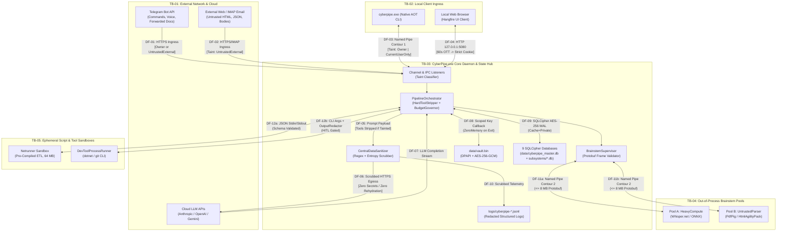

# Threat Model: Data Flows and Attack Surfaces

> **Document Role:** Maps all security-relevant data flows (`DF-01`..`DF-12`) and attack surfaces across trust boundaries `TB-01` through `TB-05`, annotated with data classification and taint propagation rules.

---

## 1. End-to-End Annotated Data Flow Diagram (DFD)



---

## 2. Data Flow Catalog & Security Invariants (`DF-01` .. `DF-12`)

| Flow ID | Source $\rightarrow$ Destination | Boundary Crossed | Protocol & Payload Format | Data Classification & Taint Level | Attack Surface & Associated Threats |
| :--- | :--- | :--- | :--- | :--- | :--- |
| **`DF-01`** | Telegram API $\rightarrow$ `TelegramChannelAdapter` | `TB-01` $\rightarrow$ `TB-03` | HTTPS (TLS 1.3) JSON Updates + binary `.ogg`/`.pdf` downloads | `Owner` (if direct text from `AllowedTelegramUserIds` & not forwarded); **`UntrustedExternal`** (if `ForwardFrom != null` or file attachment) | Prompt injection in forwarded text (`THREAT-001`), `50 MB` PDF/voice bomb (`THREAT-010`), unauthorized Telegram user ID (`THREAT-002`). |
| **`DF-02`** | External Web / IMAP $\rightarrow$ `EmailSummarySkill` / `Netrunner` | `TB-01` $\rightarrow$ `TB-03`/`TB-05` | HTTPS / IMAPS (TLS 1.3) HTML, JSON, MIME bodies | **Always `UntrustedExternal`** | Indirect prompt injection (`THREAT-001`), SSRF to local loopback/LAN (`THREAT-012`), oversized response OOM. |
| **`DF-03`** | `cyberpipe.exe` CLI $\leftrightarrow$ `CyberPipe.exe` | `TB-02` $\leftrightarrow$ `TB-03` | Contour 1 Named Pipe (`\\.\pipe\CyberPipe.Ipc.{Username}`), JSON-RPC 2.0 | `Owner` (`CurrentUserOnly` OS SID) | Named Pipe squatting before daemon startup (`THREAT-004`), pipe pool starvation (`RISK-009`). |
| **`DF-04`** | Local Browser $\leftrightarrow$ `CyberPipe.exe` (`Hangfire` UI) | `TB-02` $\leftrightarrow$ `TB-03` | HTTP `127.0.0.1:5080/hangfire` | `Owner` Admin UI Session | Browser-based localhost CSRF / SSRF / DNS rebinding triggering arbitrary Hangfire jobs (`THREAT-005`). |
| **`DF-05` / `DF-06`** | `PipelineOrchestrator` $\rightarrow$ `CentralDataSanitizer` $\rightarrow$ Cloud LLM | `TB-03` $\rightarrow$ `TB-01` | HTTPS (TLS 1.3) JSON Chat Completion Request | Scrubbed Public/Pseudonymized Context (`[REDACTED_SECRET]`, `[PII_*]`) | Secret/PII leakage via regex evasion (`THREAT-003`), secret rehydration attack (`THREAT-003`), runaway token spend (`THREAT-013`). |
| **`DF-07`** | Cloud LLM $\rightarrow$ `PipelineOrchestrator` | `TB-01` $\rightarrow$ `TB-03` | HTTPS SSE Streaming JSON (`ChatResponseUpdate`) | Model Output (inherits `UntrustedExternal` taint if input was tainted) | Adversarial tool-call blocks emitted by hijacked LLM (`THREAT-001`), unescaped Markdown/HTML injection. |
| **`DF-08`** | `SecretsVault` (`data/vault.bin`) $\leftrightarrow$ `CyberPipe.exe` | Disk $\leftrightarrow$ `TB-03` RAM | `DPAPI` (`CurrentUser`) + `AES-256-GCM` binary blob | **Critical Secret (`ASSET-01`)** | Plaintext key remnant in managed `System.String` heap or crash dump (`THREAT-007`), `DPAPI` key loss on profile reset (`RISK-014`). |
| **`DF-09`** | `SubsystemDatabaseManager` $\leftrightarrow$ 9 SQLite `.db` files | `TB-03` RAM $\leftrightarrow$ Disk (`data/`) | SQLCipher `AES-256-CBC` encrypted 4 KB pages + `.db-wal` | **Confidential User Data (`ASSET-02`)** | Unencrypted plaintext DB write due to `e_sqlite3` native binary collision (`THREAT-006`, `RISK-002`), `Cache=Shared` lock/auth bypass (`RISK-002`), partial cross-DB crash state (`THREAT-015`). |
| **`DF-10`** | `Serilog` + `CentralDataSanitizer` $\rightarrow$ `logs/*.jsonl` | `TB-03` $\rightarrow$ Disk (`logs/`) | UTF-8 JSON Lines | Internal Diagnostic Telemetry (Scrubbed) | Leakage of bearer tokens or environment variables in exception stack traces (`THREAT-007`). |
| **`DF-11a` / `DF-11b`** | `BrainstemSupervisor` $\leftrightarrow$ `CyberPipe.Brainstem.exe` (Pools A & B) | `TB-03` $\leftrightarrow$ `TB-04` | Contour 2 Named Pipe (`\\.\pipe\CyberPipe.Brainstem.{Guid}`), 4-byte length-prefixed Protobuf | Audio PCM/Opus (`Pool A`), Untrusted PDF/DOCX/HTML bytes (`Pool B`) | Malicious `0x7FFFFFFF` Protobuf length prefix crashing supervisor (`THREAT-008`), worker sandbox escape to read `data/vault.bin` (`THREAT-008`), tampered `CyberPipe.Brainstem.exe` binary (`THREAT-009`). |
| **`DF-12a`** | `WorkflowDagRunner` $\leftrightarrow$ `Netrunner` Sandbox | `TB-03` $\leftrightarrow$ `TB-05` | Pre-compiled module execution, JSON `stdin`/`stdout` validated by `JsonSchema.Net` | **Always `UntrustedExternal`** on script output | Malicious C# script reflection/P-Invoke escape (`THREAT-011`), `64 MB` Roslyn OOM (`RISK-003`), unauthorized outbound exfiltration (`THREAT-012`). |
| **`DF-12b`** | `DevToolsSkill` $\leftrightarrow$ `DevToolProcessRunner` (`dotnet` / `git`) | `TB-03` $\leftrightarrow$ `TB-05` | Child OS process with argument array (no `cmd.exe`/`sh -c`) + `OutputRedactor` | Developer Repository Code (`Untrusted` if cloned/modified) | Arbitrary code execution via MSBuild `<UsingTask>`, Roslyn Source Generators, unit tests, or `.git/hooks` (`THREAT-016`, `RISK-007`). |

---

## 3. Taint Propagation State Machine (`DF-01` .. `DF-12`)

```mermaid
stateDiagram-v2
    [*] --> UntaintedContext: Command from Verified Owner (DF-01 Direct / DF-03 CLI)
    [*] --> TaintedContext: Forwarded Message, File, Email, Web, or Netrunner Output (DF-01 Fwd / DF-02 / DF-11b / DF-12a)

    UntaintedContext --> UntaintedContext: Reads from Trusted Local DB (crm.db / finance.db)
    UntaintedContext --> TaintedContext: Ingests ANY UntrustedExternal Data (Sticky Contagion)

    state UntaintedContext {
        direction LR
        U1["ContextContainsUntrustedData = false"] --> U2["Tier 2/3 LLM: Permitted Tools Active\n(Destructive Tools Still Require HITL)"]
    }

    state TaintedContext {
        direction LR
        T1["ContextContainsUntrustedData = true\n(Irreversible for Pipeline Run)"] --> T2["HARD TOOL STRIPPING (QAS-007):\nChatOptions.Tools = Empty in C#"]
        T2 --> T3["Only Read-Only Text Summarization\nor HITL Proposal Node Permitted"]
    }
```

---

## Cross-References
- **Scope, Assets, and Trust Boundaries:** [`scope-assets-and-trust-boundaries.md`](scope-assets-and-trust-boundaries.md)
- **Threat Register (`THREAT-001`..`THREAT-016`):** [`threat-register.md`](threat-register.md)
- **Mitigations & Security Verification:** [`mitigations-and-verification.md`](mitigations-and-verification.md)
