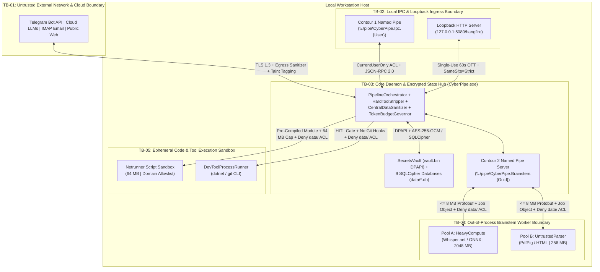

# Threat Model: Scope, Assets, Actors, and Trust Boundaries

> **Document Role:** Defines the security scope, high-value assets (`ASSET-01`..`ASSET-10`), legitimate actors, adversary profiles, privilege tiers, and trust boundaries (`TB-01`..`TB-05`) for **CyberPipe**.
> **Methodology:** Combines OWASP Threat Modeling, Microsoft STRIDE, and AI/Agentic Zero-Trust Taint Analysis (see [`../00-methodology.md`](../00-methodology.md)).

---

## 1. Threat Modeling Scope & Epistemic Baseline

- **System Under Evaluation:** CyberPipe Local-First Autonomous Personal Assistant (`CyberPipe.exe`, `cyberpipe.exe`, `CyberPipe.Brainstem.exe`, `Netrunner` ETL Sandboxes, and the `data/` State Hub).
- **Epistemic Baseline:** **Pre-Implementation Specification Audit (`RISK-004`)**. Because `CyberPipe.slnx` currently contains `0` source files, **zero security controls are currently enforced by compiled code**. All controls documented in [`mitigations-and-verification.md`](mitigations-and-verification.md) are explicitly classified as either *Proposed in `docs/plans/`* or *Recommended by `arch-argon`*.
- **Out-of-Scope Threats:** Physical hardware seizure while the workstation is unlocked in an active `Session >= 1` interactive login, or Ring-0 Windows/Linux kernel rootkits running as `SYSTEM`/`root`.

---

## 2. Protected Assets Catalog (`ASSET-01` .. `ASSET-10`)

| Asset ID | Asset Name | Location / Artifact | Security Properties (`C / I / A`) | Impact if Compromised |
| :--- | :--- | :--- | :--- | :--- |
| **`ASSET-01`** | **Cryptographic Vault & Master Keys** | `data/vault.bin` (`AES-256-GCM`) + OS `DPAPI` / Keychain root key | **Confidentiality (Critical)**, **Integrity (Critical)**, **Availability (Critical)** | Total compromise of all cloud API keys, Telegram bot token, and the 32-byte SQLCipher master key for all 9 databases; or permanent data bricking if lost (`RISK-014`). |
| **`ASSET-02`** | **Encrypted State Hub Databases** | `data/cyberpipe_master.db` + 8 `data/subsystems/*.db` (`crm`, `finance`, `health`, `knowledge`, `budget`, `hangfire`, `masstransit`, `netrunner`) | **Confidentiality (Critical)**, **Integrity (Critical)**, **Availability (High)** | Exfiltration or corruption of the Owner's financial ledger, personal CRM contacts, health/medication records, and private knowledge base (`RISK-002`). |
| **`ASSET-03`** | **Host OS Execution Environment & User Files** | Interactive Windows `Session >= 1` (`%USERPROFILE%`, SSH keys, browser cookies, source repos) | **Confidentiality (Critical)**, **Integrity (Critical)** | Arbitrary remote code execution (RCE) as the interactive Owner (`THREAT-001`, `THREAT-009`). |
| **`ASSET-04`** | **LLM Tool Dispatch & Action Pipeline** | `PipelineOrchestrator`, `ChatOptions.Tools`, `HitlApprovalNode` | **Integrity (Critical)** (Non-Bypassability) | Unauthorized execution of financial, email, CRM, or Git/DevTools skills via indirect prompt injection (`THREAT-001`). |
| **`ASSET-05`** | **Outbound Cloud LLM & Telemetry Payloads** | `CentralDataSanitizer` egress stream & `logs/cyberpipe-*.jsonl` | **Confidentiality (High)** | Irreversible leakage of PII, credit cards, SSN/INN, or API keys to third-party cloud LLM providers or plaintext log files (`THREAT-003`, `THREAT-007`). |
| **`ASSET-06`** | **Cloud API Financial Budget** | `TokenBudgetGovernor` & `data/subsystems/budget.db` | **Integrity (High)**, **Availability (High)** | Unbounded financial drain ("Denial of Wallet") via runaway agent loops or concurrent cloud LLM requests (`THREAT-013`). |
| **`ASSET-07`** | **Named Pipe & Loopback Control Channels** | Contour 1 (`\\.\pipe\CyberPipe.Ipc.*`), Contour 2 (`\\.\pipe\CyberPipe.Brainstem.*`), Loopback (`127.0.0.1:5080`) | **Integrity (Critical)**, **Confidentiality (High)**, **Availability (High)** | Local privilege escalation, pipe squatting/MITM, `Brainstem` supervisor OOM crash, or localhost browser CSRF/SSRF (`THREAT-004`, `THREAT-005`, `THREAT-008`). |
| **`ASSET-08`** | **Worker & Skill Package Binaries** | `./worker/CyberPipe.Brainstem.exe`, `./worker/worker.manifest.json`, `./models/`, `./skills/netrunner/` | **Integrity (Critical)** | Tampering with worker DLLs, ONNX/GGML models, or Netrunner scripts to achieve persistent code execution (`THREAT-009`, `THREAT-011`). |
| **`ASSET-09`** | **Daemon Availability & Preemption Control** | `CyberPipe.exe` process, `CancellationRegistry` (`/stop`) | **Availability (Critical)** | Unresponsive daemon, inability to halt a runaway agent within `< 50 ms`, or host memory/CPU starvation (`THREAT-010`, `THREAT-014`). |
| **`ASSET-10`** | **Physical & Acoustic Hardware Controls** | `MediaController` (`VolumeClamp`), `AudioSafetyPrePlaybackGuard` | **Integrity / Human Safety (High)** | Sudden `100%` volume blast during night hours (`03:00 AM`) or unintended audio broadcast during an active microphone call (`QAS-014`). |

---

## 3. Actors, Adversary Profiles, and Privilege Tiers

### 3.1 Legitimate Actors
1. **`Owner` (Privilege Tier 0 — Ultimate Authority):** The human workstation owner interacting via the local `cyberpipe.exe` CLI, local browser (`OTT` authenticated), or verified Telegram User ID (`AllowedTelegramUserIds`).
2. **`TrustedAutomation` (Privilege Tier 1 — Bounded Autonomous):** Recurring or delayed jobs registered by the Owner in `ProactiveScheduler` (`hangfire.db`), still subject to `TokenBudgetGovernor`, `VolumeClamp`, and `HitlApprovalNode` gates.
3. **`Local Coding Agent` (Privilege Tier 1 — Scoped Local Client):** External developer CLI tools (e.g., Claude Code, Cursor) running under the Owner's OS user account and invoking `cyberpipe --json` over Contour 1 IPC.

### 3.2 Adversary Profiles & Attacker Capabilities

| Adversary ID | Threat Actor Profile | Capabilities & Entry Vectors | Target Assets |
| :--- | :--- | :--- | :--- |
| **`ADV-01`** | **Remote Content / Indirect Prompt Injection Attacker** | Cannot access the workstation directly, but can craft malicious emails, web pages, forwarded Telegram messages, or weaponized PDF/DOCX/voice files (`50 MB` PDF bombs, polyglot payloads, adversarial prompt instructions) ingested by CyberPipe. | `ASSET-02`, `ASSET-03`, `ASSET-04`, `ASSET-05`, `ASSET-06`, `ASSET-09` |
| **`ADV-02`** | **Unprivileged Local Process / Multi-User OS Account** | Runs as a different Windows/Linux local user account or a low-privilege background process on the same host; attempts Named Pipe squatting before `CyberPipe.exe` starts, localhost SSRF/CSRF against `127.0.0.1:5080`, or reading `data/*.db`. | `ASSET-01`, `ASSET-02`, `ASSET-07` |
| **`ADV-03`** | **Compromised Child Worker (`Brainstem` / `Netrunner` Escape)** | Has achieved arbitrary code execution *inside* `CyberPipe.Brainstem.exe` (`TB-04`, e.g., via a native C++ buffer overflow in `ggml.dll`) or inside a `Netrunner` script (`TB-05`); attempts to read `data/vault.bin`, attack `BrainstemSupervisor` via malformed Protobuf frames, or exfiltrate data over the network. | `ASSET-01`, `ASSET-02`, `ASSET-03`, `ASSET-07`, `ASSET-09` |
| **`ADV-04`** | **Malicious Repository / Skill Package Author (Supply Chain)** | Publishes a malicious Git repository (with weaponized `.csproj` MSBuild `<UsingTask>` targets or `.git/hooks`) analyzed by `DevToolProcessRunner`, or a malicious 6-file `Netrunner` package. | `ASSET-01`, `ASSET-03`, `ASSET-08` |
| **`ADV-05`** | **Curious / Compromised Cloud LLM Provider** | Logs all inbound API prompts and completion streams sent over `TB-01`; attempts to extract PII or secrets from unsanitized context. | `ASSET-02`, `ASSET-05` |

---

## 4. Trust Boundaries (`TB-01` .. `TB-05`)

### Trust Boundary Summary Table

| Boundary ID | Boundary Name | Crossing Direction | Enforcement Mechanisms Required at Boundary |
| :--- | :--- | :--- | :--- |
| **`TB-01`** | **External Network & Cloud Boundary** | External Internet $\leftrightarrow$ `CyberPipe.exe` | **Ingress:** Telegram `AllowedTelegramUserIds` allowlist; mandatory `TaintedData<T>(UntrustedExternal)` wrapping on all external payloads. **Egress:** `CentralDataSanitizer.SanitizeForCloud()` (`< 0.5 ms`, no rehydration); `TokenBudgetGovernor` reservation; TLS 1.3. |
| **`TB-02`** | **Local IPC & Loopback Ingress Boundary** | Local OS Processes / Browser $\leftrightarrow$ `CyberPipe.exe` | **Contour 1 Pipe:** `PipeSecurity` restricted to `CurrentUserOnly` (`Owner` SID) + `FirstPipeInstance` on initial handle (`ADR-0005`). **Loopback HTTP (`127.0.0.1:5080`):** Mandatory 60s single-use `OTT` exchange $\rightarrow$ `HttpOnly; SameSite=Strict` cookie. |
| **`TB-03`** | **Core Daemon & Encrypted State Hub** | `CyberPipe.exe` Memory $\leftrightarrow$ Disk (`data/`) | `SecretsVault` (`DPAPI` + `AES-256-GCM`) with `ZeroMemory` buffer wiping; `SQLCipher` `AES-256-CBC` page encryption across all 9 `.db` files; `HardToolStripper` before `IChatClient` invocation. |
| **`TB-04`** | **`Brainstem` Out-of-Process Worker Boundary** | `CyberPipe.exe` $\leftrightarrow$ `CyberPipe.Brainstem.exe` | `worker.manifest.json` SHA-256 verification before spawn; OS Job Object (`2048 MB` Pool A / `256 MB` Pool B, `KILL_ON_JOB_CLOSE`); zero network access; explicit NTFS `Deny` ACL on `./data/`; `<= 8 MB` Protobuf frame validation on Contour 2 Pipe. |
| **`TB-05`** | **Ephemeral Code & DevTools Sandbox Boundary** | `CyberPipe.exe` $\leftrightarrow$ `Netrunner` / `DevToolProcessRunner` | Pre-compiled script execution under `64 MB` Job Object (`ADR-0007`); domain-allowlisted HTTP proxy; explicit NTFS `Deny` ACL on `./data/`; `HITL` approval + `-c core.hooksPath=/dev/null` for `DevToolProcessRunner` (`RISK-007`). |

---

## Cross-References
- **Annotated Data Flow Diagrams:** [`data-flows.md`](data-flows.md)
- **STRIDE & Agentic Threat Register (`THREAT-001`..`THREAT-016`):** [`threat-register.md`](threat-register.md)
- **Mitigations & Security Verification Matrix:** [`mitigations-and-verification.md`](mitigations-and-verification.md)
