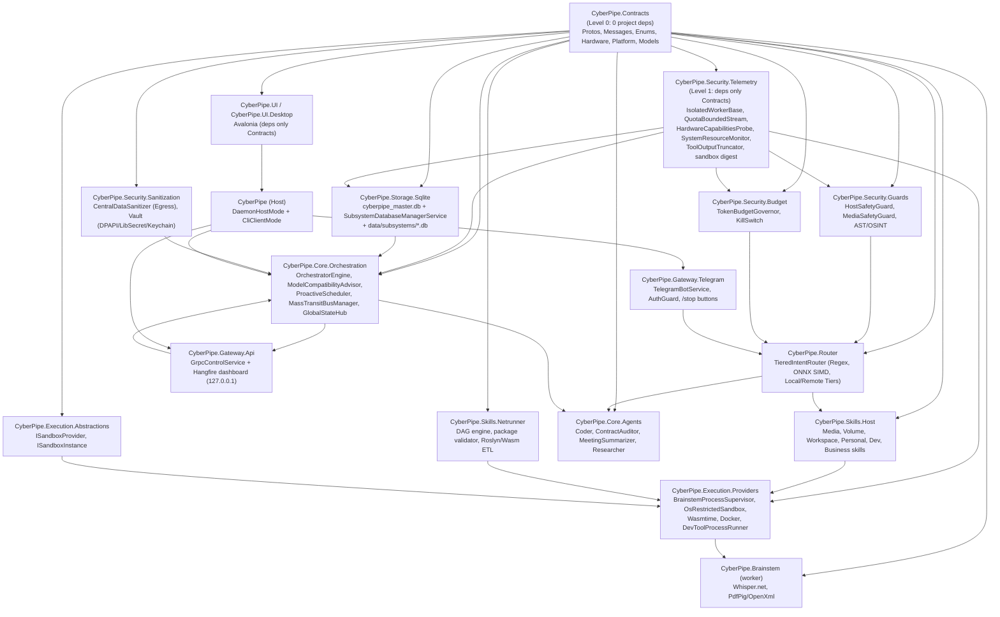

# arc42 §5 — Building Block View

Part of the [arc42 documentation](01-introduction-and-goals.md). All blocks are
**designed**; no source code exists (`AUD-01`).

---

## 5.1 Level 1 — Solution structure (project DAG)

Source: [`06-solution-structure.md`](../../plans/06-solution-structure.md). Enforced by
`ArchUnitNET` in `CyberPipe.Tests.Architecture`.

**DAG rules** (from [`06`](../../plans/06-solution-structure.md) and enforced by `ArchUnitNET`):

1. `CyberPipe.Contracts` (Level 0) has zero project dependencies.
2. `CyberPipe.Security.Telemetry` (Level 1) depends only on `Contracts`; provides `IsolatedWorkerBase` to all workers without cycles.
3. `CyberPipe.UI` and `CyberPipe.Brainstem` depend **only** on `CyberPipe.Contracts`; never on daemon assemblies.
4. `CyberPipe.Skills.Host` never references `CyberPipe.Execution.*` nor calls `System.Diagnostics.Process`/`CliWrap`; uses `IDevToolProcessRunner`.
5. `CyberPipe.Core.Agents` are invoked only after Router + Budget + Sanitizer.
6. `ModelCompatibilityAdvisorService` queries hardware only via `IHardwareCapabilitiesProbe`.
7. Workers inherit `IsolatedWorkerBase`; no `Channel.CreateUnbounded`; no blocking I/O in DI constructors.

## 5.2 Level 2 — Critical components

For each critical block: responsibility, interfaces, dependencies, lifecycle, failure modes,
data ownership, security boundary, recovery.

### 5.2.1 `TieredIntentRouter` (`CyberPipe.Router`)

| Attribute | Value |
| :--- | :--- |
| Responsibility | Route incoming text/voice to T0/T1/T2/T3; emit deterministic skill calls or LLM tasks. |
| Interfaces | `RouteAsync(IntentRequest) → IntentRouteResult`; consumes `IEmbeddingModel`, `SemanticIntentCache`, `SemanticResponseCache`, `KnowledgeVault`. |
| Dependencies | `Microsoft.ML.OnnxRuntime`, `System.Numerics.Tensors` (SIMD), `Microsoft.ML.Tokenizers` (pre-flight). |
| Lifecycle | Singleton; ONNX model warmed in `InitializeAsync` (5 s timeout). |
| Failure modes | ONNX load failure → module `DisabledFaulted` (`SafeModuleRegistration`); routing falls through to Tier 2. |
| Data ownership | Reads `SemanticIntentCache`, `SemanticResponseCache` (role-scoped, `QueryHash` key — `AUD-05` fix). |
| Security boundary | Tier-1 input pre-validated by `QuotaBoundedStream` (≤512 tokens); never receives raw external streams. |
| Recovery | In-memory caches rebuildable from SQLite; cache key must include `QueryHash` to avoid leakage. |

### 5.2.2 `TokenBudgetGovernor` (`CyberPipe.Security.Budget`)

| Attribute | Value |
| :--- | :--- |
| Responsibility | Pre-flight token estimate; force `ChatOptions.MaxOutputTokens`; track `UsageDetails`; auto-pause at `SoftTaskTokenLimit`/`MaxLlmTurnsPerTask`; velocity circuit breaker (`MaxTokensPerMinute`); daily USD cap. |
| Interfaces | `DelegatingChatClient` middleware on `IChatClient`; reads `BudgetPolicyOptions`. |
| Dependencies | `Microsoft.ML.Tokenizers` (`o200k_base`), `BudgetLedger` table (`budget.db`). |
| Lifecycle | Singleton; `ActiveExecutionRegistry` keyed by `(ChatId, TaskId)` for kill-switch. |
| Failure modes | Tokenizer mismatch for non-OpenAI models → `1.2x` Cyrillic safety factor; final settle by actual `UsageDetails`. |
| Data ownership | `BudgetLedger`, `TaskCheckpoints` in `budget.db`. |
| Security boundary | Cannot be bypassed — sits in front of every `IChatClient` call. |
| Recovery | Checkpoints in SQLite; `PausedByBudget` tasks resumable via Telegram buttons (`+5 000 tokens`, `+3 steps` up to `HardTaskTokenLimit = 12 000`). |

### 5.2.3 `HostAndMediaSafetyGuard` (`CyberPipe.Security.Guards`)

| Attribute | Value |
| :--- | :--- |
| Responsibility | Block raw shell from chat; Anti-Wipe; Volume Clamp (`60%/25%`, pre-`Play` check); NSFW filter; media whitelist; AST analysis of Tier-3 scripts; passive OSINT (fail-closed); `Hard Tool Stripping` in `TaintedContext`. |
| Interfaces | `InspectAsync(request, context) → SecurityInspectionReport`; called by Router before skill/agent dispatch. |
| Dependencies | `System.Management.Automation` (AST), `IAudioDeviceController`, `ISandboxProvider` (Tier-3 routing), OSINT clients (VirusTotal, URLhaus, DoH). |
| Lifecycle | Singleton; stateless inspection. |
| Failure modes | OSINT timeout/quota → `Fail-Closed` → `RiskLevel.RequiresApproval` (HITL). |
| Data ownership | Audit findings logged (sanitized); no PII persisted. |
| Security boundary | Mandatory gate; `TelegramGateway_Must_Not_Call_Agents_Or_Skills_Directly` enforced by `ArchUnitNET`. |
| Recovery | Blocked attempts logged; owner can override only via explicit HITL approval. |

### 5.2.4 `CyberPipe.Brainstem` (`src/Execution/CyberPipe.Brainstem`)

| Attribute | Value |
| :--- | :--- |
| Responsibility | Isolated execution of `WhisperTranscribe` (Pool 1, stateful) and `DocumentExtractText` (Pool 2, single-use). |
| Interfaces | `BrainstemHandshake`, `BrainstemTaskRequest/Response`, `BrainstemControlSignal` (Protocol v1). |
| Dependencies | `Whisper.net`, `UglyToad.PdfPig`, `DocumentFormat.OpenXml`; `CyberPipe.Contracts` only. |
| Lifecycle | Spawned by `BrainstemProcessSupervisor`; Pool 1 idle `45 min`, `MaxTasksPerProcess=500`; Pool 2 `MaxTasksPerProcess=1`. |
| Failure modes | `AccessViolationException`/OOM caught by parent; `Job Object` `KillOnJobClose`; orphaned `Running` rows increment `AttemptCount`. |
| Data ownership | Only its per-instance `worker-temp/{Guid}` + read of `./models/whisper/`; **no** access to `data/`. |
| Security boundary | OS sandbox (`AppContainer` Profile A or `RestrictedToken + Deny DACL` Profile B on Windows; `bwrap` Linux; `Seatbelt` macOS); `ActiveProcessLimit=1`; network denied. |
| Recovery | Parent detects orphaned in-flight rows; `QuotaBoundedStream` caps I/O. |

### 5.2.5 `SubsystemDatabaseManagerService` (`CyberPipe.Storage.Sqlite`)

| Attribute | Value |
| :--- | :--- |
| Responsibility | Lazy-create subsystem DBs; generate per-DB 256-bit keys in `SecretsVault`; register in `SubsystemDatabaseRegistry`; run migrations; issue `SqliteConnection`. |
| Interfaces | `GetConnectionAsync(subsystemKey)`, `ProvisionSubsystemDatabaseAsync`, `MigrateSubsystemDatabaseAsync`, `GetAllDatabasesAsync`. |
| Dependencies | `Microsoft.Data.Sqlite`, Dapper, `ISecretVaultPlatform`, **SQLCipher provider** (`AUD-04`). |
| Lifecycle | Singleton; per-call `SqliteConnection` (disposed by caller). |
| Failure modes | Wrong/missing key → fail-closed (cannot open DB). |
| Data ownership | `cyberpipe_master.db` (`AppGlobalSettings`, `SubsystemDatabaseRegistry`); never writes business data to master. |
| Security boundary | Per-subsystem key isolation; cross-subsystem access forbidden by contract (DI injects only the caller's key). |
| Recovery | Key rotation via SQLCipher `rekey`; restore from `backups/cyberpipe.v{N}.bak`. |

### 5.2.6 `NetrunnerWorkflowEngine` (`CyberPipe.Skills.Netrunner`)

| Attribute | Value |
| :--- | :--- |
| Responsibility | Execute Mini-n8n DAG workflows: 8 node types (`TriggerNode`, `SkillNode`, `NetrunnerScriptNode`, `ConditionNode/SwitchNode`, `ParallelFanOutNode`+`JoinNode`, `LlmProcessNode`, `HitlApprovalNode`, `DeliveryNode`); 4 branching patterns; step checkpointing; crash recovery. |
| Interfaces | `NetrunnerWorkflowDefinition` JSON; `NetrunnerWorkflowRuns`/`NetrunnerStepRuns` tables in `netrunner.db`. |
| Dependencies | `ISandboxProvider`, `IDevToolProcessRunner`, `INetrunnerPackageValidator`, `TokenBudgetGovernor`, Hangfire for deferred retries. |
| Lifecycle | Engine is a singleton; runs are durable records. |
| Failure modes | `SchemaValidationFailed` halts step without breaking cascade; `onError` branch; orphaned `Running` → `CancelledByCrash` or `ResumeFromCheckpoint`. |
| Data ownership | `netrunner.db`; per-run artifacts in `data/netrunner-artifacts/{RunId}/`. |
| Security boundary | Scripts run only in sandbox (`AUD-07`); file SHA-256 verified pre-run; `filesystemScope=IsolatedRunWorkspaceOnly`. |
| Recovery | `Pipeline:CrashRecoveryPolicy` (`ResumeFromCheckpoint` / `StopAndMarkCancelledByCrash`); `NetrunnerCrashRecoveryHostedService` on startup. |

## 5.3 Component matrix (responsibility × boundary)

| Component | Trust boundary | Can it call shell? | Can it touch `data/`? | Can it call cloud LLM? |
| :--- | :--- | :--- | :--- | :--- |
| TieredIntentRouter | Daemon | No | Read caches only | No |
| TokenBudgetGovernor | Daemon | No | `budget.db` only | No (wraps `IChatClient`) |
| HostAndMediaSafetyGuard | Daemon | No (AST only) | No | No (OSINT HTTP only, fail-closed) |
| OrchestratorEngine | Daemon | No | No | Indirectly via Agents |
| Core.Agents (Tier 3) | Daemon | Only via sandbox | No | Yes (sanitized) |
| CyberPipe.Brainstem | Worker (sandboxed) | No (`ActiveProcessLimit=1`) | **No** (DACL deny) | No |
| Skills.Host | Daemon | No (`IDevToolProcessRunner` whitelist) | Per-skill DB via manager | No |
| Netrunner script | Sandbox | No | Own `workspace/out/` only | No (only via `LlmProcessNode` parent) |
| UI.Desktop | Client | No | No | No |
| Hangfire Dashboard | Browser (loopback) | No | Read-only | No |

## 5.4 Interfaces (summary)

The full contract surface lives in `CyberPipe.Contracts` (Level 0). Key interfaces:

- `IHostSkill`, `IDevToolProcessRunner`, `ISandboxProvider`, `ISandboxInstance`
- `IBrainstemIsolationPlatform`, `ISecretVaultPlatform`, `IAudioDeviceController`, `IScreenOcrProvider`, `IDaemonInstaller`
- `ISubsystemDatabaseManager`, `IMessageBusProviderManager`, `IRabbitMqSupervisionService`, `ICenterInfrastructureSupervisor`
- `IGlobalStateHub`, `INetrunnerWorkflowEngine`, `INetrunnerPackageValidator`
- `IHardwareCapabilitiesProbe`, `ISystemResourceMonitor`
- `IChatClient` (`Microsoft.Extensions.AI`) for Tier-2/3 LLMs.

## 5.5 Failure-mode summary per block

Detailed per-block failure modes appear in §5.2. The cross-cutting failure model
(Bulkheads, Poison-Pill Flight Recorder, IsolatedWorkerBase quarantine) is in
[`14-fault-isolation-and-resilience.md`](../../plans/14-fault-isolation-and-resilience.md) and
[§6 runtime view](06-runtime-view.md) and [§8 cross-cutting](08-crosscutting-concepts.md).
