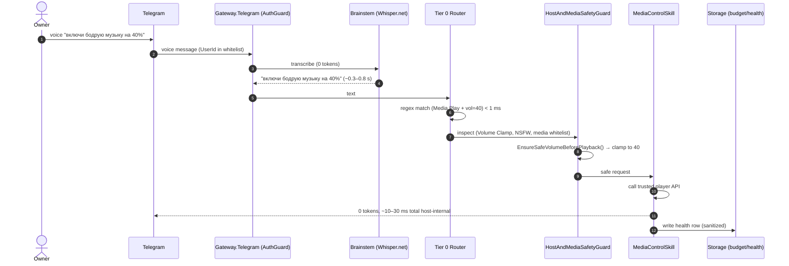

# arc42 §6 — Runtime View

Part of the [arc42 documentation](01-introduction-and-goals.md). All scenarios are
**designed**; SLOs are local-budget targets, not measured results (`AUD-06`).

---

## 6.1 Runtime scenario A — Fast command ("включи музыку на 40%")

Source: [`02-architecture-diagram.md`](../../plans/02-architecture-diagram.md) Path A.



**Latency budget**: Tier 0 `< 1 ms`, total host-internal `~10–30 ms`, 0 tokens. Telegram
network latency excluded (`AUD-06`).

**Failure paths**:
- Whisper STT failure → Brainstem `AttemptCount++`; falls back to text only if user retypes.
- Regex miss → cascade to Tier 1 (ONNX, ~5–15 ms).
- Guard blocks (e.g. unknown media source) → fail-closed; reply with reason.
- `/stop` mid-Whisper → priority kill-channel cancels; `OperationCanceledException` cleans
  `InFlightOperations` without poisoning (`AUD-07`/Poison-Pill rules in [`14`](../../plans/14-fault-isolation-and-resilience.md) §4).

## 6.2 Runtime scenario B — Complex task ("проверь PDF договора на риски")

Source: [`02`](../../plans/02-architecture-diagram.md) Path B; [`12`](../../plans/12-assistant-capabilities-and-skills.md) §4.4.

```mermaid
sequenceDiagram
    autonumber
    actor Owner
    participant GW as Gateway.Telegram
    participant Router as TieredIntentRouter
    participant Budget as TokenBudgetGovernor
    participant San as CentralDataSanitizer (Egress)
    participant BS as Brainstem (Pool 2, SingleUse)
    participant T3 as Tier 3 Agent
    participant Sec as SecurityGuard (AST + OSINT)
    participant Sandbox as Sandbox Provider
    Owner->>GW: PDF file "проверь на риски"
    GW->>Router: text + file ref
    Router->>Router: T0/T1 miss → Tier 2/3
    Router->>Budget: pre-flight estimate; set MaxOutputTokens
    Budget->>San: register egress gate
    GW->>BS: DocumentExtractText (UntrustedExternal, SingleUse, 512 MB cap)
    BS-->>GW: extracted text (UntrustedExternal)
    GW->>Sec: Hard Tool Stripping (remove host-tool schemas from ChatOptions.Tools)
    Sec->>San: sanitize text for RemoteCloud
    San->>T3: sanitized prompt + 2–3 tools (Dynamic Tool Pruning)
    T3->>T3: chain-of-thought (max 3 turns or 4 000 tokens)
    alt Soft limit reached
        Budget->>Budget: TaskLifecycleState.PausedByBudget; checkpoint in budget.db
        Budget->>Owner: Telegram buttons [+5 000 tokens / give result / stop]
    else Tool proposal
        T3->>Sec: ToolExecutionProposal (script)
        Sec->>Sec: AST analysis (Defense-in-Depth)
        Sec->>Sandbox: run in Wasmtime/Docker/OS sandbox (EphemeralWorkspace)
        Sandbox-->>T3: ExecutionTelemetryDigest (1 GB → 30 KB)
        T3->>San: sanitize for response
    end
    San-->>Owner: report + [➕ Save tasks] HITL button
```

**Token budget**: Soft `4 000` / Hard `12 000` / `MaxLlmTurnsPerTask = 3` / `MaxStepOutputTokens = 2 048`.
**Failure paths**:
- Brainstem parse OOM → `JOB_OBJECT_LIMIT_JOB_MEMORY = 512 MB` kills process; `AttemptCount++`.
- Sanitizer timeout → fail-closed; do not send unsanitized prompt.
- Sandbox escape attempt → telemetry digest flags `BlockedAccessAttempts`; owner alerted.
- `UntrustedExternal` content attempts host-tool call → physically stripped (`Hard Tool Stripping`).
- `/stop` → priority channel cancels HTTP stream + kills sandbox process tree < 50 ms.

## 6.3 Runtime scenario C — Proactive briefing (09:00 cron)

Source: [`12`](../../plans/12-assistant-capabilities-and-skills.md) §4.1; [`03`](../../plans/03-tech-stack-libraries.md) Hangfire section.

1. Hangfire triggers `ExecutiveBriefingSkill` at `0 9 * * *` (stored in `hangfire.db`).
2. Skill aggregates from local SQLite (`tasks`, `crm` follow-ups, `git` commits, server
   status, subscription due dates) at 0 tokens.
3. Optional Tier-2 summarization (`0–200 tokens`) under `TokenBudgetGovernor`.
4. Egress-sanitized digest sent to Telegram; status pushed to `GlobalStateHub` → UI.

**Failure paths**:
- PC was off at 09:00 → `misfirePolicy` (`FireOnceNow` / `SkipIfLateByMinutes` / `AskUser`).
- Aggregate query fails → module quarantined after 3 errors (`IsolatedWorkerBase`).

## 6.4 Runtime scenario D — Netrunner DAG run with HITL

Source: [`16`](../../plans/16-netrunner-etl-and-workflow-engine.md) §1, §3.1.

```mermaid
sequenceDiagram
    autonumber
    participant Cron as Hangfire Cron
    participant Engine as NetrunnerWorkflowEngine
    participant Skill as SkillNode (HttpSafeFetcher)
    participant ETL as NetrunnerScriptNode (sandbox)
    participant Cond as ConditionNode
    participant LLM as LlmProcessNode (Tier 2)
    participant HITL as HitlApprovalNode
    participant DB as netrunner.db
    Cron->>Engine: trigger wf-daily-market-watch
    Engine->>DB: NetrunnerWorkflowRuns Status=Running; StepRuns[fetch]=Running
    Engine->>Skill: fetch XML
    Skill-->>Engine: file rawXmlPayload
    Engine->>DB: StepRuns[fetch]=Completed + SHA-256
    Engine->>ETL: run cbr-currency-rates-etl@1.0.0 (sandbox)
    ETL-->>Engine: output JSON (validated by schema.output.json)
    Engine->>DB: StepRuns[etl]=Completed
    Engine->>Cond: evaluate hasSignificantChange
    alt no change
        Cond-->>Engine: route to silent exit (0 tokens)
    else change ≥ threshold
        Engine->>LLM: brief (Tier 2, capped)
        LLM-->>Engine: recommendation
        Engine->>HITL: pause; checkpoint WorkflowStateSnapshotJson
        Engine->>DB: Status=WaitingForHitl (no threads held)
        Note over HITL: PC may reboot here; state is durable
        Owner->>HITL: [✅ Approve]
        Engine->>DB: StepRuns[hitl]=Completed
        Engine->>Skill: DeliveryNode → Telegram + FinanceLedger
    end
```

**Crash recovery** (`Pipeline:CrashRecoveryPolicy`):
- `ResumeFromCheckpoint`: re-run only interrupted `Running` step (idempotent), keep prior.
- `StopAndMarkCancelledByCrash`: mark `CancelledByCrash`, alert owner, optional manual resume.

## 6.5 Runtime scenario E — `/stop` priority kill-switch

Source: [`04`](../../plans/04-agent-mesh-proposals.md) §3.

1. Owner sends `/stop` (or `хватит`) → routed via `PriorityControlChannel` (Bulkhead 0),
   bypassing the normal queue.
2. `ActiveExecutionRegistry` looks up `CancellationTokenSource` for `(ChatId, TaskId)`.
3. `cts.Cancel()` within `< 50 ms` (host-internal):
   - Aborts HTTP stream to cloud LLM mid-token.
   - Sends `BrainstemControlSignal(CancelRequested:true)`.
   - If no response within `1 500 ms`, hard-kills process tree via Job Object/cgroups.
4. `finally` block removes `InFlightOperations` row **without** incrementing `AttemptCount`
   (prevents self-DoS on legitimate cancel — `AUD-07` Poison-Pill rules).

## 6.6 Runtime scenario F — Bus transport switch from UI

Source: [`03`](../../plans/03-tech-stack-libraries.md) MassTransit section.

1. User toggles `InMemory → SQLite WAL` in UI.
2. UI sends gRPC `SwitchMessageBusProvider(SqliteWal)`.
3. Daemon: `IBusControl.StopAsync` (previous) → init new transport → `IBusControl.StartAsync`.
4. Health check recorded in `health.db` `InfrastructureHealthRecords`.
5. `GlobalStateHub` pushes new status to UI.

**Failure path**: switch to RabbitMQ when broker down → `ICenterInfrastructureSupervisor`
attempted start; on failure, status `Error` in UI with diagnostic copy button. Idempotency
of consumers required because SQLite/RabbitMQ produce duplicates (`AUD-02`).

## 6.7 Concurrency and synchronization hotspots

| Hotspot | Mechanism | Risk |
| :--- | :--- | :--- |
| `ActiveExecutionRegistry` | `ConcurrentDictionary<,>` keyed by `(ChatId, TaskId)` | Stale entries if `finally` skipped → TTL 5 min sliding window cleans. |
| `GlobalStateHub` | `BehaviorSubject<>` snapshot | Slow UI subscriber backpressure → bounded gRPC stream. |
| `InFlightOperations` (SQLite) | WAL + `BusyTimeout=5000` | Contention under burst → Fast-Path uses in-memory dict, not DB. |
| Semantic caches | `(QueryHash, UserRole, DataVersion, ExpiresAtUtc)` key | Wrong key → cross-query leakage (`AUD-05`). |
| Netrunner per-run workspace | One folder per `RunId` | Concurrent runs isolated; `MaxParallelBranches=8` bounds CPU. |
| Brainstem pools | `SemaphoreSlim(maxCount)` per pool | Voice (1) and Document (2) pools independent; no starvation across pools. |

## 6.8 Failure propagation

```
Tier-3 agent throws   → IsolatedWorkerBase catches → 3 failures/min → Quarantined
                                                          ↓
                                          Telegram/UI alert; other modules unaffected
Brainstem AV/OOM       → Job Object kills → BrainstemProcessSupervisor detects orphan row
                                                          ↓
                                          AttemptCount++ (only on true crash, not /stop)
MassTransit duplicate  → consumer must be idempotent (MessageDeduplicationId)  ← AUD-02
DB locked              → BusyTimeout=5000; retry; fail-closed if persistent
Sanitizer fail         → fail-closed; do not send unsanitized prompt
OSINT timeout          → Fail-Closed → RequiresApproval (HITL)
Sandbox escape attempt → telemetry digest flags → owner alerted; runs killed
```
