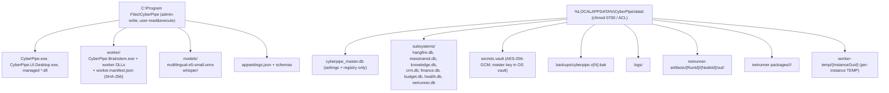

# arc42 §7 — Deployment View

Part of the [arc42 documentation](01-introduction-and-goals.md). All deployment is
**designed**; MVP target is Windows 10/11 only ([L4](../../plans/17-adr-mvp.md)).

---

## 7.1 Executables (three entry points)

Source: [`15-cli-and-execution-modes.md`](../../plans/15-cli-and-execution-modes.md) §1.

| # | Executable | Project | Integrity / Privilege | Role |
| :--- | :--- | :--- | :--- | :--- |
| 1 | `CyberPipe.exe` | `src/Host/CyberPipe` | Medium integrity; standard user; interactive session `>= 1` | Daemon (mode 1) + CLI/TUI dispatcher (mode 2). |
| 2 | `CyberPipe.UI.Desktop.exe` | `src/UI/CyberPipe.UI.Desktop` | Medium integrity; standard user | Avalonia window / tray / `Alt+Space` popup. No business logic; IPC only. |
| 3 | `worker/CyberPipe.Brainstem.exe` | `src/Execution/CyberPipe.Brainstem` | Low integrity (AppContainer) or RestrictedToken + Deny DACL | Isolated `WhisperTranscribe` (Pool 1) + `DocumentExtractText` (Pool 2). |

Supporting binaries (native runtimes, model weights) live alongside the executables:
`onnxruntime`, `whisper`, `e_sqlite3`, `multilingual-e5-small.onnx`, Whisper `.bin/.onnx`.
External services `git`, `dotnet`, `docker` are invoked via `IDevToolProcessRunner` (with
sandbox routing — `AUD-08`). Local LLM runtime `Ollama`/`LM Studio` runs as a separate
user-managed process on `localhost:11434`.

## 7.2 Install directory layout

Source: [`15`](../../plans/15-cli-and-execution-modes.md) §8.



**ACLs**:
- `C:\Program Files\CyberPipe`: admin write; standard user read & execute only.
- `data/`: standard user R/W; explicit `ACCESS_DENIED_ACE` for `RestrictedWorkerCustomSid`
  (Brainstem Profile B) and `AppContainer` SID (Profile A); `chmod 0700` on Linux.
- `worker/`: verified against `worker.manifest.json` (SHA-256 of all `.exe`/`.dll`/`.so`/
  `.dylib`) before each Brainstem spawn; `FileShare.Read` held during run.

## 7.3 Process and session model

```mermaid
flowchart LR
    subgraph InteractiveSession ["Interactive user session (Session >= 1)"]
        Daemon["CyberPipe.exe (daemon)<br/>BackgroundServiceExceptionBehavior.Ignore<br/>SafeBoot + IsolatedWorkerBase"]
        UI["CyberPipe.UI.Desktop.exe"]
        CLI["CyberPipe.exe (CLI/TUI mode)"]
        Brainstem["worker/CyberPipe.Brainstem.exe<br/>(Pool 1 stateful + Pool 2 single-use)"]
        Ollama["Ollama / LM Studio<br/>(user-managed, localhost:11434)"]
    end
    Daemon -->|gRPC Named Pipe| UI
    Daemon -->|gRPC Named Pipe| CLI
    Daemon -->|spawn + IPC + Job Object| Brainstem
    Daemon -->|HTTP localhost| Ollama
    Daemon -->|Telegram Bot API| TG["Telegram servers"]
    Daemon -->|HTTPS (sanitized)| Cloud["Cloud LLM providers"]
    Daemon -->|WMI/systemd-user/launchd| DaemonAuto["autostart<br/>(LogonTrigger / systemd --user / LaunchAgent)"]
```

Daemon is **not** a Windows Service (Session 0), because Session 0 is isolated from audio,
clipboard, and OCR. Autostart is via `IDaemonInstaller` in the user session
(`HKCU\...\Run` / Scheduled Task `LogonTrigger` / `systemd --user` / `launchd` LaunchAgent).
No admin elevation required.

## 7.4 Brainstem isolation profiles (Windows)

Source: [`15`](../../plans/15-cli-and-execution-modes.md) §3.1.

| Aspect | Profile A — `AppContainer` (default) | Profile B — `RestrictedToken + Deny DACL` (GPU fallback) |
| :--- | :--- | :--- |
| Use case | `DocumentExtractText` and CPU Whisper | `WhisperTranscribe` on GPU when driver blocks AppContainer |
| Network | Empty capabilities → fully blocked | `SidsToRestrict` includes Everyone/BuiltinUsers/CurrentUser/`RestrictedWorkerCustomSid` |
| File `data/` access | `ACCESS_DENIED` by default (no capabilities granted) | Explicit `ACCESS_DENIED_ACE` for `RestrictedWorkerCustomSid` in DACL of `data/` |
| Process memory | `Process SACL NO_READ_UP` on `CyberPipe.exe` blocks `OpenProcess(PROCESS_VM_READ)` | (same SACL) |
| Spawn children | `JOB_OBJECT_LIMIT_ACTIVE_PROCESS = 1` | (same) |
| GPU | May be blocked by driver → fall back to Profile B | Driver-compatible; monitor `WorkingSet64` (commit limits unreliable for GPU) |
| Verdict | PoC pending (`AUD-13`) | PoC pending (`AUD-13`) |

Linux uses `bwrap --unshare-all --die-with-parent` (no mount of `data/`) + `cgroups v2`
(`memory.max`, `pids.max=1`); macOS uses `sandbox-exec` profile + `setrlimit`. Equivalence
across OSes is **unverified** (`AUD-13`).

## 7.5 Updates, rollback, and migration

Source: [`15`](../../plans/15-cli-and-execution-modes.md) §8.3; [`09`](../../plans/09-data-protection-and-state-hub.md) §7.

1. New version installed side-by-side in `app-{version}/`.
2. `SqliteBackupService` creates `backups/cyberpipe.v{CurrentSchema}.bak` (consistent
   online backup via SQLite Backup API).
3. New binary runs `CyberPipe doctor --verify-update`: self-diagnosis + `SqliteMigrationRunner`
   (`PRAGMA user_version` based) + Brainstem connectivity check.
4. On failure: automatic rollback to previous working version and DB file.
5. Key rotation: `ISubsystemDatabaseManager` generates new key, SQLCipher `rekey`, updates
   `SubsystemDatabaseRegistry`. Test: training rotation without data loss (`AUD-14`).
6. Master-key loss: data unrecoverable; restore from latest verified backup and re-init
   secrets via `CyberPipe setup`. Fail-closed: daemon stops rather than running unprotected.

## 7.6 Operational model

| Concern | Approach |
| :--- | :--- |
| Observability | `Serilog` (post-sanitization) + `OpenTelemetry`; `GlobalStateHub` reactive stream to UI; `health.db` `InfrastructureHealthRecords`. |
| Backup | `CyberPipe backup sqlite create|verify|restore`; online Backup API; checksum verify; restore runbook (test required pre-release — `AUD-12`). |
| Update | Side-by-side + auto-rollback; `doctor --verify-update`. |
| Disaster | Local-only; restore from backup; no DR site (single-host product). |
| Logging | Egress-sanitized; per-request cost in tokens and USD. |
| Crash recovery | `BackgroundServiceExceptionBehavior.Ignore`; `IsolatedWorkerBase` quarantine after 3 errors/min; orphaned `Running` rows → `AttemptCount++` only on true crash. |
| Resource limits | `ISystemResourceMonitor` gates Tier-2/3 + sandbox by RAM/CPU; `QuotaBoundedStream` 16 MB; gRPC frame 4 MB; Brainstem `512 MB` (Pool 2) / model-size*1.35+1 GB (Pool 1). |

## 7.7 Inapplicable deployment concerns

- Multi-region failover, blue/green across data centers, CDN — N/A for a single-host local
  product.
- Container orchestration (Kubernetes) — N/A; daemon is one process. Docker appears only as
  an optional sandbox provider and optional RabbitMQ runtime.
