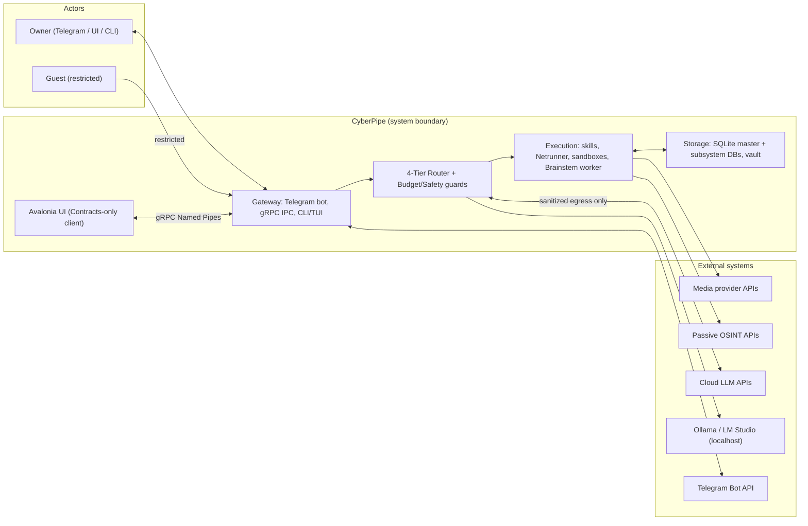

# arc42 §3 — Context and Scope

All components below are **proposed** (no implementation exists). External systems are
real-world counterparts the design depends on.

## External actors and interfaces

| Actor / system | Interface | Trust |
| :--- | :--- | :--- |
| Owner | Telegram chat, Avalonia UI, CLI/TUI | Trusted identity (whitelisted `TelegramUserId`), untrusted content |
| Guest | Telegram chat (subset) | Partially trusted; barred from Tier 3, budgets, secrets |
| Attacker (untrusted third party) | Forged/spoofed messages, malicious files/links forwarded into chat | Untrusted — must fail at `TelegramAuthGuard` |
| Telegram Bot API | Long polling / webhook, voice, files, inline buttons | Transport-trusted; content untrusted |
| Cloud LLM APIs | HTTPS, `IChatClient` via `TokenBudgetGovernor` + `SanitizingChatClient` | Untrusted with secrets (egress-sanitized); billing-relevant |
| Ollama / LM Studio | `http://localhost:11434` via `OllamaSharp` | Local-but-external process; availability not guaranteed |
| Media providers, OSINT APIs | HTTPS allow-listed endpoints | Untrusted content; fail-closed on outage |

## Trust boundaries (summary; full model in `04-threat-model/`)

`TB-01` chat→host (AuthGuard) · `TB-02` router→cloud (egress sanitizer) ·
`TB-03` daemon→Brainstem/sandbox (OS isolation + IPC handshake) ·
`TB-04` tainted content→tools (hard tool stripping) · `TB-05` UI/CLI→daemon (IPC auth +
role authorization). Detail:
[scope-assets-and-trust-boundaries.md](../04-threat-model/scope-assets-and-trust-boundaries.md).
