# arc42 §5 — Building-Block View

All blocks are **proposed**; names follow `docs/plans/06-solution-structure.md`.
Only responsibilities, interfaces, and rules needed for review are repeated here.

```mermaid
flowchart TD
    subgraph L0 ["Level 0 — Contracts (zero deps)"]
        C["CyberPipe.Contracts<br/>DTOs, enums, gRPC protos, MassTransit messages,<br/>platform contracts (audio, OCR, vault, isolation, DB, bus)"]
    end
    subgraph L1 ["Level 1 — Deterministic foundation"]
        T["Security.Telemetry<br/>IsolatedWorkerBase, quotas, probes, truncator"]
        G["Security.Guards<br/>Host/Media/AST/OSINT guards"]
        B["Security.Budget<br/>TokenBudgetGovernor, kill-switch"]
        S["Security.Sanitization<br/>Egress sanitizer, vault"]
        EA["Execution.Abstractions<br/>ISandboxProvider"]
    end
    subgraph L2 ["Level 2 — Capability"]
        R["Router<br/>TieredIntentRouter, caches"]
        SH["Skills.Host<br/>typed skills (no Process)"]
        NR["Skills.Netrunner<br/>DAG engine, package validator"]
        CO["Core.Orchestration<br/>engine, advisor, scheduler, bus mgr, StateHub"]
        AG["Core.Agents<br/>Tier-3 workers"]
        EP["Execution.Providers<br/>Brainstem supervisor, sandboxes, DevTool runner"]
        BS["Brainstem worker<br/>Whisper + parsers (Contracts-only)"]
        GW["Gateway.Telegram + Gateway.Api<br/>auth guard, bot, gRPC server"]
        DB["Storage.Sqlite<br/>master + SubsystemDatabaseManager"]
        UIx["UI + UI.Desktop<br/>Avalonia (Contracts-only)"]
        H["Host CyberPipe<br/>daemon + CLI dispatcher"]
    end
    C --> T & G & B & S & EA & R & SH & NR & CO & AG & EP & BS & GW & DB & UIx & H
```

## Critical components

| Component | Responsibility | Key interfaces / deps | Failure mode → recovery |
| :--- | :--- | :--- | :--- |
| `TieredIntentRouter` | Tier 0–3 cascade, cache lookup, tool pruning | ONNX embedder, caches, `IChatClient` | ONNX missing → all traffic falls to Tier 2/3 (cost blowout; needs fail-safe default — [RISK-006](../03-atam/risk-register.md)) |
| `TokenBudgetGovernor` | Limits, pause/checkpoint, breaker, kill-switch registry | `DelegatingChatClient`, `budget.db` | Must be non-bypassable (ArchUnitNET rule required) |
| `HostAndMediaSafetyGuard` | Anti-wipe, volume clamp, NSFW/media whitelist | `IAudioDeviceController` | Fail-closed: block on error |
| `SecurityGuard` | AST screen, SSRF filter, passive OSINT, tool stripping | `ChatOptions.Tools` mutation | OSINT outage → `RequiresApproval` (fail-closed) |
| `CentralDataSanitizer` | Egress redaction `[REDACTED:ID]`; **no** blind rehydration | Chat client, Serilog, Telegram formatter | Missed pattern → secret egress ([THREAT-006](../04-threat-model/threat-register.md)) |
| `ISubsystemDatabaseManager` | Registry, provisioning, per-DB keys, migrations | Master DB, vault, 8 subsystem DBs | Vault loss → fail-closed stop ([C-008](02-architecture-constraints.md)) |
| `BrainstemProcessSupervisor` | Spawn/isolate/supervise Brainstem pools, manifest check | `IBrainstemIsolationPlatform`, Job/cgroups | Isolation failure → refuse start, alert |
| `NetrunnerWorkflowEngine` | DAG execution, checkpoints, HITL, retries, crash policy | `netrunner.db`, sandboxes, Hangfire | Non-idempotent step crash → `InterruptedNeedsConfirmation` |
| `GlobalStateHub` | In-memory state snapshot → gRPC stream; persists health | `health.db` | Stale snapshot must be labeled as such (design gap — [ASSUMPTION-006](../06-validation/assumptions-and-open-questions.md)) |
| `MassTransit bus manager` | Transport factory (InMemory/SQLite/RabbitMQ), supervision | `masstransit.db` / broker | Transport switch must drain/stop cleanly; semantics differ per transport ([ADR-0001](../05-adr/0001-message-bus.md)) |

## Dependency rules (static, CI-enforced)

Level 0 has zero outgoing project references; Level 1 depends only on Contracts;
UI and Brainstem depend only on Contracts; `Skills.Host` must not reference
`Execution.*`, `Process`, or CliWrap; Gateway must not call Agents/Execution directly.
Source: `docs/plans/07` §2; enforcement: `CyberPipe.Tests.Architecture`.
