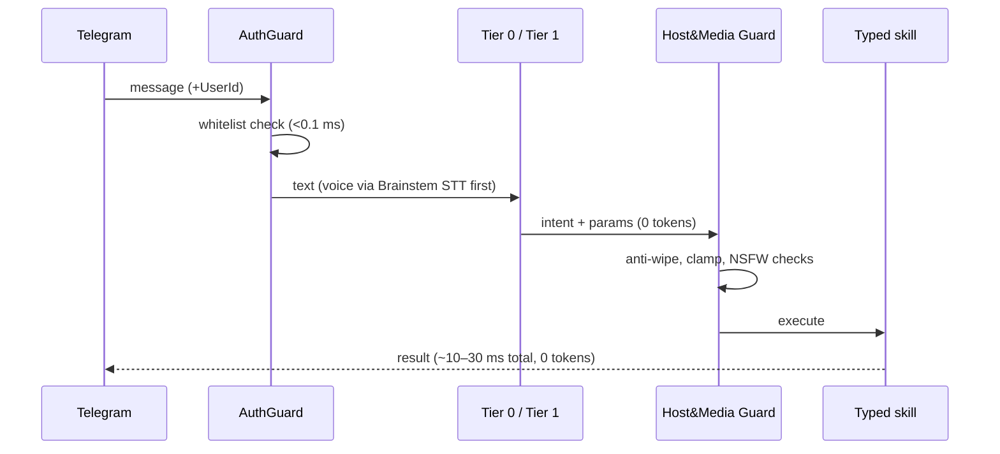

# arc42 §6 — Runtime View

Conventions: all timings are **local-only budgets** on reference hardware
([C-013](02-architecture-constraints.md)). Telegram network time is excluded everywhere.

## Scenario R-01 — Fast path (Path A)



Failure paths: unknown sender → drop + log; guard block → user-facing refusal with
rule ID; skill error → `IsolatedWorkerBase` quarantine after 3/min.

## Scenario R-02 — Heavy agent task (Path B)

```mermaid
sequenceDiagram
    participant T1 as Tier 1 (miss)
    participant BG as BudgetGovernor
    participant SN as Sanitizer
    participant T3 as Tier 2/3 LLM
    participant SG as SecurityGuard
    participant SB as Sandbox
    T1->>BG: pre-flight (tokenize, quota check)
    BG->>SN: cleared prompt (RemoteCloud only)
    SN->>T3: invoke (MaxOutputTokens enforced)
    T3->>SG: tool proposal
    SG->>SG: AST + taint check; strip host tools if tainted
    SG->>SB: execute (sandbox) / RequiresApproval → Owner
    BG-->>T1: soft limit → PausedByBudget + checkpoint + buttons
```

Failure paths: budget exceeded → pause (never silent drop); `/stop` → priority-channel
cancel (<50 ms local); sandbox timeout → hard kill; crash mid-run → recovery policy
(`ResumeFromCheckpoint` / `CancelledByCrash`).

## Scenario R-03 — Proactive / meeting (Path C)

Hangfire trigger → aggregate from SQLite (0 tokens) → optional Tier 2/3 summarization
under budget → Telegram brief with action buttons. Meeting: `NAudio` capture →
Brainstem Whisper (0 tokens) → extract Action Items → `[➕ Save]` confirmed write.

## Scenario R-04 — Netrunner DAG with HITL and crash

`TriggerNode → SkillNode → NetrunnerScriptNode (schema-validated) → ConditionNode →
LlmProcessNode (optional, budgeted) → HitlApprovalNode (checkpoint, zero held
resources) → DeliveryNode`. Crash between steps: step checkpoints in `netrunner.db`
survive; on restart the global `Pipeline:CrashRecoveryPolicy` selects resume vs
`CancelledByCrash`; non-idempotent interrupted steps require Owner confirmation.
Missed-cron catch-up follows the workflow's `misfirePolicy`.
