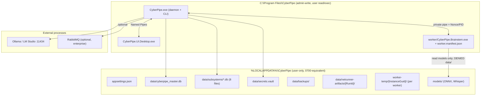

# arc42 §7 — Deployment View

Target: single-user Windows 10/11 PC (MVP). Linux/macOS deferred
([constrained](02-architecture-constraints.md) `C-002`).

## Operational rules

- Daemon autostart in the **interactive session** (`LogonTrigger` / `systemd --user` /
  `launchd` agent), never Session 0 ([C-014](02-architecture-constraints.md)).
- Install dir is admin-write; data dir is user-private and ACL-denied to the Brainstem
  SID (Windows) / unmounted (Linux) / seatbelt-denied (macOS).
- Updates are side-by-side (`app-{version}/`) with pre-migration backup and
  `doctor --verify-update` gate; rollback restores the previous version + DB backup.
- Resource envelope: Job Object (`ActiveProcessLimit=1`, memory/CPU caps, kill-on-close)
  on Windows; `cgroups v2` on Linux; `setrlimit` + seatbelt on macOS.
- Reference hardware for SLOs: 4+ CPU cores, NVMe SSD, warm process; CLI round-trip
  p95 < 25 ms; Brainstem cold start (parser, no Whisper weights) p95 < 80 ms.
