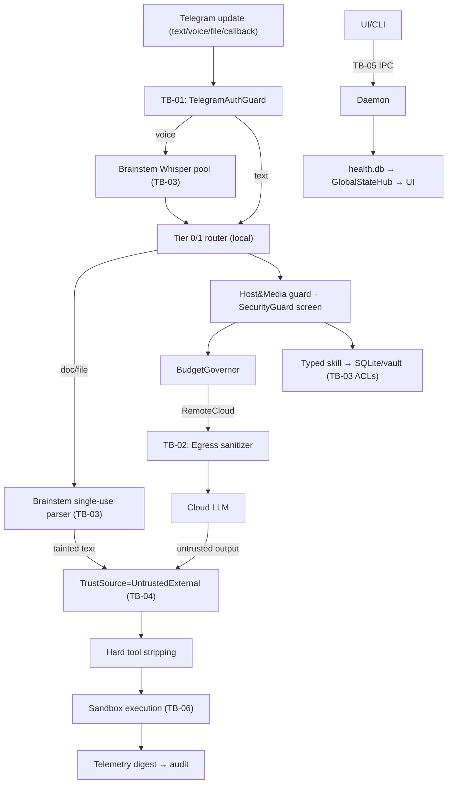

# Threat Model — Data Flows

## Storage locations of sensitive data

| Data | Location | Protection (planned) |
| :--- | :--- | :--- |
| Per-subsystem DB keys | `data/secrets.vault` (AES-256-GCM, OS-bound master) | ACL-deny Brainstem; `ZeroMemory`; rotation story |
| 8 subsystem DBs + master | `data/*.db`, `data/subsystems/*.db` (WAL) | SQLCipher **iff PoC passes**; OS ACLs meanwhile |
| Checkpoints, DAG snapshots | `budget.db`, `netrunner.db` | Same as above; no secrets in plaintext columns by policy |
| Session/nonces | Process memory only (OTT hash, 30-s TTL; sessions 4 h) | Burn-on-use; never logged |
| Logs, digests | Local log files + Telegram/audit surfaces | Post-sanitizer only |
| Run artifacts | `data/netrunner-artifacts/{RunId}/` | Per-run isolation; quota 128 MB; GC on completion |

## Entry points

Telegram updates (incl. voice/files/callbacks), UI/CLI IPC commands, Hangfire cron +
watchdog events, dashboard login URL, Netrunner package registration (6-file validator +
sandbox dry-run + HITL gate), model-catalog selection (endpoint/keys into vault).
