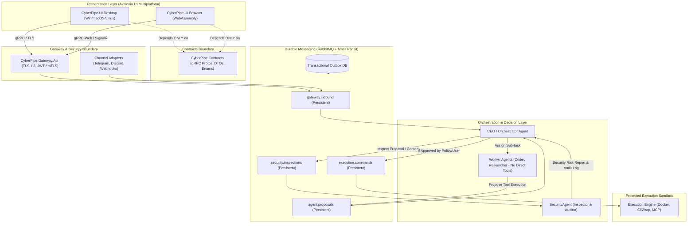

# 02. Диаграмма взаимодействия и потоков данных

В архитектуре **CyberPipe** слои строго разграничены. Презентационный уровень изолирован защищенным периметром Gateway, а все внутренние процессы взаимодействуют через персистентную шину сообщений RabbitMQ с поддержкой Transactional Outbox.

---

### Схема архитектурных слоев и маршрутизации

---

### Описание жизненного цикла пользовательского запроса:
1. Запрос поступает из Avalonia UI (через gRPC-стрим) или из внешнего канала (Telegram/Discord).
2. Gateway валидирует права и помещает задачу в персистентную очередь `gateway.inbound` через Outbox-транзакцию.
3. **CEO Agent** считывает задачу, декомпозирует её и создает изолированные воркеры с чистым контекстом.
4. Воркер в процессе ReAct-цикла решает вызвать инструмент и публикует предложение `ProposeToolExecution` в очередь `agent.proposals`.
5. CEO перенаправляет предложение на инспекцию в `SecurityAgent`.
6. `SecurityAgent` проводит многоуровневый анализ и возвращает отчет `SecurityInspectionReport`.
7. CEO Agent решает: исполнить команду в `ExecutionEngine`, запросить ручное одобрение у человека в UI или отклонить.
