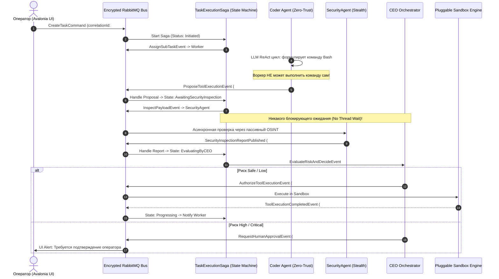

# 04. Паттерн "Zero-Trust Agent Proposal" и асинхронные саги

В **CyberPipe** выполнение действий разделено на две независимые стадии: **Формирование предложения (Proposal)** и **Авторизованное исполнение (Execution)**. Вся коммуникация построена на асинхронных конечных автоматах (MassTransit State Machine Saga), что исключает блокировку потоков операционной системы при сохранении строгой последовательности шагов и надежной защиты от дедлоков и гонок.

---

### Асинхронный недетерминированный жизненный цикл задачи



---

### Защитные механизмы саг и мультиагентного взаимодействия

#### 1. Защита от бесконечного A2A пинг-понга (`HopCountGuard`)
При взаимодействии агентов друг с другом (Agent-to-Agent / A2A) каждое сообщение сопровождается метаданными трассировки:
```csharp
public record AgentMessageMetadata(
    Guid CorrelationId,
    Guid MessageDeduplicationId,
    int HopCount, // Текущая глубина пересылки
    int MaxHopLimit = 5 // Жесткий предел
);
```
Если сабагент А вызывает сабагента Б, а тот отправляет запрос обратно сабагенту А, при `HopCount > MaxHopLimit` цепочка принудительно перехватывается сагой и передается на ручной арбитраж CEO Agent, предотвращая бесконечные циклы вызовов и сжигание токенов.

#### 2. Дедупликация и оптимистичная блокировка (ETags / Versioning)
Чтобы избежать ситуации, когда две параллельные команды на одной сессии приводят к конфликтам и дублированию ответов в пользовательские каналы:
* Каждое сообщение снабжено `MessageDeduplicationId`. Повторно доставленные сообщения отбрасываются брокером без повторного вызова LLM.
* Состояние сессии защищено версионным токеном `ETag`. Если два фоновых процесса попытаются одновременно модифицировать контекст сессии, один из них завершится контролируемым откатом (`OptimisticConcurrencyException`) с автоматическим последовательным повтором в саге.

#### 3. Безопасный Hot-Reload конфигурации (`IOptionsSnapshot<T>`)
Вместо глобальной смены настроек, убивающей активные задачи агентов:
* Все активные задачи выполняются в контексте своего неизменяемого снимка конфигурации `IOptionsSnapshot<T>`.
* Изменения конфигурационных файлов (манифестов, ключей, лимитов) мгновенно подхватываются **только для вновь создаваемых задач**, позволяя текущим вызовам завершиться стабильно.

#### 4. Инкрементальный кэш системного контекста
Для предотвращения повторной инжекции системных bootstrap-файлов и расхода до 30% лишних токенов на каждом ходу:
* Базовые инструкции и правила форматируются в виде неизменяемого префикса системного промпта.
* Слой `Microsoft.Extensions.AI` кэширует хеш префикса, отправляя в провайдер LLM только дельту пользовательских реплик и результатов выполнения инструментов.

#### 5. Атомарные файловые инструменты с поддержкой Append
Все инструменты модификации файлов в песочницах поддерживают обязательные флаги:
```csharp
public record WriteFileArgs(
    string FilePath,
    string Content,
    bool Append = false, // Защита от случайной перезаписи общих файлов
    bool CreateDirectories = true
);
```

---

### Сохранение последовательности без блокировок (State Machine)

Конечный автомат задачи (`TaskExecutionState`) отслеживает состояние в защищенной базе данных и шине:

```csharp
namespace CyberPipe.Infrastructure.Bus.Sagas;

public class TaskExecutionState : SagaStateMachineInstance
{
    public Guid CorrelationId { get; set; }
    public string CurrentState { get; set; } = null!;
    public Guid TaskId { get; set; }
    public Guid CurrentProposalId { get; set; }
    public int PendingStepIndex { get; set; }
    public int CurrentHopCount { get; set; }
    public string ETag { get; set; } = Guid.NewGuid().ToString("N");
    
    // Зашифрованные контекстные данные саги
    public byte[] EncryptedContextPayload { get; set; } = null!;
    public DateTimeOffset LastUpdatedUtc { get; set; }
}
```

* Поток ОС **не ждет** ответа от `SecurityAgent` или `Worker`. Поток освобождается в пул потоков .NET 10.
* Сохранение очередности: Сага не перейдет в состояние `ExecutingTool`, пока в очередь не придет коррелирующее событие `SecurityInspectionReportPublished` с соответствующим `PendingStepIndex`.
