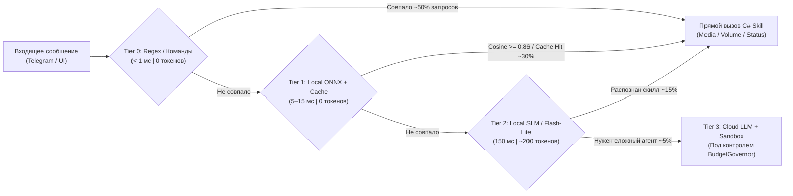

# 04. Каскадный Маршрутизатор (Zero-Token Fast-Path), Контроль Бюджета и Механизмы Паузы/Остановки

Главная проблема классических агентных систем — они отправляют **каждый чих** в тяжелую облачную LLM вместе с огромным системным промптом и 50 схемами инструментов, сжигая тысячи токенов и заставляя пользователя ждать по 5–15 секунд даже на команду *«включи музыку»* или *«сделай потише»*.

В **CyberPipe** эта проблема решена архитектурно: **Детерминированный C#-Оркестратор**, **4-уровневый каскадный роутер (`TieredIntentRouter`)** и жесткий **Контроллер Бюджета (`TokenBudgetGovernor`)** с функциями мгновенной паузы и остановки.

---

### 1. Четырехуровневый Каскадный Маршрутизатор (`TieredIntentRouter`)

Запрос из Telegram или UI проходит через фильтр от самого быстрого и бесплатного уровня к более сложному **только при необходимости**:



#### Уровень 0 (`Tier 0`): Детерминированный Fast-Path (`0 токенов`, `< 1 мс`)
* Обрабатывает слэш-команды (`/play`, `/pause`, `/next`, `/vol 40`, `/stop`, `/status`, `/budget`) и быстрые шаблоны естественного языка:
  * `^(включи|поставь|запусти)\s+(музыку|трек|плейлист|радио)(?<query>.*)$`
  * `^(громкость|звук|сделай)\s+(на\s+)?(?<vol>\d{1,3}|потише|погромче|выключи|mute)$`
  * `^(пауза|стоп|останови|хватит)$`
* **Никакого ИИ:** Команда за долю миллисекунды превращается в строго типизированный вызов `MediaSkill` или `AudioSkill` и проходит проверку в `HostSafetyGuard`.

#### Уровень 1 (`Tier 1`): Локальный Семантический Роутер и Кэш (`0 облачных токенов`, `5–15 мс`)
* Если пользователь написал нестандартно или с опечатками (например: *«братан подруби что-нибудь спокойное фоном»*, *«убавь шарманку чтобы не орала»*):
  1. Локальная ONNX-модель эмбеддингов в памяти (`multilingual-e5-small`, ~110 МБ RAM) вычисляет вектор фразы за `~5 мс` на обычном процессоре.
  2. Через аппаратные инструкции SIMD (`TensorPrimitives.CosineSimilarity` в .NET 10) вектор сравнивается с эталонными примерами всех скиллов помощника.
  3. При сходстве `>= 0.86` вызывается соответствующий локальный скилл без обращения к внешним API!
  4. Также проверяется **Локальный Семантический Кэш (`SemanticResponseCache` в SQLite)**: если на аналогичный информационный запрос уже отвечали недавно, ответ берется из кэша за `0 токенов`.

#### Уровень 2 (`Tier 2`): Локальная Микро-LLM или Ультра-дешевый Классификатор (`~150–300 мс`)
* Если фраза содержит сложные параметры (*«поставь таймер на 15 минут и включи джаз на 20 процентов»*), запрос направляется:
  * Либо в **локальную микро-модель** (например, `Qwen2.5-3B` / `Llama-3.2-3B` через локальный `Ollama` / `ONNX`) — **0$ расходов**.
  * Либо в самую дешевую облачную модель класса `Flash-Lite` / `Mini` со сжатым промптом.
* **Dynamic Tool Pruning (Динамическая обрезка тулов):** Вместо отправки описаний всех 50 инструментов системы, векторный фильтр из `Tier 1` отбирает **только топ-3 подходящих инструмента** (например, `AudioSkill`, `MediaSkill`, `TimerSkill`). Входной промпт весит всего **~200–300 токенов** вместо 8 000!

#### Уровень 3 (`Tier 3`): Полноценный Агентный Цикл (`Cloud LLM + Sandbox`)
* Активируется **только для ~5–10% действительно сложных задач** (написание и отладка кода, глубокое исследование, работа с файлами в песочнице).
* Здесь также действуют жесткие правила экономии токенов:
  * **Инкрементальный кэш префикса (Prompt Caching):** Системный промпт статичен и кэшируется на стороне провайдера (скидка до 75–90% на чтение).
  * **Обрезка вывода инструментов (`ToolOutputTruncator`):** Вывод любого скрипта или веб-страницы жестко обрезается до `1 500 символов` (начало + конец + сводка ошибок), чтобы случайный дамп лога не сжег весь контекст.
  * **Скользящее окно контекста (`Sliding Window`):** В облако передаются только последние `4–6` реплик диалога, а не вся переписка за неделю.

---

### 2. Контроллер Бюджета (`TokenBudgetGovernor`) и Защита от Бешеного Расхода

Ни один запрос к платной LLM не может обойти `TokenBudgetGovernor` (реализован как обязательный `DelegatingChatClient` middleware в `Microsoft.Extensions.AI`).

```csharp
namespace CyberPipe.Security.Budget;

public record BudgetPolicyOptions
{
    // Лимиты на ОДНУ задачу
    public int SoftTaskTokenLimit { get; init; } = 4_000;   // Порог автоматической ПАУЗЫ
    public int HardTaskTokenLimit { get; init; } = 12_000;  // Абсолютный потолок задачи
    public int MaxLlmTurnsPerTask { get; init; } = 3;       // Макс. шагов без спроса у человека

    // Защита от внезапного всплеска (Burn-Rate Circuit Breaker)
    public int MaxTokensPerMinute { get; init; } = 15_000;  // Стоп-кран при бешеном расходе

    // Дневной лимит
    public decimal DailyBudgetUsdCap { get; init; } = 0.50m; // Потолок в день (по умолчанию $0.50)
}
```

#### Механизм 1: Предварительный подсчет токенов (Pre-Flight Check)
До отправки HTTP-запроса в OpenAI/Anthropic/Gemini локальный токенизатор (`Microsoft.ML.Tokenizers`) за `< 1 мс` считает точное число входных токенов. Если запрос превышает лимит — он блокируется **до того, как провайдер спишет деньги**.

#### Механизм 2: Автоматическая Пауза при Подозрении на Перерасход (`TaskPausedByBudget`)
Если агент на уровне `Tier 3` застрял в цикле, сделал уже `3` вызова LLM или израсходовал `SoftTaskTokenLimit` (например, 4 000 токенов):
1. `TokenBudgetGovernor` **принудительно замораживает выполнение задачи** (`TaskState = PausedBudgetApproval`).
2. Текущий контекст и промежуточный результат сохраняются в локальную SQLite БД.
3. Пользователю в Telegram (и в Avalonia UI) мгновенно приходит сообщение с инлайн-кнопками:
   > ⚠️ **Пауза: Контроль расходов**  
   > Задача *«Анализ логов»* уже выполнила 3 шага и потратила **4 120 токенов (~$0.008)**.  
   > Что делаем дальше?  
   > `[▶️ Разрешить еще +5 000 токенов]`  
   > `[⚡ Завершить сейчас и выдать краткий итог]`  
   > `[🛑 Полностью отменить]`

#### Механизм 3: Velocity Circuit Breaker (Автомат защиты от сжигания бюджета)
Если из-за бага, спама или зависшего цикла скорость расхода токенов превышает `MaxTokensPerMinute` (например, > 15 000 токенов за 60 секунд), срабатывает **глобальный предохранитель (Circuit Breaker)**:
* Все платные вызовы LLM переводятся в режим `Open (Blocked)` на 15 минут или до ручного сброса владельцем.
* При этом **локальные функции помощника (`Tier 0` и `Tier 1` — музыка, громкость, таймеры, статус ПК) продолжают работать штатно и без задержек!**

---

### 3. Мгновенный Стоп-Кран (`Priority Kill-Switch`)

Пользователь в любой момент может остановить любой запрос или затянувшуюся генерацию:
* В памяти процесса работает потокобезопасный реестр `ActiveExecutionRegistry`, хранящий `CancellationTokenSource` для каждой активной задачи по `ChatId` и `TaskId`.
* Команды `/stop`, `/pause`, `стоп`, `хватит` в Telegram или кнопка `[🛑 Stop]` в UI идут по **выделенному приоритетному каналу управления (`PriorityControlChannel`)**, минуя очередь обычных сообщений.
* Вызов `cts.Cancel()` происходит за **`< 20–50 мс`**:
  1. Немедленно разрывается активное HTTP-соединение со стримом LLM (генерация токенов прекращается в ту же миллисекунду).
  2. Если в песочнице запущен дочерний процесс (`CliWrap` / `Docker`), ему немедленно посылается `SIGKILL` / `Kill(entireProcessTree: true)`.

---

### 4. Легковесный Конечный Автомат Задачи (Без внешнего брокера)

Вместо тяжеловесных распределенных саг RabbitMQ состояние многошаговых задач управляется быстрым локальным автоматом с сохранением чекпоинтов в SQLite:

```csharp
namespace CyberPipe.Core.Orchestration;

public enum TaskLifecycleState
{
    FastPathExecuted = 0,         // Выполнено мгновенно через Tier 0/1 (0 токенов)
    RunningLlmStep = 1,           // Выполняется шаг в Tier 2/3
    AwaitingSecurityApproval = 2, // Ожидает подтверждения опасного действия от пользователя
    PausedByBudget = 3,           // На паузе: ждет решения пользователя по расходу токенов
    PausedByUser = 4,             // Поставлено на паузу командой /pause
    Completed = 5,
    CancelledOrAborted = 6
}
```
* Дедупликация по `UpdateId` (из Telegram) и `MessageDeduplicationId` защищает от повторного выполнения команды при сбоях связи.
* Ограничитель `MaxHopLimit = 3` физически не дает агентам устроить бесконечный пинг-понг.
