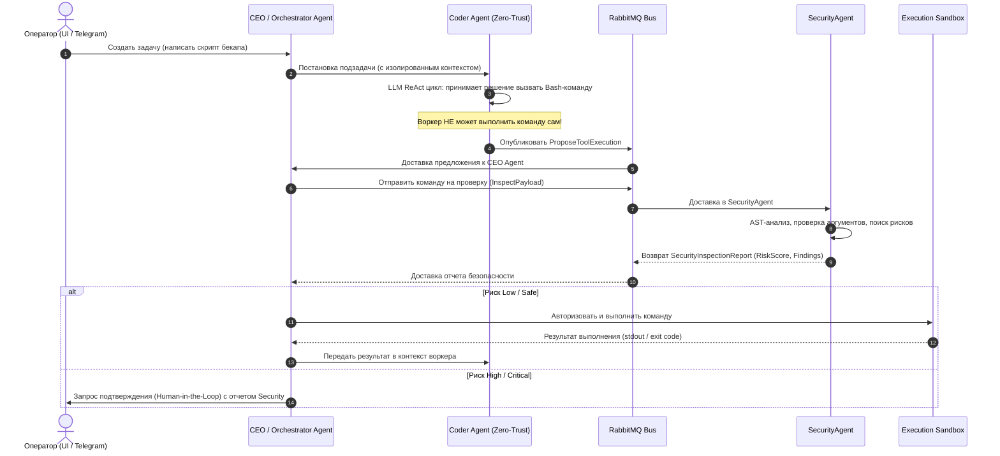

# 04. Паттерн "Zero-Trust Agent Proposal"

В классических агентных системах (AutoGPT, OpenClaw и др.) каждый агент часто имеет прямой доступ к вызову функций (Function Calling) и немедленному исполнению команд в терминале. В **CyberPipe** это категорически запрещено.

---

### Архитектурный принцип

Воркеры (Coder, Researcher, Tester) функционируют в режиме **чистого генератора решений** (Pure Reasoners). У них физически отсутствуют ссылки на библиотеки выполнения (`CliWrap`, `Docker.DotNet`, `System.IO`).



---

### Модели данных (DTO контрактов)

#### 1. Предложение выполнения инструмента:
```csharp
namespace CyberPipe.Contracts.Messages;

public record ProposeToolExecution(
    Guid ProposalId,
    Guid TaskId,
    Guid AgentId,
    string ToolName,
    IReadOnlyDictionary<string, object> Arguments,
    string Justification,
    DateTimeOffset ProposedAtUtc
);
```

#### 2. Запрос на авторизацию выполнения:
```csharp
namespace CyberPipe.Contracts.Messages;

public record AuthorizeToolExecution(
    Guid ProposalId,
    Guid ApprovedByAgentId, // Всегда CEO Agent
    bool RequiresSandboxIsolation,
    TimeSpan Timeout
);
```
