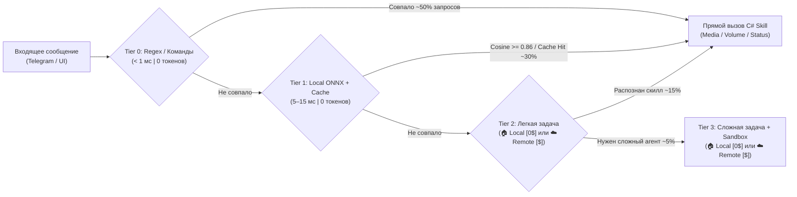

# 04. Каскадный Маршрутизатор (Zero-Token Fast-Path), Контроль Бюджета и Механизмы Паузы/Остановки

Главная проблема классических агентных систем — они отправляют **каждый чих** в тяжелую облачную LLM вместе с огромным системным промптом и 50 схемами инструментов, сжигая тысячи токенов и заставляя пользователя ждать по 5–15 секунд даже на команду *«включи музыку»* или *«сделай потише»*.

В **CyberPipe** эта проблема решена архитектурно: **Детерминированный C#-Оркестратор**, **4-уровневый каскадный роутер (`TieredIntentRouter`)** и жесткий **Контроллер Бюджета (`TokenBudgetGovernor`)** с функциями мгновенной паузы и остановки.

---

### 1. Четырехуровневый Каскадный Маршрутизатор (`TieredIntentRouter`)

Запрос из Telegram или UI проходит через фильтр от самого быстрого и бесплатного уровня к более сложному **только при необходимости**:



#### Предварительный конвейер: Голос и OCR (`0 токенов LLM`)
* Если из Telegram приходит голосовое сообщение или аудиозапись звонка, локальный модуль **`Whisper.net` (ONNX)** внутри прогретого пула `CyberPipe.Brainstem` за `0.3–0.8 с` переводит речь в текст на CPU/GPU без облачных API.
* Если команда обращается к скриншоту в буфере обмена или PDF/DOCX файлу, текст извлекается локально (`IScreenOcrProvider` / одноразовый процесс `Brainstem` с `PdfPig`), маркируется источником доверия (`MemoryTrustSource.UntrustedExternal` для внешних документов) и передается в роутер, а очистка через `CentralDataSanitizer` применяется на выходном шлюзе (Egress) перед отправкой в `RemoteCloud`, логи и Telegram.

#### Уровень 0 (`Tier 0`): Детерминированный Fast-Path (`0 токенов`, `< 1 мс`)
* Обрабатывает слэш-команды (`/play`, `/pause`, `/vol 40`, `/mode coding`, `/mode call`, `/focus 50m`, `/repos`, `/standup`, `/lock`, `/sleep`, `/stop`, `/status`, `/budget`) и быстрые шаблоны естественного языка:
  * **Медиа и ПК:** `^(включи|поставь|запусти)\s+(музыку|трек|плейлист|радио)(?<query>.*)$`, `^(громкость|звук|сделай)\s+(на\s+)?(?<vol>\d{1,3}|потише|погромче|выключи|mute)$`
  * **Личные финансы и заметки:** `^(расход|потратил|кофе|такси|обед)\s+(?<amount>\d+)\s*(?<comment>.*)$`, `^(запомни|заметка|идея):\s*(?<text>.+)$`
  * **Разработка и инфраструктура:** `^(статус\s+репозиториев|гит\s+статус|проверь\s+сервера)$`
* **Никакого ИИ и нулевой дисковый I/O на проверке:** Команда за долю миллисекунды превращается в строго типизированный вызов `MediaSkill`, `WorkspaceProfileSkill`, `FinanceSkill` или `GitRepoRadarSkill` и проходит проверку в `HostSafetyGuard`.

#### Уровень 1 (`Tier 1`): Семантический Роутер, Память «Второй мозг» и Кэш (`0 токенов LLM`, `5–15 мс`)
* Если пользователь написал нестандартно или с опечатками (*«братан подруби что-нибудь спокойное фоном»*, *«что у меня сегодня по встречам и задачам?»*, *«найди куда я сохранял ставку клиента Ивана»*):
  1. Локальная ONNX-модель эмбеддингов в памяти (`multilingual-e5-small`, ~110 МБ RAM, работающая внутри `CyberPipe` над проверенным текстом после `QuotaBoundedStream`) вычисляет вектор фразы за `~5 мс` на обычном процессоре.
  2. Через аппаратные инструкции SIMD (`TensorPrimitives.CosineSimilarity` в .NET 10) вектор сравнивается с эталонными примерами всех скиллов помощника (Личные дела, Код/DevOps, Бизнес/CRM).
  3. При сходстве `>= 0.86` вызывается соответствующий локальный скилл без обращения к LLM!
  4. **Поиск в `KnowledgeVault` и `DevMemory` (`SQLite FTS5 + In-Memory SIMD Buffer`):** плоский буфер нормализованных векторов в памяти (`Memory<float>`, `~15 МБ` на 10 000 записей) мгновенно (`< 1.5 мс`) находит сохраненные заметки, карточки клиентов из личной CRM или прошлые решения редких багов (`/remember-fix`) за `0 токенов` без чтения всех BLOB с диска.
  5. **Раздельный Семантический Кэш (`SemanticIntentCache` + ролевой `SemanticResponseCache`):**
     * `SemanticIntentCache` кэширует сопоставление `Фраза -> Intent + SkillName` (безопасно для динамических команд).
     * `SemanticResponseCache` кэширует ответы только для статических справочных запросов со строгим ключом **`(UserRole: Owner | Guest, ExpiresAtUtc)` и `TTL = 24 часа`**, полностью исключая утечку приватных ответов `Owner` пользователю с ролью `Guest` и выдачу устаревших сводок.

#### Уровень 2 (`Tier 2`): Быстрый Классификатор и Извлечение Параметров (`Выбор пользователя в UI: 🏠 Local или ☁️ RemoteCloud`)
* Если фраза содержит сложные составные параметры (*«поставь таймер на 15 минут, напомни в четверг написать Алексею по КП и сгенерируй коммит для текущих изменений»*), запрос направляется в модель, которую **пользователь сам назначил для `Tier 2` в Avalonia UI**:
  * **Вариант А — `ModelHostingType.Local` (`0$ расходов`, локальный HTTP-сервер `Ollama / LM Studio`):** Любая модель из **Curated-списка 15 локальных моделей** (например, легкие `Qwen3-0.6B` [400 МБ], `Qwen3-1.7B` [1.2 ГБ], `Phi-4 Mini` [2.5 ГБ], `Qwen3-4B` [2.6 ГБ], `SmolLM3-3B` [2 ГБ]), подобранная под RAM/VRAM пользователя сервисом **`IModelCompatibilityAdvisor`** на основе данных от **`IHardwareCapabilitiesProbe`** (см. [`13-model-advisor-and-tier-configuration.md`](file:///c:/Users/Conqueror/source/repos/CyberPipeline/docs/plans/13-model-advisor-and-tier-configuration.md)).
  * **Вариант Б — `ModelHostingType.RemoteCloud` (`Платный API`):** Любая быстрая облачная модель из **Curated-списка для легких задач** (`Gemini 2.5 Flash-Lite`, `GPT-4.1-nano / GPT-4o-mini`, `Claude 3.5 Haiku`, `DeepSeek-V3`).
* **Четкое понимание типа модели приложением:** Приложение и пользователь явно видят статус `Local` vs `RemoteCloud`. Для `Local` модели `TokenBudgetGovernor` не списывает долларовый бюджет (`$0.00`), но `ISystemResourceMonitor` контролирует свободную RAM ПК. Для `RemoteCloud` модели включается строгий долларовый учет и выходной шлюз `CentralDataSanitizer`.
* **Dynamic Tool Pruning и защита от Taint Propagation (`MemoryTrustSource`):** Вместо отправки описаний всех 50 инструментов системы, векторный фильтр из `Tier 1` отбирает **только топ-3 подходящих инструмента** и **топ-3 доверенных факта из `KnowledgeVault` (`TrustSource <= ToolOutput`)**. Если в контекст задачи включены данные с меткой `UntrustedExternal` (режим `TaintedContext`), все схемы хостовых скиллов управления ПК физически удаляются из `ChatOptions.Tools` (`Hard Tool Stripping`). Входной промпт весит всего **~200–350 токенов** вместо 8 000!

#### Уровень 3 (`Tier 3`): Полноценный Агентный Цикл (`Выбор пользователя в UI: 🏠 Local или ☁️ RemoteCloud` + `Sandbox`)
* Активируется **только для ~5–10% действительно сложных задач** (отладка упавших тестов и написание кода, аудит PDF-договоров на юридические/финансовые риски, выжимка протокола и Action Items из часового созвона, генерация КП).
* Пользователь в UI также сам выбирает модель для `Tier 3` с явной маркировкой `Local` или `RemoteCloud`:
  * **Если выбрана `Local` модель из Curated-списка 15 моделей** (через `Ollama / LM Studio`, например `Qwen3-8B`, `Llama 3.1 8B Instruct`, `GLM-4-9B-0414`, `DeepSeek-R1 Distill 8B`, `Gemma 3 4B`, `Phi-4 Mini Reasoning` — если позволяет RAM/VRAM ПК по расчету `IModelCompatibilityAdvisor`): полная автономность и `0$` за токены.
  * **Если выбрана `RemoteCloud` модель из Curated-списка платных моделей** (`Claude 3.7 Sonnet`, `GPT-4.1 / o3-mini`, `Gemini 2.5 Pro`, `DeepSeek-R1 API`): максимальное качество под защитой `TokenBudgetGovernor` (с авто-паузой в Telegram при достижении порога токенов).
* Здесь также действуют жесткие правила экономии токенов и ресурсов:
  * **Инкрементальный кэш префикса (Prompt Caching):** Системный промпт статичен и кэшируется (скидка до 75–90% на чтение в облаке и мгновенный KV-cache локально).
  * **Обрезка вывода инструментов (`ToolOutputTruncator`):** Вывод любого скрипта, `dotnet build/test` или веб-страницы жестко обрезается до `1 500 символов` (начало + конец + сводка ошибок `Error/Exception`).
  * **Скользящее окно контекста (`Sliding Window`) + Точечный RAG:** Передаются только последние `4–6` реплик диалога и найденные в `SQLite KnowledgeVault` факты по теме (при рабочем окне контекста локальных моделей по умолчанию `8K–16K` токенов), а не вся переписка за неделю.

---

### 2. Контроллер Бюджета (`TokenBudgetGovernor`) и Защита от Бешеного Расхода

Ни один запрос к платной LLM не может обойти `TokenBudgetGovernor` (реализован как обязательный `DelegatingChatClient` middleware в `Microsoft.Extensions.AI`).

```csharp
namespace CyberPipe.Security.Budget;

public record BudgetPolicyOptions
{
    // Лимиты на ОДНУ задачу
    public int SoftTaskTokenLimit { get; init; } = 4_000;   // Порог автоматической ПАУЗЫ (TaskLifecycleState.PausedByBudget)
    public int HardTaskTokenLimit { get; init; } = 12_000;  // Абсолютный потолок задачи
    public int MaxStepOutputTokens { get; init; } = 2_048;  // Жесткий потолок генерации (включая reasoning-токены) за 1 шаг
    public int MaxLlmTurnsPerTask { get; init; } = 3;       // Макс. шагов без спроса у человека

    // Защита от внезапного всплеска (Burn-Rate Circuit Breaker)
    public int MaxTokensPerMinute { get; init; } = 15_000;  // Стоп-кран при бешеном расходе

    // Дневной лимит
    public decimal DailyBudgetUsdCap { get; init; } = 0.50m; // Потолок в день (по умолчанию $0.50)
}
```

#### Механизм 1: Предварительный подсчет (Pre-Flight Check) и принудительный потолок `MaxOutputTokens`
* До отправки HTTP-запроса локальный токенизатор (`Microsoft.ML.Tokenizers`, `o200k_base`) за `< 1 мс` оценивает число входных токенов. Для не-OpenAI моделей (`Claude`, `Gemini`) на кириллическом тексте применяется защитный коэффициент `1.2x`, а итоговое списание в `BudgetLedger` выполняется строго по фактическому `UsageDetails` (`InputTokenCount`, `OutputTokenCount`, включая скрытые токены рассуждений) из ответа API по раздельным тарифам `InputCostPer1M` и `OutputCostPer1M`.
* Перед каждым вызовом `IChatClient` контроллер принудительно выставляет **`options.MaxOutputTokens = Math.Min(policy.MaxStepOutputTokens, remainingTaskTokens)`**, физически не позволяя reasoning-моделям (`o3-mini`, `DeepSeek-R1`, `Claude 3.7 Sonnet`) сжечь дневной бюджет на одном шаге генерации.

#### Механизм 2: Автоматическая Пауза при Подозрении на Перерасход (`TaskLifecycleState.PausedByBudget`)
Если агент на уровне `Tier 3` застрял в цикле, сделал уже `MaxLlmTurnsPerTask (3)` вызова LLM или израсходовал `SoftTaskTokenLimit (4 000 токенов)`:
1. `TokenBudgetGovernor` **принудительно замораживает выполнение задачи** (`TaskLifecycleState.PausedByBudget`).
2. Текущий контекст и промежуточный результат атомарно сохраняются в локальную SQLite БД (`TaskCheckpoints`).
3. Пользователю в Telegram (и в Avalonia UI) мгновенно приходит сообщение с инлайн-кнопками:
   > ⚠️ **Пауза: Контроль расходов**  
   > Задача *«Анализ логов»* уже выполнила 3 шага и потратила **4 120 токенов (~$0.008)**.  
   > Что делаем дальше?  
   > `[▶️ Разрешить еще +5 000 токенов]`  
   > `[⚡ Завершить сейчас и выдать краткий итог]`  
   > `[🛑 Полностью отменить]`
4. При нажатии **`[▶️ Разрешить еще +5 000 токенов]`** текущий мягкий порог задачи увеличивается на **`+5 000 токенов` и `+3 шага` (`MaxLlmTurnsPerTask += 3`)**, но никогда не может превысить абсолютный потолок `HardTaskTokenLimit (12 000 токенов)`.

#### Механизм 3: Velocity Circuit Breaker (Автомат защиты от сжигания бюджета)
Если из-за бага, спама или зависшего цикла скорость расхода токенов превышает `MaxTokensPerMinute` (например, > 15 000 токенов за 60 секунд), срабатывает **глобальный предохранитель (Circuit Breaker)**:
* Все платные вызовы LLM переводятся в режим `Open (Blocked)` на 15 минут или до ручного сброса владельцем.
* При этом **локальные функции помощника (`Tier 0`, `Tier 1` и локальные модели — музыка, громкость, таймеры, статус ПК) продолжают работать штатно и без задержек!**

---

### 3. Мгновенный Стоп-Кран (`Priority Kill-Switch`)

Пользователь в любой момент может остановить любой запрос или затянувшуюся генерацию:
* В памяти процесса работает потокобезопасный реестр `ActiveExecutionRegistry`, хранящий `CancellationTokenSource` для каждой активной задачи по `ChatId` и `TaskId`.
* Команды `/stop`, `/pause`, `стоп`, `хватит` в Telegram или кнопка `[🛑 Stop]` в UI идут по **выделенному приоритетному каналу управления (`PriorityControlChannel`)**, минуя очередь обычных сообщений.
* Вызов `cts.Cancel()` происходит за **`< 20–50 мс`** (при этом запись в `InFlightOperations` штатно очищается в `finally`, не попадая в `Poison-Pill`):
  1. Немедленно разрывается активное HTTP-соединение со стримом LLM (генерация токенов прекращается в ту же миллисекунду).
  2. Если в песочнице или `IDevToolProcessRunner` запущен дочерний процесс (`OS Sandbox` / `Wasmtime` / `Docker` / `Brainstem`), ему немедленно посылается сигнал отмены и `Kill(entireProcessTree: true)`.

---

### 4. Легковесный Конечный Автомат Задачи (Без внешнего брокера)

Вместо тяжеловесных распределенных саг RabbitMQ состояние многошаговых задач управляется быстрым локальным автоматом с сохранением чекпоинтов в SQLite:

```csharp
namespace CyberPipe.Contracts.Enums;

public enum TaskLifecycleState
{
    FastPathExecuted = 0,         // Выполнено мгновенно через Tier 0/1 (0 токенов)
    RunningLlmStep = 1,           // Выполняется шаг в Tier 2/3
    AwaitingSecurityApproval = 2, // Ожидает подтверждения опасного действия от пользователя
    PausedByBudget = 3,           // На паузе: ждет решения пользователя по расходу токенов (+5k токенов / +3 шага)
    PausedByUser = 4,             // Поставлено на паузу командой /pause
    Completed = 5,
    CancelledOrAborted = 6
}
```
* Дедупликация по `UpdateId` (из Telegram) и `MessageDeduplicationId` защищает от повторного выполнения команды при сбоях связи.
* Ограничитель `MaxHopLimit = 3` физически не дает агентам устроить бесконечный пинг-понг.
