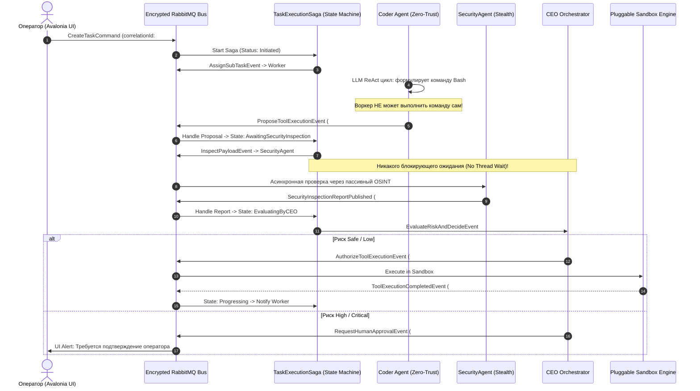

# 04. Паттерн "Zero-Trust Agent Proposal" и асинхронные саги

В **CyberPipe** выполнение действий разделено на две независимые стадии: **Формирование предложения (Proposal)** и **Авторизованное исполнение (Execution)**. Вся коммуникация построена на асинхронных конечных автоматах (MassTransit State Machine Saga), что исключает блокировку потоков операционной системы при сохранении строгой последовательности шагов.

---

### Асинхронный недетерминированный жизненный цикл задачи



---

### Сохранение последовательности без блокировок (State Machine)

Конечный автомат задачи (`TaskExecutionState`) отслеживает состояние в защищенной базе данных и шине:

```csharp
namespace CyberPipe.Infrastructure.Bus.Sagas;

public class TaskExecutionState : SagaStateMachineInstance
{
    public Guid CorrelationId { get; set; }
    public string CurrentState { get; set; } = null!;
    public Guid TaskId { get; set; }
    public Guid CurrentProposalId { get; set; }
    public int PendingStepIndex { get; set; }
    
    // Зашифрованные контекстные данные саги
    public byte[] EncryptedContextPayload { get; set; } = null!;
    public DateTimeOffset LastUpdatedUtc { get; set; }
}
```

* Поток ОС **не ждет** ответа от `SecurityAgent` или `Worker`. Поток освобождается в пул потоков .NET 10.
* Сохранение очередности: Сага не перейдет в состояние `ExecutingTool`, пока в очередь не придет коррелирующее событие `SecurityInspectionReportPublished` с соответствующим `PendingStepIndex`.

---

### Модели предложений и авторизации

#### 1. Зашифрованное предложение выполнения инструмента:
```csharp
namespace CyberPipe.Contracts.Messages;

public record ProposeToolExecution(
    Guid CorrelationId,
    Guid ProposalId,
    Guid TaskId,
    Guid AgentId,
    string ToolName,
    IReadOnlyDictionary<string, string> Arguments, // Перед отправкой санитизированы!
    string Justification,
    DateTimeOffset ProposedAtUtc
);
```

#### 2. Команда на авторизацию исполнения:
```csharp
namespace CyberPipe.Contracts.Messages;

public record AuthorizeToolExecution(
    Guid CorrelationId,
    Guid ProposalId,
    string SandboxType, // "Docker", "Wasm", "Process"
    TimeSpan ExecutionTimeout,
    IReadOnlyDictionary<string, string> EnvironmentVariables
);
```
