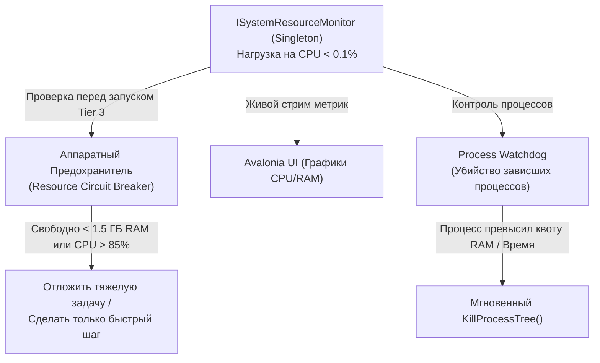

# 10. Мониторинг Ресурсов ПК и Сжатие Телеметрии Песочниц (Защита от Тормозов и Раздутия Контекста)

Умный помощник работает на основном компьютере или домашнем сервере пользователя, поэтому он **ни при каких обстоятельствах не должен вызывать фризы ОС, забивать оперативную память или сжигать токены на чтение гигабайтных логов**.

В этом документе описаны две подсистемы, гарантирующие легкость и предсказуемость работы:
1. **`ISystemResourceMonitor` (Аппаратный предохранитель хоста).**
2. **Потоковый препроцессор телеметрии песочниц (`1 ГБ логов ➔ 30 КБ дайджест` и `1 500 символов` для LLM).**

---

### 1. Realtime Singleton Мониторинга Ресурсов (`ISystemResourceMonitor`)

Потокобезопасный легковесный синглтон опрашивает показатели ОС (CPU, свободная RAM, диск, потребление памяти дочерними процессами) и защищает ПК от перегрузки:



#### Как это защищает комфорт пользователя:
* **Защита от лагов во время игр/работы/музыки:** Если пользователь нагрузил ПК (CPU > 85% или мало свободной RAM), `OrchestratorEngine` автоматически откладывает тяжелые фоновые задачи (`Tier 3` песочницы), но **мгновенно выполняет быстрые команды `Tier 0 / Tier 1`** (переключение музыки, громкость, быстрые ответы).
* **Автоматическое уничтожение зависших процессов (`Process Watchdog`):** Любой дочерний процесс в песочнице запускается с жестким таймаутом (например, 30 секунд) и лимитом памяти. При превышении порога срабатывает `Kill(entireProcessTree: true)` без участия LLM.

---

### 2. Решение проблемы «1 ГБ логов»: Двойная фильтрация (Для Безопасности и для Токенов!)

Когда в песочнице (`Tier 3`) запускается скрипт или сборка проекта, она может выплюнуть мегабайты или гигабайты текста в `stdout` и сгенерировать тысячи сетевых/файловых событий.
Если отправить этот вывод напрямую в LLM — **один запрос сожжет весь дневной бюджет токенов ($)**!

В **CyberPipe** стоит жесткий двухступенчатый фильтр на чистом C#:

```
 [Сырой вывод и активность песочницы (до 1 ГБ)]
                       │
      ┌────────────────┴────────────────┐
      ▼                                 ▼
┌─────────────────────────────────┐ ┌──────────────────────────────────┐
│ 1. ДЛЯ LLM: ToolOutputTruncator │ │ 2. ДЛЯ АУДИТА: TelemetryDigest   │
│ • Жесткий лимит: макс 1500 симв.│ │ • Фильтр Блума (отсев повторов)  │
│ • Берет только Head (500) +     │ │ • Уникальные внешние IP и порты  │
│   Tail (800) + строки с Error   │ │ • SHA256 новых/измененных файлов │
│ • Экономия 99% токенов!         │ │ • Сжатие 1 ГБ ➔ ~30 КБ JSON      │
└─────────────────────────────────┘ └──────────────────────────────────┘
```

#### А. Сжатие вывода для экономии токенов (`ToolOutputTruncator`)
Перед тем как вернуть результат выполнения команды в контекст агента (`Tier 3`), детерминированный фильтр:
1. Вырезает ANSI-коды раскраски терминала, прогресс-бары (`[=====>   ] 45%`) и повторяющиеся строки.
2. Если текст длиннее `1 500 символов` (~350 токенов), оставляет только первые `500 символов`, последние `800 символов` и выделенные строки ошибок (`Error`, `Exception`, `Failed`).
3. Полный лог сохраняется локально на диск: если агенту действительно нужна конкретная строка, он может сделать точечный поиск по файлу, не сжигая тысячи токенов на чтение мусора.

#### Б. Внеполосный сбор телеметрии песочниц (`ExecutionTelemetryDigest`)
Для проверки того, что код внутри песочницы не пытается сделать ничего вредоносного (например, скачать троян или зашифровать файлы в рабочей папке), сбор идет **снаружи песочницы** и сворачивается в компактную структуру:

```csharp
namespace CyberPipe.Contracts.Models.Telemetry;

public record ExecutionTelemetryDigest(
    Guid CorrelationId,
    TimeSpan ExecutionDuration,
    IReadOnlyList<string> UniqueOutboundEndpoints, // Только уникальные внешние IP/домены
    IReadOnlyList<string> ModifiedFiles,           // Созданные/измененные файлы + SHA256
    IReadOnlyList<string> BlockedAccessAttempts,   // Попытки выйти за пределы рабочей папки
    IReadOnlyList<string> TriggeredAnomalyCodes    // "HIGH_ENTROPY_WRITE", "SUSPICIOUS_PORT"
);
```
`SecurityGuard` проверяет этот дайджест **детерминированными правилами C# за ~1 мс (0 токенов)**.

---

### 3. Дисковая гигиена и защита SSD

1. **Автоочистка временных папок (`EphemeralWorkspace`):**
   * Любая временная папка для задачи создается через `await using var ws = new EphemeralWorkspace();` (`IAsyncDisposable`), что гарантирует 100% удаление мусора сразу после завершения или отмены задачи (`/stop`).
2. **Кэш инструментов по хешу (CAS):**
   * Бинарники и зависимости кэшируются один раз по SHA-256 и подключаются в режиме `Read-Only`, не изнашивая SSD повторными перезаписями.
