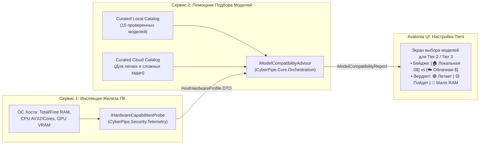

# 13. Конфигурация Tiers (Local vs Remote), Сервис Совместимости Железа и Curated-Каталог Моделей

В **CyberPipe** пользователь сам управляет тем, какая именно модель работает на каждом уровне (`Tier 1`, `Tier 2`, `Tier 3`) прямо из **Avalonia UI**. При этом и **пользователь**, и **само приложение** четко различают, является ли выбранная модель **Локальной (`Local`)** или **Удаленной/Облачной (`RemoteCloud`)**.

Чтобы помочь пользователю выбрать оптимальную локальную модель под его компьютер (без риска повесить систему из-за нехватки ОЗУ/VRAM), в архитектуру встроена связка из двух специализированных сервисов:
1. **`IHardwareCapabilitiesProbe`** — сервис сбора характеристик ПК пользователя (RAM, свободная память, CPU/SIMD, GPU/VRAM, диск).
2. **`IModelCompatibilityAdvisor`** — сервис-помощник, который получает профиль железа от первого сервиса, рассчитывает совместимость каждой модели из курируемого списка и подсказывает оптимальный выбор для легких (`Tier 2`) и сложных (`Tier 3`) задач.

---

## 1. Четкое разделение `Local` vs `RemoteCloud` на каждом Tier

Пользователь может назначить любую модель (локальную или облачную) на любой уровень маршрутизатора. Для каждой привязки хранится явный признак `ModelHostingType`:

```csharp
namespace CyberPipe.Contracts.Enums;

public enum ModelHostingType
{
    Local = 0,       // Работает на ПК пользователя (Ollama / ONNX / Llama.cpp): 0$ за токены, нагрузка на RAM/VRAM
    RemoteCloud = 1  // Внешний платный API (OpenAI / Anthropic / Gemini / DeepSeek): расход $, строгий контроль бюджета
}

public enum ModelTaskCategory
{
    LightFastTier2 = 0,     // Быстрая классификация, извлечение JSON, авто-теги, простые выжимки
    HeavyReasoningTier3 = 1 // Кодинг, сложная логика, анализ договоров, многошаговые агенты
}
```

### Почему приложению важно знать `Local` это или `RemoteCloud`:

| Подсистема CyberPipe | Если для Tier выбрана **`Local`** модель | Если для Tier выбрана **`RemoteCloud`** модель |
| :--- | :--- | :--- |
| **`TokenBudgetGovernor`** | **Стоимость = $0.00.** Запросы не расходуют дневной долларовый лимит (`DailyBudgetUsdCap`). Контролируется только лимит шагов цикла (`MaxLlmTurnsPerTask`), чтобы избежать зависания. | **Платный режим ($).** Точный подсчет стоимости в долларах до и после вызова, жесткий `Velocity Circuit Breaker` и авто-пауза при 70% бюджета задачи. |
| **`ISystemResourceMonitor`** | **Контроль RAM/VRAM.** Перед вызовом проверяется, хватит ли свободной оперативной/видеопамяти на хосте, чтобы не вызвать фриз ОС или игры. | Нагрузка на CPU/RAM хоста нулевая (только легкий HTTP-запрос). |
| **`CentralDataSanitizer`** | Базовая маскировка секретов для логов; данные **не покидают пределы ПК** (индикатор `🔒 100% On-Device` в UI). | Строжайшая очистка (`[REDACTED]`) всех ключей, паролей, путей и PII перед отправкой в интернет. |
| **Режим `Cloud Freeze (0$)`** | **Продолжает работать штатно!** Даже при полном отключении платных облаков локальные модели в `Tier 2 / Tier 3` остаются доступными. | Мгновенно блокируется при включении тумблера *«Только локальный режим (0$)»*. |

---

## 2. Двухсервисная архитектура: Оценка ПК и Помощник выбора модели



### Контракты и логика работы сервисов:

```csharp
namespace CyberPipe.Contracts.Models.Hardware;

/// <summary>
/// Результат работы Сервиса №1 (IHardwareCapabilitiesProbe) — снимок возможностей ПК пользователя.
/// </summary>
public record HostHardwareProfile(
    double TotalRamGb,
    double AvailableRamGb,
    int CpuLogicalCores,
    bool SupportsAvx2,
    string? GpuModelName,
    double DedicatedVramGb,
    double FreeDiskSpaceGb
);

public enum HardwareFitVerdict
{
    Optimal = 0,               // 🟢 Идеально: помещается в VRAM или занимает < 50% свободной RAM
    Compatible = 1,            // 🟡 Совместимо: соответствует MinRamGb, но нагрузит CPU/RAM
    InsufficientResources = 2  // 🔴 Недостаточно памяти: риск свопинга и фризов ПК
}

public record CuratedModelEntry(
    int Id,
    string Name,
    ModelHostingType HostingType,      // Local или RemoteCloud
    ModelTaskCategory RecommendedFor,  // LightFastTier2 или HeavyReasoningTier3
    string ParamsSummary,              // Напр. "3.8B", "8B", "~5B (2B active)"
    string ContextWindow,              // "32K", "128K"
    double Q4SizeGb,                   // Размер квантованной модели (для Local)
    double MinRamGb,                   // Минимальные требования к RAM (для Local)
    string BestForDescription,
    string LicenseOrPricing            // Лицензия (Apache 2.0 / MIT) или цена за 1M токенов
);

public record ModelCompatibilityEvaluation(
    CuratedModelEntry Model,
    HardwareFitVerdict Verdict,
    string UserFriendlyExplanation     // Напр.: "🟢 Отлично подойдет для вашего ПК (нужно 2.5 ГБ, свободно 14.2 ГБ RAM)"
);
```

```csharp
namespace CyberPipe.Core.Orchestration.Advisor;

/// <summary>
/// Сервис №1: Собирает данные о железе компьютера пользователя.
/// </summary>
public interface IHardwareCapabilitiesProbe
{
    Task<HostHardwareProfile> ProbeHostHardwareAsync(CancellationToken ct = default);
}

/// <summary>
/// Сервис №2: Помощник выбора модели. Запрашивает данные о ПК у IHardwareCapabilitiesProbe
/// и рассчитывает совместимость для всех моделей из Curated-списков.
/// </summary>
public interface IModelCompatibilityAdvisor
{
    Task<IReadOnlyList<ModelCompatibilityEvaluation>> EvaluateLocalModelsForHostAsync(
        ModelTaskCategory? filterByCategory = null,
        CancellationToken ct = default);

    IReadOnlyList<CuratedModelEntry> GetCuratedPaidCloudModels(
        ModelTaskCategory? filterByCategory = null);
}
```

#### Правило расчета совместимости в `ModelCompatibilityAdvisorService`:
1. Запрашивает `var hw = await _hardwareProbe.ProbeHostHardwareAsync(ct);`.
2. Для каждой из 15 локальных моделей проверяет:
   * Если `hw.TotalRamGb < model.MinRamGb` или `hw.AvailableRamGb < model.Q4SizeGb + 1.0` ➔ **`InsufficientResources` (🔴)** (*«Требуется минимум {model.MinRamGb} ГБ RAM и {model.Q4SizeGb} ГБ свободно»*).
   * Если `hw.DedicatedVramGb >= model.Q4SizeGb + 1.0` или (`hw.TotalRamGb >= model.MinRamGb * 1.5` и `hw.AvailableRamGb >= model.Q4SizeGb * 1.8`) ➔ **`Optimal` (🟢)** (*«Идеально для вашего ПК, быстрый отклик без просадки системы»*).
   * Иначе ➔ **`Compatible` (🟡)** (*«Запустится на вашем ПК, но во время генерации возможна заметная нагрузка на CPU/RAM»*).

---

## 3. Curated-Каталог 15 Локальных Моделей (`Local` — 0$ за токены)

В `ModelCompatibilityAdvisorService` зашит проверенный каталог из **15 локальных моделей**, разделенный по рекомендуемым уровням (`Tier 2` для легких/быстрых задач и `Tier 3` для сложных задач/кодинга/рассуждений):

### Полная таблица: All 15 Local Models at a Glance

| # | Model | Params | Context | Q4 Size | Min RAM | Best For | License | Рекомендуемый Tier в CyberPipe |
| :-: | :--- | :--- | :--- | :--- | :--- | :--- | :--- | :--- |
| **1** | **Qwen3-8B** | 8B | 32K | 5.2 GB | **8 GB** | General-purpose, reasoning, multilingual | Apache 2.0 | **Tier 3** (Сложные задачи / RU+EN) |
| **2** | **Gemma 3n E2B** | ~5B (2B active) | 32K | ~3 GB | **6 GB** | On-device multimodal | Open | **Tier 2 / Tier 3** (Быстрая мультимодальность) |
| **3** | **Llama 3.1 8B Instruct** | 8B | 128K | 4.7 GB | **8 GB** | Multilingual dialogue | Llama License | **Tier 3** (Длинный контекст 128K, диалоги) |
| **4** | **Phi-4 Mini** | 3.8B | 128K | 2.5 GB | **4 GB** | Reasoning, math | MIT | **Tier 2** (Быстрый парсинг + большой контекст) |
| **5** | **Mistral 7B** | 7B | 32K | 4.1 GB | **8 GB** | General chat, translation | Apache 2.0 | **Tier 3** (Перевод, работа с текстом) |
| **6** | **SmolLM3-3B** | 3B | 32K | ~2 GB | **4 GB** | Transparent training, reasoning | Apache 2.0 | **Tier 2** (Легкая классификация и логика) |
| **7** | **Qwen3-4B** | 4B | 32K | 2.6 GB | **4 GB** | Compact multilingual | Apache 2.0 | **Tier 2** (Лучший баланс RU/EN для легких задач) |
| **8** | **DeepSeek-R1 Distill** | 1.5B / 8B | 32K | 1.1 / 5 GB | **3 / 8 GB** | Chain-of-thought reasoning | MIT | **1.5B ➔ Tier 2** / **8B ➔ Tier 3** (Глубокая логика) |
| **9** | **Gemma 3 4B** | 4B | 128K | 2.6 GB | **6 GB** | Vision + text | Open | **Tier 2 / Tier 3** (Анализ скриншотов + текст) |
| **10** | **GLM-4-9B-0414** | 9B | 32K | 6.2 GB | **10 GB** | Code, function calling | Open | **Tier 3** (Кодинг и точный вызов тулов) |
| **11** | **Qwen3-0.6B** | 0.6B | 32K | ~400 MB | **2 GB** | Ultra-lightweight, on-device | Apache 2.0 | **Tier 2** (Мгновенный JSON-экстрактор на любом ПК) |
| **12** | **TinyLlama 1.1B** | 1.1B | 2K | ~700 MB | **2 GB** | IoT, basic extraction | Apache 2.0 | **Tier 2** (Простейшее извлечение параметров) |
| **13** | **Phi-4 Mini Reasoning** | 3.8B | 128K | 2.5 GB | **4 GB** | Math, STEM, logic | MIT | **Tier 2 / Tier 3** (Сложная логика на слабом ПК) |
| **14** | **StableLM Zephyr 3B** | 3B | 4K | ~2 GB | **4 GB** | Basic QA, text extraction | StabilityAI | **Tier 2** (Быстрые ответы и выжимка текста) |
| **15** | **Qwen3-1.7B** | 1.7B | 32K | ~1.2 GB | **3 GB** | Edge deployment, agents | Apache 2.0 | **Tier 2** (Быстрый агентный роутинг и тегирование) |

### Группировка локальных моделей в UI-помощнике:
* **Для легких задач (`Tier 2` — Классификация, JSON-аргументы, Авто-теги заметок):**
  * *Слабые ПК / Ноутбуки (2–3 ГБ RAM):* `#11 Qwen3-0.6B` (~400 МБ), `#12 TinyLlama 1.1B` (~700 МБ), `#15 Qwen3-1.7B` (~1.2 ГБ), `#8 DeepSeek-R1 Distill 1.5B` (1.1 ГБ).
  * *Средние ПК (4–6 ГБ RAM):* `#7 Qwen3-4B` (2.6 ГБ), `#4 Phi-4 Mini` (2.5 ГБ), `#6 SmolLM3-3B` (~2 ГБ), `#14 StableLM Zephyr 3B` (~2 ГБ), `#2 Gemma 3n E2B` (~3 ГБ).
* **Для сложных задач (`Tier 3` — Кодинг, Анализ договоров, Выжимка встреч, Рассуждения):**
  * *Средние ПК (4–6 ГБ RAM):* `#13 Phi-4 Mini Reasoning` (2.5 ГБ), `#9 Gemma 3 4B` (2.6 ГБ, Vision + 128K контекст).
  * *Мощные ПК (8–10+ ГБ RAM):* `#1 Qwen3-8B` (5.2 ГБ), `#3 Llama 3.1 8B Instruct` (4.7 ГБ, 128K контекст), `#5 Mistral 7B` (4.1 ГБ), `#8 DeepSeek-R1 Distill 8B` (5 ГБ), `#10 GLM-4-9B-0414` (6.2 ГБ, лучшая для кода и Function Calling).

---

## 4. Curated-Каталог Платных Облачных Моделей (`RemoteCloud`)

Если пользователь не хочет нагружать свой ПК или ему нужен максимальный облачный интеллект, помощник предлагает **два курируемых списка платных моделей** (с автоматическим подключением `TokenBudgetGovernor`):

### А. Платные модели для легких и быстрых задач (`Tier 2 — Fast & Cheap Cloud`)
*Используются для мгновенного разбора сложных голосовых команд, Dynamic Tool Pruning (2–3 тула) и быстрых выжимок с минимальным расходом бюджета:*

| Модель | Провайдер | Контекст | Ориентир цены (In / Out за 1M) | Для чего оптимальна в Tier 2 |
| :--- | :--- | :--- | :--- | :--- |
| **Gemini 2.5 Flash-Lite** | Google | 1M | ~$0.075 / $0.30 | Сверхдешевая классификация, мгновенный отклик, огромный контекст |
| **GPT-4.1-nano / GPT-4o-mini** | OpenAI | 128K–1M | ~$0.10–$0.15 / $0.40–$0.60 | Идеальное следование JSON-схемам и парсинг аргументов скиллов |
| **Claude 3.5 Haiku** | Anthropic | 200K | ~$0.80 / $4.00 | Быстрое пре-ревью `git diff`, генерация коммитов и деловых писем |
| **DeepSeek-V3 (Fast API)** | DeepSeek / OpenRouter | 64K–128K | ~$0.14 / $0.28 | Очень дешевая обработка текста, выжимка встреч и перевод |

### Б. Платные модели для тяжелых задач кодинга, аналитики и бизнеса (`Tier 3 — Flagship Cloud`)
*Используются под строгим контролем `TokenBudgetGovernor` (с авто-паузой в Telegram при достижении порога токенов):*

| Модель | Провайдер | Контекст | Ориентир цены (In / Out за 1M) | Для чего оптимальна в Tier 3 |
| :--- | :--- | :--- | :--- | :--- |
| **Claude 3.7 Sonnet** | Anthropic | 200K | ~$3.00 / $15.00 | Сложный рефакторинг .NET кода, исправление упавших тестов, архитектура |
| **GPT-4.1 / o3-mini** | OpenAI | 200K–1M | ~$1.10–$2.00 / $4.40–$8.00 | Глубокая отладка, генерация скриптов для песочницы, аудит безопасности |
| **Gemini 2.5 Pro** | Google | 1M–2M | ~$1.25 / $10.00 | Анализ огромных PDF-договоров, многофайловых репозиториев и ТЗ |
| **DeepSeek-R1 (Cloud API)** | DeepSeek | 64K–128K | ~$0.55 / $2.19 | Сложные математические и логические рассуждения (Chain-of-Thought) за малый бюджет |

---

## 5. Как это работает в Avalonia UI для пользователя

В разделе **«Настройка Моделей и Уровней (Tier Configuration)»** в Avalonia UI:
1. Вверху экрана отображается **Паспорт ПК** от `IHardwareCapabilitiesProbe`:
   > 💻 **Ваш ПК:** `32 ГБ RAM (свободно 18.4 ГБ) | CPU: 16 потоков (AVX2) | GPU: RTX 4070 (12 ГБ VRAM)`
2. Для каждого уровня (**`Tier 2: Легкие задачи`** и **`Tier 3: Сложные задачи`**) пользователь видит переключатель источника:
   * **`[🏠 Локальная модель (0$ / На вашем ПК)]`** — открывает таблицу из 15 моделей, отсортированную `IModelCompatibilityAdvisor` специально под железо этого ПК (зеленые `🟢 Идеально` сверху, красные `🔴 Мало памяти` внизу с предупреждением).
   * **`[☁️ Удаленная платная модель (Cloud API)]`** — открывает Curated-список лучших облачных моделей для этого Tier + поле ввода своего `Endpoint / ModelId / ApiKey` (сохраняется в зашифрованный `DPAPI` Vault).
3. Рядом с каждым Tier горит наглядный статус:
   * Например: `Tier 2: 🏠 Local (Qwen3-4B, 2.6 ГБ) — 0.00$/запрос [🟢 Оптимально для вашего ПК]`
   * Например: `Tier 3: ☁️ RemoteCloud (Claude 3.7 Sonnet) — Под защитой TokenBudgetGovernor (Лимит: $0.50/день)`
