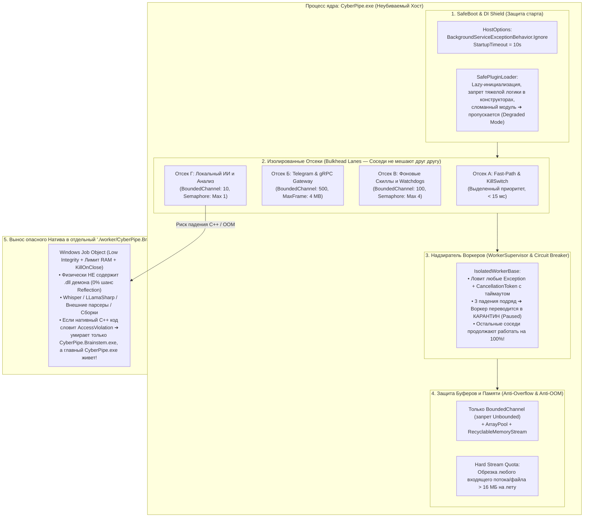

# 14. Защита ядра `CyberPipe.exe` от падений, Переполнения Буферов и Взаимного Влияния (5-Уровневая Изоляция)

Так как **`CyberPipe.exe`** (`src/Host/CyberPipe`) является центральным фоновым процессом системы (внутри которого крутятся DI, локальный gRPC-сервер, шина `Channels`, роутер, `Telegram`-шлюз, `SQLite`, расписания и скиллы), в .NET 10 по умолчанию есть опасные места:
1. Необработанное исключение в любом `BackgroundService` по стандартному поведению .NET (`StopHost`) **останавливает весь `CyberPipe.exe`**.
2. Один «задумавшийся» или зациклившийся скилл может забить общий `ThreadPool` или очередь, заморозив соседние модули (эффект «шумного соседа» — *Noisy Neighbor*).
3. Чтение огромного файла, лога или gRPC-пакета в память без лимита вызовет `OutOfMemoryException` и убьет весь процесс.
4. Ошибка в нативной C++ библиотеке (`Whisper.net`, `LLamaSharp`, `ONNX`, `NAudio`, `LibGit2Sharp`) вызывает `AccessViolationException`, который не ловится обычным `try/catch`.

Ниже представлена **5-уровневая система внутренней бронезащиты `CyberPipe.exe`**, гарантирующая, что ни один упавший или зависший компонент внутри него не сможет уронить ядро или помешать соседям.

---

## Общая схема внутренней изоляции `CyberPipe.exe`



---

## Уровень 1. Защита при старте и регистрации DI (`SafeBoot & Zero-Logic Constructors`)

Чтобы ошибка в одном скилле, битом конфиге или недоступной сети при запуске не помешала старту `CyberPipe.exe`:

1. **Отключение фатальной остановки хоста (`BackgroundServiceExceptionBehavior.Ignore`):**
   * В .NET по умолчанию падение любого `BackgroundService` вызывает `IHostApplicationLifetime.StopApplication()`. Мы принудительно переключаем поведение:
     ```csharp
     builder.Services.Configure<HostOptions>(options =>
     {
         // Падение любого фонового воркера КАТЕГОРИЧЕСКИ НЕ ОСТАНАВЛИВАЕТ CyberPipe.exe!
         options.BackgroundServiceExceptionBehavior = BackgroundServiceExceptionBehavior.Ignore;
         options.StartupTimeout = TimeSpan.FromSeconds(10);
         options.ShutdownTimeout = TimeSpan.FromSeconds(5);
     });
     ```
2. **Архитектурный запрет тяжелых конструкторов (`Zero-I/O in Constructors`):**
   * В конструкторах классов, регистрируемых в DI, **запрещено** открывать файлы, сокеты, подключаться к БД или загружать веса моделей (проверяется тестом `ArchUnitNET`). Конструктор только сохраняет ссылки на интерфейсы (`< 0.01 мс`).
   * Вся инициализация идет лениво (`Lazy<T>`) или в защищенном `InitializeAsync(CancellationToken ct)` с жестким таймаутом `5 секунд`.
3. **Изолированная регистрация модулей (`SafeModuleRegistration`):**
   * Каждый плагин/скилл регистрируется через обёртку `TryRegisterModule<TModule>()`. Если у модуля битая конфигурация или отсутствует зависимость — он помечается статусом `ModuleState.DisabledFaulted`, в лог и UI/CLI (`CyberPipe doctor` / `CyberPipe triage`) пишется предупреждение, но **сам `CyberPipe.exe` успешно запускается**.

---

## Уровень 2. Чтобы соседи внутри `CyberPipe.exe` не мешали друг другу (`Bulkhead Isolation` + `IsolatedWorkerBase`)

Чтобы зависший Git-сканер или тяжелый парсер PDF не заблокировал переключение музыки, команду `/stop` или CLI-запрос:

1. **Запрет голого `BackgroundService` — все воркеры наследуются только от `IsolatedWorkerBase`:**
   * Ни один разработчик не пишет `class MyWorker : BackgroundService`. Используется единый бронированный базовый класс `IsolatedWorkerBase`:
     * Каждая итерация цикла обернута в `try / catch (Exception ex)` + жесткий `CancellationTokenSource.CreateLinkedTokenSource` с таймаутом операции (например, `30 сек`).
     * **Встроенный `Circuit Breaker` (Авто-Карантин):** Если воркер выбросил ошибку **3 раза подряд за 1 минуту**, `IsolatedWorkerBase` **не крутит бесконечный цикл ошибок** (не жрет CPU и не забивает диск гигабайтами логов), а переводит именно этого воркера в статус **`Quarantined (В карантине)`** и шлет тихое уведомление в Telegram/UI: *"⚠️ Скилл `InfraWatchdog` упал 3 раза и изолирован в карантин. Остальные системы в норме. [🔄 Перезапустить]"*.
2. **Раздельные отсеки исполнения (`Bulkhead Lanes`):**
   * Внутри `CyberPipe.exe` нет одной общей очереди на всё. Ресурсы разделены переборками (как отсеки на подводной лодке):
     * **Отсек 0 (`Priority Kill-Switch & CLI Status`):** Выделенный канал для `/stop`, `/pause`, кнопки экстренной остановки и быстрых CLI-команд (`CyberPipe status`). Всегда имеет свободный поток.
     * **Отсек 1 (`Fast-Path Tier 0/1`):** Пул для быстрых команд (музыка, громкость, заметки). Лимит времени выполнения: `500 мс`.
     * **Отсек 2 (`Background Watchdogs & Cron`):** Ограничен семафором `SemaphoreSlim(maxCount: 3)`. Даже если одновременно сработают 20 проверок расписания, они встанут в очередь и не займут все ядра CPU.
     * **Отсек 3 (`Heavy Local AI / STT`):** Строгий `SemaphoreSlim(maxCount: 1)`. Нельзя одновременно запустить две тяжелые локальные модели или два `Whisper`, чтобы не положить RAM.

---

## Уровень 3. Защита от переполнения буферов и утечек памяти (`Anti-Buffer-Overflow & Memory Quotas`)

Чтобы ни один входной поток (gRPC, Telegram, чтение файла, вывод процесса) не смог раздуть память `CyberPipe.exe`:

1. **Абсолютный запрет `Channel.CreateUnbounded<T>()`:**
   * В проекте на уровне `ArchUnitNET` запрещен вызов `Channel.CreateUnbounded`.
   * Все внутрипроцессные каналы создаются **только через `Channel.CreateBounded<T>(capacity)`** (например, `500` сообщений для шлюза, `50` для фоновых задач) с политикой `BoundedChannelFullMode.DropOldest` (для метрик) или `Wait` с таймаутом `2 сек` (для команд). Переполнить очередь в памяти невозможно физически.
2. **Жесткие лимиты на уровне gRPC (UI / CLI ↔ `CyberPipe.exe`):**
   * `MaxReceiveMessageSize = 4 * 1024 * 1024` (4 МБ) и `MaxSendMessageSize = 4 * 1024 * 1024`.
   * `MaxConcurrentCallsPerConnection = 32`. Ни один сбойный клиент не сможет залить в `CyberPipe.exe` гигабайтный пакет.
3. **Защищенный поток чтения (`QuotaBoundedStream` + `ArrayPool<byte>`):**
   * Любое чтение внешних данных (скачивание голосового/документа из Telegram, чтение PDF, чтение `stdout` дочернего процесса) идет только через обертку `QuotaBoundedStream(maxBytes: 16_777_216)` и арендованные буферы `ArrayPool<byte>.Shared.Rent(8192)`.
   * Как только размер данных превышает лимит — чтение мгновенно обрывается без аллокации в `Large Object Heap (LOH)`.
4. **Автоматический сброс памяти (`GC Hard Limit & Trim`):**
   * При срабатывании `ISystemResourceMonitor` (если рабочий набор `CyberPipe.exe` превысил заданный порог, например `500 МБ` без учета локальной LLM) автоматически сбрасывается `MemoryCache.Compact(1.0)`.

---

## Уровень 4. Защита от «Отравленных сообщений» (`Poison-Pill Protection` & `Flight Recorder`)

Что если конкретное битое сообщение из Telegram или кривой PDF-файл вызывает баг парсера при каждой попытке его обработать?

1. **Черный ящик перед выполнением (`Pre-Execution Flight Recorder` в SQLite):**
   * Перед тем как передать сообщение в любой скилл или парсер, `CyberPipe.exe` за `0.2 мс` записывает в локальную таблицу `InFlightOperations` его `MessageHash` и увеличивает счетчик `AttemptCount`.
   * После успешного завершения запись удаляется.
2. **Мгновенная блокировка виновника падения:**
   * Если сообщение вызвало ошибку (или даже если весь процесс внезапно перезапустился из-за нативного сбоя во время обработки этого сообщения), при следующей попытке `CyberPipe.exe` видит `AttemptCount >= 2` в `InFlightOperations`.
   * Сообщение **мгновенно помечается как `Poisoned` (Отравленное)**, больше **никогда не запускается автоматически** и переносится в отстойник карантина (`DeadLetterQueue`), который можно просмотреть через `CyberPipe triage` или в UI.

---

## Уровень 5. Вынос опасного нативного кода в отдельный стерильный бинарник `worker/CyberPipe.Brainstem.exe`

В .NET обычным `try/catch` **нельзя** поймать две вещи: `StackOverflowException` и нативный `AccessViolationException` (Segmentation Fault внутри C++ библиотек `llama.cpp`, `whisper.cpp`, `onnxruntime` или `libgit2`). Кроме того, код внутри дочернего воркера **не должен иметь доступа ни к оперативной памяти, ни к секретам, ни даже к классам/коду главного демона через `System.Reflection`**.

1. **Физически отделенный стерильный исполняемый файл (`./worker/CyberPipe.Brainstem.exe`):**
   * Проект `CyberPipe.Brainstem` (`src/Execution/CyberPipe.Brainstem`) компилируется в отдельный бинарник **`CyberPipe.Brainstem.exe`** в изолированной подпапке `./worker/`.
   * Он **физически не имеет ссылок (`ProjectReference`)** на сборки демона (`CyberPipe.Core`, `CyberPipe.Skills.Host`, `CyberPipe.Gateway`, `CyberPipe.Storage`, `CyberPipe.Security`) — он ссылается **только на `CyberPipe.Contracts`**, что проверяется тестом `ArchUnitNET`.
   * Благодаря этому внутри `CyberPipe.Brainstem.exe` **даже через `System.Reflection` физически не существует ни единого класса или метода демона**.
2. **Защита ОЗУ, диска и секретов главного демона (`Zero-Trust Process Boundary`):**
   * **Запуск с пониженным уровнем целостности (`Low Integrity Level` через `CreateRestrictedToken`):** Главный демон `CyberPipe.exe` работает на уровне **`Medium Integrity`**, а дочерний `CyberPipe.Brainstem.exe` принудительно запускается на уровне **`Low / Untrusted Integrity`**. Механизм ядра Windows (**Mandatory Integrity Control**) жестко блокирует (`ERROR_ACCESS_DENIED`) любые попытки вызвать `OpenProcess` / `ReadProcessMemory` в сторону `CyberPipe.exe`, а также закрывает чтение верхней папки, где лежат `.dll` демона и база `SQLite`.
   * **Стерильная среда (`Environment.Clear()` + `bInheritHandles = false`):** При старте `CyberPipe.Brainstem.exe` полностью очищаются переменные окружения родителя, не передается `PID` демона и отключается наследование открытых дескрипторов.
   * **Блокировка доступа к `DPAPI` и буферу обмена (`JOB_OBJECT_UILIMIT_*`):** Хранилище ключей демона защищено дополнительной энтропией в памяти `CyberPipe.exe`, а флаги `JOB_OBJECT_UILIMIT_HANDLES`, `READCLIPBOARD` и `WRITECLIPBOARD` запрещают `CyberPipe.Brainstem.exe` обращаться к буферу обмена и окнам хоста.
3. **Жесткая ресурсная клетка `Windows Job Object`:**
   * `CyberPipe.Brainstem.exe` привязывается к объекту ядра Windows (`CreateJobObject` + `AssignProcessToJobObject`) с флагами:
     * `JOB_OBJECT_LIMIT_KILL_ON_JOB_CLOSE` — как только главный демон закрывает дескриптор (или завершается сам), ядро Windows мгновенно уничтожает `CyberPipe.Brainstem.exe` и все его подпроцессы (0 процессов-зомби).
     * `JOB_OBJECT_LIMIT_PROCESS_MEMORY` и `CpuRateControl` — жесткий потолок RAM и CPU.
   * Если внутри C++ библиотеки произойдет `AccessViolationException` или переполнение буфера C++ — **умрет только изолированный `CyberPipe.Brainstem.exe`**, а главный мозг **`CyberPipe.exe` останется полностью невредимым**.

---

## Сводная матрица: «Атака / Сбой ➔ Как защищен `CyberPipe.exe`»

| Что пошло не так | Без защиты | С нашей 5-уровневой защитой |
| :--- | :--- | :--- |
| **Скилл кинул необработанный `NullReferenceException` в фоновом воркере** | Весь демон падает (`StopHost`). | `HostOptions.Ignore` + `IsolatedWorkerBase` перехватывают сбой. После 3 ошибок скилл уходит в **Карантин**, всё остальное работает. |
| **Один модуль завис в `while(true)` или долгом сетевом запросе** | Забивается пул, бот перестает отвечать на `/stop` и музыку. | **Bulkhead-отсеки** + принудительный `CancellationToken(30s)`. Быстрые команды `Tier 0/1`, CLI и `/stop` идут по отдельному приоритетному отсеку. |
| **Воркер или клиент пытается залить 2 ГБ текста в очередь/поток** | `OutOfMemoryException`, краш процесса. | **`BoundedChannel`**, лимит кадра gRPC `4 МБ` и **`QuotaBoundedStream (16 МБ)`** обрезают поток на лету. |
| **Пришел «убийственный» PDF/сообщение, роняющее парсер при каждом чтении** | Бесконечный цикл падений и перезапусков (Crash-Loop). | **Flight Recorder в SQLite** видит незавершенную попытку №2 и мгновенно отправляет сообщение в карантин (`Poison-Pill`). |
| **Внутри нативной C++ DLL случился `AccessViolation` или попытка рефлексии** | Неперехватываемый краш процесса или доступ к классам демона. | Нативный код вынесен в отдельный стерильный **`worker/CyberPipe.Brainstem.exe`** (`Low Integrity` + `Job Object`, без `.dll` демона) — умирает только он, главный `CyberPipe.exe` живет. |
