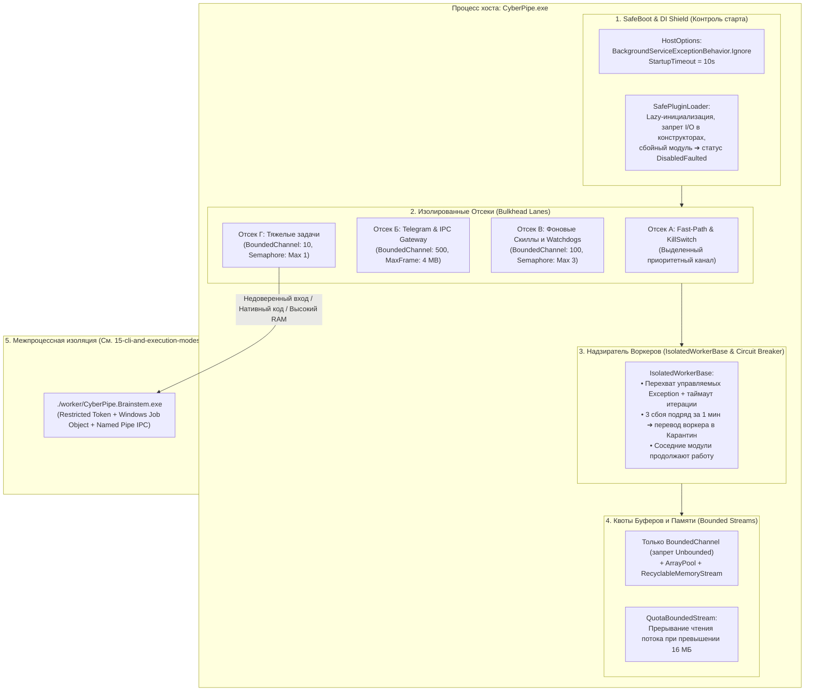

# 14. Устойчивость ядра `CyberPipe.exe` к сбоям, Контроль Буферов и Внутрипроцессная Изоляция (`Bulkhead`)

Так как **`CyberPipe.exe`** (`src/Host/CyberPipe`) объединяет фоновые воркеры, маршрутизатор, локальный сервер IPC, `Telegram`-шлюз и доступ к `SQLite`, стандартные настройки .NET создают риски каскадного отказа:
1. Необработанное исключение в любом `BackgroundService` по поведению .NET по умолчанию (`StopHost`) останавливает весь процесс хоста.
2. Зависший или ресурсоемкий фоновый модуль может исчерпать пул потоков или общую очередь, заблокировав соседние подсистемы (*Noisy Neighbor*).
3. Неограниченное чтение внешних файлов, потоков или IPC-сообщений ведет к `OutOfMemoryException`.
4. Ошибки памяти в неуправляемом коде (`AccessViolationException`) или парсерах сложных внешних форматов не перехватываются стандартным `try/catch` внутри того же процесса.

Ниже описаны **4 внутрипроцессных контура устойчивости `CyberPipe.exe`**, а также точка стыковки с **5-м межпроцессным контуром (`CyberPipe.Brainstem.exe`)**, спецификация которого вынесена в [`15-cli-and-execution-modes.md`](file:///c:/Users/Conqueror/source/repos/CyberPipeline/docs/plans/15-cli-and-execution-modes.md).

---

## Общая схема контуров устойчивости `CyberPipe.exe`



---

## Уровень 1. Контроль старта и регистрации DI (`SafeBoot & Zero-I/O Constructors`)

Чтобы ошибка конфигурации отдельного скилла или недоступность сети при запуске не блокировала старт `CyberPipe.exe`:

1. **Отключение остановки хоста при сбое фоновой службы (`BackgroundServiceExceptionBehavior.Ignore`):**
   ```csharp
   builder.Services.Configure<HostOptions>(options =>
   {
       options.BackgroundServiceExceptionBehavior = BackgroundServiceExceptionBehavior.Ignore;
       options.StartupTimeout = TimeSpan.FromSeconds(10);
       options.ShutdownTimeout = TimeSpan.FromSeconds(5);
   });
   ```
2. **Запрет блокирующего ввода-вывода в конструкторах (`Zero-I/O in Constructors`):**
   * В конструкторах классов DI запрещено открывать файлы, сокеты, подключаться к БД или загружать модели.
   * Инициализация выполняется лениво (`Lazy<T>`) или в асинхронном методе `InitializeAsync(CancellationToken ct)` с таймаутом `5 секунд`.
3. **Безопасная регистрация модулей (`SafeModuleRegistration`):**
   * Каждый прикладной модуль инициализируется через `TryInitializeModuleAsync<TModule>()`. При ошибке конфигурации модуль переводится в состояние `ModuleState.DisabledFaulted` с записью в диагностический журнал (`CyberPipe triage`), а остальные подсистемы продолжают запуск.

---

## Уровень 2. Разделение ресурсов между соседями (`Bulkhead Isolation` + `IsolatedWorkerBase`)

Чтобы зависший фоновый опрос не блокировал обработку команд управления:

1. **Единый базовый класс `IsolatedWorkerBase` вместо прямого наследования от `BackgroundService`:**
   * Каждая итерация цикла воркера выполняется внутри блока перехвата управляемых исключений со связанным `CancellationTokenSource` и лимитом времени на итерацию (`30 сек`).
   * **Автоматический `Circuit Breaker` (Карантин):** После **3 последовательных ошибок за 1 минуту** `IsolatedWorkerBase` прекращает повторные запуски сбойного воркера, переводит его в состояние **`Quarantined`** и отправляет уведомление в Telegram/UI.
2. **Раздельные отсеки исполнения (`Bulkhead Lanes`):**
   * **Отсек 0 (`Priority Kill-Switch & Control`):** Выделенный канал для `/stop`, `/pause` и запросов статуса.
   * **Отсек 1 (`Fast-Path Tier 0/1`):** Пул для быстрых детерминированных команд с целевым таймаутом `500 мс`.
   * **Отсек 2 (`Background Watchdogs & Cron`):** Ограничен семафором `SemaphoreSlim(maxCount: 3)`.
   * **Отсек 3 (`Out-of-Process Dispatch`):** Ограничен семафором `SemaphoreSlim(maxCount: 2)` для вызовов `CyberPipe.Brainstem.exe`.

---

## Уровень 3. Квотирование буферов и потоков (`Memory & Stream Quotas`)

1. **Использование только ограниченных очередей (`Channel.CreateBounded<T>`):**
   * Вызовы `Channel.CreateUnbounded<T>()` запрещены правилом `ArchUnitNET`.
   * Все каналы создаются с явно заданной емкостью (`BoundedChannelOptions`) и политикой `DropOldest` (для телеметрии) или `Wait` с таймаутом (для команд).
2. **Ограничения кадра IPC и потокового чтения (`QuotaBoundedStream`):**
   * Размер сообщений gRPC ограничен `4 МБ`.
   * Чтение внешних файлов и потоков выполняется через обертку `QuotaBoundedStream(maxBytes: 16 * 1024 * 1024)` с использованием пулов буферов `ArrayPool<byte>.Shared`. При превышении лимита чтение прерывается с `QuotaExceededException`.
3. **Сброс кэша при росте потребления памяти:**
   * При превышении порогового рабочего набора процесса `ISystemResourceMonitor` инициирует `MemoryCache.Compact(1.0)`.

---

## Уровень 4. Защита от «Отравленных сообщений» (`Poison-Pill Flight Recorder`)

Для предотвращения циклов падения и перезапуска (`Crash-Loop`) на одном и том же проблемном входе:
1. **Журнал перед выполнением (`InFlightOperations` в SQLite WAL):**
   * Перед запуском обработки входящего сообщения или файла в таблицу `InFlightOperations` записывается его `ContentHash`, `HandlerName` и инкрементируется `AttemptCount`.
   * При штатном завершении запись удаляется.
2. **Карантин со 2-й неудачной попытки:**
   * Если при повторном поступлении (или после перезапуска процесса) для данного `ContentHash` обнаруживается `AttemptCount >= 2`, входное сообщение помечается статусом `Poisoned`, не передается в обработчик и перемещается в карантин (`CyberPipe triage`).

---

## Уровень 5. Межпроцессная изоляция в `CyberPipe.Brainstem.exe`

Задачи с риском повреждения нативной памяти (`AccessViolationException`), непредсказуемым потреблением RAM/CPU или разбором сложных недоверенных файлов выносятся из процесса `CyberPipe.exe` в отдельный процесс **`worker/CyberPipe.Brainstem.exe`**.

Полная техническая спецификация этого контура приведена в [**`15-cli-and-execution-modes.md`**](file:///c:/Users/Conqueror/source/repos/CyberPipeline/docs/plans/15-cli-and-execution-modes.md):
* Создание урезанного токена Windows (`CreateRestrictedToken`, `Low Integrity` / `Restricted SID`, `SACL NO_READ_UP`) — см. [раздел 3](file:///c:/Users/Conqueror/source/repos/CyberPipeline/docs/plans/15-cli-and-execution-modes.md#L54-L90).
* Аутентификация Named Pipe по `PID` и `SessionNonce` — см. [раздел 4](file:///c:/Users/Conqueror/source/repos/CyberPipeline/docs/plans/15-cli-and-execution-modes.md#L94-L115).
* Контракты протокола, таймауты и отмена задач — см. [раздел 5](file:///c:/Users/Conqueror/source/repos/CyberPipeline/docs/plans/15-cli-and-execution-modes.md#L119-L170).
* Ограничения `Windows Job Object` (`ActiveProcessLimit = 1`, лимит памяти и CPU, `KillOnJobClose`) и обязательные интеграционные проверки изоляции в CI — см. [разделы 6–9](file:///c:/Users/Conqueror/source/repos/CyberPipeline/docs/plans/15-cli-and-execution-modes.md#L174-L249).

