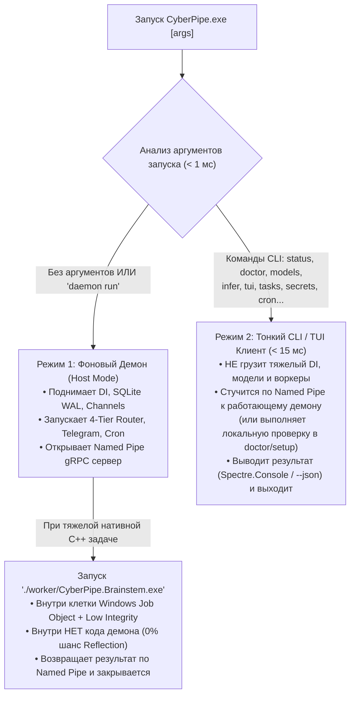

# 15. Исполняемые файлы (`.exe`), Режимы Запуска `CyberPipe.exe`, `CyberPipe.Brainstem.exe` и Системный CLI / TUI

Архитектура исполняемых файлов **CyberPipe** построена по принципу **физического разделения привилегий**: вся система состоит из **3 четких исполняемых файлов (`.exe`)**, где каждый отвечает за свой уровень доступа.

---

## 1. Карта исполняемых файлов (`.exe`) в системе

| № | Исполняемый файл | Проект в Solution | Уровень привилегий и Назначение |
| :--- | :--- | :--- | :--- |
| **1** | **`CyberPipe.exe`** | `src/Host/CyberPipe` | **Главный мозг («Кора мозга», `Medium Integrity`, 2 режима работы):**<br/>1) **Фоновый Демон-Оркестратор** (по умолчанию / `daemon run`);<br/>2) **Системный CLI и TUI-клиент** (при передаче команд `status`, `doctor`, `models`, `tui` и др.). |
| **2** | **`CyberPipe.UI.Desktop.exe`** | `src/UI/CyberPipe.UI.Desktop` | **Графический десктопный клиент (Avalonia UI 11+):**<br/>Висит в системном трее, открывает быстрый попап по `Alt+Space` и полноэкранный дашборд. Общается с `CyberPipe.exe` по локальному `gRPC` поверх `Named Pipes`. |
| **3** | **`worker/CyberPipe.Brainstem.exe`** | `src/Execution/CyberPipe.Brainstem` | **Стерильный изолированный субпроцесс («Ствол мозга», `Low Integrity` + `Windows Job Object`):**<br/>Лежит в отдельной подпапке `./worker/`. **Физически не содержит `.dll` и классов демона** (даже через `Reflection`). Запускается автоматически самим `CyberPipe.exe` для тяжелых/опасных нативных C++ задач (`Whisper`, `LLamaSharp`, парсинг сложных PDF). |

---

## 2. Режимы работы `CyberPipe.exe` и связка с `CyberPipe.Brainstem.exe`

В точке входа `Program.cs` внутри `CyberPipe.exe` до инициализации тяжелого DI-контейнера за `< 1 мс` проверяются аргументы командной строки (`args`):



### Почему такая компоновка идеальна для скорости и безопасности:
* **Мгновенный отклик CLI (`~10–15 мс`):** Когда пользователь вводит в терминале `CyberPipe status` или `CyberPipe models scan`, второй экземпляр `CyberPipe.exe` **не загружает** тяжелые сервисы — он сразу переходит в легкую ветку `CliClientMode`, подключается к уже работающему в фоне `CyberPipe.exe` через `NamedPipeClientStream`, получает ответ и закрывается.
* **Физическая защита от рефлексии и крашей C++:** Опасные нативные операции вынесены в отдельный **`worker/CyberPipe.Brainstem.exe`**, у которого нет ни ссылок на код демона, ни прав чтения папки демона (`Low Integrity`).
* **Удобный короткий алиас в терминале:** При установке (`CyberPipe setup`) в `PATH` добавляется возможность вызывать утилиту как полным именем `CyberPipe <команда>`, так и коротким алиасом `cpipe <команда>`.

---

## 3. Полный справочник команд CLI (`CyberPipe <command>`)

Консольный интерфейс построен на `System.CommandLine` + `Spectre.Console` и охватывает все аспекты управления оркестратором, моделями, безопасностью и памятью:

### А. Онбординг, самодиагностика и конфигурация
| Команда | Описание |
| :--- | :--- |
| `CyberPipe setup` / `CyberPipe onboard` | Интерактивный мастер первоначальной настройки в терминале: инициализация БД `SQLite (WAL)`, проверка железа ПК, выбор моделей для `Tier 2` и `Tier 3`, сохранение ключей в `SecretsVault`. |
| `CyberPipe doctor [--fix]` | **Полная самодиагностика системы:** проверяет целостность SQLite (`PRAGMA integrity_check`), права доступа, наличие AVX2/VRAM (`IHardwareCapabilitiesProbe`), изоляцию `CyberPipe.Brainstem.exe`, доступность микрофона (`NAudio`) и валидность API-ключей. |
| `CyberPipe config get \| set \| unset \| list \| validate \| file` | Чтение и безопасное изменение параметров конфигурации из консоли со строгой проверкой схемы и горячей перезагрузкой в демоне. |
| `CyberPipe completion <pwsh\|bash\|zsh>` | Генерация скрипта автодополнения по `Tab` для PowerShell, Bash или Zsh. |

### Б. Управление фоновым демоном, здоровьем и карантином
| Команда | Описание |
| :--- | :--- |
| `CyberPipe daemon status \| install \| uninstall \| start \| stop \| restart \| run` | Управление автозапуском и жизненным циклом фонового процесса `CyberPipe.exe` (Windows Service / фоновый демон). |
| `CyberPipe status [--json] [--usage]` | Сводка состояния: аптайм, CPU/RAM, статистика срабатываний `Tier 0 / Tier 1 / Tier 2 / Tier 3`, сэкономленные деньги и остаток дневного бюджета в `TokenBudgetGovernor`. |
| `CyberPipe health` | Быстрая проверка здоровья всех отсеков (`Bulkhead Lanes`) и подключений. |
| `CyberPipe triage` | **Разбор сбоев и карантина:** показывает, какие фоновые воркеры перезапускались, какие скиллы переведены в карантин (`Circuit Breaker`) и какие сообщения заблокированы в `InFlightOperations` (`Poison-Pill`). |
| `CyberPipe logs [--follow] [--level <lvl>] [--tail <n>]` | Живой просмотр структурированных логов демона (после очистки секретов `Sanitizer`) прямо в терминале. |

### В. Управление Моделями, Железом ПК и 4-Tier Роутером
| Команда | Описание |
| :--- | :--- |
| `CyberPipe models scan` | Запускает связку `IHardwareCapabilitiesProbe` + `IModelCompatibilityAdvisor` и рисует в консоли таблицу всех **15 Curated локальных моделей** ([`13-model-advisor-and-tier-configuration.md`](file:///c:/Users/Conqueror/source/repos/CyberPipeline/docs/plans/13-model-advisor-and-tier-configuration.md)) с оценкой памяти и вердиктом для твоего ПК (`🟢 Optimal`, `🟡 Compatible`, `🔴 InsufficientResources`). |
| `CyberPipe models list [--local \| --cloud]` | Выводит список всех доступных моделей с четкой маркировкой `[🏠 Local 0$]` и `[☁️ RemoteCloud $]`. |
| `CyberPipe models status` | Показывает, какие именно модели сейчас назначены пользователем на `Tier 1`, `Tier 2` и `Tier 3`. |
| `CyberPipe models set <tier2\|tier3> <model-id>` | Назначает выбранную локальную или облачную модель на указанный Tier прямо из консоли (синхронизируется с Avalonia UI). |
| `CyberPipe infer "<запрос>" [--explain]` | Тестовый или боевой прогон фразы через 4-Tier роутер: с флагом `--explain` показывает, какой Tier перехватил запрос (`Tier 0` Regex, `Tier 1` ONNX/Cache, `Tier 2` или `Tier 3`), сколько миллисекунд это заняло и сколько токенов/$ стоило. |

### Г. Безопасность, Секреты, Задачи, Песочницы и Бэкапы
| Команда | Описание |
| :--- | :--- |
| `CyberPipe security audit` | Аудит безопасности хоста: проверка правил `HostAndMediaSafetyGuard` (`Volume Clamp`, Anti-Wipe), белых списков `TelegramUserId`, прав ACL на папку `./worker/` и базу БД. |
| `CyberPipe secrets set <key> \| list \| audit \| reload` | Безопасный ввод API-ключей и токенов со скрытым вводом в консоль и шифрованием в локальный `DPAPI` / `AES-256-GCM` сейф. |
| `CyberPipe approvals list \| approve <id> \| reject <id> \| allowlist` | Просмотр и подтверждение ожидающих `HITL`-запросов безопасности или разблокировка задач, поставленных на паузу бюджетом (`TaskPausedByBudget`). |
| `CyberPipe tasks list \| show <id> \| pause <id> \| resume <id> \| cancel <id> \| stop-all` | Управление активными и приостановленными задачами (`stop-all` вызывает мгновенный `PriorityKillSwitch` за `< 50 мс`). |
| `CyberPipe sandbox list \| explain \| kill <id>` | Список активных песочниц и дочерних процессов `CyberPipe.Brainstem.exe` в `Windows Job Objects` с возможностью мгновенного уничтожения. |
| `CyberPipe backup sqlite create \| verify \| restore` | Горячее создание резервной копии базы `SQLite WAL`, проверка контрольной суммы и восстановление. |

### Д. Память («Второй мозг»), Cron, Скиллы и Интерактивный TUI
| Команда | Описание |
| :--- | :--- |
| `CyberPipe memory search "<запрос>" \| add "<текст>" \| status \| index` | Мгновенный гибридный поиск (`FTS5 + SIMD`) по личному «Второму мозгу», базе багов и CRM прямо из терминала за 0 токенов. |
| `CyberPipe cron list \| add \| edit \| rm \| enable \| disable \| run <id>` | Управление расписанием `ProactiveScheduler` (утренние/вечерние брифинги, проверки Git/серверов, напоминания). |
| `CyberPipe skills list \| info <name> \| check \| enable \| disable \| unquarantine <name>` | Управление скиллами (`Media`, `GitRepoRadar`, `BuildWatchdog`, `PersonalCrm`, `MeetingAssistant`) и ручной вывод скилла из карантина после сбоя. |
| `CyberPipe tui [--local]` *(или `CyberPipe chat`)* | Запускает полноценный терминальный интерфейс (TUI) с чатом, живыми полосками бюджета/RAM, переключением режимов (`/mode coding`) и флагом `--local` (принудительный `0$ Cloud Freeze`). |

---

## 4. Строгий `--json` контракт для скриптов, Git-хуков и CI/CD

Любая команда `CyberPipe` поддерживает глобальные флаги `--json`, `--profile <dev|work|personal>`, `--no-color` и `--log-level`:

* При передаче флага **`--json`**:
  1. Все прогресс-бары, спиннеры и логи автоматически перенаправляются в `stderr` или подавляются.
  2. В `stdout` выводится **ровно один валидный JSON-документ**, пригодный для парсинга через `ConvertFrom-Json` в PowerShell или `jq` в Bash:
     ```json
     {
       "ok": true,
       "mode": "cli",
       "data": {
         "daemonRunning": true,
         "uptimeSeconds": 84320,
         "tier2Model": { "name": "Phi-4 Mini", "hosting": "Local", "costUsd": 0.0 },
         "tier3Model": { "name": "Claude 3.7 Sonnet", "hosting": "RemoteCloud" },
         "dailyBudgetUsedUsd": 0.14,
         "dailyBudgetCapUsd": 2.00
       }
     }
     ```
  3. При любой ошибке возвращается ненулевой код выхода (`ExitCode != 0`) и стандартизированный JSON-конверт ошибки:
     ```json
     {
       "ok": false,
       "error": {
         "type": "cli_error",
         "code": "DAEMON_UNAVAILABLE",
         "message": "Фоновый процесс CyberPipe.exe не запущен. Выполните 'CyberPipe daemon start' или 'CyberPipe doctor'."
       }
     }
     ```
