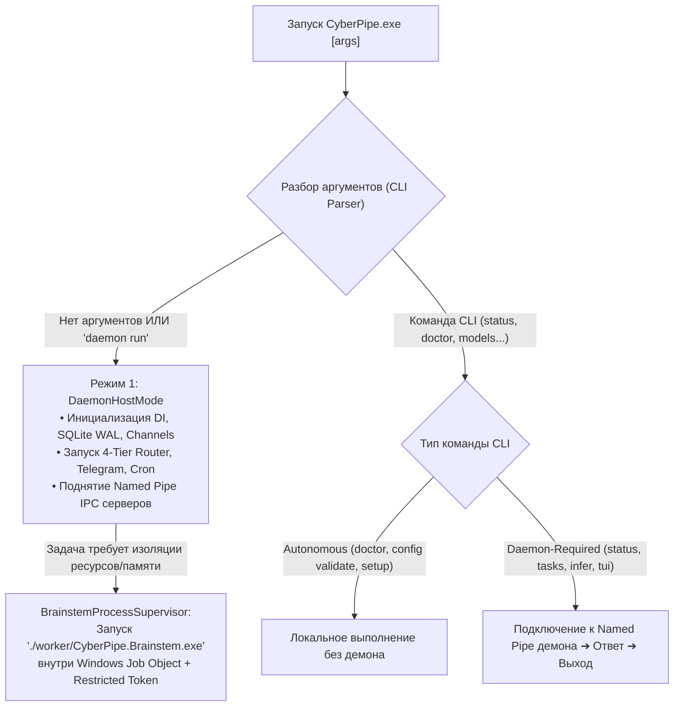

# 15. Исполняемые файлы, Межпроцессная Изоляция (`CyberPipe.Brainstem`), Безопасность IPC и Системный CLI / TUI

Этот документ является **единым каноническим источником** по компоновке исполняемых файлов системы, модели привилегий Windows, протоколам межпроцессного взаимодействия (IPC), жизненному циклу изолированного воркера `CyberPipe.Brainstem.exe` и спецификации командного интерфейса (CLI/TUI). В остальных документах ([`06-solution-structure.md`](file:///c:/Users/Conqueror/source/repos/CyberPipeline/docs/plans/06-solution-structure.md), [`07-ui-isolation-and-arch-tests.md`](file:///c:/Users/Conqueror/source/repos/CyberPipeline/docs/plans/07-ui-isolation-and-arch-tests.md), [`14-fault-isolation-and-resilience.md`](file:///c:/Users/Conqueror/source/repos/CyberPipeline/docs/plans/14-fault-isolation-and-resilience.md)) приводятся только ссылки на данный раздел.

---

## 1. Состав дистрибутива и три точки входа (`.exe`)

Система включает **три собственных исполняемых файла (Entry-Point Executables)**, разделенных по ролям и уровню доверия, а также сопутствующие управляемые сборки (`.dll`), нативные рантайм-библиотеки (`onnxruntime.dll`, `whisper.dll`, `llama.dll`, `e_sqlite3.dll`), файлы весов моделей (`.onnx`, `.gguf`), конфигурационные файлы и внешние системные утилиты (при использовании песочниц `git.exe`, `dotnet.exe`, `docker.exe`).

| № | Точка входа (`.exe`) | Проект в Solution | Роль процесса и профиль привилегий |
| :--- | :--- | :--- | :--- |
| **1** | **`CyberPipe.exe`** | `src/Host/CyberPipe` | **Основной хост и CLI-диспетчер (`Medium Integrity`):**<br/>• *Режим 1 (Демон, по умолчанию / `daemon run`):* фоновая служба оркестрации, БД `SQLite`, роутер, шлюз `Telegram`, планировщик и сервер IPC.<br/>• *Режим 2 (CLI/TUI клиент):* консольный интерфейс управления и диагностики. |
| **2** | **`CyberPipe.UI.Desktop.exe`** | `src/UI/CyberPipe.UI.Desktop` | **Графический клиент Avalonia UI (`Medium Integrity`):**<br/>Окно управления, системный трей и быстрый попап (`Alt+Space`). Не выполняет бизнес-логику локально; общается с `CyberPipe.exe` по локальному IPC. |
| **3** | **`worker/CyberPipe.Brainstem.exe`** | `src/Execution/CyberPipe.Brainstem` | **Изолированный процесс-исполнитель (`Low Integrity` или `Restricted Token` + `Windows Job Object`):**<br/>Выделенный процесс в подкаталоге `./worker/` для выполнения задач с повышенным риском сбоя памяти, высоким потреблением ресурсов или обработкой недоверенных внешних данных. |

### Критерии вынесения задачи в `CyberPipe.Brainstem.exe`
Задача выносится из процесса `CyberPipe.exe` в `CyberPipe.Brainstem.exe` не по формальному признаку языка (C++ или C#), а при наличии **любого из трех факторов риска**:
1. **Обработка недоверенных внешних входов сложными парсерами:** декодирование сторонних аудиофайлов, разбор внешних PDF/DOCX-документов, архивов и изображений.
2. **Неуправляемый код и риск повреждения памяти:** вызовы нативных библиотек (`Whisper.net`, `LLamaSharp`), где ошибка приводит к неперехватываемым в CLR исключениям (`AccessViolationException`, `StackOverflowException`) или зависанию нативного потока, не реагирующему на `CancellationToken`.
3. **Непредсказуемый профиль памяти и CPU:** операции с крупными аллокациями, способные вызвать длительные паузы GC или `OutOfMemoryException` в основном демоне.

---

## 2. Диспетчеризация запуска и целевые показатели задержки (Latency Benchmarks)

В точке входа `Program.cs` внутри `CyberPipe.exe` до построения DI-контейнера демона анализируются аргументы командной строки:



### Целевые показатели производительности (Target SLOs & Условия измерения)
Показатели времени отклика не являются безусловными константами и фиксируются как **целевые ориентиры (SLO)**, проверяемые тестами `BenchmarkDotNet` при следующих базовых условиях (Windows 11 x64, 4+ ядер CPU, SSD NVMe, прогретый процесс демона, размер IPC-сообщения $\le 64\text{ КБ}$):
* **Разбор аргументов в `Program.cs` (выбор ветки `Daemon` vs `CLI`):** целевой показатель $p95 < 2\text{ мс}$ (без инициализации `HostBuilder`).
* **Round-trip простого CLI-запроса (`CyberPipe status --json`) к уже запущенному демону по Named Pipe:** целевой показатель $p95 < 25\text{ мс}$ (включая старт процесса CLI, подключение к пайпу и сериализацию JSON).
* **Холодный старт `CyberPipe.Brainstem.exe` до готовности Named Pipe (без загрузки тяжелых весов LLM):** целевой показатель $p95 < 80\text{ мс}$.

---

## 3. Модель безопасности Windows для `CyberPipe.Brainstem.exe`

Разделение на процессы само по себе **не гарантирует** изоляцию, если дочерний процесс наследует токен и права родителя. Поэтому безопасность `CyberPipe.Brainstem.exe` строится на проверяемых механизмах ядра Windows.

### 3.1. Создание урезанного токена и управление уровнем целостности (MIC)
При запуске `CyberPipe.Brainstem.exe` супервизор демона формирует токен через Win32 API:
1. **`OpenProcessToken` + `CreateRestrictedToken`:**
   * Флаги `DISABLE_MAX_PRIVILEGE | SANDBOX_INERT`.
   * Из токена принудительно удаляются все привилегии (`SeDebugPrivilege`, `SeImpersonatePrivilege`, `SeTakeOwnershipPrivilege`, `SeLoadDriverPrivilege` и др.).
2. **Два профиля целостности (Integrity Profiles) в зависимости от типа задачи:**
   * **Профиль А (`LowIntegrity` — по умолчанию для парсеров PDF/DOCX, обработки текста и CPU-задач):**
     * Через `SetTokenInformation(TokenIntegrityLevel)` процессу назначается SID **`S-1-16-4096` (`Low Mandatory Level`)**.
   * **Профиль Б (`RestrictedMediumGpu` — для задач с аппаратным ускорением CUDA/DirectML, если драйвер GPU блокирует `Low Integrity`):**
     * Сохраняется `Medium Mandatory Level`, но в `CreateRestrictedToken` добавляется изолирующий **Restricted SID** (`S-1-5-5-...` / `Write-Restricted`), запрещающий доступ к каталогам данных демона по DACL.
3. **Запуск через `CreateProcessAsUserW`:**
   * **`bInheritHandles = FALSE`:** дочерний процесс не наследует открытые файловые дескрипторы, сокеты или дескрипторы SQLite родителя.
   * **Очистка окружения (`Environment Block`):** переменные окружения родителя не копируются; передаются только системные пути (`SystemRoot`) и выделенный изолированный каталог `TEMP`/`TMP`.

### 3.2. Важный нюанс Windows MIC (`No-Read-Up`) и настройка ACL / SACL
По умолчанию Mandatory Integrity Control (MIC) в Windows реализует политику **`No-Write-Up`** (процесс с `Low Integrity` не может модифицировать объекты `Medium Integrity`), но **не блокирует чтение (`Read-Up`)** пользовательских файлов на диске, если обычный DACL разрешает чтение текущему пользователю!

Чтобы закрыть чтение памяти демона, базы данных и сборок демона из `CyberPipe.Brainstem.exe`, применяются три обязательные меры:
1. **Защита процесса `CyberPipe.exe` в памяти (Process SACL):**
   * При старте `CyberPipe.exe` устанавливает на собственный дескриптор процесса метку SACL:
     `SYSTEM_MANDATORY_LABEL_NO_READ_UP | SYSTEM_MANDATORY_LABEL_NO_WRITE_UP | SYSTEM_MANDATORY_LABEL_NO_EXECUTE_UP`.
   * Это блокирует вызовы `OpenProcess(PROCESS_VM_READ | PROCESS_QUERY_INFORMATION)` со стороны любого процесса с более низким уровнем целостности (`ERROR_ACCESS_DENIED`).
2. **Разделение каталогов и файловые ACL:**
   * Каталог данных `%LOCALAPPDATA%\CyberPipe\data\` (база `SQLite`, логи, `SecretsVault`) получает SACL `NO_READ_UP | NO_WRITE_UP` и явный `Deny` в DACL для Restricted SID воркера.
   * Каталог `./worker/` имеет права `Read & Execute` для `Low Integrity`, но запрет на запись (`Deny Write`).
3. **Дополнительная энтропия `DPAPI`:**
   * Локальный сейф секретов использует `ProtectedData.Protect(..., optionalEntropy)`, где ключ энтропии хранится только в оперативной памяти `CyberPipe.exe` и не может быть восстановлен вызовом `CryptUnprotectData` из другого процесса того же пользователя.

---

## 4. Защита межпроцессного взаимодействия (IPC Security)

В системе используются два физически разделенных контура Named Pipes с разными протоколами и правилами доступа:

| Параметр | Контур 1: Управление (`UI / CLI ↔ CyberPipe.exe`) | Контур 2: Воркер (`CyberPipe.exe ↔ CyberPipe.Brainstem.exe`) |
| :--- | :--- | :--- |
| **Имя канала (Pipe Name)** | `\\.\pipe\CyberPipe.Control.{UserSid}` | `\\.\pipe\CyberPipe.Brainstem.{WorkerInstanceGuid}` |
| **Транспорт и сериализация** | `Grpc.AspNetCore` (`Kestrel` `ListenNamedPipe`) + Protobuf | Длина-префиксный бинарный канал (`NamedPipeServerStream`) + JSON SourceGen / Protobuf |
| **Количество клиентов** | До `8` одновременных подключений (UI + CLI) | Строго `maxNumberOfServerInstances = 1` (точка-точка) |
| **Флаги создания Pipe** | `FirstPipeInstance \| Asynchronous \| CurrentUserOnly` | `FirstPipeInstance \| Asynchronous` + явный `PipeSecurity` |

### Верификация и защита от подмены (Anti-Squatting & Authentication):
1. **Защита от перехвата имени пайпа (`FILE_FLAG_FIRST_PIPE_INSTANCE`):** Если при создании серверного пайпа имя уже занято другим процессом, `CyberPipe.exe` немедленно прерывает инициализацию с критической ошибкой безопасности.
2. **Проверка `PID` и одноразовый `SessionNonce` для `Brainstem`:**
   * При запуске `CyberPipe.Brainstem.exe` демон генерирует криптографический 256-битный `SessionNonce`.
   * После подключения клиента к `\\.\pipe\CyberPipe.Brainstem.{Guid}` демон вызывает Win32 `GetNamedPipeClientProcessId(pipeHandle, out uint clientPid)` и сверяет: **`clientPid == spawnedProcess.Id`**. Если `PID` не совпадает — соединение мгновенно разрывается.
   * В первом кадре рукопожатия воркер обязан предъявить `SessionNonce`.
3. **Ограничения размеров и таймауты:**
   * Для Контура 1 (gRPC): `MaxReceiveMessageSize = 4 МБ`, `MaxSendMessageSize = 4 МБ`, `KeepAliveTimeout = 10 с`.
   * Для Контура 2 (`Brainstem`): чтение заголовка длины (`int32`), при `frameLength <= 0 || frameLength > MaxConfiguredPayloadBytes (16 МБ)` поток немедленно закрывается до выделения буфера в памяти.

---

## 5. Протокол взаимодействия с `CyberPipe.Brainstem.exe`

В проекте `CyberPipe.Contracts.Brainstem` определены строго версионированные структуры обмена:

```csharp
namespace CyberPipe.Contracts.Brainstem;

public const int CurrentBrainstemProtocolVersion = 1;

public enum BrainstemTaskKind
{
    Ping = 0,
    WhisperTranscribe = 1,
    LocalLlmInference = 2,
    DocumentExtractText = 3,
    GitRepositoryInspect = 4
}

public record BrainstemHandshake(
    int ProtocolVersion,
    int ProcessId,
    string SessionNonce,
    string WorkerBinarySha256
);

public record BrainstemTaskRequest(
    Guid RequestId,
    BrainstemTaskKind TaskKind,
    int ExecutionTimeoutMs,
    long MaxInputBytes,
    long MaxOutputBytes,
    ReadOnlyMemory<byte> Payload // Или SafeFileHandle / имя MemoryMappedFile для больших моделей/аудио
);

public record BrainstemTaskResponse(
    Guid RequestId,
    bool IsSuccess,
    string? ErrorCode,
    string? DiagnosticMessage,
    long ElapsedMs,
    long PeakWorkingSetBytes,
    ReadOnlyMemory<byte> ResultPayload
);

public record BrainstemControlSignal(
    Guid RequestId,
    bool CancelRequested,
    bool ShutdownWorkerRequested
);
```

### Обработка отмены и таймаутов:
1. **Кооперативная отмена (`Soft Cancel`):** При нажатии `/stop` пользователем демон отправляет кадр `BrainstemControlSignal(CancelRequested: true)` по управляющему дуплексному пайпу, который активирует `CancellationTokenSource` внутри `Brainstem`.
2. **Принудительное завершение (`Hard Timeout / Kill`):** Если по истечении `ExecutionTimeoutMs` (или через `1 500 мс` после `CancelRequested`) ответ не получен, супервизор демона принудительно закрывает дескриптор `Windows Job Object`, мгновенно уничтожая процесс `CyberPipe.Brainstem.exe` на уровне ядра ОС.

---

## 6. Жизненный цикл и ресурсные ограничения (`Windows Job Object`)

Управлением процессами `CyberPipe.Brainstem.exe` занимается сервис **`BrainstemProcessSupervisor`** внутри `CyberPipe.exe`:

1. **Лимит экземпляров и переработка (Recycling):**
   * Одновременно разрешено не более `MaxConcurrentBrainstemWorkers = 2` (не более `1` для задач `LocalLlmInference` и `1` для `DocumentExtractText` / `WhisperTranscribe`).
   * **Защита от утечек нативной памяти:** один экземпляр `CyberPipe.Brainstem.exe` выполняет не более `MaxTasksPerProcess = 20` задач или живет не дольше `IdleTimeout = 5 минут`, после чего планово перезапускается.
   * Для обработки внешних PDF/DOCX из интернета может включаться режим `SingleUseProcess = true` (завершение процесса сразу после одного документа).
2. **Конфигурация `Windows Job Object` (`JOBOBJECT_EXTENDED_LIMIT_INFORMATION`):**
   * `JOB_OBJECT_LIMIT_KILL_ON_JOB_CLOSE` — гарантированное уничтожение всех процессов `Brainstem` ядром Windows при завершении или аварийном падении родительского `CyberPipe.exe`.
   * `JOB_OBJECT_LIMIT_ACTIVE_PROCESS = 1` — **запрет порождения дочерних процессов** (код внутри `Brainstem` не может запустить `cmd.exe`, `powershell.exe` или другой `.exe`).
   * `JOB_OBJECT_LIMIT_JOB_MEMORY` — жесткий потолок виртуальной памяти (например, `512 МБ` для парсинга документов; для локальной LLM — рассчитывается как `Q4SizeGb * 1.25` от `IModelCompatibilityAdvisor`).
   * `JOB_OBJECT_LIMIT_DIE_ON_UNHANDLED_EXCEPTION` + `SetErrorMode(SEM_NOGPFAULTERRORBOX)` — отключение зависающих диалоговых окон `WerFault.exe` при нативном сбое.
   * `JOB_OBJECT_CPU_RATE_CONTROL_ENABLE | JOB_OBJECT_CPU_RATE_CONTROL_HARD_CAP` — ограничение доли CPU (например, `75%`), чтобы воркер не вызывал фризов звука и интерфейса ОС.

---

## 7. Совместимость с .NET 10, Нативными Библиотеками и GPU при ограниченных правах

При запуске процесса с урезанным токеном (`Low Integrity`) стандартные механизмы .NET и C++ библиотек сталкиваются с ограничениями ОС, которые решаются следующим образом:

1. **Проблема доступа к `%TEMP%` (на которой падают .NET, `ONNX Runtime` и `PdfPig`):**
   * Стандартный каталог `%LOCALAPPDATA%\Temp` имеет уровень `Medium Integrity`, поэтому процесс с `Low Integrity` получает `Access Denied` при создании временных файлов.
   * **Решение:** Перед стартом воркера супервизор демона создает изолированную папку `%LOCALAPPDATA%\CyberPipe\worker-temp\{InstanceGuid}`, программно выставляет на неё метку `Low Mandatory Level (S-1-16-4096)` с автоматической очисткой при завершении воркера и передает этот путь в переменные `TEMP` и `TMP` дочернего процесса.
2. **Загрузка тяжелых файлов моделей (`.gguf`, `.onnx`) без открытия доступа к диску:**
   * Чтобы не давать `CyberPipe.Brainstem.exe` широких прав на чтение файловой системы пользователя, демон может открывать файл весов модели в режиме `FileAccess.Read, FileShare.Read` или создавать `MemoryMappedFile` и передавать в `Brainstem` только **Read-Only дескриптор отображения**, либо разрешать чтение строго фиксированного каталога `./models/` с проверкой контрольной суммы файла.
3. **Совместимость с драйверами GPU (CUDA / DirectML / Vulkan):**
   * На некоторых конфигурациях Windows драйверы GPU требуют `Medium Integrity` для открытия `D3DKMT` / CUDA-контекста.
   * Команда `CyberPipe doctor` при первом запуске проводит автоматический пробный тест запуска `Brainstem` в режиме `LowIntegrity` и `RestrictedMediumGpu`, фиксируя рабочий профиль для данной видеокарты.

---

## 8. Установка, Целостность Бинарников и Безопасное Обновление

1. **Структура каталогов при установке:**
   * `C:\Program Files\CyberPipe\` (или защищенный каталог приложения): содержит `CyberPipe.exe`, `CyberPipe.UI.Desktop.exe`, управляемые `.dll` демона и подкаталог `worker\CyberPipe.Brainstem.exe`. Права на запись (`Write/Modify`) есть только у `BUILTIN\Administrators` / `NT AUTHORITY\SYSTEM`. Обычный пользователь и сам демон имеют только `Read & Execute`.
   * `%LOCALAPPDATA%\CyberPipe\data\`: содержит `cyberpipe.db` (`SQLite WAL`), `secrets.vault` и логи. Закрыт от `Low Integrity` и сторонних пользователей.
2. **Проверка целостности `CyberPipe.Brainstem.exe` перед запуском (`Binary Integrity Check`):**
   * Перед каждым созданием процесса `CyberPipe.Brainstem.exe` супервизор демона открывает файл `worker/CyberPipe.Brainstem.exe` с флагом `FileShare.Read` (блокируя его изменение на диске на всё время работы воркера) и проверяет его **SHA-256 хеш** (и Authenticode-подпись при наличии) против эталонного значения, зашитого при сборке. При несовпадении запуск блокируется.
3. **Атомарное обновление и откат (Side-by-Side Update):**
   * Обновление ставится в параллельную версионную директорию `app-{version}/`.
   * Перед переключением активного указателя новый бинарник запускается в режиме `CyberPipe.exe doctor --verify-update`. Если самодиагностика или проверка связи с `Brainstem` завершается ошибкой, обновление автоматически откатывается на предыдущую рабочую версию.

---

## 9. Проверка фактической изоляции в CI (Интеграционные критерии приёмки)

Одного статического теста `ArchUnitNET` недостаточно для подтверждения безопасности. В конвейер CI (`CyberPipe.Tests.Isolation` и скрипты сборки) включены **5 обязательных автоматических проверок**:

1. **Статический анализ зависимостей (`ArchUnitNET`):**
   * Проверка, что `CyberPipe.UI` и `CyberPipe.Brainstem` не имеют ссылок на `CyberPipe.Core`, `CyberPipe.Skills`, `CyberPipe.Gateway`, `CyberPipe.Storage`, `CyberPipe.Security`.
2. **Аудит состава папки публикации (`Publish Directory Layout Gate`):**
   * Пост-билд скрипт проверяет содержимое `publish/worker/`. Наличие в ней любой сборки демона (`CyberPipe.Core.*.dll`, `Microsoft.Data.Sqlite.dll`, `Telegram.Bot.dll`) немедленно валит сборку CI.
3. **Интеграционный тест токена и привилегий (`Token & Integrity Verification Test`):**
   * В CI реально запускается `CyberPipe.Brainstem.exe`, который запрашивает собственный `WindowsIdentity` / `GetTokenInformation`: тест проверяет, что `IntegrityLevel == Low` (или активен `RestrictedSid`) и список опасных привилегий пуст.
4. **Пентест-попытка пробить границу процесса и диска (`Negative Escape Tests`):**
   * Специальный тестовый обработчик внутри `Brainstem` в рамках интеграционного теста пытается:
     * Вызвать `OpenProcess(PROCESS_VM_READ, daemonPid)` $\rightarrow$ тест проходит **только если получен `ACCESS_DENIED (5)`**.
     * Открыть файл базы `../data/cyberpipe.db` или `../CyberPipe.Core.dll` $\rightarrow$ тест проходит **только при `UnauthorizedAccessException`**.
     * Вызвать `Process.Start("cmd.exe")` внутри `Job Object` с `ActiveProcessLimit = 1` $\rightarrow$ тест проходит **только при блокировке создания процесса ядром ОС**.
5. **Тест на `AccessViolation` и превышение лимита памяти (`Crash & OOM Resilience Test`):**
   * Тестовая команда намеренно вызывает `Marshal.WriteIntPtr(IntPtr.Zero, IntPtr.Zero)` (симуляция падения C++) и аллокацию сверх лимита `Job Object` внутри `Brainstem`: проверяется, что `CyberPipe.exe` остается жив, корректно фиксирует ошибку в `InFlightOperations` и готов к следующему запросу менее чем через `200 мс`.

---

## 10. Матрица команд системного CLI (`CyberPipe <command>`)

Команды CLI четко разделены по режиму выполнения:
* **`Autonomous (Offline)`** — выполняется локально самим процессом CLI, **не требует** запущенного фонового демона (удобно для первоначальной настройки, починки конфига и диагностики упавшей службы).
* **`Daemon-Required (IPC)`** — обращается по Named Pipe к работающему демону `CyberPipe.exe`. Если демон остановлен, возвращает код выхода `ExitCode = 2 (DAEMON_UNAVAILABLE)`.
* **`Hybrid`** — проверяет локальное окружение автономно и дополнительно опрашивает демон, если он активен.

| Команда | Режим работы | Права | Описание |
| :--- | :--- | :--- | :--- |
| `CyberPipe setup` / `onboard` | `Autonomous` | User | Интерактивный мастер инициализации БД `SQLite`, проверки железа, настройки моделей и `SecretsVault`. |
| `CyberPipe doctor [--fix]` | `Hybrid` | User | Диагностика: `PRAGMA integrity_check` БД, проверка ACL папок, хеша и изоляции `Brainstem.exe`, AVX2/VRAM, тест GPU и микрофона. |
| `CyberPipe config get\|set\|validate` | `Hybrid` | User | Чтение и валидация конфига на диске; если демон запущен — отправка сигнала горячей перезагрузки. |
| `CyberPipe completion <pwsh\|bash\|zsh>` | `Autonomous` | User | Генерация скрипта автодополнения для командной оболочки. |
| `CyberPipe daemon install\|uninstall` | `Autonomous` | **Admin** | Регистрация или удаление автозапуска фоновой службы Windows Service / фонового хоста. |
| `CyberPipe daemon start\|stop\|restart\|status` | `Hybrid` | User / Admin | Запуск, остановка и проверка состояния процесса демона `CyberPipe.exe`. |
| `CyberPipe status [--json] [--usage]` | `Daemon-Required` | User | Сводка аптайма, RAM/VRAM, статистики срабатываний `Tier 0–3` и остатка бюджета в `TokenBudgetGovernor`. |
| `CyberPipe health` / `triage` | `Hybrid` | User | Статус отсеков (`Bulkhead Lanes`), список воркеров в карантине (`Circuit Breaker`) и заблокированных `Poison-Pill` сообщений. |
| `CyberPipe logs [--follow] [--tail <n>]` | `Hybrid` | User | Чтение локальных логов с диска или живой стрим из демона (после фильтрации `Sanitizer`). |
| `CyberPipe models scan` | `Hybrid` | User | Запуск `IHardwareCapabilitiesProbe` + `IModelCompatibilityAdvisor`: таблица 15 локальных моделей с вердиктами совместимости (`🟢/🟡/🔴`). |
| `CyberPipe models list\|status\|set` | `Hybrid` | User | Просмотр и назначение `Local` или `RemoteCloud` модели для `Tier 2` и `Tier 3`. |
| `CyberPipe infer "<текст>" [--explain]` | `Daemon-Required` | User | Прогон запроса через 4-Tier роутер с отчетом о выбранном Tier, затраченном времени и стоимости. |
| `CyberPipe security audit` | `Hybrid` | User | Проверка правил `HostAndMediaSafetyGuard`, ACL каталогов, целостности `Brainstem.exe` и белых списков `TelegramUserId`. |
| `CyberPipe secrets set\|list\|audit` | `Hybrid` | User | Управление ключами API в зашифрованном хранилище со скрытым вводом из консоли. |
| `CyberPipe approvals list\|approve\|reject` | `Daemon-Required` | User | Подтверждение или отклонение ожидающих `HITL`-запросов безопасности и разблокировка пауз бюджета. |
| `CyberPipe tasks list\|pause\|resume\|stop-all` | `Daemon-Required` | User | Управление активными задачами (`stop-all` активирует `PriorityKillSwitch`). |
| `CyberPipe sandbox list\|explain\|kill <id>` | `Daemon-Required` | User | Список активных экземпляров `CyberPipe.Brainstem.exe` и песочниц с возможностью принудительного завершения. |
| `CyberPipe backup sqlite create\|verify\|restore` | `Hybrid` | User | Горячий бэкап базы `SQLite WAL` (через SQLite Backup API), проверка контрольной суммы и восстановление. |
| `CyberPipe memory search\|add\|status` | `Hybrid` | User | Гибридный поиск (`FTS5 + SIMD`) по `KnowledgeVault` и базе решенных проблем. |
| `CyberPipe cron list\|add\|enable\|disable\|run` | `Daemon-Required` | User | Управление задачами планировщика `ProactiveScheduler`. |
| `CyberPipe skills list\|check\|unquarantine` | `Daemon-Required` | User | Статус подключенных скиллов и ручной вывод скилла из карантина после сбоя. |
| `CyberPipe tui [--local]` | `Daemon-Required` | User | Интерактивный терминальный интерфейс (TUI) с чатом, мониторингом бюджета и флагом локального режима `--local`. |

### Строгий `--json` контракт и коды возврата (`ExitCode`)
* При передаче флага **`--json`** все диагностические сообщения направляются в `stderr`, а в `stdout` выводится **ровно один JSON-объект** (`{ "ok": true, "data": { ... } }` или `{ "ok": false, "error": { "code": "...", "message": "..." } }`).
* Стандартизированные коды возврата для скриптов и CI:
  * `0` — Успешное выполнение.
  * `1` — Ошибка валидации аргументов или выполнения команды.
  * `2` — Демон `CyberPipe.exe` не запущен (для команд `Daemon-Required`).
  * `3` — Нарушение безопасности, прав доступа (ACL) или проверки целостности (`Security / Integrity Check Failed`).
  * `4` — Превышен лимит бюджета или таймаут операции.

---

## 11. Архитектурные компромиссы и обоснование решений (Trade-offs & Rationale)

1. **Почему `CyberPipe.UI` ссылается только на `CyberPipe.Contracts`:**
   * **Плюсы:** Исключает случайный вызов блокирующих запросов к БД или ИИ напрямую из UI-потока; позволяет перезапускать или закрывать окно GUI без влияния на фоновый демон; ускоряет компиляцию UI и позволяет тестировать верстку на мок-данных.
   * **Цена (Компромисс):** Любое новое действие в UI требует добавления DTO/метода в `CyberPipe.Contracts` вместо прямого вызова C#-сервиса.
2. **Какие сборки доступны `CyberPipe.Brainstem.exe` и почему выбран единый воркер-бинарник вместо множества мелких `.exe`:**
   * **Состав зависимостей `Brainstem`:** Ссылается только на `CyberPipe.Contracts` и пакеты изолируемых задач (`Whisper.net`, `LLamaSharp`, `UglyToad.PdfPig`, `DocumentFormat.OpenXml`). Сборки ядра оркестратора, `Telegram`, `SQLite` и `SecretsVault` в него не входят.
   * **Почему один `CyberPipe.Brainstem.exe`, а не 5 отдельных `.exe` под каждый парсер:** Создание отдельного `.exe` на каждую библиотеку усложняет сборку, доставку обновлений, управление правилами антивирусов/брандмауэра и верификацию хешей. Вместо распыления бинарников изоляция между разными задачами (например, парсингом PDF и локальной моделью) обеспечивается **запуском отдельных экземпляров процесса `CyberPipe.Brainstem.exe`** с разными лимитами памяти в `Windows Job Object` и разными профилями токенов (`LowIntegrity` для парсеров vs `RestrictedMediumGpu` для GPU-инференса).
   * **Ограничение подхода:** Поскольку `Whisper.net` и `PdfPig` находятся в одной папке `./worker/`, скомпрометированный парсер PDF внутри своего экземпляра `Brainstem.exe` имеет доступ к `.dll` других воркер-задач в `./worker/`, но **не имеет доступа** к процессу демона `CyberPipe.exe`, базе `SQLite`, ключам `SecretsVault` и данным других запущенных экземпляров `Brainstem.exe`.
