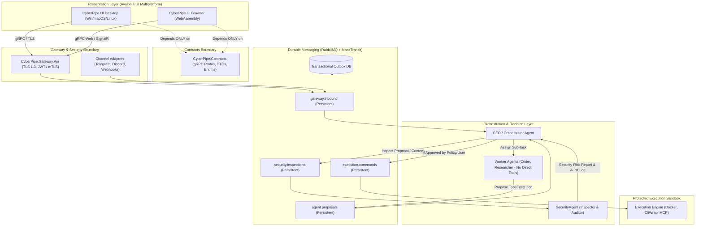

# Архитектурный план проекта CyberPipe

**Платформа:** .NET 10  
**Тип системы:** Автономный мультиагентный оркестратор с моделью Zero-Trust, шиной гарантированной доставки сообщений и кроссплатформенным UI на Avalonia.  
**Вдохновлен:** OpenClaw, но с жестким разделением привилегий, инспекцией безопасности и отказоустойчивостью enterprise-уровня.

---

## 1. Фундаментальные архитектурные принципы

1. **Zero-Trust Agent Mesh (Модель нулевого доверия к агентам):**
   * Ни один рабочий агент (воркер: Coder, Researcher и т.д.) не имеет прямого доступа к файловой системе, терминалу, сети или песочницам.
   * Агенты формируют только предложения к выполнению действий (**Tool Execution Proposals**).
   * Единственный компонент, имеющий право авторизовать исполнение действия, — **CEO / Orchestrator Agent**.
2. **Обязательная инспекция безопасности (SecurityAgent):**
   * Все предложения (proposals), а также ответы LLM могут быть переданы на анализ специализированному агенту-инспектору (**SecurityAgent**).
   * Роль SecurityAgent — выявить риски, проверить ссылки, IP-адреса, проанализировать скрипты (AST-анализ) и выдать структурированный отчет с уровнем риска (Risk Score & Findings), а также записать аудит-лог.
3. **Отказоустойчивость и гарантированная доставка (No Message Loss):**
   * Взаимодействие между Gateway, Router, CEO Agent и очередями выполнения происходит через надежный брокер сообщений (**RabbitMQ** с персистентными очередями и **Transactional Outbox Pattern**).
   * При падении или перезапуске любого узла системы состояние и команды не теряются.
4. **Строгая изоляция UI (Avalonia 11+ Multiplatform):**
   * UI-клиент разрабатывается на **Avalonia UI** для Windows, macOS, Linux и Web (WebAssembly).
   * UI **не имеет прямых ссылок** на библиотеки бизнес-логики (`Core`, `Engine`, `Storage`, `Agents`).
   * Взаимодействие идет исключительно через контрактную сборку `CyberPipe.Contracts` по защищенному протоколу (gRPC over HTTP/2 с TLS + mTLS/JWT Auth).

---

## 2. Диаграмма взаимодействия и потоков данных



---

## 3. Выбор библиотек (.NET 10)

| Область | Рекомендуемая библиотека | Обоснование |
| :--- | :--- | :--- |
| **Кроссплатформенный UI** | `Avalonia` (11.x+) | Полноценная поддержка Windows, macOS, Linux и WebAssembly (в браузере). Единая XAML кодовая база. |
| **UI MVVM Framework** | `CommunityToolkit.Mvvm` | Быстрый реактивный MVVM на Source Generators (высокая производительность в AOT/Wasm). |
| **Транспорт UI ↔ Gateway** | `Grpc.Net.Client`, `Grpc.Net.Client.Web` | Бинарная сериализация Protobuf, потоковая передача мыслей/логов (gRPC Streaming), mTLS. |
| **Шина сообщений** | `MassTransit` + `MassTransit.RabbitMQ` | Персистентные очереди, Publisher Confirms, Consumer Acks, Saga State Machines, Transactional Outbox. |
| **AI Абстракции** | `Microsoft.Extensions.AI` | Официальный .NET 10 стандарт для LLM, эмбеддингов, middleware, rate limiting. |
| **Агентные шаблоны** | `Microsoft.SemanticKernel` / Custom ReAct | Реализация циклов рассуждений агентов и генерации предложений (Proposals). |
| **Поддержка инструментов** | `ModelContextProtocol.NET` | Протокол MCP от Anthropic для подключения стандартизированных внешних тулов. |
| **Изолированное исполнение** | `Docker.DotNet` + `CliWrap` | Запуск изолированных контейнеров и CLI процессов с контролем ресурсов и таймаутами. |
| **AST-анализ PowerShell** | `System.Management.Automation` | Официальный парсер Microsoft для анализа абстрактного синтаксического дерева скриптов. |
| **Базы данных и Outbox** | `Npgsql.EntityFrameworkCore.PostgreSQL` / `Microsoft.Data.Sqlite` | Хранение сессий, состояний саг, Outbox-таблиц. |
| **Векторная память** | `pgvector` / `QdrantClient` | Долговременная семантическая память и RAG. |
| **Аудит и трассировка** | `Serilog` + `OpenTelemetry` | Неизменяемый структурированный аудит всех событий безопасности и шагов агентов. |

---

## 4. Паттерн "Zero-Trust Agent Proposal"

В отличие от стандартных систем, где каждый агент дергает функции напрямую:

1. **Воркер формулирует намерение (Proposal):**
   ```csharp
   public record ProposeToolExecution(
       Guid ProposalId,
       Guid TaskId,
       Guid AgentId,
       string ToolName,
       IReadOnlyDictionary<string, object> Arguments,
       string Justification
   );
   ```
2. **Передача через шину:** Сообщение публикуется в персистентную очередь `agent.proposals`.
3. **CEO перехватывает запрос:** CEO Agent считывает предложение, но не передает его на исполнение.
4. **Вызов SecurityAgent:** CEO отправляет полезную нагрузку на инспекцию:
   ```csharp
   public record InspectPayloadCommand(
       Guid ProposalId,
       string PayloadType, // "PowerShell", "Bash", "UrlList", "TextContent"
       string RawContent
   );
   ```

---

## 5. SecurityAgent: Движок инспекции и аудита

SecurityAgent выполняет функции независимого офицера безопасности:

### Анализаторы:
1. **URL & Domain Scanner:**
   * Извлечение всех ссылок из текста ответов и команд.
   * Проверка через локальные черные списки (DNSBL, фиды фишинга, URLhaus).
   * Опциональная интеграция с внешними OSINT API (VirusTotal, Google Safe Browsing).
2. **IP & Network Reputation:**
   * Детект попыток SSRF (обращения к `localhost`, `127.0.0.1`, приватным диапазонам `10.0.0.0/8`, `192.168.0.0/16`, облачным метаданным `169.254.169.254`).
   * Проверка внешних IP-адресов по репутационным базам.
3. **AST & Script Heuristics:**
   * **PowerShell AST:** Парсинг через `Parser.ParseInput`. Поиск токенов `Invoke-Expression` (`iex`), `DownloadString`, флагов скрытого запуска (`-enc`, `-w hidden`), обращений к реестру.
   * **Bash Heuristics:** Детект деструктивных операций (`rm -rf`, форк-бомб, манипуляций с `/dev/tcp`, вызовов `nc -e`, `curl | bash`).

### Результат инспекции:
```csharp
public enum RiskLevel { Safe, Low, Medium, High, Critical }

public record SecurityFinding(
    string RuleId,
    RiskLevel Level,
    string Description,
    string Evidence
);

public record SecurityInspectionReport(
    Guid AuditId,
    Guid ProposalId,
    RiskLevel OverallRisk,
    int RiskScore, // 0 to 100
    IReadOnlyList<SecurityFinding> Findings,
    string AuditLogSummary
);
```

### Политика принятия решений CEO:
* **Safe / Low:** Автоматическое утверждение и отправка в `ExecutionEngine`.
* **Medium:** Утверждение с расширенным логированием или предупреждением.
* **High / Critical:** Задача замораживается; через gRPC-стрим в UI уходит запрос на ручное подтверждение оператором (`RequestHumanApprovalEvent`) с полной раскладкой от SecurityAgent.

---

## 6. Структура Solution (`CyberPipe.slnx`)

```text
CyberPipe.slnx
├── src/
│   ├── Shared/
│   │   └── CyberPipe.Contracts/               # КРИТИЧЕСКИ ВАЖНО: Единственная зависимость UI!
│   │       ├── Protos/                        # gateway.proto, session.proto, security.proto
│   │       ├── Events/                        # MassTransit события (TaskCreated, ProposalApproved)
│   │       ├── Commands/                      # Команды (ExecuteTask, ApproveProposal)
│   │       └── Models/                        # DTO: RiskReportDto, AgentStateDto
│   │
│   ├── UI/                                    # Мультиплатформенный изолированный интерфейс
│   │   ├── CyberPipe.UI/                      # Общий код: Views, ViewModels, Services (gRPC Client)
│   │   ├── CyberPipe.UI.Desktop/              # Runner для Windows, macOS, Linux
│   │   └── CyberPipe.UI.Browser/              # Runner для WebAssembly (Wasm)
│   │
│   ├── Gateway/                               # Входной защищенный периметр
│   │   ├── CyberPipe.Gateway.Api/             # ASP.NET Core gRPC / SignalR Server, TLS 1.3, JWT Auth
│   │   ├── CyberPipe.Gateway.Channels/        # Адаптеры внешних каналов (Telegram.Bot, Discord.Net)
│   │   └── CyberPipe.Gateway.Infrastructure/  # Продюсеры сообщений в RabbitMQ Outbox
│   │
│   ├── Agents/                                # Агентный интеллект
│   │   ├── CyberPipe.Agents.Ceo/              # CEO Orchestrator (Policy Engine, Dispatcher, Session State)
│   │   ├── CyberPipe.Agents.Security/         # SecurityAgent (URL, IP, AST сканеры, Audit Store)
│   │   └── CyberPipe.Agents.Workers/          # Специализированные воркеры (генерируют только Proposals)
│   │
│   ├── Execution/                             # Слой физического исполнения (доступен ТОЛЬКО для CEO)
│   │   ├── CyberPipe.Execution.Abstractions/  # Интерфейсы IToolExecutor, ISandboxProvider
│   │   └── CyberPipe.Execution.Sandbox/       # Docker.DotNet, CliWrap, MCP Runtime
│   │
│   ├── Infrastructure/                        # Транспорт и хранение данных
│   │   ├── CyberPipe.Infrastructure.Bus/      # Настройка MassTransit, RabbitMQ топологий, DLQ
│   │   └── CyberPipe.Infrastructure.Storage/  # EF Core, Transactional Outbox, PostgreSQL/SQLite, Аудит
│   │
│   └── Host/
│       └── CyberPipe.Daemon/                  # Хост-процесс (запуск брокера, воркеров и оркестратора)
│
└── tests/
    ├── CyberPipe.Tests.Architecture/          # ArchUnitNET тесты на соблюдение чистоты зависимостей UI
    ├── CyberPipe.Tests.Security/              # Тестирование AST-парсеров, детекта вредоносных скриптов и IP
    └── CyberPipe.Tests.Integration/           # Интеграционные тесты RabbitMQ и Outbox при сбоях
```

---

## 7. Архитектурный контроль изоляции UI (ArchUnitNET)

Для гарантии того, что никто из разработчиков случайно не добавит ссылку на внутренние сборки системы в проект UI:

```csharp
[Fact]
public void UI_Must_Not_Reference_Internal_Modules()
{
    Architecture architecture = new ArchLoader()
        .LoadAssemblies(typeof(CyberPipe.UI.App).Assembly)
        .Build();

    IObjectProvider<IType> forbiddenTypes = ArchRuleDefinition.Types()
        .That().ResideInNamespace("CyberPipe.Agents.*")
        .Or().ResideInNamespace("CyberPipe.Execution.*")
        .Or().ResideInNamespace("CyberPipe.Gateway.*")
        .Or().ResideInNamespace("CyberPipe.Infrastructure.*");

    ArchRuleDefinition.Types()
        .That().ResideInAssembly(typeof(CyberPipe.UI.App).Assembly)
        .Should().NotDependOnAny(forbiddenTypes)
        .Check(architecture);
}
```

---

## 8. План поэтапной реализации

1. **Фаза 1: Контракты и шина (Фундамент)**
   * Создать `CyberPipe.Contracts` с gRPC-спецификацией и базовыми сообщениями MassTransit.
   * Настроить `CyberPipe.Infrastructure.Bus` с локальным RabbitMQ и поддержкой Transactional Outbox.
2. **Фаза 2: Gateway и SecurityAgent**
   * Развернуть `CyberPipe.Gateway.Api` с защитой по токенам.
   * Реализовать `CyberPipe.Agents.Security` с AST-парсером PowerShell и regex-анализатором команд/ссылок.
3. **Фаза 3: CEO Orchestrator и воркеры**
   * Реализовать цикл генерации `ProposeToolExecution` у воркеров.
   * Настроить цепочку: `Worker -> Proposal -> CEO -> SecurityAgent -> Audit/Approve -> ExecutionEngine`.
4. **Фаза 4: Avalonia UI**
   * Разработать клиент на `Avalonia UI` с подключением по gRPC-стримингу.
   * Реализовать интерфейс интерактивного подтверждения опасных операций (Human-in-the-Loop) на основе отчетов безопасности.
