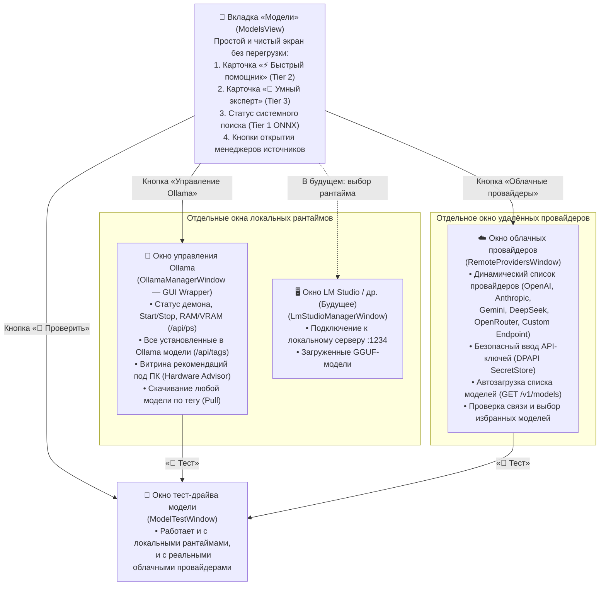

# План улучшения и упрощения управления моделями в `CyberPipe.Desktop`

> **Статус:** Проект улучшения (Enhancement Plan)  
> **Затрагиваемые проекты:** `CyberPipe.Desktop`, `CyberPipe.Contracts`, `CyberPipe.Models`  
> **Главная цель:** Превратить перегруженную вкладку «Models» в интуитивный, простой и понятный любому пользователю экран выбора моделей, а управление источниками разделить на специализированные окна: **отдельное окно динамических облачных провайдеров** и **отдельное окно-враппер для Ollama** (с архитектурным заделом под отдельные окна для LM Studio и других локальных движков в будущем).

---

## 1. Диагностика текущих проблем (Почему сейчас неудобно)

Анализ текущей реализации ([ModelsView.axaml](../../../src/CyberPipe.Desktop/Views/ModelsView.axaml), [ModelsViewModel.cs](../../../src/CyberPipe.Desktop/ViewModels/ModelsViewModel.cs), [LocalModelInstallerViewModel.cs](../../../src/CyberPipe.Desktop/ViewModels/LocalModelInstallerViewModel.cs), [IModelTestService.cs](../../../src/CyberPipe.Desktop/Services/IModelTestService.cs)) выявил 5 ключевых UX- и архитектурных проблем:

1. **Эффект «длинной простыни» и смешение ролей на одном экране:**
   В одном вертикальном `ScrollViewer` свалены сразу 5 разнородных блоков:
   * Техническая таблица `Tier Model Assignments` (`Tier 0`, `Tier 1`, `Tier 2`, `Tier 3`);
   * Статус локального рантайма Ollama;
   * Скачивание/удаление ONNX-эмбеддинга `multilingual-e5-small`;
   * Установщик 15 локальных моделей Ollama;
   * Общий `Model Catalog` из 24 моделей (где те же 15 локальных моделей дублируются второй раз подряд!).
2. **Высокий порог входа (непонятно «что к чему и зачем»):**
   * Пользователю без технического бэкграунда непонятны термины `Tier 0 (Regex)`, `Tier 1 (Semantic)`, `Tier 2 (Small LLM)`, `Tier 3 (Large LLM)`.
   * В каждой строке одновременно показаны и `ComboBox`, и текстовое поле ручного ввода `ID модели` моноширинным шрифтом.
   * `Tier 0 (builtin-regex-rules)` вообще не является нейросетью, но отображается в списке моделей с кнопкой `💬 Тест`.
3. **Хардкод сторонних (облачных) провайдеров и отсутствие управления ими:**
   * Облачные провайдеры (`Google`, `OpenAI`, `Anthropic`, `DeepSeek`) зашиты как статические строки в [cloud-models.json](../../../src/CyberPipe.Models/Catalogs/cloud-models.json) и в фоллбэк-массивы внутри `ModelsViewModel.GetCandidatesForHosting()`.
   * В UI **нет возможности** добавить API-ключ, поменять `Base URL`, подключить OpenRouter / Groq / корпоративный OpenAI-совместимый шлюз или динамически запросить список доступных моделей у провайдера.
   * При нажатии `💬 Тест` на облачной модели `ModelTestService` пытается отправить запрос в локальную Ollama (`localhost:11434/api/chat`), получает `404` и выдаёт ошибку о том, что нужен облачный ключ, который в интерфейсе даже негде ввести.
4. **Ограниченность управления Ollama:**
   * Текущий блок локальных моделей жестко привязан только к 15 записям из `local-models.json`. Если пользователь уже установил в Ollama другие модели (например, `qwen2.5-coder:7b` или `llama3.2`), интерфейс их не показывает в списке управления.
   * Нельзя скачать произвольную модель из реестра Ollama по тегу (`ollama pull <tag>`), нельзя увидеть, какие модели сейчас висят в оперативной/видеопамяти (`/api/ps`), и нельзя выгрузить их из памяти.
5. **Отсутствие модульности для других локальных рантаймов (LM Studio, llama.cpp и др.):**
   * Локальный режим сейчас жестко прибит к Ollama прямо внутри главной вкладки моделей.

---

## 2. Целевая концепция: «Простой выбор на главном экране — детальное управление в своих окнах»

Мы разделяем сценарии **«Выбрать, чем пользуется ассистент»** (ежедневная простая задача для любого человека) и **«Настроить провайдеры / скачать модели»** (управление инфраструктурой в отдельных специализированных окнах).

---

## 3. Детальный дизайн экранов и окон

### 3.1. Главный экран вкладки «Модели» (`ModelsView.axaml`) — Максимальное упрощение

На главном экране больше **нет** таблиц каталогов и установщиков. Весь экран помещается на один взгляд и состоит из 3 понятных частей:

#### Блок А. Панель источников и возможностей ПК (Верхняя карточка)
* **Понятный статус компьютера:** `💻 Ваш ПК: 32 ГБ ОЗУ (свободно 18.4 ГБ) — отлично подходит для локальных моделей до 8B`.
* **Две крупные карточки-кнопки источников моделей:**
  1. **`🏠 Локальный движок: Ollama`**
     * Статус: `🟢 Работает (установлено моделей: 4)` или `⚪ Не запущена / Не установлена`.
     * Кнопка: **`[⚙️ Открыть менеджер Ollama]`** (открывает `OllamaManagerWindow`).
     * *(Задел под будущее: рядом или в выпадающем списке можно подключать другие локальные движки — например, LM Studio).*
  2. **`☁️ Облачные провайдеры (API)`**
     * Статус: `🟢 Подключено: OpenAI, DeepSeek (доступно 12 моделей)` или `⚪ Ключи не добавлены`.
     * Кнопка: **`[⚙️ Настроить провайдеры и API-ключи]`** (открывает `RemoteProvidersWindow`).

#### Блок Б. Назначение моделей по ролям (Вместо сложных `Tier 2` и `Tier 3`)
Вместо технических названий ярусов и ручного ввода ID — две наглядные карточки с человеческим объяснением **«Зачем это нужно»**:

1. **Карточка 1: «⚡ Быстрый помощник»** *(внутри это `Tier 2`)*
   * **Подсказка простым языком:** *«Отвечает за секунду на простые вопросы, разбирает голосовые команды, ставит напоминания и сортирует заметки».*
   * **Переключатель режима:** `[🏠 На моём ПК (Бесплатно, приватно)]` ↔ `[☁️ В облаке (По API)]`.
   * **Выбор модели:**
     * Один чистый выпадающий список (`ComboBox`) с человекопонятными названиями:
       * Если выбран локальный режим — показываются **только реально установленные в Ollama модели** (например, `Qwen3 4B (Локально • 2.6 ГБ • 🟢 Идеально)`). Если ни одной модели ещё нет — прямо здесь кнопка `[📥 Выбрать и скачать модель в Ollama]`.
       * Если выбран облачный режим — показываются модели из **активных настроенных облачных провайдеров** (с группировкой по провайдеру: `OpenAI — GPT-4o-mini`, `DeepSeek — DeepSeek-V3`). Если ни один провайдер не настроен — кнопка `[🔑 Подключить облачный провайдер]`.
   * **Кнопка действия:** `[💬 Проверить ответ]`.
   * **Автосохранение:** при смене модели выбор сразу сохраняется в `ui-overrides.json` без лишней кнопки «Сохранить назначения».

2. **Карточка 2: «🧠 Умный эксперт»** *(внутри это `Tier 3`)*
   * **Подсказка простым языком:** *«Решает сложные задачи: пишет и проверяет код, анализирует большие документы, строит цепочки автоматизации и глубоко рассуждает».*
   * **Переключатель режима:** `[🏠 На моём ПК (Бесплатно)]` ↔ `[☁️ В облаке (Максимальный интеллект)]`.
   * **Выбор модели:** аналогичный чистый список установленных локальных или подключённых облачных моделей + бейдж нагрузки на ПК или расхода бюджета (`Под защитой лимита: до $0.50/день`).
   * **Кнопка действия:** `[💬 Проверить ответ]`.

#### Блок В. Компактная строка «Встроенный поиск и память» (Внизу экрана)
* `Tier 0 (Regex)` полностью скрывается с экрана выбора моделей (он работает автоматически и не требует участия пользователя).
* `Tier 1 (Семантический поиск ONNX)` отображается одной аккуратной строкой:
  * Если скачан: `🟢 Модуль умного поиска по памяти (multilingual-e5-small, 470 МБ) — Активен` + небольшая иконка/кнопка `[Переустановить / Удалить]`.
  * Если не скачан: `🟡 Для понимания смысла команд без затрат на ИИ рекомендуется скачать локальный модуль поиска (470 МБ)` + кнопка `[📥 Скачать в 1 клик]`.

---

### 3.2. Окно управления удалёнными провайдерами (`RemoteProvidersWindow`) — Динамические провайдеры без хардкода

Отдельное модальное или немодальное окно, вызываемое кнопкой **«Настроить провайдеры и API-ключи»**.

#### Ключевые возможности окна:
1. **Динамический список провайдеров (Мастер-деталь интерфейс):**
   * **Левая колонка:** список провайдеров со статусом (`🟢 Активен`, `⚪ Нет ключа`, `🔴 Ошибка`) и кнопка **`[+ Добавить провайдер]`**.
   * **Быстрые пресеты при добавлении (в 1 клик заполняют `Base URL` и тип протокола):**
     * **OpenAI** (`https://api.openai.com/v1`, `OpenAiCompatible`)
     * **Anthropic** (`https://api.anthropic.com/v1`, `Anthropic`)
     * **Google Gemini** (`https://generativelanguage.googleapis.com/v1beta`, `GoogleGemini`)
     * **DeepSeek** (`https://api.deepseek.com/v1`, `OpenAiCompatible`)
     * **OpenRouter** (`https://openrouter.ai/api/v1`, `OpenAiCompatible`)
     * **Groq / Mistral / xAI** (`OpenAiCompatible`)
     * **Свой провайдер (Custom OpenAI-Compatible API)** — любой URL (LiteLLM, vLLM, корпоративный прокси).
2. **Правая панель настройки выбранного провайдера:**
   * **Название провайдера** и тумблер `Включён / Выключен`.
   * **Адрес API (`Base URL`)** и **Тип API** (`OpenAI-совместимый`, `Anthropic Messages`, `Google Gemini`).
   * **Поле API-ключа (с маской `••••••••`):**
     * Ключ сохраняется **только** в защищённое платформенное хранилище `ISecretStore` (DPAPI на Windows) по динамическому ключу вида `provider.<providerId>.apiKey`. В JSON-конфигурации хранится только имя ссылки на секрет.
   * **Кнопка `[🔄 Проверить связь и обновить список моделей]`:**
     * Отправляет тестовый запрос к провайдеру (например, `GET /v1/models` с Bearer-токеном).
     * Показывает понятный результат: `🟢 Подключение успешно! Найдено моделей: 18 (отклик 240 мс)`.
   * **Управление моделями провайдера:**
     * Таблица доступных моделей провайдера (объединение рекомендованных из `cloud-models.json` + динамически полученных через `/v1/models` + добавленных пользователем вручную по `ModelId`).
     * Чекбокс **«Показывать в списке выбора»** напротив модели (чтобы пользователь мог отметить 3–5 любимых моделей, которые будут видны на главном экране), рекомендация роли (`Быстрый Tier 2` / `Эксперт Tier 3`) и кнопка `[💬 Тест]`.
     * Кнопка `[+ Добавить свою модель по ID]` (если провайдер не поддерживает `/v1/models`).

---

### 3.3. Окно управления Ollama (`OllamaManagerWindow`) — Полноценный GUI-враппер над Ollama

Отдельное окно, превращающее работу с Ollama в наглядный графический интерфейс без необходимости открывать терминал.

#### Структура окна `OllamaManagerWindow`:

1. **Верхняя панель управления демоном Ollama (Ollama Server Bar):**
   * **Статус рантайма:** `🟢 Ollama запущена (v0.6.2) • http://localhost:11434` (или кнопки `[📥 Установить Ollama с официального сайта]` / `[▶️ Запустить Ollama]`).
   * **Живой индикатор памяти (`Ollama Memory Monitor` через `GET /api/ps`):**
     * Показывает, какая модель прямо сейчас загружена в VRAM/RAM (например: `В памяти сейчас: qwen3:8b (5.8 ГБ VRAM)`), и кнопку **`[⏏ Выгрузить из памяти]`** (отправляет запрос с `keep_alive: 0`, мгновенно освобождая память ПК).
   * **Паспорт железа ПК** от `IHardwareCapabilitiesProbe`: свободная RAM, VRAM, свободное место на диске.

2. **Вкладка 1: «📦 Установленные в Ollama» (Реальный `ollama list` / `GET /api/tags`):**
   * Отображает **абсолютно все модели**, которые реально установлены в локальной Ollama (даже если они не входят в стандартный список из 15 моделей).
   * Для каждой модели показываются:
     * Имя и тег (`qwen3:8b`, `deepseek-r1:1.5b`, `codellama:7b` и т.д.);
     * Реальный размер на диске (из ответа `/api/tags`), семейство и квантование;
     * Вердикт совместимости с ПК (`🟢 Летает`, `🟡 Рабочая нагрузка`, `🔴 Мало памяти`);
     * Бейдж текущего использования: `[⚡ Назначена Быстрым помощником]` или `[🧠 Назначена Экспертом]`.
   * **Кнопки действий:**
     * `[⚡ Назначить Быстрым]` / `[🧠 Назначить Экспертом]`
     * `[💬 Открыть чат-тест]`
     * `[🔄 Обновить (Pull)]`
     * `[🗑 Удалить с диска]` (с подтверждением и показом, сколько ГБ освободится).

3. **Вкладка 2: «🌟 Рекомендованные для вашего ПК» (Курируемая витрина с `IModelCompatibilityAdvisor`):**
   * Для новичков, которые не знают, какую модель выбрать.
   * **Простые человеческие фильтры-теги:**
     * `[Все (15)]` • `[🟢 Идеально для моего ПК]` • `[⚡ Быстрые и лёгкие (2–4 ГБ ОЗУ)]` • `[🧠 Умные и для кода (8+ ГБ ОЗУ)]` • `[👁 Понимают картинки (Vision)]`.
   * Каждая карточка модели объясняет простым языком:
     * Название и назначение (*«Лучший баланс русского и английского языка для быстрых задач»*);
     * Сколько займёт на диске (`2.6 ГБ`) и сколько нужно памяти (`🟢 Нужно ~4.5 ГБ, у вас свободно 18.4 ГБ`);
     * Для моделей с вариантами (например, `DeepSeek-R1 Distill`: `1.5B` или `8B`) — удобный переключатель размера прямо на карточке!
     * Кнопка `[📥 Скачать и установить]` с плавным прогресс-баром (`МБ скачано / МБ всего`, `%`, стадия) и кнопкой `[✖ Отмена]`.

4. **Вкладка 3 / Панель: «🔍 Скачать любую модель по имени (Ollama Pull)»:**
   * Строка ввода тега модели с подсказками (например: `qwen2.5-coder:7b`, `llama3.2:3b`, `gemma3:12b`) и ссылкой на каталог `ollama.com/library`.
   * Кнопка **`[📥 Скачать в Ollama]`** — запускает потоковый `POST /api/pull` с отображением прогресса прямо в окне. После скачивания модель сразу появляется во вкладке «Установленные» и в списках выбора на главном экране.

---

### 3.4. Архитектурный задел под другие локальные движки (LM Studio, llama.cpp и др.)

Чтобы в будущем добавление **LM Studio** (или `llama.cpp`, `Jan`, `Foundry Local`) не требовало переделки главного окна моделей:

1. Вводится единый контракт локального менеджера рантайма **`ILocalRuntimeProvider`**:
   * Свойства: `RuntimeId` (`"ollama"`, `"lm-studio"`), `DisplayName`, `DefaultEndpoint`, `SupportsModelPull`, `SupportsProcessControl`.
   * Методы: `GetStatusAsync()`, `ListInstalledModelsAsync()`, `GetLoadedModelsInMemoryAsync()`, `UnloadModelAsync()`.
2. На главном экране `ModelsView` в карточке «Локальные модели» отображается список зарегистрированных локальных движков:
   * Сейчас активен адаптер **Ollama** (`OllamaManagerWindow`).
   * В будущем рядом появляется карточка **LM Studio** со своей кнопкой `[⚙️ Открыть менеджер LM Studio]` (`LmStudioManagerWindow`), который общается с локальным сервером LM Studio (`http://localhost:1234/v1/models`).
3. Выпадающий список локальных моделей на главном экране агрегирует модели от всех активных локальных движков (с префиксом/значком движка: `[Ollama] qwen3:4b`, `[LM Studio] mistral-7b-instruct`).

---

## 4. Изменения в контрактах и сервисах (`CyberPipe.Contracts` и `CyberPipe.Models`)

Все изменения проектируются с полным соблюдением архитектурных тестов ([ProjectGraphTests.cs](../../../tests/CyberPipe.Tests.Architecture/ProjectGraphTests.cs) и [ContractsBoundaryTests.cs](../../../tests/CyberPipe.Tests.Architecture/ContractsBoundaryTests.cs)):

### 4.1. Новые DTO и интерфейсы в `CyberPipe.Contracts`
В файле `src/CyberPipe.Contracts/Models.cs` и `src/CyberPipe.Contracts/LocalModels.cs`:
* **`RemoteProviderProtocol`** (`enum`): `OpenAiCompatible = 0`, `Anthropic = 1`, `GoogleGemini = 2`.
* **`RemoteProviderProfileDto`** (`record`):
  * `string Id` (например, `"openai"`, `"deepseek"`, `"openrouter"`, `"custom-1"`)
  * `string Name` (например, `"OpenAI"`, `"OpenRouter"`)
  * `RemoteProviderProtocol Protocol`
  * `string BaseUrl`
  * `string ApiKeySecretName` (ключ в `ISecretStore`, например `"provider.openai.apiKey"`)
  * `bool IsEnabled`
  * `IReadOnlyList<RemoteModelEntryDto> Models` (список моделей провайдера с флагом `IsEnabledForSelection` и `RecommendedTier`)
* **`OllamaRunningModelDto`** (`record` для `/api/ps`):
  * `string Name`, `long SizeBytes`, `long SizeVramBytes`, `DateTimeOffset? ExpiresAtUtc`
* Расширение `ILocalModelInstaller` (или новый `IOllamaRuntimeClient`):
  * `Task<IReadOnlyList<OllamaRunningModelDto>> ListRunningModelsAsync(CancellationToken ct = default)` — запрос к `GET /api/ps`.
  * `Task<Result> UnloadModelAsync(string modelId, CancellationToken ct = default)` — выгрузка модели из RAM/VRAM.
  * `Task<Result<ModelProbeResult>> PullByTagAsync(string modelTag, IProgress<ModelInstallProgress>? progress = null, CancellationToken ct = default)` — скачивание произвольного тега Ollama (не только из JSON-каталога).

### 4.2. Обновление `SecretKeys` и `ISecretStore`
В [Secrets.cs](../../../src/CyberPipe.Contracts/Secrets.cs):
* Добавить хелпер `SecretKeys.ForModelProvider(string providerId)` -> `"provider." + providerId + ".apiKey"`, чтобы ключи динамических провайдеров стандартно хранились в платформенном хранилище `ISecretStore` и автоматически маскировались в логах и `EgressSanitizer`.

### 4.3. Реальное тестирование и вызов облачных провайдеров
В [IModelTestService.cs](../../../src/CyberPipe.Desktop/Services/IModelTestService.cs) и `CyberPipe.Models`:
* Убрать отправку `RemoteCloud`-моделей в `localhost:11434`.
* Для `RemoteCloud` резолвить профиль провайдера (`RemoteProviderProfileDto`), доставать API-ключ из `ISecretStore` и выполнять запрос к `BaseUrl` провайдера (`/v1/chat/completions` для OpenAI-совместимых, `/v1/messages` для Anthropic, `:generateContent` для Gemini).
* Добавить метод проверки провайдера и динамического получения моделей: `ProbeAndFetchModelsAsync(RemoteProviderProfileDto provider, SecretValue apiKey, CancellationToken ct)`.

---

## 5. Поэтапный план реализации (Roadmap)

### Этап 1. Упрощение главного экрана `ModelsView` (Быстрый UX-выигрыш)
**Цель:** Убрать визуальный шум и сделать выбор моделей понятным с первого взгляда.
1. Переработать [ModelsView.axaml](../../../src/CyberPipe.Desktop/Views/ModelsView.axaml) и [ModelsViewModel.cs](../../../src/CyberPipe.Desktop/ViewModels/ModelsViewModel.cs):
   * Скрыть `Tier 0 (Regex)` из списка пользовательских назначений.
   * Переименовать карточки `Tier 2` и `Tier 3` в понятные человеку роли: **«⚡ Быстрый помощник (Tier 2)»** и **«🧠 Умный эксперт (Tier 3)»** с короткими описаниями.
   * Убрать дублирующее текстовое поле `ID модели` рядом с `ComboBox` (оставить только понятный выбор из списка с отображением статуса готовности модели).
   * Сделать сохранение назначений в `ui-overrides.json` автоматическим при выборе модели в выпадающем списке.
   * Вынести `Tier 1 (Семантический поиск ONNX)` в компактную статус-строку внизу экрана.
   * Убрать дублирующиеся списки `Локальные ИИ модели` и `Model Catalog` с главного экрана, заменив их двумя аккуратными карточками-входами: **«🦙 Локальные модели (Ollama)»** и **«☁️ Облачные провайдеры (API)»**.

### Этап 2. Создание окна-враппера `OllamaManagerWindow`
**Цель:** Дать пользователю полноценный, удобный инструмент управления Ollama в отдельном окне.
1. Расширить `OllamaLocalModelInstaller` в [ModelInstaller.cs](../../../src/CyberPipe.Models/ModelInstaller.cs):
   * Добавить чтение детальных метаданных из `GET /api/tags` (размер, семейство, квантование).
   * Добавить мониторинг загруженных в память моделей через `GET /api/ps` и выгрузку (`UnloadModelAsync`).
   * Добавить `PullByTagAsync(string tag)` для скачивания любой модели по имени из библиотеки Ollama.
2. Создать в `src/CyberPipe.Desktop`:
   * `Views/OllamaManagerWindow.axaml` (+ `.cs`)
   * `ViewModels/OllamaManagerViewModel.cs`
3. Реализовать внутри `OllamaManagerWindow` 3 вкладки:
   * **«Установленные в Ollama»** (все реально установленные модели + назначение на роль в 1 клик + тест + удаление);
   * **«Рекомендованные под ваш ПК»** (15 курируемых моделей с фильтрами по задачам/ОЗУ, выбором варианта `1.5B / 8B` и индикаторами `IModelCompatibilityAdvisor`);
   * **«Скачать по имени (Pull)»** (ввод любого тега Ollama с прогресс-баром скачивания).

### Этап 3. Динамические облачные провайдеры и окно `RemoteProvidersWindow`
**Цель:** Убрать хардкод облачных провайдеров и дать полноценное управление сторонними API.
1. Добавить `RemoteProviderProfileDto` и конфигурацию провайдеров в `CyberPipe.Contracts` (с сохранением профилей в `ui-overrides.json` и ключей в `ISecretStore`).
2. Реализовать сервис проверки и синхронизации моделей провайдера (`IRemoteModelProviderClient` — поддержка `OpenAiCompatible`, `Anthropic`, `GoogleGemini`, автозагрузка `GET /v1/models`).
3. Создать в `src/CyberPipe.Desktop`:
   * `Views/RemoteProvidersWindow.axaml` (+ `.cs`)
   * `ViewModels/RemoteProvidersViewModel.cs`
4. Реализовать в окне:
   * Пресеты в 1 клик (`OpenAI`, `Anthropic`, `Gemini`, `DeepSeek`, `OpenRouter`, `Groq`, `Custom URL`);
   * Безопасный ввод и сохранение API-ключа;
   * Кнопку «Проверить и загрузить модели» + чекбоксы выбора активных моделей для главного экрана;
   * Обновить `ModelTestService`, чтобы кнопка `💬 Тест` реально вызывала облачные модели через настроенного провайдера.

### Этап 4. Унификация контракта локальных рантаймов (Задел под LM Studio и др.)
**Цель:** Подготовить почву для подключения других локальных рантаймов без переписывания UI.
1. Выделить интерфейс `ILocalRuntimeManager` / дескриптор локального движка.
2. Зарегистрировать `Ollama` как первый плагин-рантайм со своим окном `OllamaManagerWindow`.
3. Добавить точку расширения в `ModelsViewModel`, чтобы при появлении адаптера `LM Studio` (`localhost:1234`) он автоматически появлялся в блоке «Локальные движки» со своей кнопкой открытия окна управления.

---

## 6. Сводка изменений по файлам

| Файл / Компонент | Действие | Назначение |
| :--- | :--- | :--- |
| `src/CyberPipe.Desktop/Views/ModelsView.axaml` | **Рефакторинг** | Лаконичный главный экран: статус ПК и источников, 2 понятные карточки ролей («Быстрый помощник» и «Умный эксперт»), компактный статус ONNX, кнопки открытия окон Ollama и Облачных провайдеров. |
| `src/CyberPipe.Desktop/ViewModels/ModelsViewModel.cs` | **Рефакторинг** | Убрать хардкод массивов моделей; формировать списки выбора динамически из реально установленных в Ollama моделей и активных облачных провайдеров; автосохранение при выборе. |
| `src/CyberPipe.Desktop/Views/OllamaManagerWindow.axaml` | **Новый файл** | Отдельное окно-враппер над Ollama: управление сервером, монитор VRAM/RAM (`/api/ps`), все установленные модели (`/api/tags`), витрина с фильтрами под ПК и `Pull` любой модели по тегу. |
| `src/CyberPipe.Desktop/ViewModels/OllamaManagerViewModel.cs` | **Новый файл** | Логика окна-враппера Ollama (развивает и заменяет `LocalModelInstallerViewModel`). |
| `src/CyberPipe.Desktop/Views/RemoteProvidersWindow.axaml` | **Новый файл** | Отдельное окно управления сторонними облачными провайдерами (пресеты, Custom URL, API-ключи в DPAPI, загрузка моделей `/v1/models`). |
| `src/CyberPipe.Desktop/ViewModels/RemoteProvidersViewModel.cs` | **Новый файл** | Логика динамического добавления, редактирования, тестирования и фильтрации моделей сторонних провайдеров. |
| `src/CyberPipe.Desktop/Services/IModelTestService.cs` | **Обновление** | Поддержка реального тестирования облачных моделей через сконфигурированные динамические провайдеры и `ISecretStore`. |
| `src/CyberPipe.Contracts/Models.cs` & `LocalModels.cs` | **Расширение** | DTO профилей удалённых провайдеров (`RemoteProviderProfileDto`), моделей в памяти Ollama (`OllamaRunningModelDto`), методы `PullByTagAsync` и `UnloadModelAsync`. |
| `src/CyberPipe.Models/ModelInstaller.cs` | **Расширение** | Реализация вызовов `/api/ps`, выгрузки из памяти и скачивания произвольных тегов Ollama. |
| `tests/CyberPipe.Tests.Unit/DesktopUiTests.cs` | **Дополнение** | Юнит-тесты для упрощённого `ModelsViewModel`, `OllamaManagerViewModel` и `RemoteProvidersViewModel`. |

---

## 7. Декомпозиция на атомарные задачи (Для безопасного пошагового выполнения)

Чтобы не перегружать контекст и гарантировать, что после каждого шага проект собирается и проходит тесты, план разбит на 4 самодостаточные атомарные задачи в папке [tasks/](tasks/README.md):

1. **[TASK-ENH-01](tasks/TASK-ENH-01-contracts-and-ollama-runtime-api.md)** — Контракты провайдеров/рантаймов и расширение движка Ollama (`/api/ps`, выгрузка из памяти, `PullByTagAsync`, DTO облачных провайдеров).
2. **[TASK-ENH-02](tasks/TASK-ENH-02-ollama-manager-window.md)** — Отдельное окно-враппер управления Ollama (`OllamaManagerWindow` + `OllamaManagerViewModel` + тесты).
3. **[TASK-ENH-03](tasks/TASK-ENH-03-remote-providers-window-and-client.md)** — Динамическое управление облачными провайдерами (`RemoteProvidersWindow`, `IRemoteProviderService`, ключи в `ISecretStore`, реальный тест облачных моделей).
4. **[TASK-ENH-04](tasks/TASK-ENH-04-simplified-main-models-view-integration.md)** — Радикальное упрощение главного экрана `ModelsView` и связка всех окон в `MainWindow`.

---

## 8. Ожидаемый результат для пользователя

1. **Понятно за 5 секунд:** Открыв вкладку «Модели», любой пользователь видит всего два простых вопроса: *«Какая модель работает Быстрым помощником?»* и *«Какая модель работает Умным экспертом?»*, а также наглядный переключатель `🏠 На моём ПК (Бесплатно)` / `☁️ В облаке`.
2. **Никакого хардкода провайдеров:** В окне «Облачные провайдеры» можно за минуту подключить OpenAI, DeepSeek, OpenRouter или любой свой OpenAI-совместимый сервер, проверить ключ и подтянуть свежий список моделей без пересборки приложения.
3. **Полноценный центр управления Ollama:** В окне «Менеджер Ollama» видно состояние сервера, занятую память, все реально установленные в системе модели, рекомендации под железо конкретного ПК и возможность скачать любую модель из библиотеки Ollama по имени.
4. **Готовность к росту:** Архитектура раздельных окон управления позволяет в будущем легко добавить рядом с окном Ollama отдельное окно для LM Studio или другого локального сервера.
