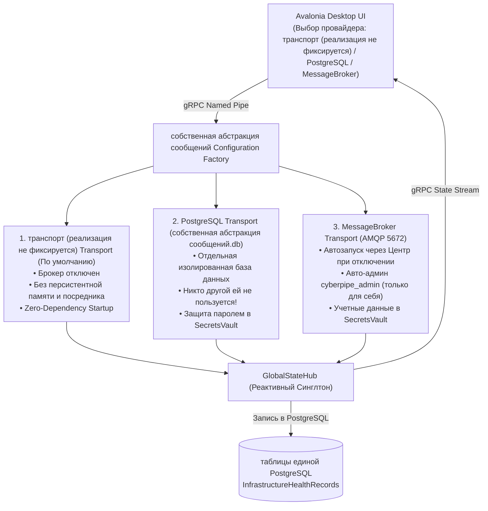

# 03. Технологический стек и библиотеки (.NET 10)

Стек подобран по критериям **максимальной скорости отклика, минимального потребления памяти, простоты развертывания (Zero-Dependency Startup)** и **радикальной экономии токенов** в .NET 10. Из стека исключены тяжеловесные внешние сервисы (обязательный MessageBroker, PostgreSQL), которые усложняли запуск и добавляли сетевые задержки.

---

### Сводная таблица библиотек и их роли

| Область | Рекомендуемая библиотека | Обоснование и решаемая задача |
| :--- | :--- | :--- |
| **Универсальная шина сообщений (Message Bus)** | `собственная абстракция сообщений` (`собственная абстракция сообщений`, `собственная абстракция сообщений.MessageBroker`, `собственная абстракция сообщений.SqlTransport.PostgreSQL`) | Единая абстракция шины сообщений вместо `System.Threading.Channels`, позволяющая прозрачно менять транспорт. По умолчанию: **транспорт (реализация не фиксируется)** (отключен внешний брокер, без посредников и персистентной памяти). Пользователь в UI выбирает провайдер: (1) **транспорт (реализация не фиксируется)**, (2) **MessageBroker** (с автозапуском через Центр и учетными данными в `SecretsVault`), (3) **Отдельный PostgreSQL + WAL (`data/subsystems/собственная абстракция сообщений` (PostgreSQL))**, защищенный паролем в `SecretsVault`, которым пользуется **только собственная абстракция сообщений и никто другой**. |
| **Архитектура баз данных (Центральный Мастер + Изолированные БД подсистем)** | `Microsoft.Data.PostgreSQL` (WAL + `FTS5`) + `Dapper` + `ISubsystemDatabaseManager` | **Центральный Мастер PostgreSQL (`единая база PostgreSQL`)** хранит только базовые настройки приложения и таблицу-реестр `SubsystemDatabaseRegistry`. **Каждая подсистема и сервис имеют свой отдельный PostgreSQL-файл** в `таблицы единой PostgreSQL` (`Quartz.NET` (PostgreSQL), `собственная абстракция сообщений` (PostgreSQL), `knowledge` (PostgreSQL), `crm` (PostgreSQL), `finance` (PostgreSQL), `budget` (PostgreSQL), `health` (PostgreSQL)) со своим паролем шифрования в `SecretsVault` (DPAPI/LibSecret/Keychain). Выделенный сервис `ISubsystemDatabaseManager` управляет lazy-созданием, реестром, генерацией паролей и выдачей защищенных `PostgreSQLConnection`. |
| **Telegram-интеграция** | `Telegram.Bot` | Быстрый клиент Telegram API (Long Polling / Webhook), поддержка голосовых сообщений, файлов, Inline-кнопок бюджета (`[▶️ Продолжить]`, `[🛑 Стоп]`) и фильтрация по `UserId`. |
| **Локальное распознавание речи (0$ Voice STT)** | `Whisper.net` (ONNX / GGML runtime в `CyberPipe.Brainstem`) | Локальная транскрибация голосовых сообщений из Telegram и записей рабочих созвонов на CPU/GPU внутри прогретого пула `CyberPipe.Brainstem` за **0 облачных токенов**. |
| **Локальный Семантический Роутер (Tier 1)** | `Microsoft.ML.OnnxRuntime` + `System.Numerics.Tensors` | Запуск компактной мультиязычной модели эмбеддингов (`multilingual-e5-small` / `bge-micro`) внутри процесса `CyberPipe` на проверенном входе после `QuotaBoundedStream` за ~5–10 мс + аппаратное SIMD-вычисление косинусной близости (`TensorPrimitives`). **0 токенов на распознавание команд и поиск в памяти!** |
| **Гибкий AI Пайплайн (`Local` и `RemoteCloud` для каждого Tier)** | `Microsoft.Extensions.AI` (`IChatClient`) + `OllamaSharp` (Local HTTP) + `OpenAI` / Cloud SDKs + `Microsoft.ML.Tokenizers` | Пользователь в UI сам назначает для `Tier 2` и `Tier 3` либо **локальную модель (`Local`, 0$)** через локальный HTTP-сервер **Ollama / LM Studio** (`http://localhost:11434`), либо **удаленную платную (`RemoteCloud`)**. Приложение четко знает тип хостинга (`ModelHostingType`), адаптируя бюджет (`TokenBudgetGovernor`) и контроль RAM (`ISystemResourceMonitor`). |
| **Оценка железа ПК и Подбор моделей** | `IHardwareCapabilitiesProbe` + `IModelCompatibilityAdvisor` (Встроено в ядро) | Сервис `IHardwareCapabilitiesProbe` считывает RAM/VRAM/CPU хоста и передает в `IModelCompatibilityAdvisor`, который рассчитывает совместимость каждой из 15 локальных моделей (с учетом весов `Q4SizeGb` и `KV-Cache`) с ПК пользователя (`🟢 Оптимально`, `🟡 Совместимо`, `🔴 Мало RAM`). |
| **Аудио Хоста, Медиа и Запись Созвонов** | `IAudioDeviceController`: `NAudio` (Windows WASAPI) / `PipeWire-PulseAudio` (Linux) / `CoreAudio` (macOS) | Кроссплатформенное управление громкостью с жестким потолком (`Volume Clamp` и проверкой перед `Play`), медиа-команды (`Play/Pause/Next`) и захват системного звука + микрофона для протоколирования встреч. |
| **Проактивный планировщик и Фоновые задачи** | `Quartz.NET` (`Quartz.NET.Core`, `Quartz.NET.AspNetCore`, `Quartz.NET.Storage.PostgreSQL`) | Промышленный планировщик фоновых и регулярных задач (утренние/вечерние брифинги, умные напоминания, подписки, мониторинг серверов). Работает на **отдельной зашифрованной паролем базе `Quartz.NET` (PostgreSQL)** с локальным **Read-Only Dashboard** на `127.0.0.1`, защищенным одноразовым криптографическим токеном и `HttpOnly` cookie-сессией. |
| **Интеграция с Git и Инструментами Разработки** | `LibGit2Sharp` + `IDevToolProcessRunner` (`CliWrap` в `Execution.Providers`) | Мгновенный локальный радар репозиториев (`/repos`, `/standup`) через `LibGit2Sharp` и строго типизированный запуск фиксированных утилит (`git`, `dotnet build/test`) через `IDevToolProcessRunner` с белым списком рабочих директорий. |
| **Чтение документов, договоров и OCR** | `UglyToad.PdfPig` + `DocumentFormat.OpenXml` (в `Brainstem`) + `IScreenOcrProvider` (`Windows.Media.Ocr` / `Tesseract`) | Локальное извлечение текста из недоверенных PDF-договоров и DOCX в одноразовом изолированном процессе `Brainstem`, а также OCR скриншотов буфера обмена без отправки сырых бинарников в облако. |
| **Кроссплатформенный UI (`CyberPipe.UI.Desktop`)** | `Avalonia` (11.x+) + `CommunityToolkit.Mvvm` | Нативный быстрый GUI (Desktop/Трей/Попап `Alt+Space`) для Windows, Linux и macOS без прожорливого Electron. Быстрый MVVM на Source Generators. |
| **Системный CLI и TUI (Режим №2 в `CyberPipe`)** | `System.CommandLine` + `Spectre.Console` | Встроенный в `CyberPipe` консольный интерфейс (`doctor`, `status`, `models scan`, `infer`, `tui`, строгий `--json`), выполняющий полный Round-trip к демону за `p95 < 25 мс`. |
| **Транспорт UI / CLI ↔ `CyberPipe`** | `Grpc.Net.Client` / `Grpc.AspNetCore` (Named Pipes / Unix Domain Sockets) | Быстрый бинарный стриминг метрик, логов, расходов токенов и команд управления между `CyberPipe.UI.Desktop`, CLI-режимом и фоновым демоном `CyberPipe` (лимит кадра `4 МБ`). |
| **Бэкенды песочниц и `CyberPipe.Brainstem`** | `IBrainstemIsolationPlatform` (`Windows AppContainer / Restricted Token + Job Object`, Linux `bwrap + cgroups v2`, macOS `Seatbelt`), `Wasmtime`, `Docker.DotNet` | • `CyberPipe.Brainstem` — стерильный воркер без `.dll` демона для `Whisper.net` и парсеров `PdfPig`/`OpenXml` с запретом доступа к папке `data/`.<br>• `Wasmtime` / `Docker.DotNet` / ОС-песочница (`AppContainer`/`bwrap`/`Seatbelt`) — реальные песочницы для сгенерированного кода `Tier 3` (обычный `CliWrap` не используется как песочница). |
| **AST-анализ и защита от вайпа** | `System.Management.Automation` + Кастомный `HostSafetyGuard` | Синтаксический разбор скриптов PowerShell/Bash (Defense-in-Depth) + жесткий блокировщик деструктивных команд (`rm -rf`, `Format-Volume`, реестр) и многослойный фильтр 18+ / NSFW контента. |
| **Защита секретов и Выходной шлюз очистки** | `ISecretVaultPlatform` (`DPAPI` / `LibSecret` / `Keychain` + `AES-256-GCM`) + `CentralDataSanitizer` | Платформенное шифрование мастер-ключа на диске с защитой файла `secrets.vault` правами ОС и занулением ключей в ОЗУ (`ZeroMemory`); очистка секретов (`[REDACTED]`) на границе выхода (`RemoteCloud`, логи, Telegram) без слепой обратной подстановки. |
| **Защита Буферов и Памяти (Anti-OOM)** | `System.Buffers` (`ArrayPool<T>`) + `QuotaBoundedStream` + `MemoryCache` | Запрет `UnboundedChannel`, обрезка потоков `> 16 МБ` на лету, нулевые лишние аллокации в LOH и строгий потолок потребления ОЗУ кэшем. |
| **Аудит и трассировка** | `Serilog` + `OpenTelemetry` | Быстрое асинхронное логирование (после очистки секретов) с учетом стоимости каждого запроса в токенах и долларах. |

---

### Архитектура Quartz.NET, Отдельная Защищенная PostgreSQL БД и Безопасный Read-Only Dashboard

Вместо примитивных in-memory таймеров фоновые и проактивные задачи управляются промышленным планировщиком **`Quartz.NET`** с хранением в **отдельной зашифрованной паролем базе данных PostgreSQL**.

```mermaid
sequenceDiagram
    autonumber
    actor User as Пользователь / Desktop UI
    participant Desktop as CyberPipe Desktop
    participant Kestrel as Локальный ASP.NET Core (127.0.0.1:5080)
    participant Auth as DashboardSessionManager
    participant Browser as Браузер пользователя
    participant Quartz.NET as Quartz.NET Dashboard (Read-Only)

    User->>Desktop: Нажатие кнопки «Открыть Dashboard»
    Desktop->>Auth: Запрос создания одноразового секрета (One-Time Token)
    Auth-->>Desktop: Токен OTT (TTL: 30 сек, в памяти сохранен только SHA-256)
    Desktop->>Browser: Запуск системного браузера с URL /dashboard-login?token={OTT}
    Browser->>Kestrel: GET /dashboard-login?token={OTT} (проверка Loopback 127.0.0.1)
    Kestrel->>Auth: Валидация и ОДНОКРАТНОЕ сжигание OTT
    Auth-->>Kestrel: OTT подтвержден, создана сессия пользователя
    Kestrel-->>Browser: Set-Cookie: CyberPipe.Dashboard={SessionSecret}; HttpOnly; SameSite=Strict; Path=/Quartz.NET + Redirect 302 /Quartz.NET
    Browser->>Quartz.NET: GET /Quartz.NET (с Cookie)
    Quartz.NET->>Auth: DashboardAuthorizationFilter: проверка Loopback + Cookie
    Auth-->>Quartz.NET: Авторизовано (IsReadOnly = true)
    Quartz.NET-->>Browser: Отрисовка Read-Only Quartz.NET Dashboard
```

#### 1. Отдельная зашифрованная база данных PostgreSQL (`data/subsystems/Quartz.NET` (PostgreSQL))
* **Физическая изоляция:** задачи Quartz.NET хранятся в отдельном файле `%LOCALAPPDATA%\CyberPipe\data\subsystems\Quartz.NET` (PostgreSQL) (на Linux/macOS: `~/.local/share/CyberPipe/data/subsystems/Quartz.NET` (PostgreSQL)), полностью изолированном от центрального мастера `единая база PostgreSQL`.
* **Защита паролем:** строка подключения Quartz.NET PostgreSQL использует криптографический ключ/пароль (`Password=...` / шифрование страниц базы через шифрование на уровне PostgreSQL/диска-провайдер `Npgsql` или эквивалент — стоковый `Microsoft.Data.PostgreSQL` без него не шифрует; статус — гипотеза до PoC AUD-04), динамически генерируемый при первой инициализации (`CyberPipe setup`) и сохраняемый в платформенном сейфе `SecretsVault` (под защитой **Windows DPAPI** / **Linux LibSecret** / **macOS Keychain**).
* **Права файловой системы:** на каталог и файл `Quartz.NET` (PostgreSQL) распространяются те же строгие правила изоляции ядра ОС: запрет доступа для воркера `CyberPipe.Brainstem` (`ACCESS_DENIED_ACE` для `RestrictedWorkerCustomSid` на Windows, `bwrap` unmount на Linux, `Seatbelt` deny на macOS).

#### 2. Режим Read-Only для веб-панели (Zero Mutation from Browser)
Веб-интерфейс Quartz.NET используется исключительно для визуализации очередей, состояния задач и истории выполнений. Возможность модификации, постановки задач, ручного перезапуска или удаления джобов из веб-браузера **полностью отключена**:
```csharp
app.UseQuartz.NETDashboard("/Quartz.NET", new DashboardOptions
{
    Authorization = new[] { new DashboardAuthorizationFilter() },
    IsReadOnlyFunc = _ => true, // Полный запрет мутаций из браузера!
    DashboardTitle = "CyberPipe Tasks Radar"
});
```

#### 3. Сервис авторизации и валидации сессий (`IDashboardAuthorizationFilter`)
```csharp
using Quartz.NET.Dashboard;
using System.Net;

public sealed class DashboardAuthorizationFilter : IDashboardAuthorizationFilter
{
    public bool Authorize(DashboardContext context)
    {
        var http = context.GetHttpContext();

        // 1. Строгая привязка только к Loopback (127.0.0.1 / ::1)
        var remoteIp = http.Connection.RemoteIpAddress;
        if (remoteIp == null || !IPAddress.IsLoopback(remoteIp))
        {
            return false;
        }

        // 2. Проверка валидной cookie-сессии
        return http.Request.Cookies.TryGetValue("CyberPipe.Dashboard", out var sessionToken)
               && !string.IsNullOrWhiteSpace(sessionToken)
               && DashboardSessionManager.ValidateSession(sessionToken);
    }
}
```

#### 4. Безопасный Handshake: Одноразовый криптографический секрет + HttpOnly Cookie
```csharp
using System.Security.Cryptography;
using System.Text;

public static class DashboardSessionManager
{
    // Хранение SHA-256 хешей одноразовых токенов перехода (TTL = 30 сек)
    private static readonly ConcurrentDictionary<string, DateTimeOffset> OneTimeSecrets = new();
    
    // Хранение активных сессий браузера (TTL = 4 часа)
    private static readonly ConcurrentDictionary<string, DateTimeOffset> ActiveSessions = new();

    public static string GenerateOneTimeToken()
    {
        var rawToken = Convert.ToHexString(RandomNumberGenerator.GetBytes(32)); // 256 бит крипто-энтропии
        var hash = ComputeSha256(rawToken);
        OneTimeSecrets[hash] = DateTimeOffset.UtcNow.AddSeconds(30);
        return rawToken;
    }

    public static bool TryExchangeTokenForSession(string rawToken, out string sessionToken)
    {
        sessionToken = string.Empty;
        var hash = ComputeSha256(rawToken);

        // Атомарное однократное использование (сжигание)
        if (OneTimeSecrets.TryRemove(hash, out var expiresAt))
        {
            if (DateTimeOffset.UtcNow <= expiresAt)
            {
                var newSession = Convert.ToHexString(RandomNumberGenerator.GetBytes(32));
                ActiveSessions[newSession] = DateTimeOffset.UtcNow.AddHours(4);
                sessionToken = newSession;
                return true;
            }
        }
        return false;
    }

    public static bool ValidateSession(string sessionToken)
    {
        if (ActiveSessions.TryGetValue(sessionToken, out var expiresAt))
        {
            if (DateTimeOffset.UtcNow <= expiresAt)
                return true;

            ActiveSessions.TryRemove(sessionToken, out _);
        }
        return false;
    }

    private static string ComputeSha256(string input) =>
        Convert.ToHexString(SHA256.HashData(Encoding.UTF8.GetBytes(input)));
}
```

#### 5. Обработчик локального входа (`/dashboard-login`) и запуск из Desktop UI
```csharp
// Регистрация локального endpoint в ASP.NET Core:
app.MapGet("/dashboard-login", (HttpContext context, string? token) =>
{
    var remoteIp = context.Connection.RemoteIpAddress;
    if (remoteIp == null || !IPAddress.IsLoopback(remoteIp) || string.IsNullOrWhiteSpace(token))
    {
        return Results.Unauthorized();
    }

    if (!DashboardSessionManager.TryExchangeTokenForSession(token, out var sessionToken))
    {
        return Results.Text("Срок действия одноразовой ссылки истек или она уже была использована.", statusCode: 401);
    }

    context.Response.Cookies.Append("CyberPipe.Dashboard", sessionToken, new CookieOptions
    {
        HttpOnly = true,
        Secure = false, // Локальный HTTP loopback
        SameSite = SameSiteMode.Strict,
        Path = "/Quartz.NET",
        Expires = DateTimeOffset.UtcNow.AddHours(4)
    });

    return Results.Redirect("/Quartz.NET");
});
```

В десктопном приложении (`CyberPipe.UI.Desktop` / `Avalonia`) при нажатии на кнопку *«Открыть Dashboard»*:
```csharp
// 1. Десктоп запрашивает у локального демона одноразовый секрет (через IPC Named Pipe)
string oneTimeToken = await _daemonIpcClient.GetDashboardOneTimeTokenAsync();

// 2. Открытие браузера с одноразовым токеном (URL никогда не содержит постоянных секретов):
Process.Start(new ProcessStartInfo
{
    FileName = $"http://127.0.0.1:5080/dashboard-login?token={Uri.EscapeDataString(oneTimeToken)}",
    UseShellExecute = true
});
```

#### 6. Чек-лист безопасности авторизации Quartz.NET Dashboard:
1. **Привязка строго к `127.0.0.1`:** Сервер слушает только интерфейс обратной петли (Loopback), привязка к `0.0.0.0` категорически запрещена.
2. **Криптографический одноразовый токен (One-Time Token, OTT):** 256 бит случайности из `RandomNumberGenerator`. Сервер сохраняет только SHA-256 хеш токена.
3. **Немедленное сжигание токена:** Секрет удаляется из памяти сразу при первом обращении (`TryRemove`). Повторный переход по ссылке из истории браузера возвращает 401.
4. **Безопасные параметры Cookie:** `HttpOnly = true`, `SameSite = SameSiteMode.Strict`, `Path = "/Quartz.NET"`.
5. **Read-Only безопасность:** Dashboard не позволяет триггерить или удалять задачи через веб.
6. **Defense-in-Depth:** Проверка Loopback IP сочетается с проверкой валидности сессии в памяти.

---

### Архитектура собственная абстракция сообщений: Выбор Провайдера в UI, MessageBroker с Супервизией, Отдельный PostgreSQL (`собственная абстракция сообщений` (PostgreSQL)) и GlobalStateHub

Для передачи сообщений между сервисами, воркерами и агентами вместо привязки к единственной библиотеке в проекте выбрана универсальная шина **`собственная абстракция сообщений`**. Это позволяет прозрачно заменять транспорт очередей без изменения бизнес-логики и кода потребителей (`IConsumer<T>`).



#### 1. Три режима транспорта (Управление пользователем через UI)
1. **`транспорт (реализация не фиксируется)` (По умолчанию — Out-of-the-Box):**
   * Внешний брокер полностью отключен.
   * Работает без посредников и без персистентной памяти.
   * Обеспечивает мгновенный отклик и автономность на любом ПК с расходом 0 дополнительных ресурсов.
2. **`PostgreSQL` (Отдельная изолированная база `data/subsystems/собственная абстракция сообщений` (PostgreSQL)):**
   * Используется пакет `собственная абстракция сообщений.SqlTransport.PostgreSQL`.
   * **Строгая изоляция:** для собственная абстракция сообщений выделен отдельный файл `%LOCALAPPDATA%\CyberPipe\data\собственная абстракция сообщений` (PostgreSQL) в режиме `WAL`. **Никакой другой сервис или компонент системы к этой базе не обращается**.
   * **Защита паролем:** база шифруется стойким криптографическим ключом (`Password=...` на шифрование на уровне PostgreSQL/диска-провайдере — обязателен, см. выше), который генерируется при инициализации и сохраняется в системном сейфе `SecretsVault` (Windows DPAPI / Linux LibSecret / macOS Keychain).
   * Идеально для надежной персистентной доставки и очередей без необходимости устанавливать или запускать сторонние службы.
3. **`MessageBroker` (Промышленный брокер через `собственная абстракция сообщений.MessageBroker`):**
   * Для распределенных или внешних интеграций.
   * **Супервизия через Центр:** при выборе провайдера или старте системы проверяются порты `5672` (AMQP) и `15672` (Management). Если брокер не запущен, запрос на старт направляется в платформенный Центр Инфраструктуры (`ICenterInfrastructureSupervisor`), который запускает отвязанный процесс (WMI / systemd) и проверяет переменную `ERLANG_HOME`.
   * **Авто-генерация админа:** если в `SecretsVault` нет логина/пароля, генерируется 256-битный пароль, создается пользователь `cyberpipe_admin` с тегом `administrator` и правами **строго только для себя** (`MessageBrokerctl set_permissions -p / cyberpipe_admin ".*" ".*" ".*"`). Учетные данные шифруются в `SecretsVault`.

#### 2. Динамическое переключение провайдера через UI (`CyberPipe.UI.Desktop`)
* На экране настроек инфраструктуры пользователь видит радио-переключатель:
  * `🔘 транспорт (реализация не фиксируется) (Без брокера, легковесный режим)`
  * `⚪ PostgreSQL (Автономная защищенная БД собственная абстракция сообщений.db)`
  * `⚪ MessageBroker (Серверный брокер с автозапуском через Центр)`
* При смене провайдера:
  1. UI отправляет gRPC-запрос `SwitchMessageBusProvider(providerType)`.
  2. Демон выполняет мягкую остановку предыдущей шины (`IBusControl.StopAsync`), инициализирует новый транспорт и запускает шину (`IBusControl.StartAsync`).
  3. Результат проверки нового транспорта пишется в таблицу `InfrastructureHealthRecords` в `таблицы единой PostgreSQL`.
  4. Обновленный статус транслируется через `GlobalStateHub` обратно в UI.

#### 3. Диагностика и проверка подключения из UI:
* **Индикатор:** `🟢 Шина: MessageBroker (1.4 мс)` / `🟢 Шина: PostgreSQL (собственная абстракция сообщений.db)` / `⚪ Шина: транспорт (реализация не фиксируется)`.
* **Кнопка `[🔄 Проверить подключение]`:** проверяет текущий выбранный транспорт (доступность БД `собственная абстракция сообщений` (PostgreSQL), открытие сокетов MessageBroker, чтение паролей из `SecretsVault`).
* **Кнопка `[🚀 Запустить через Центр]`:** доступна при выборе MessageBroker, если нода остановлена.
* **Лог ошибок:** при сбое подключения подробности выводятся в UI с кнопкой копирования диагностического отчета.

---

### Каноническое решение MVP (ADR-001, AUD-02/AUD-10)

Каноническая шина MVP — **`собственная абстракция сообщений`**. Транспорт по умолчанию — **`транспорт (реализация не фиксируется)`** (нулевые внешние зависимости).
`PostgreSQL` (`data/subsystems/собственная абстракция сообщений` (PostgreSQL)) — опциональный персистентный режим, `MessageBroker` — только enterprise-опция
за отдельным ADR. Упоминания `System.Threading.Channels` как шины межсервисных сообщений недействительны.
Доставка: `транспорт (реализация не фиксируется)` теряет сообщения при рестарте; `PostgreSQL`/`MessageBroker` дают повторы — потребители обязаны быть
идемпотентными (дедупликация по `MessageDeduplicationId`).


