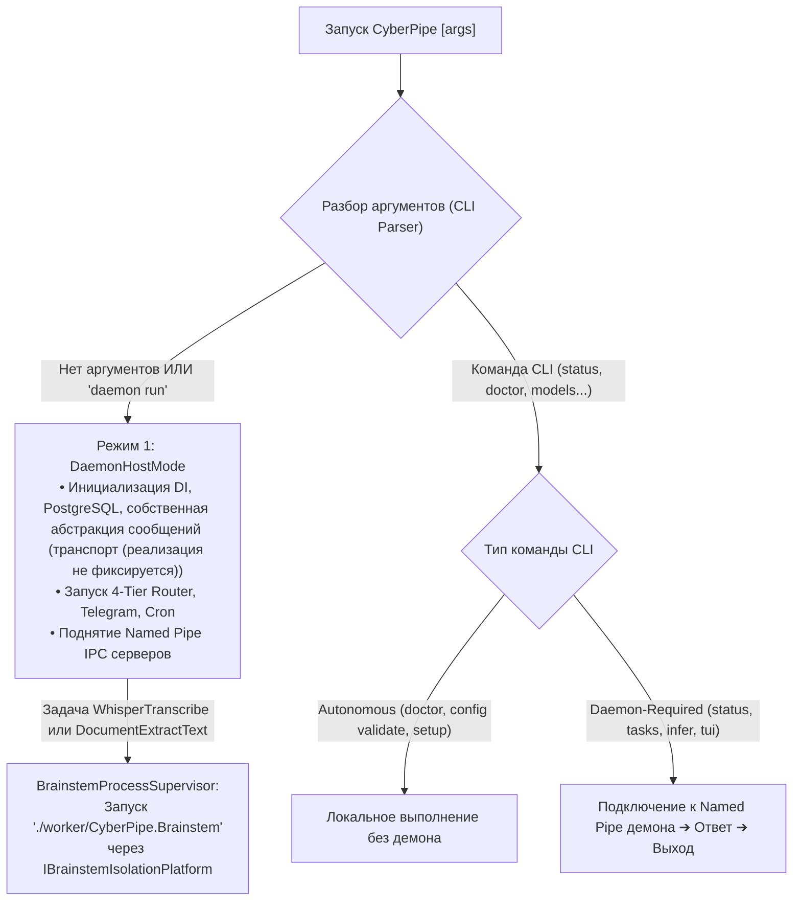

# 15. Исполняемые файлы, Межпроцессная Изоляция (`CyberPipe.Brainstem`), Безопасность IPC и Системный CLI / TUI

Этот документ является **единым каноническим источником** по компоновке исполняемых файлов системы, кроссплатформенной модели изоляции процессов (`IBrainstemIsolationPlatform` для Windows / Linux / macOS), протоколам межпроцессного взаимодействия (IPC), жизненному циклу двух пулов изолированного воркера `CyberPipe.Brainstem` и спецификации командного интерфейса (CLI/TUI). В остальных документах ([`06-solution-structure.md`](file:///c:/Users/Conqueror/source/repos/CyberPipeline/docs/plans/06-solution-structure.md), [`07-ui-isolation-and-arch-tests.md`](file:///c:/Users/Conqueror/source/repos/CyberPipeline/docs/plans/07-ui-isolation-and-arch-tests.md), [`14-fault-isolation-and-resilience.md`](file:///c:/Users/Conqueror/source/repos/CyberPipeline/docs/plans/14-fault-isolation-and-resilience.md)) приводятся только ссылки на данный раздел.

---

## 1. Состав дистрибутива и три точки входа (`.exe` / бинарники)

Система включает **три собственных исполняемых файла (Entry-Point Executables)**, разделенных по ролям и уровню доверия, а также сопутствующие управляемые сборки (`.dll`), нативные рантайм-библиотеки (`onnxruntime`, `whisper`, `e_PostgreSQL3`), файлы весов моделей (`.onnx` для эмбеддингов `multilingual-e5-small` и `.bin`/`.onnx` для `Whisper.net`), конфигурационные файлы и внешние системные сервисы (локальный HTTP-сервер `Ollama / LM Studio` для генеративных LLM `Tier 2 / Tier 3`, а также `git`, `dotnet`, `docker`).

| № | Точка входа | Проект в Solution | Роль процесса и профиль привилегий |
| :--- | :--- | :--- | :--- |
| **1** | **`CyberPipe`** (`CyberPipe.exe`) | `src/Host/CyberPipe` | **Основной хост и CLI-диспетчер (`Medium Integrity` / стандартный пользователь в интерактивной сессии):**<br/>• *Режим 1 (Демон, по умолчанию / `daemon run`):* фоновая служба оркестрации, БД `PostgreSQL`, роутер (`Tier 1` `Microsoft.ML.OnnxRuntime` in-process), шлюз `Telegram`, планировщик и сервер IPC.<br/>• *Режим 2 (CLI/TUI клиент):* консольный интерфейс управления и диагностики. |
| **2** | **`CyberPipe.UI.Desktop`** (`CyberPipe.UI.Desktop.exe`) | `src/UI/CyberPipe.UI.Desktop` | **Графический клиент Avalonia UI (`Medium Integrity` / стандартный пользователь):**<br/>Окно управления, системный трей и быстрый попап (`Alt+Space`). Не выполняет бизнес-логику локально; общается с `CyberPipe` по локальному IPC. |
| **3** | **`worker/CyberPipe.Brainstem`** (`worker/CyberPipe.Brainstem.exe`) | `src/Execution/CyberPipe.Brainstem` | **Изолированный процесс-исполнитель (`IBrainstemIsolationPlatform`: Windows `AppContainer` или `Restricted Token + Job Object`, Linux `bwrap + cgroups v2`, macOS `Seatbelt`):**<br/>Выделенный процесс в подкаталоге `./worker/` строго для двух задач: голосовой транскрибации (`Whisper.net`) и парсинга недоверенных документов (`PdfPig` / `OpenXml`). |

### Граница ответственности между `CyberPipe`, `CyberPipe.Brainstem` и `Ollama`
1. **Что работает внутри `worker/CyberPipe.Brainstem`:**
   * **`WhisperTranscribe` (`Whisper.net`):** декодирование сторонних голосовых сообщений и аудиопотоков в нативном C++ коде.
   * **`DocumentExtractText` (`UglyToad.PdfPig` и `DocumentFormat.OpenXml`):** разбор сложных вложенных контейнеров PDF и DOCX/XLSX (ZIP-архивы + XML-деревья) из внешних источников с жестким лимитом памяти `512 МБ` и одноразовым процессом (`SingleUseProcess = true`).
2. **Почему генеративные локальные LLM (`Tier 2 / Tier 3`) вынесены во внешний HTTP-сервер (`Ollama / LM Studio`), а не в `Brainstem`:**
   * Загрузка и удержание многогигабайтных весов генеративных LLM, управление драйверами CUDA/ROCm/Metal и `KV-Cache` уже оптимально решены в `Ollama` (`http://localhost:11434`). Взаимодействие через `OllamaSharp` (`IChatClient`) исключает дублирование `LLamaSharp`/`llama.dll` внутри `Brainstem` и не конфликтует с лимитами виртуальной памяти `JOB_OBJECT_LIMIT_JOB_MEMORY` при инициализации драйверов GPU.
3. **Почему эмбеддер `Tier 1` (`Microsoft.ML.OnnxRuntime` + `multilingual-e5-small`) работает внутри процесса `CyberPipe`:**
   * В отличие от парсеров бинарных контейнеров (PDF/аудио), `ONNX Runtime` в `Tier 1` принимает на вход исключительно короткие, уже проверенные через `QuotaBoundedStream` UTF-8 строки (`<= 512 токенов`) и возвращает фиксированный вектор `float[384]`. Выполнение в памяти `CyberPipe` обеспечивает задержку инференса `< 5–10 мс` без накладных расходов на сериализацию IPC.

---

## 2. Диспетчеризация запуска и целевые показатели задержки (Latency Benchmarks)

В точке входа `Program.cs` внутри `CyberPipe.exe` до построения DI-контейнера демона анализируются аргументы командной строки:



### Целевые показатели производительности (Target SLOs & Условия измерения)
Показатели времени отклика фиксируются как **целевые ориентиры (SLO)**, проверяемые тестами `BenchmarkDotNet` при следующих базовых условиях (4+ ядер CPU, SSD NVMe, прогретый процесс демона, размер IPC-сообщения $\le 64\text{ КБ}$):
* **Разбор аргументов в `Program.cs` (выбор ветки `Daemon` vs `CLI`):** целевой показатель $p95 < 2\text{ мс}$ (без инициализации `HostBuilder`).
* **Round-trip простого CLI-запроса (`CyberPipe status --json`) к уже запущенному демону по Named Pipe:** единый целевой показатель по всей документации $p95 < 25\text{ мс}$ (включая старт процесса CLI, подключение к пайпу и сериализацию JSON).
* **Холодный старт `CyberPipe.Brainstem` до готовности Named Pipe (для `DocumentExtractText` без загрузки весов `Whisper`):** целевой показатель $p95 < 80\text{ мс}$.
* **Сквозной путь через Telegram — вне локальных бюджетов:** сетевые задержки Telegram не нормируются;
  сквозной сценарий `Telegram → роутер → песочница → ответ` измеряется отдельно как best-effort до накопления статистики.
  Отчетность по всем SLO — процентилями `p95/p99` на эталонном железе; разовые замеры минимума не являются доказательством.

---

## 3. Кроссплатформенная модель безопасности для `CyberPipe.Brainstem` (`IBrainstemIsolationPlatform`)

Разделение на процессы само по себе **не гарантирует** изоляцию, если дочерний процесс наследует токен и файловые права родителя. Контракт `IBrainstemIsolationPlatform` (в `CyberPipe.Contracts`) реализует строгую изоляцию памяти и файловой системы с учетом реального поведения ядра каждой ОС.
> [!CAUTION]
> **Эквивалентность AppContainer / bwrap / Seatbelt не доказана (AUD-13, гипотеза).** Гарантии, API и модели разрешений
> платформ различаются. Требуется PoC на каждой целевой ОС с одинаковым набором негативных тестов (раздел 9);
> расхождения фиксируются документально. MVP стартует на Windows 10/11.

### 3.1. Архитектура изоляции на Windows (`WindowsBrainstemIsolationPlatform`)
В ядре Windows механизм Mandatory Integrity Control (MIC) по умолчанию реализует политику **`No-Write-Up`**, а монитор безопасности **NTFS игнорирует флаг `SYSTEM_MANDATORY_LABEL_NO_READ_UP` в SACL файлов и папок** (применяя `NO_READ_UP` только к объектам процессов и потоков в памяти). Кроме того, обычный процесс `Medium Integrity` не обладает привилегией `SeAssignPrimaryTokenPrivilege` для произвольного `CreateProcessAsUserW`.

Поэтому на Windows защита памяти демона, баз `единая база PostgreSQL`, `таблицы единой PostgreSQL` (`Quartz.NET` (PostgreSQL), `собственная абстракция сообщений` (PostgreSQL), `knowledge` (PostgreSQL), `crm` (PostgreSQL), `finance` (PostgreSQL), `budget` (PostgreSQL), `health` (PostgreSQL)) и `secrets.vault` от `CyberPipe.Brainstem.exe` строится на **трех реально работающих в ядре NT механизмах**:

1. **Защита процесса `CyberPipe.exe` в оперативной памяти (Process SACL `NO_READ_UP`):**
   * При старте `CyberPipe.exe` устанавливает на **собственный дескриптор процесса (`Process Kernel Object`)** метку SACL:
     `SYSTEM_MANDATORY_LABEL_NO_READ_UP | SYSTEM_MANDATORY_LABEL_NO_WRITE_UP | SYSTEM_MANDATORY_LABEL_NO_EXECUTE_UP`.
   * Поскольку для объектов процессов ядро Windows строго проверяет `NO_READ_UP`, любой вызов `OpenProcess(PROCESS_VM_READ | PROCESS_QUERY_INFORMATION)` из процесса с `Low Integrity` / `AppContainer` гарантированно блокируется ядром с `ERROR_ACCESS_DENIED (5)`.
2. **Два профиля запуска и реальной файловой изоляции (`data/`):**
   * **Профиль А (`AppContainer` — по умолчанию для `DocumentExtractText` и CPU-задач):**
     * Супервизор регистрирует профиль `CreateAppContainerProfile("CyberPipe.Brainstem.Sandbox", ...)` с **нулевым списком сетевых возможностей (`Capabilities = Empty`)** — ядро Windows полностью блокирует исходящую и входящую сеть.
     * Запуск выполняется штатным `CreateProcessW` с `EXTENDED_STARTUPINFO_PRESENT` и атрибутом `PROC_THREAD_ATTRIBUTE_SECURITY_CAPABILITIES` (не требует административных привилегий или `SeAssignPrimaryTokenPrivilege`).
     * Процесс в `AppContainer` получает уникальный `AppContainer SID` (`Low Integrity`) и по умолчанию **не имеет прав чтения (`ACCESS_DENIED`) ни к каким пользовательским папкам**, включая `%LOCALAPPDATA%\CyberPipe\data\` (`единая база PostgreSQL`, каталог `data/subsystems/`, `secrets.vault`), кроме явно разрешенных `Read & Execute` на `./worker/` и `Modify` на одноразовую папку `worker-temp/{InstanceGuid}`.
   * **Профиль Б (`RestrictedTokenWithRestrictingSids` — для `WhisperTranscribe` с GPU CUDA/DirectML, если драйвер видеокарты блокирует `AppContainer`):**
     * Формируется токен через `CreateRestrictedToken` с флагами `DISABLE_MAX_PRIVILEGE | SANDBOX_INERT` и массивом ограничивающих SID **`SidsToRestrict` (`RESTRICTED_SID`)**: `[Everyone (S-1-1-0), BuiltinUsers (S-1-5-32-545), CurrentUserSid, RestrictedWorkerCustomSid (S-1-5-99-214-1)]`.
     * При проверке доступа в Windows объект открывается только тогда, когда доступ разрешен **и** основному списку SID, **и** списку `SidsToRestrict`.
     * На каталог `%LOCALAPPDATA%\CyberPipe\data\` (содержащий `единая база PostgreSQL`, `data/subsystems/` и `secrets.vault`) при инициализации (`CyberPipe setup` / старте демона) в **DACL** прописывается явная запись отказа **`ACCESS_DENIED_ACE` для `RestrictedWorkerCustomSid (S-1-5-99-214-1)`**. Так как у основного процесса `CyberPipe.exe` этого SID нет, демон беспрепятственно работает с БД и секретами, а `Brainstem.exe` с `RestrictedWorkerCustomSid` в `SidsToRestrict` получает от NTFS жесткий `UnauthorizedAccessException` при любой попытке открыть `единая база PostgreSQL`, базы подсистем в `таблицы единой PostgreSQL` или `secrets.vault`.
3. **Запрет наследования дескрипторов и очистка окружения:**
   * При вызове `CreateProcess` устанавливается `bInheritHandles = FALSE` (воркер не наследует открытые дескрипторы PostgreSQL или сокеты родителя), а в блок окружения передаются только `SystemRoot` и изолированный `TEMP`/`TMP`.

### 3.2. Архитектура изоляции на Linux и macOS
* **Linux (`LinuxBubblewrapIsolationPlatform`):** запуск воркера через `bwrap --unshare-all --die-with-parent --ro-bind ./worker /app/worker --bind ./worker-temp/{Guid} /tmp` (сетевое пространство имен `--unshare-net` отключено, каталог `~/.local/share/CyberPipe/data/` вообще не монтируется в файловое дерево воркера) + жесткие лимиты памяти и `pids.max = 1` через `cgroups v2`.
* **macOS (`MacOsSeatbeltIsolationPlatform`):** запуск через профиль `sandbox-exec` с правилами `(deny network*)` и `(deny file-read* file-write* (subpath ".../Application Support/CyberPipe/data"))` + лимиты памяти через `setrlimit`.

### 3.3. Постоянное криптографическое хранилище `SecretsVault` (без потери ключей при перезапуске)
* Чтобы секреты (`secrets.vault` и зашифрованные колонки в PostgreSQL) надежно сохранялись между перезапусками `CyberPipe` и были доступны автономным командам `CyberPipe secrets set|list`, ключ шифрования **не использует эфемерную энтропию, живущую только в ОЗУ**.
* `ISecretVaultPlatform` использует персистентное системное хранилище ключей ОС:
  * **Windows:** `ProtectedData.Protect(..., DataProtectionScope.CurrentUser)` с детерминированной привязкой к профилю установки (+ опциональный мастер-пароль пользователя через `Argon2id`).
  * **Linux / macOS:** `LibSecret` (`freedesktop Secret Service`) / `macOS Keychain` (или `AES-256-GCM` с ключом `Argon2id`).
* Защита от чтения файла `secrets.vault` процессом `CyberPipe.Brainstem` обеспечивается **на уровне файловой системы ОС** (`AppContainer` / `ACCESS_DENIED_ACE` для `RestrictedWorkerCustomSid` в DACL каталога `data/` / отсутствие маунта в `bwrap`), а расшифрованные в `CyberPipe` байты ключей очищаются в `finally` через `CryptographicOperations.ZeroMemory`.

---

## 4. Защита межпроцессного взаимодействия (IPC Security)

В системе используются два физически разделенных контура Named Pipes / Unix Domain Sockets с разными протоколами и правилами доступа:

| Параметр | Контур 1: Управление (`UI / CLI ↔ CyberPipe`) | Контур 2: Воркер (`CyberPipe ↔ CyberPipe.Brainstem`) |
| :--- | :--- | :--- |
| **Имя канала (Pipe Name)** | `\\.\pipe\CyberPipe.Control.{UserSid}` (или `unix:/.../control.sock` с `0600`) | `\\.\pipe\CyberPipe.Brainstem.{WorkerInstanceGuid}` |
| **Транспорт и сериализация** | `Grpc.AspNetCore` (`Kestrel` `ListenNamedPipe`) + Protobuf | Длина-префиксный бинарный канал (`NamedPipeServerStream`) + JSON SourceGen / Protobuf |
| **Количество клиентов** | До `8` одновременных подключений (UI + CLI) | Строго `maxNumberOfServerInstances = 1` (точка-точка) |
| **Флаги создания Pipe** | `FirstPipeInstance \| Asynchronous \| CurrentUserOnly` | `FirstPipeInstance \| Asynchronous` + явный `PipeSecurity` |

### Верификация и защита от подмены (Anti-Squatting & Authentication):
1. **Защита от перехвата имени пайпа (`FILE_FLAG_FIRST_PIPE_INSTANCE`):** Если при создании серверного пайпа имя уже занято другим процессом, `CyberPipe` немедленно прерывает инициализацию с критической ошибкой безопасности.
2. **Проверка `PID` и одноразовый `SessionNonce` для `Brainstem`:**
   * При запуске `CyberPipe.Brainstem` демон генерирует криптографический 256-битный `SessionNonce`.
   * После подключения клиента к пайпу демон проверяет `PID` подключившегося процесса (`GetNamedPipeClientProcessId` на Windows / `SO_PEERCRED` на Linux / `LOCAL_PEERPID` на macOS) и сверяет: **`clientPid == spawnedProcess.Id`**. Если `PID` не совпадает — соединение мгновенно разрывается.
   * В первом кадре рукопожатия воркер обязан предъявить `SessionNonce`.
3. **Ограничения размеров и таймауты:**
   * Для Контура 1 (gRPC): `MaxReceiveMessageSize = 4 МБ`, `MaxSendMessageSize = 4 МБ`, `KeepAliveTimeout = 10 с`.
   * Для Контура 2 (`Brainstem`): чтение заголовка длины (`int32`), при `frameLength <= 0 || frameLength > MaxConfiguredPayloadBytes (16 МБ)` поток немедленно закрывается до выделения буфера в памяти.
4. **Одноразовый `SessionNonce` с TTL и защитой от повторов (AUD-09):** nonce генерируется на каждый запуск воркера,
   действует только в пределах одной сессии и сжигается после первого успешного рукопожатия; повторный кадр
   с тем же nonce отклоняется. Окно рукопожатия ограничено таймаутом (воркер без валидного handshake за N секунд уничтожается).
5. **Авторизация команд (не только аутентификация воркера):** контур 1 (`UI/CLI ↔ CyberPipe`) проверяет роль
   вызывающего (`Owner` vs `Guest (удалён решением Q18: только Owner)` из белого списка `TelegramUserId`/конфига): гостю запрещены команды управления задачами
   Tier 3, секретами и лимитами. Неавторизованная команда возвращает ошибку, а не выполняется частично.
6. **Fail-closed и негативные тесты:** подмененный клиент (чужой `PID`, неверный/повторный nonce, перехват имени пайпа)
   получает отказ (`ExitCode = 3`, разрыв соединения). Обязательные тесты: подмена IPC-клиента, перехват endpoint,
   повторная отправка кадра управления.

---

## 5. Протокол взаимодействия с `CyberPipe.Brainstem`

В проекте `CyberPipe.Contracts.Brainstem` определены строго версионированные структуры обмена (из `BrainstemTaskKind` исключены `LocalLlmInference` и `GitRepositoryInspect`, так как локальные LLM работают через `Ollama`, а инспекция Git — через `LibGit2Sharp` / `IDevToolProcessRunner`):

```csharp
namespace CyberPipe.Contracts.Brainstem;

public const int CurrentBrainstemProtocolVersion = 1;

public enum BrainstemTaskKind
{
    Ping = 0,
    WhisperTranscribe = 1,
    DocumentExtractText = 2
}

public record BrainstemHandshake(
    int ProtocolVersion,
    int ProcessId,
    string SessionNonce,
    string WorkerManifestSha256
);

public record BrainstemTaskRequest(
    Guid RequestId,
    BrainstemTaskKind TaskKind,
    int ExecutionTimeoutMs,
    long MaxInputBytes,
    long MaxOutputBytes,
    ReadOnlyMemory<byte> Payload // Или путь к файлу во временной директории worker-temp/{InstanceGuid}
);

public record BrainstemTaskResponse(
    Guid RequestId,
    bool IsSuccess,
    string? ErrorCode,
    string? DiagnosticMessage,
    long ElapsedMs,
    long PeakWorkingSetBytes,
    ReadOnlyMemory<byte> ResultPayload
);

public record BrainstemControlSignal(
    Guid RequestId,
    bool CancelRequested,
    bool ShutdownWorkerRequested
);
```

### Обработка отмены и таймаутов:
1. **Кооперативная отмена (`Soft Cancel`):** При нажатии `/stop` пользователем демон отправляет кадр `BrainstemControlSignal(CancelRequested: true)` по управляющему дуплексному пайпу, который активирует `CancellationTokenSource` внутри `Brainstem`.
2. **Принудительное завершение (`Hard Timeout / Kill`):** Если по истечении `ExecutionTimeoutMs` (или через `1 500 мс` после `CancelRequested`) ответ не получен, супервизор демона принудительно уничтожает контейнер процесса (`Windows Job Object` / `cgroups` / группа процессов) на уровне ядра ОС.

---

## 6. Разделение на два пула воркеров и ресурсные ограничения (`Windows Job Object` / `cgroups v2`)

Управлением процессами `CyberPipe.Brainstem` занимается сервис **`BrainstemProcessSupervisor`** внутри `CyberPipe`. Чтобы избежать конфликта между «теплым» удержанием весов `Whisper.net` (для мгновенного распознавания голоса за `0.3–0.8 сек`) и одноразовой изоляцией парсеров недоверенных PDF/DOCX, супервизор поддерживает **два независимых пула**:

| Параметр пула | Пул 1: `Stateful Voice STT Worker Pool` (`WhisperTranscribe`) | Пул 2: `SingleUse Document Parser Pool` (`DocumentExtractText`) |
| :--- | :--- | :--- |
| **Назначение и библиотеки** | Локальное распознавание речи (`Whisper.net`) | Парсинг недоверенных внешних `.pdf` / `.docx` (`PdfPig`, `OpenXml`) |
| **Максимум экземпляров (`Semaphore`)** | `MaxInstances = 1` (Отсек 3А) | `MaxInstances = 2` (Отсек 3Б) |
| **Жизненный цикл процесса** | **Долгоживущий («теплый»):** держит веса `Whisper` в памяти; `IdleTimeout = 45 мин`, `MaxTasksPerProcess = 500` (или выгружается по сигналу `ISystemResourceMonitor` при нехватке RAM на хосте). | **Строго одноразовый (`SingleUseProcess = true`):** `MaxTasksPerProcess = 1`. Процесс уничтожается сразу после извлечения текста из одного документа. |
| **Профиль изоляции (Windows)** | Профиль А (`AppContainer` для CPU) или Профиль Б (`RestrictedToken + Deny DACL on data/` для GPU) | Всегда Профиль А (`AppContainer` / `bwrap` / `Seatbelt`) с полным запретом сети |
| **Лимит памяти** | CPU-режим: `WhisperModelSizeGb * 1.35 + 1.0 ГБ` в `JOB_OBJECT_LIMIT_JOB_MEMORY`.<br/>GPU-режим (CUDA/DirectML): так как драйвер GPU резервирует крупные адресные диапазоны в `Virtual Memory Commit`, жесткий `JOB_OBJECT_LIMIT_JOB_MEMORY` заменяется программным контролем `WorkingSet64` со стороны супервизора (`HardKill` при превышении лимита ОЗУ). | Жесткий потолок `JOB_OBJECT_LIMIT_JOB_MEMORY = 512 МБ` (`cgroups memory.max = 512M`). |

### Конфигурация `Windows Job Object` (`JOBOBJECT_EXTENDED_LIMIT_INFORMATION`):
* `JOB_OBJECT_LIMIT_KILL_ON_JOB_CLOSE` — гарантированное уничтожение всех процессов `Brainstem` ядром Windows при завершении или аварийном падении родительского `CyberPipe.exe`.
* `JOB_OBJECT_LIMIT_ACTIVE_PROCESS = 1` — **запрет порождения дочерних процессов** (код внутри `Brainstem` не может запустить `cmd.exe`, `powershell.exe` или другой `.exe`).
* `JOB_OBJECT_LIMIT_DIE_ON_UNHANDLED_EXCEPTION` + `SetErrorMode(SEM_NOGPFAULTERRORBOX)` — отключение зависающих диалоговых окон `WerFault.exe` при нативном сбое.
* `JOB_OBJECT_CPU_RATE_CONTROL_ENABLE | JOB_OBJECT_CPU_RATE_CONTROL_HARD_CAP` — ограничение доли CPU (например, `75%`), чтобы воркер не вызывал фризов звука и интерфейса ОС.

---

## 7. Совместимость с .NET 10, Нативными Библиотеками и GPU при ограниченных правах

1. **Изолированный каталог `%TEMP%` для каждого экземпляра воркера:**
   * Перед стартом воркера супервизор демона создает изолированную папку `%LOCALAPPDATA%\CyberPipe\worker-temp\{InstanceGuid}`, программно выдает на неё права записи для конкретного `AppContainer SID` / `RestrictedWorkerCustomSid` с автоматическим удалением папки при завершении воркера и передает этот путь в переменные `TEMP` и `TMP` дочернего процесса.
2. **Безопасная загрузка весов `Whisper` без открытия широкого доступа к диску:**
   * Воркеру Пула 1 разрешено чтение (`Read`) только фиксированного каталога `./models/whisper/` с предварительной проверкой контрольной суммы файла модели.
3. **Автоматический выбор профиля GPU (`CyberPipe doctor`):**
   * Команда `CyberPipe doctor` при первом запуске проводит автоматический пробный тест запуска `Brainstem` с `Whisper.net` в Профиле А (`AppContainer`) и Профиле Б (`RestrictedTokenWithRestrictingSids`), фиксируя рабочий профиль для данной видеокарты.

---

## 8. Установка, Целостность Манифеста Сборок и Безопасное Обновление

1. **Структура каталогов при установке:**
   * `C:\Program Files\CyberPipe\` (или защищенный системный каталог `/opt/cyberpipe`, `/Applications/CyberPipe.app`): содержит `CyberPipe`, `CyberPipe.UI.Desktop`, управляемые `.dll` демона и подкаталог `worker/` (`CyberPipe.Brainstem` + манифест `worker.manifest.json`). Права на запись (`Write/Modify`) есть только у администратора (`BUILTIN\Administrators` / `root`). Обычный пользователь и сам демон имеют только `Read & Execute`.
   * `%LOCALAPPDATA%\CyberPipe\data\` (`~/.local/share/CyberPipe/data/`): содержит `единая база PostgreSQL` (`PostgreSQL`, только настройки и реестр) и подкаталог `subsystems/` (`Quartz.NET` (PostgreSQL), `собственная абстракция сообщений` (PostgreSQL), `knowledge` (PostgreSQL), `crm` (PostgreSQL), `finance` (PostgreSQL), `budget` (PostgreSQL), `health` (PostgreSQL), `netrunner` (PostgreSQL) — каждая со своим паролем в `SecretsVault`), `secrets.vault`, `backups/` и логи. Закрыт от `AppContainer`, от `RestrictedWorkerCustomSid` (через `ACCESS_DENIED_ACE` в DACL) и от сторонних пользователей (`chmod 0700`).
2. **Полная проверка целостности `worker/worker.manifest.json` перед запуском (`Full Worker Directory Integrity Check`):**
   * Чтобы исключить атаку подмены зависимых библиотек (`DLL Hijacking` через `whisper.dll` или управляемые `.dll`), при сборке релиза генерируется подписанный манифест `worker/worker.manifest.json`, содержащий **SHA-256 хеши `CyberPipe.Brainstem.exe` и всех `.dll` / `.so` / `.dylib` в каталоге `./worker/`**.
   * Перед созданием процесса `Brainstem` супервизор сверяет SHA-256 всех исполняемых и библиотечных файлов в `./worker/` против эталонного манифеста и удерживает дескриптор `FileShare.Read` на время работы воркера. При любом несовпадении запуск блокируется с кодом `ExitCode = 3`.
3. **Предмиграционный бэкап БД и атомарное обновление (`Side-by-Side Update`):**
   * Обновление ставится в параллельную версионную директорию `app-{version}/`.
   * Перед запуском проверки новой версии и применением миграций схемы (`PostgreSQLMigrationRunner`) автоматически создается консистентная резервная копия базы `backups/cyberpipe.v{CurrentSchema}.bak` через `PostgreSQLBackupService`.
   * Затем новый бинарник запускается в режиме `CyberPipe doctor --verify-update`. Если самодиагностика, миграция или проверка связи с `Brainstem` завершается ошибкой, обновление и файл БД автоматически откатываются на предыдущую рабочую версию.

---

## 9. Проверка фактической изоляции в CI (Интеграционные критерии приёмки со Спринта 1)

В конвейер CI (`CyberPipe.Tests.Architecture` и `CyberPipe.Tests.Isolation`, начиная со **Спринта 1**) включены **5 обязательных автоматических проверок**:

1. **Статический анализ зависимостей (`ArchUnitNET` с защитой от пустых выборок):**
   * Загрузка всех 16 сборок решения + `Assert.NotEmpty(...)` перед проверками правил: `CyberPipe.UI` и `CyberPipe.Brainstem` не имеют ссылок на `CyberPipe.Core`, `CyberPipe.Skills`, `CyberPipe.Gateway`, `CyberPipe.Storage`, `CyberPipe.Security`; `CyberPipe.Skills.Host` не имеет ссылок на `System.Diagnostics.Process` и `CliWrap`.
2. **Аудит состава папки публикации (`Publish Directory Layout Gate`):**
   * Пост-билд скрипт проверяет содержимое `publish/worker/` и валидирует `worker.manifest.json`. Наличие в `publish/worker/` любой сборки демона (`CyberPipe.Core.*.dll`, `Microsoft.Data.PostgreSQL.dll`, `Telegram.Bot.dll`) немедленно валит сборку CI.
3. **Интеграционный тест токена и привилегий (`Token & Sandbox Verification Test`):**
   * В CI реально запускается `CyberPipe.Brainstem`, который проверяет активный профиль изоляции (`AppContainer` или `RestrictedToken` с `RestrictedWorkerCustomSid` на Windows / `bwrap` на Linux) и отсутствие опасных привилегий.
4. **Пентест-попытка пробить границу процесса и диска (`Negative Escape Tests`):**
   * Специальный тестовый обработчик внутри `Brainstem` в рамках интеграционного теста пытается:
     * Вызвать `OpenProcess(PROCESS_VM_READ, daemonPid)` $\rightarrow$ тест проходит **только если получен `ACCESS_DENIED (5)`** (благодаря `Process SACL NO_READ_UP`).
     * Открыть файл базы `../data/единая база PostgreSQL`, `../data/subsystems/Quartz.NET` (PostgreSQL), `../data/subsystems/собственная абстракция сообщений` (PostgreSQL) или `../data/secrets.vault` $\rightarrow$ тест проходит **только при `UnauthorizedAccessException`** (как в Профиле А `AppContainer`, так и в Профиле Б `RestrictedWorkerCustomSid` за счет `ACCESS_DENIED_ACE` в DACL `data/`).
     * Вызвать `Process.Start("cmd.exe")` внутри `Job Object` с `ActiveProcessLimit = 1` $\rightarrow$ тест проходит **только при блокировке создания процесса ядром ОС**.
5. **Тест на `AccessViolation`, OOM и защиту от ложного `Poison-Pill` (`Crash & Cancellation Resilience Test`):**
   * Намеренный вызов нативного падения памяти (`AccessViolation`) и превышения лимита `512 МБ` внутри `Brainstem` подтверждает, что `CyberPipe` остается жив, инкрементирует `AttemptCount` в `InFlightOperations` и готов к следующему запросу менее чем через `200 мс`, тогда как штатная отмена задачи через `/stop` (`OperationCanceledException`) удаляет запись `InFlightOperations` без пометки `Poisoned`.

---

## 10. Матрица команд системного CLI (`CyberPipe <command>`)

Команды CLI четко разделены по режиму выполнения:
* **`Autonomous (Offline)`** — выполняется локально самим процессом CLI, **не требует** запущенного фонового демона (использует персистентный `SecretsVault` и локальную `PostgreSQL` с `BusyTimeout = 5000`).
* **`Daemon-Required (IPC)`** — обращается по Named Pipe к работающему демону `CyberPipe`. Если демон остановлен, возвращает код выхода `ExitCode = 2 (DAEMON_UNAVAILABLE)`.
* **`Hybrid`** — проверяет локальное окружение автономно и дополнительно опрашивает демон, если он активен.

| Команда | Режим работы | Права | Спринт | Описание |
| :--- | :--- | :--- | :---: | :--- |
| `CyberPipe setup` / `onboard` | `Autonomous` | User | Спринт 1/2 | Интерактивный мастер инициализации БД `PostgreSQL`, проверки железа, настройки моделей и `SecretsVault`. |
| `CyberPipe doctor [--fix]` | `Hybrid` | User | Спринт 1 | Диагностика: `PRAGMA integrity_check` БД, проверка DACL `data/`, манифеста `worker.manifest.json` и изоляции `Brainstem`, AVX2/VRAM, тест GPU и аудио. |
| `CyberPipe config get\|set\|validate` | `Hybrid` | User | Спринт 1 | Чтение и валидация конфига на диске; если демон запущен — отправка сигнала горячей перезагрузки. |
| `CyberPipe completion <pwsh\|bash\|zsh>` | `Autonomous` | User | Спринт 5 | Генерация скрипта автодополнения для командной оболочки. |
| `CyberPipe daemon install\|uninstall` | `Autonomous` | **User** | Спринт 5 | Регистрация или удаление автозапуска демона **в интерактивной пользовательской сессии (`Session >= 1`)** через `IDaemonInstaller` (Windows Scheduled Task `LogonTrigger` / `HKCU\...\Run`, Linux `systemd --user`, macOS `launchd` LaunchAgent) для сохранения доступа к аудиоустройствам, буферу обмена и OCR экрана (запуск в `Session 0` Windows Service не используется). |
| `CyberPipe daemon start\|stop\|restart\|status` | `Hybrid` | User | Спринт 1 | Запуск, остановка и проверка состояния процесса демона `CyberPipe`. |
| `CyberPipe status [--json] [--usage]` | `Daemon-Required` | User | Спринт 1 | Сводка аптайма, RAM/VRAM, статистики срабатываний `Tier 0–3` и остатка бюджета в `TokenBudgetGovernor`. |
| `CyberPipe health` / `triage` | `Hybrid` | User | Спринт 2 | Статус отсеков (`Bulkhead Lanes`), список воркеров в карантине (`Circuit Breaker`) и заблокированных `Poison-Pill` сообщений. |
| `CyberPipe logs [--follow] [--tail <n>]` | `Hybrid` | User | Спринт 2 | Чтение локальных логов с диска или живой стрим из демона (после Egress-фильтрации `Sanitizer`). |
| `CyberPipe models scan` | `Hybrid` | User | Спринт 2 | Запуск `IHardwareCapabilitiesProbe` + `IModelCompatibilityAdvisor`: таблица 15 локальных моделей с учетом `KV-Cache` и вердиктами совместимости (`🟢/🟡/🔴`). |
| `CyberPipe models list\|status\|set` | `Hybrid` | User | Спринт 2 | Просмотр и назначение `Local` (`Ollama`) или `RemoteCloud` модели для `Tier 2` и `Tier 3`. |
| `CyberPipe infer "<текст>" [--explain]` | `Daemon-Required` | User | Спринт 2 | Прогон запроса через 4-Tier роутер с отчетом о выбранном Tier, затраченном времени и стоимости. |
| `CyberPipe security audit` | `Hybrid` | User | Спринт 4 | Проверка правил `HostAndMediaSafetyGuard`, DACL каталога `data/`, манифеста `Brainstem` и белых списков `TelegramUserId`. |
| `CyberPipe secrets set\|list\|audit` | `Hybrid` | User | Спринт 2 | Управление ключами API в персистентном зашифрованном хранилище `SecretsVault` со скрытым вводом из консоли. |
| `CyberPipe approvals list\|approve\|reject` | `Daemon-Required` | User | Спринт 4 | Подтверждение или отклонение ожидающих `HITL`-запросов безопасности и разблокировка пауз бюджета (`PausedByBudget`). |
| `CyberPipe tasks list\|pause\|resume\|stop-all` | `Daemon-Required` | User | Спринт 1 | Управление активными задачами (`stop-all` активирует `PriorityKillSwitch`). |
| `CyberPipe sandbox list\|explain\|kill <id>` | `Daemon-Required` | User | Спринт 4 | Список активных экземпляров `CyberPipe.Brainstem` (Пул 1 и Пул 2) и песочниц с возможностью принудительного завершения. |
| `CyberPipe backup PostgreSQL create\|verify\|restore` | `Hybrid` | User | Спринт 2 | Горячий бэкап базы `PostgreSQL` (через `PostgreSQLBackupService` Backup API), проверка контрольной суммы и восстановление. |
| `CyberPipe memory search\|add\|status` | `Hybrid` | User | Спринт 2 | Гибридный поиск (`FTS5 + In-Memory SIMD`) по `KnowledgeVault` с учетом `TrustSource`. |
| `CyberPipe cron list\|add\|enable\|disable\|run` | `Daemon-Required` | User | Спринт 3 | Управление задачами планировщика `ProactiveScheduler`. |
| `CyberPipe MessageBroker status\|check\|start` | `Hybrid` | User | Спринт 1 | Проверка доступности портов 5672/15672, пинг ноды, старт через Центр и валидация учетных данных в `SecretsVault`. |
| `CyberPipe skills list\|check\|unquarantine` | `Daemon-Required` | User | Спринт 3 | Статус подключенных скиллов и ручной вывод скилла из карантина после сбоя. |
| `CyberPipe tui [--local]` | `Daemon-Required` | User | Спринт 5 | Интерактивный терминальный интерфейс (TUI) с чатом, мониторингом бюджета и флагом локального режима `--local`. |

### Строгий `--json` контракт и коды возврата (`ExitCode`)
* При передаче флага **`--json`** все диагностические сообщения направляются в `stderr`, а в `stdout` выводится **ровно один JSON-объект** (`{ "ok": true, "data": { ... } }` или `{ "ok": false, "error": { "code": "...", "message": "..." } }`).
* Стандартизированные коды возврата для скриптов и CI:
  * `0` — Успешное выполнение.
  * `1` — Ошибка валидации аргументов или выполнения команды.
  * `2` — Демон `CyberPipe` не запущен (для команд `Daemon-Required`).
  * `3` — Нарушение безопасности, прав доступа (ACL) или проверки целостности манифеста (`Security / Integrity Check Failed`).
  * `4` — Превышен лимит бюджета или таймаут операции.

---

## 11. Архитектурные компромиссы и обоснование решений (Trade-offs & Rationale)

1. **Почему `CyberPipe.UI` ссылается только на `CyberPipe.Contracts`:**
   * **Плюсы:** Исключает случайный вызов блокирующих запросов к БД или ИИ напрямую из UI-потока; позволяет перезапускать или закрывать окно GUI без влияния на фоновый демон; ускоряет компиляцию UI и позволяет тестировать верстку на мок-данных.
   * **Цена (Компромисс):** Любое новое действие в UI требует добавления DTO/метода в `CyberPipe.Contracts` вместо прямого вызова C#-сервиса.
2. **Какие сборки доступны `CyberPipe.Brainstem` и почему он разделен на два пула процессов:**
   * **Состав зависимостей `Brainstem`:** Ссылается только на `CyberPipe.Contracts` и пакеты двух изолируемых задач (`Whisper.net`, `UglyToad.PdfPig`, `DocumentFormat.OpenXml`). Сборки ядра оркестратора, `Telegram`, `PostgreSQL` и `SecretsVault` в него не входят.
   * **Почему один бинарник `CyberPipe.Brainstem` с двумя пулами (`Stateful Voice STT Pool` и `SingleUse Document Parser Pool`):** Вместо распыления 5 разных `.exe` один верифицированный по `worker.manifest.json` бинарник запускается супервизором в разных экземплярах процессов с разными лимитами и профилями: голосовой воркер держит прогретую модель `Whisper.net` в памяти (`IdleTimeout = 45 мин`), а парсер внешних PDF/DOCX запускается в жестком `AppContainer` (`SingleUseProcess = true`, `512 МБ`) и уничтожается сразу после одного документа.
3. **Почему демон регистрируется в интерактивной сессии пользователя (`Session >= 1`), а не как системная служба `Session 0`:**
   * Службы `Session 0` в Windows изолированы ядром от графического рабочего стола, буфера обмена и аудиоустройств пользователя (`WASAPI` / `Windows.Media.Ocr`). Запуск `CyberPipe` как фонового хоста интерактивной сессии (`LogonTrigger` / `systemd --user` / `LaunchAgent`) сохраняет 100% работоспособность голосового ассистента, записи созвонов, управления громкостью и OCR экрана без требования прав администратора.


