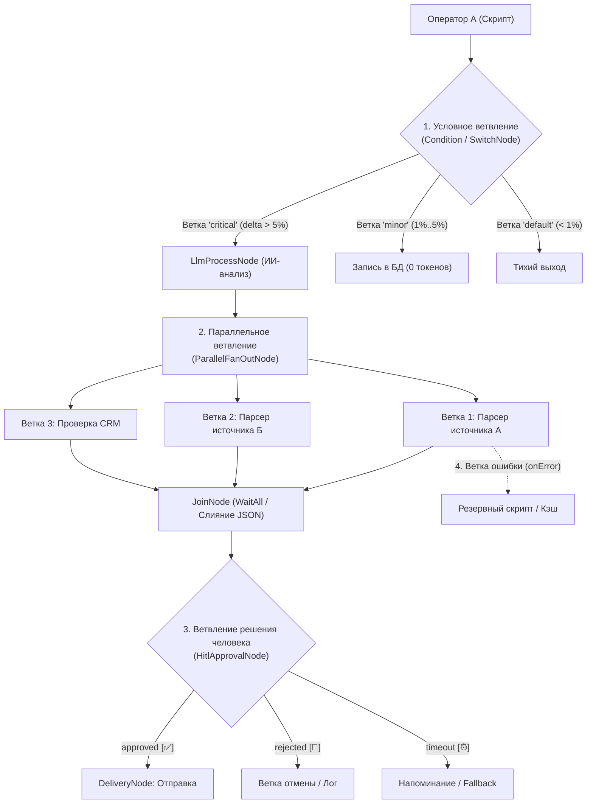

> **Решения владельца 2026-10-19 ([DECISIONS.md](../DECISIONS.md), [17-adr-mvp.md](17-adr-mvp.md)):** хранение - одна PostgreSQL + pgvector (SQLite/SQLCipher убраны); цепочки только Trigger -> Skill -> Script -> Delivery (термины цепочка/цепочка/workflow/граф удалены); Telegram - первый канал, не единственный; Service и Desktop - разные приложения. При расхождении верны DECISIONS.md и 17-adr-mvp.md.

# 16. Ассистент Netrunner: Движок Каскадных Задач (цепочка Trigger → Skill → Script → Delivery), HITL и Стандарт Пакетов Скриптов

**Netrunner** — это выделенный автономный ассистент и подсистема внутри **CyberPipe**, объединяющая:
1. **Стандартизированную базу детерминированных ETL-скриптов** (написанных пользователем или один раз синтезированных ИИ `Tier 3`), которые выполняют парсинг, очистку, фильтрацию и трансформацию данных за **0 облачных токенов**.
2. **Надежный движок каскадных и зависимых задач (`Netrunner Цепочка Engine` — «цепочка»)** с поддержкой ветвлений, параллельного исполнения, точечных ИИ-узлов (`LlmStep`) и обязательного подтверждения человеком (`Human-in-the-Loop / HITL`).

---

## 1. Архитектура Каскадного Конвейера (цепочка Trigger → Skill → Script → Delivery Workflow)

Вместо разрозненных одиночных скриптов Netrunner позволяет строить **ориентированные ациклические графы задач (цепочка)**, где данные (типизированный JSON и файловые артефакты) передаются по цепочке между детерминированными скиллами, ETL-скриптами, ИИ-агентами и точками ручного подтверждения:

```mermaid
flowchart LR
    subgraph Triggers ["1. Триггеры запуска"]
        T1["⏰ Cron (Quartz.NET)"]
        T2["💬 Команда / Голос"]
        T3["⚡ Событие / Watchdog"]
    end

    subgraph Step1 ["2. Сбор данных (0 токенов)"]
        S1["SkillNode: HttpSafeFetcher / GitRadar<br/>• Скачивание HTML / API / Лога"]
    end

    subgraph Step2 ["3. Детерминированный ETL (0 токенов)"]
        N1["NetrunnerScriptNode<br/>• Пакет: cbr-rates-etl@1.0.0<br/>• Валидация schema.input.json<br/>• Парсинг 5 000 строк ➔ 3 записи<br/>• Валидация schema.output.json"]
    end

    subgraph Step3 ["4. Условие / Фильтр (0 токенов)"]
        C1{"ConditionNode<br/>deltaPercent >= 1.5%?"}
    end

    subgraph Step4 ["5. Опциональный ИИ-шаг (Сжатый контекст)"]
        AI["LlmProcessNode (Tier 2 / Tier 3)<br/>• Получает только 3 строки вместо 5 000!<br/>• Контроль TokenBudgetGovernor<br/>• Экономия ~98% токенов"]
    end

    subgraph Step5 ["6. Human-in-the-Loop (HITL)"]
        HITL["HitlApprovalNode<br/>• Чекпоинт в netrunner.db<br/>• Кнопки в Telegram и UI:<br/>[✅ Одобрить] [✏️ Изменить] [🛑 Стоп]"]
    end

    subgraph Step6 ["7. Доставка и Запись"]
        D1["DeliveryNode<br/>• Отправка в Telegram-канал<br/>• Запись в FinanceLedger / CRM"]
        Stop["Тихое завершение<br/>(0 токенов)"]
    end

    T1 & T2 & T3 --> S1
    S1 -->|JSON + Входной файл| N1
    N1 -->|Типизированный Output| C1
    C1 -->|Нет (Ниже порога)| Stop
    C1 -->|Да (Аномалия / Дельта)| AI
    AI -->|Черновик решения| HITL
    HITL -->|Approved| D1
```

### Почему связка `SkillNode ➔ NetrunnerScriptNode ➔ LlmProcessNode ➔ HitlApprovalNode` радикально экономит токены и гарантирует надежность:
1. **Никакого повторного «обучения» ИИ на сырых данных:** Если нужно каждый день проверять котировки, прайс-листы, логи или ленту новостей, `SkillNode` забирает сырые данные, а `NetrunnerScriptNode` локально за `< 30 мс` и **0 токенов** вырезает 99% информационного мусора, считает математику/дельты и формирует чистую структуру.
2. **ИИ включается только по делу:** Если узел `ConditionNode` видит, что важных изменений нет, граф завершается с расходом **0 токенов**. Если изменения есть — узел `LlmProcessNode` получает уже выжатые 200 токенов фактов вместо 50 000 токенов сырой HTML-разметки.
3. **Человек контролирует критические шаги (`HITL`):** Перед выполнением чувствительного действия узел `HitlApprovalNode` ставит граф на паузу, сохраняет полное состояние на диск в `data/subsystems/netrunner.db` и ждет нажатия кнопки в Telegram или Avalonia Desktop UI.

---

## 2. Стандарт Пакета Скрипта Netrunner (`Netrunner Skill Package Specification`)

Скрипты Netrunner — это **не «сырые куски текста в базе» и не сторонние плагины из интернета**, а созданные специально под задачи пользователя (вручную или синтезированные ИИ `Tier 3`) **стандартизированные пакеты**.

Каждый пакет хранится в изолированной директории `%LOCALAPPDATA%\CyberPipe\data\netrunner-packages\<slug>\<version>\` и регистрируется в базе `data/subsystems/netrunner.db` с криптографической проверкой хешей **SHA-256** всех входящих файлов.

### 2.1. Обязательная файловая структура пакета (`Mandatory Files`)

Сервис валидации `INetrunnerPackageValidator` **категорически отклоняет** регистрацию или запуск пакета, если в его папке отсутствует хотя бы один из **6 обязательных файлов**:

```text
data/netrunner-packages/<slug>/<version>/
├── netrunner.manifest.json       # 1. [ОБЯЗАТЕЛЬНЫЙ] Стандартизированный манифест пакета (аналог package.json)
├── SKILL.md                      # 2. [ОБЯЗАТЕЛЬНЫЙ] Паспорт скилла для роутера Tier 1, ИИ-агентов и человека
├── schema.input.json             # 3. [ОБЯЗАТЕЛЬНЫЙ] JSON Schema (Draft 2020-12) входных параметров и входных файлов
├── schema.output.json            # 4. [ОБЯЗАТЕЛЬНЫЙ] JSON Schema (Draft 2020-12) выходных данных и выходных файлов
├── skill-hack.csx | skill-hack.py | skill-hack.js  # 5. [ОБЯЗАТЕЛЬНЫЙ] Точка входа детерминированного ETL-скрипта
└── tests/
    └── sample.fixture.json       # 6. [ОБЯЗАТЕЛЬНЫЙ] Набор эталонных пар (Input ➔ ExpectedOutput) для авто-проверки
```

---

### 2.2. Спецификация `netrunner.manifest.json` (Стандартизированный паспорт пакета)

Файл `netrunner.manifest.json` жестко описывает метаданные, среду исполнения, входные/выходные форматы, файловые контракты, разрешения песочницы и контрольные суммы:

```json
{
  "$schema": "https://cyberpipe.local/schemas/netrunner.manifest.v1.json",
  "slug": "cbr-currency-rates-etl",
  "name": "Курсы валют ЦБ РФ и расчет дневной дельты",
  "version": "1.0.0",
  "description": "Извлекает курсы валют из XML/JSON ответа ЦБ РФ, рассчитывает дельту к предыдущему дню и формирует сводную CSV-таблицу.",
  "author": {
    "origin": "AiSynthesizedTier3",
    "synthesizedByModel": "claude-3-7-sonnet",
    "approvedByUserId": "123456789",
    "createdAtUtc": "2026-10-17T09:50:00Z"
  },
  "runtime": {
    "engine": "CSharpRoslyn",
    "entrypoint": "skill-hack.csx",
    "timeoutMs": 15000,
    "maxMemoryMb": 64,
    "deterministic": true
  },
  "io": {
    "inputSchemaFile": "schema.input.json",
    "outputSchemaFile": "schema.output.json",
    "inputFormats": ["application/json", "application/xml"],
    "outputFormats": ["application/json", "text/csv"],
    "inputFiles": [
      {
        "alias": "rawXmlPayload",
        "required": true,
        "allowedExtensions": [".xml", ".json"],
        "mimeTypes": ["application/xml", "text/xml", "application/json"],
        "maxSizeBytes": 2097152,
        "description": "Сырой файл котировок, скачанный предыдущим узлом SkillNode (HttpSafeFetcher)"
      }
    ],
    "outputFiles": [
      {
        "alias": "ratesSummaryCsv",
        "filenamePattern": "cbr_rates_delta.csv",
        "mimeType": "text/csv",
        "required": true,
        "maxSizeBytes": 524288,
        "description": "Очищенная CSV-таблица с курсами и процентами изменений"
      }
    ]
  },
  "permissions": {
    "allowNetwork": false,
    "allowedDomains": [],
    "filesystemScope": "IsolatedRunWorkspaceOnly",
    "requiredVaultSecretRefs": []
  },
  "economics": {
    "estimatedTokensSavedPerRun": 3200
  },
  "integrity": {
    "filesSha256": {
      "skill-hack.csx": "e3b0c44298fc1c149afbf4c8996fb92427ae41e4649b934ca495991b7852b855",
      "schema.input.json": "8f434346648f6b96df89dda901c5176b10a6d83961dd3c1ac88b59b2dc327aa4",
      "schema.output.json": "2c26b46b68ffc68ff99b453c1d30413413422d706483bfa0f98a5e886266e7ae",
      "SKILL.md": "4b227777d4dd1fc61c6f884f48641d02b4d121d3fd328cb08b5531fcacdabf8a",
      "tests/sample.fixture.json": "ef2d127de37b942baad06145e54b0c619a1f22327b2ebbcfbec78f5564afe39d"
    }
  }
}
```

---

### 2.3. Спецификация `schema.input.json` и `schema.output.json` (Контракты данных)

Оба файла используют стандарт **JSON Schema (Draft 2020-12)** и обеспечивают **строгую типизацию между узлами графа**:

* **Пример `schema.input.json`:**
```json
{
  "$schema": "https://json-schema.org/draft/2020-12/schema",
  "title": "CbrRatesEtlInput",
  "type": "object",
  "required": ["targetCurrencies", "alertDeltaThresholdPercent"],
  "additionalProperties": false,
  "properties": {
    "targetCurrencies": {
      "type": "array",
      "items": { "type": "string", "enum": ["USD", "EUR", "CNY", "GBP", "KZT"] },
      "minItems": 1
    },
    "alertDeltaThresholdPercent": {
      "type": "number",
      "minimum": 0.01,
      "maximum": 100.0,
      "default": 1.0
    },
    "previousRates": {
      "type": "object",
      "additionalProperties": { "type": "number" }
    }
  }
}
```

* **Пример `schema.output.json`:**
```json
{
  "$schema": "https://json-schema.org/draft/2020-12/schema",
  "title": "CbrRatesEtlOutput",
  "type": "object",
  "required": ["date", "rates", "hasSignificantChange", "maxAbsDeltaPercent"],
  "additionalProperties": false,
  "properties": {
    "date": { "type": "string", "format": "date" },
    "hasSignificantChange": { "type": "boolean" },
    "maxAbsDeltaPercent": { "type": "number" },
    "rates": {
      "type": "array",
      "items": {
        "type": "object",
        "required": ["code", "value", "deltaPercent"],
        "properties": {
          "code": { "type": "string" },
          "value": { "type": "number" },
          "deltaPercent": { "type": "number" }
        }
      }
    }
  }
}
```

> [!IMPORTANT]
> **Гарантия на стыках узлов (Contract Enforcement):**
> 1. **До запуска скрипта (`Pre-Execution Validation`):** Движок проверяет входной JSON по `schema.input.json`, а также наличие, расширение, MIME-тип и лимит размера каждого файла из `io.inputFiles`.
> 2. **После запуска скрипта (`Post-Execution Validation`):** Движок проверяет возвращенный скриптом JSON по `schema.output.json` и убеждается, что все обязательные файлы из `io.outputFiles` созданы в выходной папке `workspace/out/`. Если схема нарушена (например, сайт изменил верстку и скрипт вернул `null` вместо числа), шаг немедленно помечается как `SchemaValidationFailed` и не ломает последующие узлы каскада!

---

### 2.4. Спецификация `SKILL.md` и `tests/sample.fixture.json`

1. **`SKILL.md` — Семантический паспорт пакета:**
   * Содержит YAML-заголовок (`slug`, `name`, `triggers`, `inputSummary`, `outputSummary`) и описание логики трансформации.
   * При регистрации пакета локальный роутер `Tier 1` (`multilingual-e5-small` ONNX) индексирует фразы-триггеры из `SKILL.md`. Благодаря этому, когда пользователь пишет в чат *«какой сегодня курс валют и дельта?»*, роутер `Tier 1` за `< 10 мс` и **0 токенов** сразу запускает готовый пакет Netrunner, не обращаясь к LLM!
2. **`tests/sample.fixture.json` — Обязательный самотест (`Dry-Run Gate`):**
   * Содержит эталонный вход (`sampleInput`, тестовый входной файл) и ожидаемый выход (`expectedOutput` или проверочные инварианты).
   * Когда агент `Tier 3` синтезирует новый скрипт для пользователя, скрипт **не может быть сохранен в базу**, пока автоматический раннер не прогонит `skill-hack.*` на `sample.fixture.json` и не получит `PASS` по `schema.output.json`.

---

## 2.5. Обязательное изолированное исполнение (AUD-07)

> [!CAUTION]
> **SHA-256 манифеста доказывает только целостность файлов, а не изоляцию выполнения.** Без OS-механизма скрипт
> работал бы с полными правами хоста.

* **Запуск только через изолированный воркер:** `NetrunnerScriptNode` выполняется исключительно внутри `ISandboxProvider`
  (`OsRestrictedSandboxProvider` / `Wasmtime` / `Docker`) или изолированного `CyberPipe.Brainstem` с правами из манифеста
  (`permissions.filesystemScope = IsolatedRunWorkspaceOnly`, `allowNetwork = false` по умолчанию); прямой `Process.Start`
  на хосте запрещен архитектурным тестом.
* **Проверка:** негативный тест — скрипт не может прочитать файлы вне своей рабочей папки (`workspace/out/`);
  попытка чтения `data/subsystems/*.db` или `secrets.vault` завершается отказом в доступе.

---

## 3. Типы Узлов и Спецификация Графа (`NetrunnerWorkflowDefinition`)

Граф автоматизации описывается декларативным JSON-документом и поддерживает **8 типов узлов**:

| Тип узла (`NodeType`) | Назначение в каскаде | Расход токенов |
| :--- | :--- | :---: |
| **`TriggerNode`** | Точка старта: `Cron` (через Quartz.NET), `TelegramCommand`, `SystemEvent` (завершение билда, файл в папке), `Manual`. | **0 токенов** |
| **`SkillNode`** | Вызов встроенного C#-скилла (`HttpSafeFetcher`, `GitRepoRadar`, `ScreenOcr`, `DatabaseExport`, `AudioCapture`). | **0 токенов** |
| **`NetrunnerScriptNode`** | Запуск стандартизированного пакета `<slug>@<version>`. Выполняет детерминированный ETL (парсинг, фильтрация, расчеты, генерация файлов). | **0 токенов** |
| **`ConditionNode` / `SwitchNode`** | Детерминированная маршрутизация по `JSONPath`-выражениям (`$.hasSignificantChange == true`, `$.items.length > 0`). | **0 токенов** |
| **`ParallelFanOutNode` + `JoinNode`** | Параллельный запуск нескольких независимых веток (`WhenAll` / `WhenAny`) и слияние их выходных JSON-объектов в единый массив/объект. | **0 токенов** |
| **`LlmProcessNode`** | Вызов ИИ (`Tier 2` или `Tier 3`, `Local` или `RemoteCloud`) над **уже очищенными и сжатыми данными** от предыдущих шагов со строгой проверкой ответа по JSON-схеме (`Structured Output`). | Контролируется `TokenBudgetGovernor` |
| **`HitlApprovalNode`** | **Human-in-the-Loop:** ставит выполнение графа на паузу (`WaitingForHumanApproval`), сохраняет чекпоинт в `netrunner.db` и ждет решения владельца в Telegram / UI (`[✅ Одобрить]`, `[✏️ Правка]`, `[🛑 Отмена]`). | **0 токенов** |
| **`DeliveryNode`** | Финальная доставка или сохранение результата: отправка сообщения/файла в Telegram, запись в `KnowledgeVault`, `FinanceLedger`, `PersonalCrm` или вызов дочернего графа. | **0 токенов** |

---

### 3.1. Пример декларативного описания каскадного Workflow (JSON)

Сценарий: **Ежедневный мониторинг котировок и цен конкурентов ➔ Детерминированный ETL ➔ Проверка порога ➔ ИИ-резюме (только при скачке) ➔ Подтверждение человеком (HITL) ➔ Публикация отчета**:

```json
{
  "workflowId": "wf-daily-market-watch",
  "name": "Мониторинг курсов и цен с ИИ-выжимкой и подтверждением",
  "version": 1,
  "isEnabled": true,
  "nodes": [
    {
      "id": "trigger_morning",
      "type": "TriggerNode",
      "config": { "kind": "Cron", "cronExpression": "0 9 * * 1-5" }
    },
    {
      "id": "fetch_xml",
      "type": "SkillNode",
      "skillName": "HttpSafeFetcherSkill",
      "inputMapping": {
        "url": "https://www.cbr-xml-daily.ru/daily_json.js",
        "saveAsFileAlias": "rawXmlPayload"
      },
      "retryPolicy": { "maxAttempts": 3, "backoffMs": 2000 }
    },
    {
      "id": "etl_parse_rates",
      "type": "NetrunnerScriptNode",
      "packageSlug": "cbr-currency-rates-etl",
      "packageVersion": "1.0.0",
      "inputMapping": {
        "targetCurrencies": ["USD", "EUR", "CNY"],
        "alertDeltaThresholdPercent": 1.5
      },
      "fileInputBindings": {
        "rawXmlPayload": "{{ steps.fetch_xml.files.rawXmlPayload }}"
      }
    },
    {
      "id": "check_delta",
      "type": "ConditionNode",
      "expression": "$.steps.etl_parse_rates.output.hasSignificantChange == true"
    },
    {
      "id": "ai_briefing",
      "type": "LlmProcessNode",
      "tier": "Tier2LightTask",
      "maxOutputTokens": 400,
      "promptTemplate": "Курсы изменились сильнее порога: {{ steps.etl_parse_rates.output.rates }}. Сформируй короткую рекомендацию на 3 пункта для закупок.",
      "trustLevel": "TrustedInternalEtl"
    },
    {
      "id": "human_approval",
      "type": "HitlApprovalNode",
      "config": {
        "title": "Подтвердите отправку валютного отчета в рабочий чат",
        "previewTemplate": "📊 Дельта: {{ steps.etl_parse_rates.output.maxAbsDeltaPercent }}%\n\n💡 Рекомендация ИИ:\n{{ steps.ai_briefing.output.text }}",
        "attachFiles": ["{{ steps.etl_parse_rates.files.ratesSummaryCsv }}"],
        "timeoutMinutes": 180,
        "onTimeout": "CancelWorkflow"
      }
    },
    {
      "id": "deliver_report",
      "type": "DeliveryNode",
      "config": {
        "channel": "Telegram",
        "messageTemplate": "{{ steps.human_approval.approvedPayload.text }}",
        "sendFiles": ["{{ steps.etl_parse_rates.files.ratesSummaryCsv }}"]
      }
    }
  ],
  "edges": [
    { "from": "trigger_morning", "to": "fetch_xml" },
    { "from": "fetch_xml", "to": "etl_parse_rates" },
    { "from": "etl_parse_rates", "to": "check_delta" },
    { "from": "check_delta", "conditionBranch": "true", "to": "ai_briefing" },
    { "from": "ai_briefing", "to": "human_approval" },
    { "from": "human_approval", "conditionBranch": "approved", "to": "deliver_report" }
  ]
}
```

---

### 3.2. Четыре типа ветвлений в каскаде (`Branching Patterns`)

Граф в Netrunner не обязан быть прямой линией — он поддерживает **4 вида ветвлений**, как в полноценном `n8n`:



1. **Условное ветвление (`If/Else` через `ConditionNode` и мульти-ветвление `SwitchNode`):**
   * На основе JSON-выхода предыдущего скрипта (`JSONPath`) поток направляется в одну из `2..N` веток (`conditionBranch: "true" | "false"` или именованные кейсы `"critical"`, `"normal"`, `"default"`). Неактивные ветки помечаются как `Skipped` и **не тратят ни ресурсов, ни токенов**.
2. **Параллельные ветки со слиянием (`ParallelFanOutNode` ➔ `JoinNode`):**
   * Из одного узла одновременно запускается несколько независимых цепочек операторов (до `MaxParallelBranches = 8` по умолчанию).
   * Узел слияния `JoinNode` поддерживает два режима:
     * **`WaitAll` (`WhenAll`):** дожидается завершения всех параллельных веток и склеивает их `OutputJson` в единый словарь `{"branch1": {...}, "branch2": {...}}` для следующего шага.
     * **`WaitAny` (`WhenAny`):** пускает каскад дальше, как только успешно завершилась первая быстрая ветка (удобно при опросе основного и зеркального источников).
3. **Ветки решения человека (`HitlApprovalNode`):**
   * Узел ручного подтверждения имеет три отдельных выхода:
     * `approved` — пользователь нажал `[✅ Одобрить]` (или отредактировал данные через `[✏️ Изменить]`).
     * `rejected` — пользователь нажал `[🛑 Отклонить]` (запускается ветка корректной отмены или компенсации).
     * `timeout` — истекло время ожидания ответа (можно пойти по безопасной дефолтной ветке).
4. **Ветки перехвата ошибок (`onError` / Fallback Branch):**
   * У любого узла-скрипта помимо стандартного выхода успеха можно провести резервную связь с `conditionBranch: "onError"`. Если скрипт или внешний сайт упал после всех попыток `retryPolicy`, каскад **не падает целиком**, а уходит на резервную ветку (например, читает вчерашний кэш или берет данные из запасного источника).

---

### 3.3. Умное ожидание, Polling и Ретраи по условию (`Wait & Conditional Retry`)

Частая ситуация в ETL: скрипт запустился в 09:00, но внешний сайт/API еще не обновил параметр (например, дата отчета все еще вчерашняя или статус задачи `"PROCESSING"`). Чтобы скрипт **не держал впустую оперативную память и поток ОС** во время долгого ожидания, в Netrunner предусмотрены **3 механизма ожидания и ретраев**:

1. **Протокол отложенного ретрая изнутри самого скрипта (`Exit Code 75 / DEFER_RETRY`):**
   * Скрипт проверяет нужный параметр, видит, что он еще не обновился, и вместо `sleep()` в памяти возвращает специальный результат (или код возврата `75` / `NetrunnerResult.DeferRetry`):
     ```json
     {
       "$netrunnerControl": "DeferRetry",
       "retryAfterSeconds": 300,
       "reason": "На сайте ЦБ все еще стоит дата за вчера (2026-10-16), ждем публикации за 2026-10-17"
     }
     ```
   * Процесс скрипта **мгновенно завершается и освобождает ОЗУ**.
   * Оркестратор переводит шаг в статус `WaitingForConditionRetry` в `netrunner.db` и через `Quartz.NET` / `MassTransit` планирует повторный запуск этого же шага ровно через `300 сек`.
2. **Декларативный `pollUntil` в настройках узла (`Node-Level Conditional Retry` — без изменения кода скрипта):**
   * Любому узлу (`SkillNode` или `NetrunnerScriptNode`) в JSON графа можно задать блок `retryPolicy` не только на технические ошибки, но и **на ожидание нужного значения выходного параметра (`untilExpression`)**:
     ```json
     "retryPolicy": {
       "maxAttempts": 12,
       "strategy": "FixedOrExponential",
       "intervalSeconds": 300,
       "maxWaitWindowMinutes": 60,
       "retryOnFailure": true,
       "untilExpression": "$.output.reportDate == $today && $.output.isReady == true",
       "onExhausted": "RouteToOnErrorBranch"
     }
     ```
   * Если скрипт отработал без ошибок (`Exit Code 0`), но условие `untilExpression` вернуло `false` (параметр еще не обновился), движок автоматически ставит шаг на паузу и перезапускает его через `intervalSeconds` (например, до 12 раз каждые 5 минут).
3. **Короткое ожидание внутри самого скрипта (`In-Script Micro-Polling`):**
   * Если нужно подождать всего несколько секунд (например, `2–10 сек`, пока API сформирует файл выгрузки), скрипт может использовать штатный `await Task.Delay(...)` / `time.sleep(...)` внутри своего `timeoutMs` (по умолчанию до `15–30 сек`). Для любых пауз дольше `15–30 сек` используется бессерверный отложенный ретрай (`DeferRetry` / `untilExpression`).

---

## 4. Персистентность, Надежность и Идемпотентность в `data/subsystems/netrunner.db`

Для того чтобы каскад задач работал как часы и никогда не терял состояние при паузах `HITL`, перезагрузке ПК или сетевых сбоях, в изолированной базе `data/subsystems/netrunner.db` (под управлением `ISubsystemDatabaseManager` со своим паролем в `SecretsVault`) реализована транзакционная схема хранения:

```sql
-- 1. Реестр стандартизированных пакетов скриптов Netrunner
CREATE TABLE IF NOT EXISTS NetrunnerPackages (
    Slug TEXT NOT NULL,
    Version TEXT NOT NULL,
    Name TEXT NOT NULL,
    Description TEXT,
    PackageDirPath TEXT NOT NULL,          -- 'data/netrunner-packages/cbr-currency-rates-etl/1.0.0'
    RuntimeEngine TEXT NOT NULL,           -- 'CSharpRoslyn', 'PythonSandbox', 'JavaScript'
    ManifestJson TEXT NOT NULL,            -- Полная копия netrunner.manifest.json
    ManifestSha256 TEXT NOT NULL,          -- Контрольная сумма манифеста и всех файлов пакета
    InputSchemaJson TEXT NOT NULL,         -- Копия schema.input.json
    OutputSchemaJson TEXT NOT NULL,        -- Копия schema.output.json
    CreatedBy TEXT NOT NULL,               -- 'AiSynthesizedTier3' / 'UserManual'
    EstimatedTokensSavedPerRun INTEGER NOT NULL DEFAULT 0,
    TotalRunsCount INTEGER NOT NULL DEFAULT 0,
    TotalTokensSaved INTEGER NOT NULL DEFAULT 0,
    IsVerified INTEGER NOT NULL DEFAULT 1, -- Прошел ли обязательный тест sample.fixture.json
    CreatedAtUtc TEXT NOT NULL,
    LastRunAtUtc TEXT,
    PRIMARY KEY (Slug, Version)
);

-- 2. Определения каскадных графов (Цепочкаs)
CREATE TABLE IF NOT EXISTS NetrunnerWorkflowDefinitions (
    WorkflowId TEXT PRIMARY KEY,
    Name TEXT NOT NULL,
    Description TEXT,
    Version INTEGER NOT NULL DEFAULT 1,
    цепочкаDefinitionJson TEXT NOT NULL,       -- Узлы (nodes), связи (edges), триггеры
    IsEnabled INTEGER NOT NULL DEFAULT 1,
    CreatedAtUtc TEXT NOT NULL,
    UpdatedAtUtc TEXT NOT NULL
);

-- 3. Активные и завершенные экземпляры запусков графа (Workflow Runs)
CREATE TABLE IF NOT EXISTS NetrunnerWorkflowRuns (
    RunId TEXT PRIMARY KEY,                -- GUID запуска
    WorkflowId TEXT NOT NULL,
    TriggerSource TEXT NOT NULL,           -- 'Cron', 'Telegram', 'Event', 'ManualUI'
    Status TEXT NOT NULL,                  -- 'Running', 'WaitingForHitl', 'WaitingForConditionRetry', 'PausedByBudget', 'Completed', 'Failed', 'Cancelled', 'CancelledByCrash'
    CurrentActiveNodeIdsJson TEXT,         -- На каких узлах сейчас находится выполнение
    WorkflowStateSnapshotJson TEXT,        -- Накопленные выходные данные всех пройденных узлов
    TotalTokensSpent INTEGER NOT NULL DEFAULT 0,
    TotalTokensSaved INTEGER NOT NULL DEFAULT 0,
    StartedAtUtc TEXT NOT NULL,
    CompletedAtUtc TEXT,
    ErrorMessage TEXT,
    FOREIGN KEY (WorkflowId) REFERENCES NetrunnerWorkflowDefinitions(WorkflowId)
);

-- 4. Журнал выполнения каждого узла внутри запуска (Step Checkpoints & Audit)
CREATE TABLE IF NOT EXISTS NetrunnerStepRuns (
    StepRunId TEXT PRIMARY KEY,
    RunId TEXT NOT NULL,
    NodeId TEXT NOT NULL,
    NodeType TEXT NOT NULL,                -- 'SkillNode', 'NetrunnerScriptNode', 'LlmProcessNode', 'HitlApprovalNode'
    Status TEXT NOT NULL,                  -- 'Pending', 'Running', 'WaitingApproval', 'WaitingForConditionRetry', 'Completed', 'Failed', 'Skipped', 'CancelledByCrash'
    AttemptCount INTEGER NOT NULL DEFAULT 1,
    InputPayloadJson TEXT,
    OutputPayloadJson TEXT,
    InputFilesManifestJson TEXT,           -- Список входных файлов с их SHA-256
    OutputFilesManifestJson TEXT,          -- Список созданных файлов в data/netrunner-artifacts/{RunId}/{NodeId}/
    StartedAtUtc TEXT NOT NULL,
    CompletedAtUtc TEXT,
    DurationMs REAL,
    ErrorMessage TEXT,
    FOREIGN KEY (RunId) REFERENCES NetrunnerWorkflowRuns(RunId)
);
CREATE INDEX IF NOT EXISTS idx_netrunner_runs_status ON NetrunnerWorkflowRuns(Status, StartedAtUtc DESC);
CREATE INDEX IF NOT EXISTS idx_netrunner_steps_run ON NetrunnerStepRuns(RunId, NodeId);
```

### 4.1. Протокол восстановления после отключения света или падения процесса (`Crash & Power-Outage Recovery`)

В **главных (общих) настройках приложения** (`cyberpipe_master.db` $\to$ таблица `AppGlobalSettings`, ключ `'Pipeline:CrashRecoveryPolicy'`, управляется через главный экран настроек в Avalonia UI) администратор выбирает глобальное правило поведения пайплайнов при аварийном сбое или отключении питания:

```csharp
public enum PipelineCrashRecoveryPolicy
{
    /// <summary>
    /// Вариант 1: Автоматически продолжать выполнение с места падения (с прерванного шага).
    /// </summary>
    ResumeFromCheckpoint = 0,

    /// <summary>
    /// Вариант 2: Остановить и оставить как есть, присвоив запуску и прерванному шагу
    /// специальный статус CancelledByCrash («Отменен из-за аварийного сбоя»).
    /// </summary>
    StopAndMarkCancelledByCrash = 1
}
```

Если во время работы пайплайна внезапно отключили электричество, ОС перезагрузилась или процесс аварийно завершился, при следующем старте срабатывает **4-уровневый механизм**:

1. **Защита от повреждения БД на диске (`SQLite WAL + synchronous=NORMAL/FULL`):**
   * И центральная база `cyberpipe_master.db`, и база оркестратора `data/subsystems/netrunner.db`, и база шины `masstransit.db`, и база планировщика `Quartz.NET.db` работают в режиме **Write-Ahead Logging (`PRAGMA journal_mode=WAL`)**. Даже при мгновенном обесточивании ПК во время записи транзакция либо атомарно зафиксирована, либо чисто откатывается при открытии файла без повреждения БД (`database disk image is malformed` исключен).
2. **Пошаговый чекпоинт после каждого оператора (`Step-Level Checkpointing`):**
   * Перед стартом каждого узла в `NetrunnerStepRuns` записывается статус `Running`.
   * Как только узел (`SkillNode`, `NetrunnerScriptNode`, `LlmProcessNode`) завершился, его выходной JSON и SHA-256 всех созданных в `data/netrunner-artifacts/{RunId}/{NodeId}/out/` файлов **атомарно коммитятся в `NetrunnerStepRuns` (`Status = 'Completed'`)** и обновляют `WorkflowStateSnapshotJson` до запуска следующего шага.
   * **Результат:** Если каскад из 20 шагов успел пройти 14 шагов и на 15-м шаге выключили свет, **первые 14 шагов (и их файлы/результаты) в любом случае остаются сохраненными на 100%!**
3. **Фоновый сервис `NetrunnerCrashRecoveryHostedService` при старте приложения (читает `Pipeline:CrashRecoveryPolicy` из `cyberpipe_master.db`):**
   * При запуске `CyberPipe` сервис проверяет глобальную настройку `PipelineCrashRecoveryPolicy` и сканирует прерванные пайплайны в `NetrunnerWorkflowRuns`:
     * **Если в общих настройках выбрано `StopAndMarkCancelledByCrash` («Остановить и оставить как есть»):**
       1. Пайплайн **НЕ продолжает** выполнение автоматически.
       2. Все уже выполненные шаги (`1..14`) и созданные ими файлы в `data/netrunner-artifacts/{RunId}/` остаются в сохранности «как есть».
       3. Прерванному шагу (`№15`) и самому запуску (`NetrunnerWorkflowRuns`) присваивается специальный статус **`CancelledByCrash`** (*«Отменен из-за аварийного сбоя / отключения питания»*) с записью в `ErrorMessage`: `"Execution interrupted by unexpected host shutdown or power outage"`.
       4. Статус пробрасывается в `GlobalStateHub` (отображается в UI специальным бейджем `⚡ Отменен из-за сбоя`) и отправляется уведомление в Telegram. При желании пользователь всегда может осмотреть состояние в UI и вручную нажать кнопку `[▶️ Продолжить с места падения]`.
     * **Если в общих настройках выбрано `ResumeFromCheckpoint` («Продолжать с места падения»):**
       1. Каскады, стоявшие на паузе (`WaitingForHitl`, `WaitingForConditionRetry`, `PausedByBudget`), просто восстанавливают свои таймеры и ожидание кнопок с того же шага.
       2. Если свет отключили прямо во время выполнения чистых ETL-скриптов (`Step.Status == 'Running'`, режим `Idempotent`), временная выходная папка прерванного шага №15 очищается от недописанных файлов, **шаг №15 автоматически перезапускается** с готовыми входными данными от шага №14, и пайплайн идет дальше до конца (шаги 15 $\to$ 20).
       3. Если прерванный шаг имел внешние побочные эффекты (`NonIdempotentExternalAction`), он переводится в `InterruptedNeedsConfirmation` и запрашивает подтверждение у владельца, чтобы не выполнить внешнюю отправку дважды.
4. **Догоняющий запуск пропущенных расписаний (`Missed Cron Catch-Up`):**
   * Если компьютер был выключен с 08:30 до 10:15, а каскад должен был стартовать по Cron в `09:00`, при включении ПК `Quartz.NET` + `Scheduler` видят пропущенное окно и поступают согласно настройке `misfirePolicy` каскада:
     * `FireOnceNow` *(по умолчанию для ежедневных отчетов)* — сразу запускает пропущенный утренний пайплайн один раз при включении ПК.
     * `SkipIfLateByMinutes` — пропускает запуск, если информация актуальна только строго в 09:00.
     * `AskUser` — спрашивает в Telegram: *«Утренний каскад в 09:00 был пропущен (ПК был выключен). Запустить сейчас?»*.

### 4.2. Дополнительные гарантии целостности и изоляции:
1. **Идемпотентный продолженный старт (`Checkpoint & Resume`):**
   * Когда граф останавливается на узле `HitlApprovalNode` (ожидание подтверждения владельца) или `PausedByBudget`, он **не держит открытых потоков в ОЗУ**.
   * Как только пользователь нажимает `[✅ Одобрить]` в Telegram или Desktop UI (даже спустя 2 часа или после перезагрузки ПК), `NetrunnerWorkflowEngine` загружает `WorkflowStateSnapshotJson` и файлы из `data/netrunner-artifacts/{RunId}/` и запускает **только следующий узел после `HitlApprovalNode`**, не выполняя заново предыдущие шаги!
2. **Контроль целостности пакетов (`Tamper Protection`):**
   * Перед каждым запуском `NetrunnerScriptNode` движок сверяет SHA-256 файлов `skill-hack.*`, `schema.input.json` и `schema.output.json` на диске с хешами в `NetrunnerPackages.ManifestSha256`. Если файл был изменен в обход валидатора — выполнение мгновенно блокируется.
3. **Изоляция файлового обмена между узлами (`Run Artifact Workspace`):**
   * Каждому запуску графа выделяется временная изолированная рабочая директория `data/netrunner-artifacts/{RunId}/`.
   * Узел `A` может записать выходной файл только в свою подпапку `{RunId}/{NodeA}/out/`.
   * Следующий узел `B` получает этот файл в режиме **Read-Only** по явному биндингу `fileInputBindings`, что исключает повреждение данных или выход за пределы песочницы (`Path Traversal` блокируется проверкой канонического пути).

---

## 5. Как ИИ автоматически синтезирует и валидирует новые пакеты Netrunner

Когда пользователь просит автоматизировать новую рутинную задачу (*«Каждый вечер собирай список новых релизов в трех моих GitHub-репозиториях, фильтруй только критические фиксы и присылай таблицу»*):

1. **Этап 1 — Синтез пакета (`Tier 3 NetrunnerSynthesizerAgent`):**
   * Агент генерирует все 6 обязательных файлов пакета (`netrunner.manifest.json`, `SKILL.md`, `schema.input.json`, `schema.output.json`, `skill-hack.csx`, `tests/sample.fixture.json`) во временной песочнице.
2. **Этап 2 — Автоматический конвейер верификации (`NetrunnerPackageValidator`):**
   * Проверяет наличие всех обязательных файлов и корректность JSON Schema.
   * Проверяет AST-дерево скрипта через `SecurityGuard` (отсутствие запрещенных вызовов `Process.Start`, рефлексии, обращения к системным папкам).
   * Запускает скрипт в песочнице на тестовом наборе `tests/sample.fixture.json` и проверяет, что выходной JSON и выходные файлы на 100% соответствуют `schema.output.json`.
3. **Этап 3 — Одобрение владельцем (`HITL Registration Gate`):**
   * Пользователю в UI / Telegram показывается карточка нового пакета (входные/выходные форматы, список разрешенных доменов, код скрипта и результат тестового прогона) с кнопкой `[✅ Сохранить пакет в Netrunner и включить расписание]`.
4. **Этап 4 — Вечная работа за 0 токенов:**
   * После нажатия кнопки пакет подписывается SHA-256, регистрируется в `netrunner.db` и начинает работать по расписанию или в составе каскадных графов с **нулевым расходом токенов**.

---

## 6. Лимиты Шагов, Глубины Каскада и Предохранители Графа (`NetrunnerWorkflowLimits`)

В **Netrunner** ограничения разделены на два контура: **детерминированные узлы (0 токенов)** и **узлы ИИ (`LlmProcessNode`)**. Все лимиты и глобальная политика восстановления вынесены в `cyberpipe_master.db` (`AppGlobalSettings`) / `appsettings.json` (`CyberPipe:Netrunner`) и настраиваются пользователем в Avalonia UI без перекомпиляции:

| Параметр (`AppGlobalSettings` / `CyberPipe:Netrunner`) | По умолчанию | Диапазон в UI / Конфиге | Назначение и поведение при достижении |
| :--- | :---: | :---: | :--- |
| **`Pipeline:CrashRecoveryPolicy`** | **`ResumeFromCheckpoint`** | `ResumeFromCheckpoint` \| `StopAndMarkCancelledByCrash` | **Глобальная настройка поведения при отвале/отключении света** (хранится в `cyberpipe_master.db`): либо автоматически продолжать пайплайн с прерванного шага, либо остановить как есть и присвоить спец-статус `CancelledByCrash` (*«Отменен из-за сбоя»*). |
| **`MaxNodesPerWorkflow`** | **`64` узла** | `1 .. 256` | Максимальное общее число шагов (узлов) в одном графе `NetrunnerWorkflowDefinition`. Проверяется валидатором при сохранении графа. |
| **`MaxSequentialDepth`** | **`32` шага подряд** | `1 .. 128` | Максимальная длина последовательной цепочки (критического пути) от `TriggerNode` до `DeliveryNode`. Ацикличность (отсутствие бесконечных петель) гарантируется топологической сортировкой (алгоритм Кана). |
| **`MaxParallelBranches`** | **`8` веток** | `1 .. 32` | Максимальное число параллельно исполняемых веток в `ParallelFanOutNode` (ограничивается через `SemaphoreSlim`), чтобы один каскад не занял 100% ядер CPU. |
| **`MaxSubWorkflowCallDepth`** | **`3` уровня** | `1 .. 10` | Максимальная глубина вложенности при вызове дочернего графа из родительского (`Workflow A ➔ Workflow B ➔ Workflow C`). Защищает от межграфовой рекурсии. |
| **`SoftLlmNodesPerWorkflowRun`** | **`5` ИИ-шагов** | `1 .. 50` | Мягкий лимит числа узлов `LlmProcessNode` за один прогон каскада. В отличие от обычного чата (`MaxLlmTurnsPerTask = 3`), в каскаде при превышении 5 ИИ-узлов или `SoftTaskTokenLimit (4 000 токенов)` граф **не обрывается с ошибкой**, а сохраняет чекпоинт `PausedByBudget` в `netrunner.db` и присылает кнопку `[▶️ Продолжить каскад (+5 000 токенов)]`. |
| **`MaxRunWorkspaceMb`** | **`128 МБ`** | `16 .. 2048 МБ` | Максимальный суммарный объем промежуточных файлов в папке запуска `data/netrunner-artifacts/{RunId}/`. |
| **`DefaultHitlTimeoutMinutes`** | **`1440 мин` (24 ч)** | `5 .. 10080 мин` | Время ожидания кнопки подтверждения владельца на узле `HitlApprovalNode` (потоки CPU/RAM в это время не удерживаются). |

> [!TIP]
> **Главное правило масштабирования каскада:**
> Детерминированные узлы (`SkillNode`, `NetrunnerScriptNode`, `ConditionNode`, `DeliveryNode`) **не расходуют лимит шагов ИИ** (`SoftLlmNodesPerWorkflowRun`). Вы можете построить граф из **50 детерминированных ETL-шагов подряд** и включить всего **1 узел `LlmProcessNode`** в самом конце — такой каскад пройдет без единой бюджетной паузы с минимальным расходом токенов!


