# CyberPipe — Задачи реализации (индекс)

## Назначение

Этот каталог — единый реестр атомарных задач реализации CyberPipe: локального персонального ассистента на .NET 10.

- Одна задача = один проверяемый результат = один файл `TASK-XXX-slug.md`.
- Каждая задача содержит: ID и название, Цель, Контекст, Объём работ, Вне рамок, Зависимости, Контракты и интерфейсы, Результаты, Критерии приёмки, Тестирование, Команды проверки, Статус.
- Канон решений: [DECISIONS.md](../plans/DECISIONS.md) и [17-adr-mvp.md](../plans/initial_arch/17-adr-mvp.md). При противоречии со старыми текстами приоритет у этих двух документов.
- Кода пока нет (`CyberPipe.slnx` пуст); пути проектов в задачах помечены как to-be-created, команды `dotnet build` / `dotnet test` — планируемые стандартные команды .NET.
- Базовые правила: одна PostgreSQL + pgvector; Quartz.NET в той же PostgreSQL; сообщения через собственные интерфейсы со сменным транспортом без фиксированного брокера; цепочки только `Trigger -> Skill -> Script -> Delivery`; только Owner (Guest удалён); DevTools/Git/Build-навыки удалены.

Статусы: `Ready` — нет зависимостей, можно брать в работу; `Planned` — есть невыполненные зависимости. Статус в этом файле должен совпадать со статусом в файле задачи; при расхождении верен файл задачи, а этот индекс исправляется.

## Области

| Область | Папка | Задач | Назначение |
|---|---|---:|---|
| 01-foundation | [01-foundation](01-foundation/README.md) | 4 | Каркас решения, контракты, конфигурация и секреты, логирование |
| 02-data | [02-data-layer](02-data-layer/README.md) | 4 | PostgreSQL + pgvector, миграции, репозитории |
| 03-service-host | [03-service-host](03-service-host/README.md) | 4 | Windows Service, управление из Desktop, Brainstem, sandbox |
| 04-router | [04-router-tiers](04-router-tiers/README.md) | 5 | Tier 0 regex → Tier 1 семантика → Tier 2/3 LLM, бюджет, семантический кэш |
| 05-chains | [05-chains](05-chains/README.md) | 7 | Цепочки, триггеры, пакеты `skill-hack.*`, раннеры, Quartz, HITL |
| 06-skills | [06-skills](06-skills/README.md) | 4 | Хост-, персональные, голосовые и знаниевые навыки |
| 07-channels-ui | [07-channels-ui](07-channels-ui/README.md) | 4 | Telegram, Avalonia Desktop, CLI/TUI, мастер первого запуска |
| 08-security | [08-security](08-security/README.md) | 4 | Anti-wipe, безопасность аудио/контента, egress-sanitizer, Owner-auth |
| 09-models | [09-models](09-models/README.md) | 3 | Каталоги моделей JSON (15+8), установщик Ollama, советник по железу |
| 99-integration | [99-integration](99-integration/README.md) | 4 | Композиционный корень, E2E-сценарии, ворота выпуска |
| **Итого** |  | **43** |  |

> Примечание о папках: на диске области 02 и 04 называются `02-data-layer` и `04-router-tiers`; логические имена в глобальной карте — `02-data` и `04-router`. ID задач от этого не зависят.

## Полная таблица задач

Зависимости и статусы ниже считаны из файлов задач при составлении индекса (см. раздел «Прогресс»).

| ID | Задача | Зависимости | Статус |
|---|---|---|---|
| TASK-001 | Каркас решения (solution skeleton) | — | Done |
| TASK-002 | Контракты и интерфейсы (DTO, интерфейсы, абстракции сообщений) | TASK-001 | Done |
| TASK-003 | Конфигурация и секреты | TASK-001, TASK-002 | Done |
| TASK-004 | Логирование и диагностика | TASK-001, TASK-002 | Done |
| TASK-010 | Bootstrap PostgreSQL (установка, подключение, запрос пароля) | TASK-002, TASK-003 | Done |
| TASK-011 | Схема базы данных и миграции | TASK-010 | Done |
| TASK-012 | Хранилище эмбеддингов на pgvector | TASK-002, TASK-011 | Done |
| TASK-013 | Репозитории и доступ к данным | TASK-002, TASK-011, TASK-012 | Done |
| TASK-020 | Windows Service Host | TASK-001, TASK-002, TASK-003, TASK-004 | Done |
| TASK-021 | Управление Service из Desktop (Start/Stop/Restart) | TASK-002, TASK-020 | Done |
| TASK-022 | Супервизор Brainstem-воркера | TASK-002, TASK-020, TASK-023 | Done |
| TASK-023 | Sandbox: Restricted Token + Job Object + Deny-ACL | TASK-002 | Done |
| TASK-030 | Tier 0: regex-роутер | TASK-002 | Done |
| TASK-031 | Tier 1: семантический роутер на ONNX-эмбеддингах | TASK-002, TASK-012 | Done |
| TASK-032 | Tier 2/3: LLM-роутер (лёгкая и тяжёлая модели) | TASK-002, TASK-033 | Done |
| TASK-033 | TokenBudgetGovernor | TASK-002, TASK-011 | Done |
| TASK-034 | Семантический кэш маршрутизации | TASK-002, TASK-012 | Done |
| TASK-040 | Определение цепочки конфигурацией (ChainDefinition) | TASK-002 | Done |
| TASK-041 | Триггеры: Webhook, Cron, function call, сообщение из чата | TASK-002, TASK-040 | Done |
| TASK-042 | Валидатор пакета скрипта (`skill-hack.*`, `netrunner.manifest.json`) | TASK-002 | Done |
| TASK-043 | Раннеры скриптов по языкам и средам | TASK-002, TASK-042 | Done |
| TASK-044 | Исполнитель цепочки Trigger → Skill → Script → Delivery с чекпоинтами в PostgreSQL | TASK-002, TASK-011, TASK-040, TASK-041, TASK-042, TASK-043 | Done |
| TASK-045 | Планировщик Quartz.NET в той же PostgreSQL (Cron-цепочки) | TASK-002, TASK-010, TASK-011, TASK-040, TASK-041 | Ready |
| TASK-046 | HITL-подтверждения (Approve / Edit / Reject / Timeout) | TASK-002, TASK-011, TASK-044 | Ready |
| TASK-050 | Хост-навыки: медиа, система (media/volume/status/timers) | TASK-002, TASK-020 | Ready |
| TASK-051 | Персональные навыки (notes/finance/reminders/crm) | TASK-002, TASK-011 | Ready |
| TASK-052 | Голос: распознавание речи Whisper (voice-whisper) | TASK-002 | Ready |
| TASK-053 | Знания: второй мозг (knowledge-second-brain, search/memory) | TASK-002, TASK-011, TASK-012 | Ready |
| TASK-060 | Telegram-бот: первый канал связи | TASK-002, TASK-020 | Ready |
| TASK-061 | Avalonia Desktop UI | TASK-002, TASK-021 | Ready |
| TASK-062 | CLI/TUI клиент | TASK-002 | Ready |
| TASK-063 | Мастер первого запуска (First-Run Setup Wizard) | TASK-002, TASK-010, TASK-011 | Ready |
| TASK-070 | Anti-wipe guard | TASK-002 | Ready |
| TASK-071 | Эвристическая безопасность аудио и контента | TASK-002 | Ready |
| TASK-072 | Egress sanitizer | TASK-002 | Ready |
| TASK-073 | Owner auth whitelist | TASK-002 | Ready |
| TASK-080 | Каталоги моделей в JSON (15 локальных + 8 облачных) | TASK-002 | Ready |
| TASK-081 | Инструмент установки и настройки локальных моделей (Ollama) | TASK-002, TASK-080 | Planned |
| TASK-082 | Советник по железу и совместимости локальных моделей | TASK-002, TASK-080 | Planned |
| TASK-090 | Композиционный корень и DI: сборка Service, Desktop, CLI и Brainstem в единую систему | TASK-001–TASK-004, TASK-010–TASK-013, TASK-020–TASK-023, TASK-030–TASK-034, TASK-040–TASK-046, TASK-050–TASK-053, TASK-060–TASK-063, TASK-070–TASK-073, TASK-080–TASK-082 (все 39 задач областей 01–09) | Planned |
| TASK-091 | Сквозной сценарий Telegram: сообщение Owner → ответ ассистента | TASK-060, TASK-073, TASK-090 | Planned |
| TASK-092 | Сквозной сценарий цепочки Trigger → Skill → Script → Delivery на четырёх триггерах | TASK-040, TASK-041, TASK-042, TASK-043, TASK-044, TASK-045, TASK-046, TASK-090 | Planned |
| TASK-093 | Полная сборка и ворота выпуска: build, тесты, публикация, дымовой прогон | TASK-090, TASK-091, TASK-092 | Planned |

Файлы задач лежат рядом с README своей области, например [TASK-001](01-foundation/TASK-001-solution-skeleton.md), [TASK-044](05-chains/TASK-044-chain-executor.md), [TASK-090](99-integration/TASK-090-composition-root-di.md). Полный путь любого файла восстанавливается из таблицы областей и имени файла `TASK-XXX-*.md` внутри папки области.

## Граф зависимостей

Стрелка `A --> B` означает «B зависит от A» (A нужно завершить раньше). Для TASK-090 рёбра от всех 39 задач областей 01–09 сгруппированы в одно ребро от узла-агрегата, чтобы граф остался читаемым; точный список — в таблице выше и в файле TASK-090.

```mermaid
graph TD
    subgraph F["01-foundation"]
        T001["TASK-001"] --> T002["TASK-002"]
        T001 --> T003["TASK-003"]
        T002 --> T003
        T001 --> T004["TASK-004"]
        T002 --> T004
    end
    subgraph D["02-data"]
        T002 --> T010["TASK-010"]
        T003 --> T010
        T010 --> T011["TASK-011"]
        T002 --> T012["TASK-012"]
        T011 --> T012
        T002 --> T013["TASK-013"]
        T011 --> T013
        T012 --> T013
    end
    subgraph H["03-service-host"]
        T001 --> T020["TASK-020"]
        T002 --> T020
        T003 --> T020
        T004 --> T020
        T002 --> T021["TASK-021"]
        T020 --> T021
        T002 --> T023["TASK-023"]
        T002 --> T022["TASK-022"]
        T020 --> T022
        T023 --> T022
    end
    subgraph R["04-router"]
        T002 --> T030["TASK-030"]
        T002 --> T031["TASK-031"]
        T012 --> T031
        T002 --> T033["TASK-033"]
        T011 --> T033
        T002 --> T032["TASK-032"]
        T033 --> T032
        T002 --> T034["TASK-034"]
        T012 --> T034
    end
    subgraph C["05-chains"]
        T002 --> T040["TASK-040"]
        T002 --> T041["TASK-041"]
        T040 --> T041
        T002 --> T042["TASK-042"]
        T002 --> T043["TASK-043"]
        T042 --> T043
        T002 --> T044["TASK-044"]
        T011 --> T044
        T040 --> T044
        T041 --> T044
        T042 --> T044
        T043 --> T044
        T002 --> T045["TASK-045"]
        T010 --> T045
        T011 --> T045
        T040 --> T045
        T041 --> T045
        T002 --> T046["TASK-046"]
        T011 --> T046
        T044 --> T046
    end
    subgraph S["06-skills"]
        T002 --> T050["TASK-050"]
        T020 --> T050
        T002 --> T051["TASK-051"]
        T011 --> T051
        T002 --> T052["TASK-052"]
        T002 --> T053["TASK-053"]
        T011 --> T053
        T012 --> T053
    end
    subgraph U["07-channels-ui"]
        T002 --> T060["TASK-060"]
        T020 --> T060
        T002 --> T061["TASK-061"]
        T021 --> T061
        T002 --> T062["TASK-062"]
        T002 --> T063["TASK-063"]
        T010 --> T063
        T011 --> T063
    end
    subgraph SEC["08-security"]
        T002 --> T070["TASK-070"]
        T002 --> T071["TASK-071"]
        T002 --> T072["TASK-072"]
        T002 --> T073["TASK-073"]
    end
    subgraph M["09-models"]
        T002 --> T080["TASK-080"]
        T002 --> T081["TASK-081"]
        T080 --> T081
        T002 --> T082["TASK-082"]
        T080 --> T082
    end
    subgraph I["99-integration"]
        ALL["Все задачи 01–09<br/>(TASK-001–TASK-082, 39 шт.)"] --> T090["TASK-090"]
        T060 --> T091["TASK-091"]
        T073 --> T091
        T090 --> T091
        T040 --> T092["TASK-092"]
        T041 --> T092
        T042 --> T092
        T043 --> T092
        T044 --> T092
        T045 --> T092
        T046 --> T092
        T090 --> T092
        T090 --> T093["TASK-093"]
        T091 --> T093
        T092 --> T093
    end
```

Правила графа: зависимости идут только на TASK-002 (контракты), TASK-010/TASK-011 (данные) и TASK-020 (хост), где это действительно нужно; циклов нет; остальные связи между фичами заменены моками/фейками из разделов «Тестирование» задач.

## Параллельные ветки

После завершения критической базы ветки ниже не зависят друг от друга и могут выполняться параллельно разными исполнителями. Внутри ветки порядок задаёт граф выше.

| Ветка | Задачи | Стартует после |
|---|---|---|
| Данные | TASK-010 → TASK-011 → TASK-012 → TASK-013 | TASK-002, TASK-003 |
| Хост и изоляция | TASK-023, затем TASK-020 → TASK-021 / TASK-022 | TASK-002 (для TASK-023); TASK-001–TASK-004 (для TASK-020) |
| Маршрутизация | TASK-030; TASK-033 → TASK-032; TASK-031 и TASK-034 после TASK-012 | TASK-002; TASK-011/TASK-012 по задаче |
| Цепочки | TASK-040 → TASK-041; TASK-042 → TASK-043; слияние в TASK-044 → TASK-046; TASK-045 параллельно с TASK-044 | TASK-002 |
| Навыки | TASK-050, TASK-051, TASK-052, TASK-053 | TASK-002; TASK-020/TASK-011/TASK-012 по задаче |
| Каналы и UI | TASK-060, TASK-062; TASK-061 после TASK-021; TASK-063 после TASK-010/TASK-011 | TASK-002 |
| Безопасность | TASK-070, TASK-071, TASK-072, TASK-073 | TASK-002 |
| Модели | TASK-080 → TASK-081 / TASK-082 | TASK-002 |
| Интеграция | TASK-090 → TASK-091 / TASK-092 → TASK-093 | Все ветки выше |

Единственная точка обязательного слияния всех веток — TASK-090. До неё несвязанные ветки не должны блокировать друг друга: недостающие соседи заменяются моками/фейками.

## Блокирующие задачи

Блокирующей считается задача, от которой прямо или транзитивно зависит много других. Порядок по числу прямых потомков (считано из файлов задач):

| Задача | Прямых потомков | Кого блокирует |
|---|---:|---|
| TASK-002 | 37 | Почти все задачи: любой контракт, DTO или абстракция сообщения |
| TASK-011 | 10 | TASK-012, TASK-013, TASK-033, TASK-044, TASK-045, TASK-046, TASK-051, TASK-053, TASK-063, TASK-090 |
| TASK-001 | 5 | TASK-002, TASK-003, TASK-004, TASK-020, TASK-090 |
| TASK-012 | 5 | TASK-013, TASK-031, TASK-034, TASK-053, TASK-090 |
| TASK-020 | 5 | TASK-021, TASK-022, TASK-050, TASK-060, TASK-090 |
| TASK-040 | 5 | TASK-041, TASK-044, TASK-045, TASK-090, TASK-092 |
| TASK-010 | 4 | TASK-011, TASK-045, TASK-063, TASK-090 |
| TASK-042 | 4 | TASK-043, TASK-044, TASK-090, TASK-092 |
| TASK-090 | 3 | TASK-091, TASK-092, TASK-093 |

Критический путь (самая длинная цепочка): `TASK-001 → TASK-002 → TASK-003 → TASK-010 → TASK-011 → TASK-012 → TASK-013 → TASK-090 → TASK-092 → TASK-093`. Задержки на нём сдвигают выпуск напрямую; задержки вне его поглощаются параллельностью.

Вывод: начинать нужно с TASK-001 и TASK-002 и не расширять контракты TASK-002 без проверки всех 37 потомков.

## Критерии готовности к интеграции

Область 99-integration можно начинать, когда выполнены все пункты:

1. Все 39 задач областей 01–09 имеют статус не ниже выполненной реализации: код/артефакты лежат по путям из разделов «Результаты» задач, критерии приёмки каждой задачи закрыты.
2. `dotnet build` решения проходит без ошибок; тесты уровня unit/component каждой задачи зелёны (команды — в разделах «Команды проверки» файлов задач).
3. Контракты TASK-002 заморожены: публичные интерфейсы не меняются без отдельного согласования, потому что от них зависят 37 задач.
4. Одна PostgreSQL + pgvector поднята через TASK-010, миграции TASK-011 применены на чистой базе, Quartz.NET использует ту же БД (TASK-045).
5. Service стартует как Windows Service (TASK-020), Desktop управляет им (TASK-021), Brainstem работает под супервизором (TASK-022), скрипты исполняются в sandbox (TASK-023).
6. Цепочка `Trigger -> Skill -> Script -> Delivery` проходит на всех четырёх триггерах хотя бы на тестовом пакете `skill-hack.*` (подготовка к TASK-092).
7. Хотя бы один канал отвечает Owner end-to-end (Telegram TASK-060 + whitelist TASK-073 — подготовка к TASK-091).
8. Нет открытых расхождений статусов: статус в этом индексе равен статусу в каждом файле задачи.

Интеграция считается готовой, когда TASK-093 зелён: полная сборка, все тесты, публикация и дымовой прогон на чистой машине Windows пройдены.

## Прогресс

Снимок на момент составления индекса, считан из файлов задач:

| Статус | Количество | Задачи |
|---|---:|---|
| Done | 22 | TASK-001–TASK-004, TASK-010–TASK-013, TASK-020–TASK-023, TASK-030–TASK-034, TASK-040–TASK-044 |
| In Progress | 0 | — |
| Ready | 14 | TASK-045, TASK-046, TASK-050, TASK-051, TASK-052, TASK-053, TASK-060, TASK-061, TASK-062, TASK-063, TASK-070–TASK-073, TASK-080 |
| Planned | 7 | TASK-081, TASK-082, TASK-090–TASK-093 |
| **Итого** | **43** |  |

`Done` у 22 завершённых задач (области 01-foundation, 02-data-layer, 03-service-host целиком, 04-router-tiers целиком, TASK-040–TASK-044 из 05-chains). `Ready` у 14 разблокированных задач без незавершённых зависимостей.

Как обновлять: при смене статуса исполнитель меняет статус в файле своей задачи и в таблице выше одной правкой; раз в итерацию ответственный за индекс сверяет таблицу со сканированием папок (`TASK-*.md`, разделы «Зависимости» и «Статус») и исправляет расхождения.

## Как пользоваться индексом

1. Взять задачу со статусом `Ready` (сейчас — только TASK-001) или задачу, у которой все зависимости завершены.
2. Прочитать файл задачи целиком; работать только в её «Объёме работ», не расширяя в «Вне рамок».
3. Проверять себя командами из раздела «Команды проверки» задачи; SLO-числа в задачах — цели, а не ворота приёмки.
4. По завершении обновить статус в файле задачи и в этом индексе и отметить следующие разблокированные задачи.
